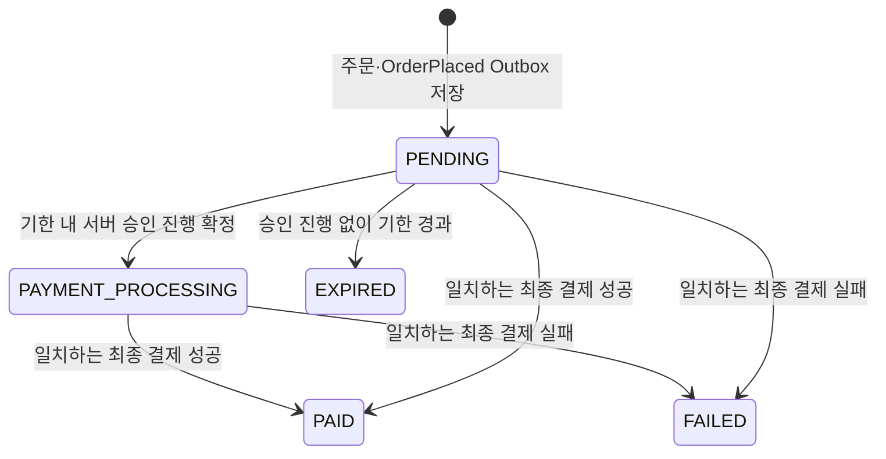

# 설계: Order

## 아키텍처 위치

- 포트 8082, 저장소 MySQL.
- `core/{domain, port, service}` + `api/{controller, listener, scheduler}` + `adapter/` + `config` 경계를 따른다. Catalog HTTP 호출·PG 결과 매핑은 `adapter/`에, 조립은 `config`가 담당한다.
- Gateway(8080)의 `/api/v1/orders/**` MEMBER 경로를 사용하고, 내부 경로(`/internal/v1/...`)는 Gateway·공개 OpenAPI에 노출하지 않는다.
- 상품 근거는 Catalog 내부 키(`CATALOG_ORDER_SERVICE_KEY`·`X-Order-Service-Key`)로 `/internal/v1/order-products/{code}`를 조회한다. 승인 진행 접수는 Payment 전용 `X-Payment-Service-Key`를 검사한다.

## 핵심 설계 결정

- **주문 당시 스냅샷을 고정한다.** 확인한 공개본의 상품 ID·코드·제목·contentVersion·정가·할인액 0·청구액·통화를 주문에 박고, 이후 Catalog 변경이나 결과 이벤트로 수정하지 않는다. amount는 **고객 청구액**이며 PG 비용·판매자 지급액과 구분한다.
- **구매자는 JWT sub.** 본문·쿼리·헤더로 선택하지 않는다. `(buyerSubject, requestId)` 유일 제약으로 멱등을 처리하며 별도 Redis 락·멱등 테이블을 두지 않는다.
- **결제 생명주기는 서버 시각 기준.** `createdAt + 30분` 고정 기한을 상태와 함께 검사한다. 30분은 서버가 승인 진행을 확정·기록할 수 있는 기한이며, 기한 내 확정된 진행은 늦은 PG 승인·통지에도 완료한다([결정 32](../../../docs/decisions.md#order-expiry-approval-admission)).
- **구매는 판매 금지만 막는다(결정 89).** 같은 상품의 기존 주문 상태와 무관하게 새 requestId면 새 주문이다. 중복 청구는 `(buyerSubject, requestId)` 멱등이 막고, 보유 중복은 License 등록이 막는다. V28이 구매 슬롯(`purchase_guard`)과 구매자·상품 유일 제약을 지웠다.
- **결과 반영은 행 잠금·Inbox·상태 전이를 원자 처리.** 최종 상태는 덮어쓰지 않고, 최초 `PAID`에 `OrderPaid` Outbox를 함께 기록한다.
- **OrderPaid는 한 번만 만든다.** eventId는 최초 PAID 트랜잭션에서 생성하고, 릴레이 재시도·DEAD 재큐잉·재전달은 저장된 eventId·키·본문을 그대로 쓴다. 조회나 중복 결제 결과 수신으로 다시 만들지 않으며, 롤백된 후보 eventId는 발행된 결과가 아니다.
- **전액 환불은 접수/심사와 실제 실행을 분리.** Order는 접수·심사·진행을 소유하고 Payment가 PG 실행/조회, License가 실제 이용권 상태를 소유한다.

## 데이터 모델

| 테이블 | 내용 |
|---|---|
| `purchase_order` | 단일 업무 엔티티. orderNo·buyerSubject·requestId·상품 스냅샷·listAmount·discountAmount·amount·currency·status·createdAt·updatedAt·requestEventId·paymentResultEventId·paymentResult·expiresAt·승인 진행 식별자. 선택적 pgPaidAmount·pgDiscountAmount |
| `order_payment_admission` | 승인 진행 확정의 불변 영수증. admissionId·paymentId·admittedAt·원래 만료 시각 |
| `order_refund` | 환불 접수·판정·고객 상태(PENDING_REVIEW/PROCESSING/COMPLETED/FAILED/REJECTED)·첫 접수 시각·rejectionReason |
| `order_license_grant` | 실제 지급 확인 근거 |
| `order_refund_attempt` | 환불 실행 시도 이력(attemptId·순번·previousAttemptId·PENDING/SUCCEEDED/FAILED·준비 사실·조사 표시) |
| `order_refund_review_round` | 심사 회차(최초·고객 재심사·관리자 정정)별 판정·감사·명령 영수증·승인 중단 |
| 환불 금액 사본 | RefundAmountProjection(주문·승인 금액과 확인된 반환 구성). 금융 완료와 별도 읽기 사본 |
| Inbox·Outbox | 기존 common:messaging 재사용. aggregateId·Kafka 키는 orderNo |

- 시각은 UTC·마이크로초 정밀도, 금액은 정수 long. 식별자 컬럼·유일 제약은 대소문자를 구분한다.
- `requestEventId`(최초 OrderPlaced.eventId)와 nullable `paymentResultEventId`에 각각 유일 제약을 둔다.
- 마이그레이션은 V10(purchase_order)부터 누적되며, V11(중복 구매 제한), V12~V19(환불 접수·지급 확인·시도·정지 완료·금융 확인·직접 성공·실패/복구·명시적 재시도), V20~V23(최초 판정·재심사·승인 중단·준비 사실), V24(승인 영수증·구매 제한 열), V25(실패 종료 영수증), V26(만료 스캔 인덱스), V27(환불 금액 상세), V28(구매 슬롯·유일 제약 제거), V29(환불의 보관함 반환 표시)까지 기존 버전·자료를 보존한다. V21은 알려진 최초 판정만 이력으로 복사하고 미기록 판정자를 만들지 않는다. V27의 새 금액 열은 nullable이며 과거 값을 주문 총액·0원으로 채우지 않는다. 구 V1~V9 자료·구 Outbox는 자동 이관하지 않는다.

## API 계약

| 메서드 | 경로 | 역할 | 동작 |
|---|---|---|---|
| POST | `/api/v1/orders` | MEMBER | 단일 상품 주문 생성 또는 동일 요청 재조회 |
| GET | `/api/v1/orders` | MEMBER | 내 주문 페이지 목록 |
| GET | `/api/v1/orders/{orderNo}` | MEMBER | 내 주문 상세 |
| POST | `/api/v1/orders/{orderNo}/refund` | MEMBER | 서버 원금 전액 환불 접수 |
| GET | `/api/v1/orders/{orderNo}/refund` | MEMBER | 본인 환불 상태 조회 |
| GET | `/api/v1/admin/refunds` | ADMIN | 상태별 환불 목록(기본 PENDING_REVIEW) |
| GET | `/api/v1/admin/refunds/{refundId}` | ADMIN | 원구매·처리 상태·최초 판정 상세 |
| POST | `/api/v1/admin/refunds/{refundId}/decision` | ADMIN | requestId·APPROVED/REJECTED·사유로 판정 |
| POST | `/api/v1/orders/{orderNo}/refund/retries` | MEMBER | `previousAttemptId`로 확정 실패·복구 뒤 명시적 재시도(202) |
| POST | `/api/v1/orders/{orderNo}/refund/reconsiderations` | MEMBER | requestId·previousReviewId·reason으로 반려 뒤 재심사(202) |
| GET | `/api/v1/orders/{orderNo}/refund/reviews` | MEMBER | 본인 심사 회차 이력 페이지 |
| GET | `/api/v1/admin/refunds/{refundId}/reviews` | ADMIN | 전체 심사 회차·감사 이력 페이지 |
| POST | `/api/v1/admin/refunds/{refundId}/reconsiderations/{reviewId}/decision` | ADMIN | 지정 회차(재심사·정정) 판정 |
| POST | `/api/v1/admin/refunds/{refundId}/approval-stops` | ADMIN | 실행 요청 저장 전 잘못된 승인 중단(202) |
| POST | `/internal/v1/orders/{orderNo}/payment-admissions` | 내부 키 | Payment의 승인 진행 확정 접수 |
| POST | `/internal/v1/orders/{orderNo}/payment-admissions/{admissionId}/failure` | 내부 키 | 검증된 개별 실패 종료(기한 내 PENDING, 기한 후 EXPIRED) |

- 생성 입력: `requestId`(UUID)·`productCode`(`[A-Za-z0-9][A-Za-z0-9._-]{0,49}`)·`expectedContentVersion`(양수)·`expectedAmount`(0 이상). 익명 401, 역할 없음 403, 잘못된 입력 400, 없는 상품·주문 404, 기대 값·요청 ID 충돌·무료 상품 409.
- 공개 상세 허용 근거(`publicDetailAllowed`)가 false인 상품의 신규 주문은 404. 관리자 판매 BLOCKED는 새 승인 접수를 `PRODUCT_SALE_RESTRICTED` 409로 구분한다.
- 상세는 상품 스냅샷·금액 3종·통화·상태·`expiresAt`·결과 시각·실패 사유·환불 `amountDetails`를 제공하고 내부 연결 정보는 숨긴다. 민감 응답은 no-store.

## 이벤트 계약

| 방향 | 이벤트 / 토픽 | 본문 요지 |
|---|---|---|
| 발행 | `OrderPlaced` / stove.order.v1 | orderNo·buyerSubject·상품 스냅샷·listAmount·discountAmount·amount·currency |
| 발행 | `OrderPaid` / stove.order.v1 | 최초 PAID에 함께. License 지급 근거 |
| 발행 | `OrderExpired` / stove.order.v1 | orderNo·원 OrderPlaced ID·구매자·청구액·통화·고정 기한·만료 확정 시각. 금융 실패 이벤트 아님 |
| 발행 | `LicenseSuspensionRequested` / stove.order.v1 | 환불·주문·구매자·상품·결제 연결값. License 불변 구매 기록과 대조 |
| 발행 | `RefundExecutionRequested` / stove.order.v1 | 실제 지급·정지 확인 뒤 refundId·attemptId·원구매 연결·금액. 재시도는 선택적 previousAttemptId |
| 발행 | `LicenseRestorationRequested` / `LicenseApprovalCorrectionRequested` | 검증된 PG 실패 뒤 복구 / 승인 중단 뒤 정정 복구 |
| 발행 | `PurchaseRefunded` / stove.order.v1 | 최초 환불 `COMPLETED`와 같은 트랜잭션. License가 구매 근거를 `REFUNDED`로 끝낸다(결정 96) |
| 수신 | `LicenseGranted`·`LicenseSuspended`·`LicenseRestored`·`LicenseApprovalCorrected` / stove.license.v1 | 구매 근거 생성(지급 확인)·정지·복구·정정 완료. 복구 두 이벤트의 `returnedToStorage`는 환불의 `purchaseReturnedToStorage`로 남긴다. 원래 요청 ID·구매 연결 대조 |
| 수신 | `RefundPaymentConfirmed`·`RefundExecutionSucceeded`·`RefundExecutionFailed`·`RefundExecutionPrepared` / stove.payment.v1 | 금융 완료(출처·취소 ID·선택적 금액 스냅샷)·시도 성공·검증된 실패·최초 준비 시각/3시간 경계 |
| 수신 | `OrderPaymentCompleted`/`OrderPaymentFailed` / stove.payment.v1 | requestEventId·orderNo·buyerSubject·amount·currency(+실패 reasonCode·reason) |

- 소비 그룹은 `order-payment-result`. `requestEventId`는 원래 OrderPlaced.eventId, `paymentId`는 Payment가 발급하는 불투명 식별자다.
- 같은 최종 결과의 재전달은 최초 eventId·본문을 유지하고 새 이벤트를 만들지 않는다. 결과 소비는 봉투/본문 검증 → 행 잠금·결과 이벤트 ID 교차 조회 → 결과 스냅샷 비교 → Inbox·상태·결과 원자 저장 순서다.
- 선택적 PG 실결제/할인 쌍과 환불 금액 스냅샷은 `OrderPaymentCompletedEvent`·환불 성공 이벤트에 담겨 읽기 사본을 보완하되, 금융 완료·원래 PAID를 덮어쓰지 않는다([결정 36](../../../docs/decisions.md#refund-amount-details)).

## 외부 연동

- Catalog 공개 상세가 아닌 `/internal/v1/order-products/{code}` 내부 근거만 읽는다. 상품 ID·코드·제목·버전·금액·통화·판매 상태·`publicDetailAllowed`만 받고 공개 본문·저장 경로는 받지 않는다.
- Catalog 호출은 Order DB 트랜잭션 밖에서 연결 3초·읽기 10초 타임아웃으로 수행한다. 404는 주문 404, 타임아웃·연결 실패·5xx는 503, 형식·필수 값 오류는 502(내부 키 미설정/거절은 연계 장애)로 처리한다.
- 승인 진행 접수는 Payment 전용 키를 검사하며 PG `paymentToken`·비밀값을 Order로 전달하지 않는다.

## 상태 전이

- `expiresAt = createdAt + 30분`. 상태가 PENDING이어도 서버 시각이 기한을 지나면 새 승인 접수를 거절하고 EXPIRED를 먼저 커밋한다.
- 기한 내 확정된 `PAYMENT_PROCESSING`은 시각 경과만으로 EXPIRED·FAILED로 바꾸지 않는다. 늦은 성공은 연결된 paymentId와 대조한다.
- `PAID`·`FAILED`·`EXPIRED`는 최종 상태다. 구매 슬롯은 없다(V28).

## 환불 처리 요약

| 내부 상태(`RefundStatus`) | 고객 상태 | 의미 |
|---|---|---|
| `PENDING_REVIEW` | PENDING_REVIEW | 4시간 초과 접수·재심사·정정 회차의 관리자 판정 대기. 이용권 유지 |
| `PENDING_LICENSE_GRANT` | PROCESSING | 허용됐으나 실제 지급 확인 대기 |
| `PENDING_LICENSE_SUSPENSION` | PROCESSING | 정지 요청 발행, 실제 정지 완료 대기 |
| `PENDING_PAYMENT_REFUND` | PROCESSING | 실행 요청 저장, Payment 금융 결과 대기 |
| `PENDING_LICENSE_RESTORATION` | PROCESSING | 검증된 PG 실패 뒤 실제 복구 대기 |
| `PENDING_APPROVAL_STOP` | PROCESSING | 잘못된 승인 중단 뒤 정지·정정 복구 대기 |
| `COMPLETED` / `FAILED` / `REJECTED` | 같음 | 금융 완료 / 확정 실패+실제 복구 완료 / 반려(사유 표시) |

| 경합·역순·중복 | 처리 |
|---|---|
| 관리자 동시 판정 | Order 행 잠금 뒤 최신 Refund·회차를 읽어 회차별 최초 판정·감사·필요 Outbox를 원자 저장. 늦은 판정·다른 명령은 409, 같은 명령·판정자·내용은 최초 영수증 |
| 같은 접수·재시도·재심사·중단 명령 재전송 | 각 requestId/previousAttemptId 단위 최초 영수증으로 수렴, 새 회차·시도 없음 |
| 지급 확인이 접수보다 먼저 | 지급 근거 저장 후 허용 시 즉시 정지 요청 |
| 승인 중단 vs 정지 완료 | 같은 주문 잠금으로 직렬화. 실행 요청 저장이 먼저면 중단 거절, 중단이 먼저면 늦은 정지 완료를 정정 복구로 연결 |
| 금융 확인 vs 늦은/먼저 온 실행 성공 | 순서와 무관하게 최초 금융 확인 ID·시각·source와 시도 SUCCEEDED 보존 |
| 과거 정지·복구·명령 이벤트 | 이후 회차·새 정지·새 시도를 바꾸지 않음 |
| 근거 없는·불일치 완료 | 거절·격리(DLT). DB 일시 장애는 재시도, DLT 발행 실패 시 원본 소비 미완료 |

- 접수→(4시간 이내 자동 허용 또는 관리자 심사)→승인→실제 License 지급 확인→정지 요청→실제 정지 확인→`RefundExecutionRequested`.
- 자동 허용 자격은 최초 Payment 결과 시각부터 정확히 4시간. 관리자 API가 PG를 직접 호출하지 않는다.
- 환불 상태는 원구매 PAID와 분리 저장한다. 조회는 no-store이며 저장된 근거만 사용하고 조회 시 Payment·PG HTTP를 호출하지 않는다.

## 유스케이스 구성

| 위치 | 구성 |
|---|---|
| core.domain | Order·상품/결과/승인 값 객체·환불 집합·리포지토리, 스냅샷·최종 상태·기한 불변식 |
| core.service | CreateOrder, SearchOrders, ReadOrder, ApplyPaymentResult, RequestOrderPaymentProcessing, CloseExpiredOrder, ApplyOrderExpiry 연계, 환불 접수/조회/심사/판정 |
| core.port / adapter | 공개 상품 내부 근거 조회 포트와 Catalog HTTP 어댑터, PG 결과·환불 금액 Mapper |
| api.controller | 주문 생성·목록·상세·환불 DTO, 승인 접수 내부 컨트롤러 |
| api.listener | 결제 결과 유형 해석·PaymentResultMapper 변환 후 ApplyPaymentResult 호출 |
| api.scheduler | 만료 대상 자동 스캔(트랜잭션 유스케이스 CloseExpiredOrder 호출) |
| config | JWT·권한·Kafka·DB·HTTP 타임아웃·서비스 키 설정 조립 |

- CreateOrder는 요청 확인·Catalog HTTP 호출 뒤 TransactionTemplate으로 저장 경계를 연다(외부 동기 호출을 트랜잭션 밖에 두는 유일한 Facade 사례).
- SearchOrders·ReadOrder는 읽기 전용, ApplyPaymentResult·승인 접수·환불 판정은 행 잠금·Inbox·상태 변경을 같은 트랜잭션으로 조율한다.
- 멱등 가드·트랜잭션은 서비스가 소유하고 리스너는 역직렬화·위임만 한다.

## 미연결·후속 범위

- G1 결제 생명주기의 종료 조건(금융 보류 건의 다음 행동·실제 TEST 전체 여정 종결).
- G2 지급 확인 누락의 Order 측 복구 연계, 환불 조사 이후 조치·종결 기준, 실제 ADMIN 계정·운영 화면 여정.
- 장바구니·다중 통화·부분 환불·다중 PG·조사 종결 등 제품 범위·성능 고도화.

## 사용 안내

- 생성 전에 Store 상세의 `productCode`·`contentVersion`·`price`를 확인해 `{"requestId":"<UUID>","productCode":"demo-game","expectedContentVersion":3,"expectedAmount":10000}`를 보낸다. MEMBER access token이 필요하다(창작자 가입은 MEMBER·CREATOR를 함께 받는다).
- 응답을 잃었으면 **같은 requestId·같은 입력**으로 재조회한다. 기대 버전·금액 409는 현재 정보를 확인한 뒤 **새 requestId**로 다시 요청한다. 같은 주문의 결제 실패 뒤에는 기한 안에서 같은 주문으로 재결제하고, `EXPIRED`면 새 requestId 주문을 만든다.
- 오류 해석: Catalog 중단·타임아웃·서비스 키 미설정/거절 503, 잘못된 Catalog 응답 502, 무료 상품 409, 없거나 숨긴 상품 404, page<0·size 범위 밖·소수 금액 400.
- 주문 취소·결과 주입·공통 운영 HTTP API는 없다. 결과는 Payment가 Kafka로 전달한다. Order 단독 검증의 결과 이벤트는 테스트 픽스처이며 실제 PG 승인 증거가 아니다.
- 독립 사용자 흐름 검증: `python3 tools/verification/verify-order.py`(일곱 앱과 임시 MySQL·Redis·Kafka·MinIO를 기동, 포트 오프셋 `ORDER_TEST_PORT_OFFSET` 기본 30000, 이 실행이 만든 자원만 정리). 공개·주문·소유권·재출시 스냅샷, Kafka 중단 중 Outbox 보존, 결과 픽스처·수수료 공제 결과 DLT, Catalog 중단 중 조회 유지·신규 503, 재시작 후 상태 보존의 6단계를 확인한다.
- 구 DB 전환: 구 Order 쓰기·릴레이를 멈춘 뒤 `tools/migrations/order/order-transition.sql`을 명시적으로 실행한다. 구 미발행 Outbox는 `order_legacy_outbox_archive`에 보존하고 DEAD로 격리하며, 마지막 `unexpected_legacy_pending`=0을 확인한 뒤 새 릴레이를 켠다. 기본 기동은 이 SQL을 실행하지 않는다.
- 이벤트 복구: 재시도 소진 DEAD는 원인 해결 뒤 원래 eventId·본문으로 공통 Outbox 복구 절차로 회수한다. 결과 DLT는 원래 주문·요청 연결을 복구한 뒤 원본 이벤트로 재전달하며 새 주문번호·이벤트 ID로 맞추지 않는다. 격리된 구 이벤트는 재투입하지 않는다. 상충하는 최종 결과는 먼저 확정한 결과를 보존하므로 거래 기록을 대조해 조사한다.
