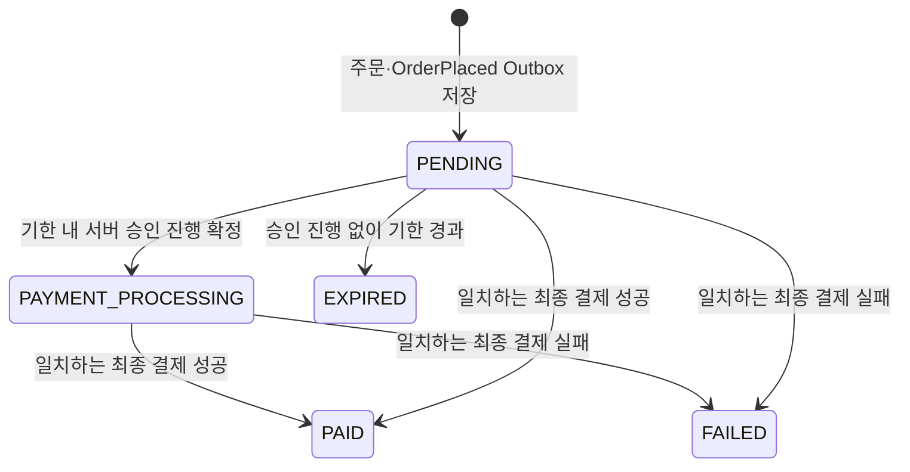

# 설계: Order

## 아키텍처 위치

- 포트 8082, 저장소 MySQL.
- `core/{domain, port, service}` + `api/{controller, listener, scheduler}` + `adapter/` + `config` 경계를 따른다. Catalog HTTP 호출·PG 결과 매핑은 `adapter/`에, 조립은 `config`가 담당한다.
- Gateway(8080)의 `/api/v1/orders/**` MEMBER 경로를 사용하고, 내부 경로(`/internal/v1/...`)는 Gateway·공개 OpenAPI에 노출하지 않는다.
- 상품 근거는 Catalog 내부 키(`CATALOG_ORDER_SERVICE_KEY`·`X-Order-Service-Key`)로 `/internal/v1/order-products/{code}`를 조회한다. 승인 진행 접수는 Payment 전용 `X-Payment-Service-Key`를 검사한다.

## 핵심 설계 결정

- **주문 당시 스냅샷을 고정한다.** 확인한 공개본의 상품 ID·코드·제목·contentVersion·정가·할인액 0·청구액·통화를 주문에 박고, 이후 Catalog 변경이나 결과 이벤트로 수정하지 않는다. amount는 **고객 청구액**이며 PG 비용·판매자 지급액과 구분한다.
- **구매자는 JWT sub.** 본문·쿼리·헤더로 선택하지 않는다. `(buyerSubject, requestId)` 유일 제약으로 멱등을 처리하며 별도 Redis 락·멱등 테이블을 두지 않는다.
- **결제 생명주기는 서버 시각 기준.** `createdAt + 30분` 고정 기한을 상태와 함께 검사한다. 30분은 서버가 승인 진행을 확정·기록할 수 있는 기한이며, 기한 내 확정된 진행은 늦은 PG 승인·통지에도 완료한다([결정 32](../../../docs/decisions.md#order-expiry-approval-admission)).
- **구매는 판매 금지만 막는다(결정 89).** 같은 상품의 기존 주문 상태와 무관하게 새 requestId면 새 주문이다. 중복 청구는 `(buyerSubject, requestId)` 멱등이 막고, 보유 중복은 License 등록이 막는다. V28이 구매 슬롯(`purchase_guard`)과 구매자·상품 유일 제약을 지웠다.
- **결과 반영은 행 잠금·Inbox·상태 전이를 원자 처리.** 최종 상태는 덮어쓰지 않고, 최초 `PAID`에 `OrderPaid` Outbox를 함께 기록한다.
- **OrderPaid는 한 번만 만든다.** eventId는 최초 PAID 트랜잭션에서 생성하고, 릴레이 재시도·DEAD 재큐잉·재전달은 저장된 eventId·키·본문을 그대로 쓴다. 조회나 중복 결제 결과 수신으로 다시 만들지 않으며, 롤백된 후보 eventId는 발행된 결과가 아니다.
- **전액 환불은 접수/심사와 실제 실행을 분리.** Order는 접수·심사·진행을 소유하고 Payment가 PG 실행/조회, License가 실제 이용권 상태를 소유한다.

## 데이터 모델

| 테이블 | 내용 |
|---|---|
| `purchase_order` | 단일 업무 엔티티. orderNo·buyerSubject·requestId·상품 스냅샷·listAmount·discountAmount·amount·currency·status·createdAt·updatedAt·requestEventId·paymentResultEventId·paymentResult·승인 진행 식별자(`expiresAt`은 열이 없고 `createdAt + 30분`으로 매번 계산). 선택적 pgPaidAmount·pgDiscountAmount |
| `order_payment_admission` | 승인 진행 확정의 불변 영수증. admissionId·paymentId·admittedAt·원래 만료 시각 |
| `order_expired_review_closure`(V31) | 이미 만료된 주문에 늦게 온 운영자 종결 실패(`REVIEW_CLOSED`)의 결과 식별. 주문·eventId 각각 유일, 주문 FK(삭제 cascade 없음). 주문 상태는 EXPIRED 그대로 |
| `order_refund` | 환불 접수·판정·고객 상태(PENDING_REVIEW/PROCESSING/COMPLETED/FAILED/REJECTED)·첫 접수 시각·rejectionReason·지급 확인 대기 진입 시각(V32, 대기 중 NOT NULL CHECK·`(status, license_grant_wait_started_at)` 인덱스)·정지/복구/승인 중단 대기 진입 시각(V34, 상태별 NOT NULL CHECK·`(status, 시각)` 인덱스) |
| `order_license_grant` | 실제 지급 확인 근거 |
| `order_refund_attempt` | 환불 실행 시도 이력(attemptId·순번·previousAttemptId·PENDING/SUCCEEDED/FAILED·준비 사실·조사 표시) |
| `order_refund_review_round` | 심사 회차(최초·고객 재심사·관리자 정정)별 판정·감사·명령 영수증·승인 중단 |
| 환불 금액 사본 | RefundAmountProjection(주문·승인 금액과 확인된 반환 구성). 금융 완료와 별도 읽기 사본 |
| Inbox·Outbox | 기존 common:messaging 재사용. aggregateId·Kafka 키는 orderNo |

- 시각은 UTC·마이크로초 정밀도, 금액은 정수 long. 식별자 컬럼·유일 제약은 대소문자를 구분한다.
- `requestEventId`(최초 OrderPlaced.eventId)와 nullable `paymentResultEventId`에 각각 유일 제약을 둔다.
- 마이그레이션은 V10(purchase_order)부터 누적되며, V11(중복 구매 제한), V12~V19(환불 접수·지급 확인·시도·정지 완료·금융 확인·직접 성공·실패/복구·명시적 재시도), V20~V23(최초 판정·재심사·승인 중단·준비 사실), V24(승인 영수증·구매 제한 열), V25(실패 종료 영수증), V26(만료 스캔 인덱스), V27(환불 금액 상세), V28(구매 슬롯·유일 제약 제거), V29(환불의 보관함 반환 표시), V30(이전에 끝난 환불의 `PurchaseRefunded` 채움, 이벤트 ID `purchase-refunded-<refundId>`, 결정 99), V31(만료 주문의 운영자 종결 결과 식별), V32(지급 확인 대기 진입 시각, 결정 125), V33(재발행 기록 `outbox_republish`, 결정 129), V34(정지·복구·승인 중단 대기 진입 시각, 결정 125 범위 확장)까지 기존 버전·자료를 보존한다. V34는 이미 대기 중인 옛 행만 기록된 사실로 채운다. 정지는 재시도면 현재 시도의 `retry_requested_at`, 첫 정지면 정지 요청 Outbox 행의 `created_at`, 그 행이 없으면 `license_grant_wait_started_at`, 그것도 없으면 접수 시각이다(실제 진입보다 늦지 않다). 복구는 현재 시도의 `restoration_requested_at`, 승인 중단은 현재 회차의 `stop_received_at`이며 없으면 접수 시각이다. 다른 상태는 NULL로 둔다. V32는 이미 대기 중인 옛 행만 기록된 사실로 채운다(자동 허용은 접수 시각, 심사 환불은 현재 회차 승인 시각, 판정 시각이 없는 옛 행은 접수 시각 — 실제 진입보다 늦지 않아 멈춘 건을 숨기지 않는다). 다른 상태는 NULL로 둔다. V21은 알려진 최초 판정만 이력으로 복사하고 미기록 판정자를 만들지 않는다. V27의 새 금액 열은 nullable이며 과거 값을 주문 총액·0원으로 채우지 않는다. 구 V1~V9 자료·구 Outbox는 자동 이관하지 않는다.
- V32 적용 절차: V32는 열 추가 → 대기 행 채움 → CHECK·색인 추가를 차례로 실행하고, MySQL DDL은 문장마다 커밋된다. 그래서 모든 Order 인스턴스를 멈춰 진행 중 트랜잭션이 없게 한 뒤 새 버전을 기동해 Flyway가 V32를 실행하게 한다. 옛 버전과 함께 돌리면 채움 뒤 옛 버전이 만든 대기 행의 시각이 NULL이라 CHECK 추가가 실패하거나, CHECK 뒤에는 옛 버전의 환불 접수·승인이 제약 위반으로 실패한다. 부분 실패 복구: `flyway_schema_history`에서 V32 실패 행과 이미 적용된 변경을 확인하고, 적용된 것만 역순으로 되돌린 뒤(`ALTER TABLE order_refund DROP INDEX ix_order_refund_license_grant_wait;`, `ALTER TABLE order_refund DROP CHECK chk_order_refund_license_grant_wait;`, `ALTER TABLE order_refund DROP COLUMN license_grant_wait_started_at;`) V32 실패 행을 지우고(Flyway `repair`와 같은 동작) 다시 기동한다.
- V34 적용 절차: V32와 같다. 열 추가 → 세 대기 상태 채움 → CHECK·색인 추가를 차례로 실행하고 DDL이 문장마다 커밋되므로, 모든 Order 인스턴스를 멈춘 뒤 새 버전을 기동해 Flyway가 V34를 실행하게 한다. 옛 버전과 함께 돌리면 채움 뒤 옛 버전이 만든 대기 행의 시각이 NULL이라 CHECK 추가가 실패하거나, CHECK 뒤 옛 버전의 지급 확인·재시도·실패 확정·승인 중단이 제약 위반으로 실패한다. 부분 실패 복구: `flyway_schema_history`에서 V34 실패 행과 이미 적용된 변경을 확인하고, 적용된 것만 역순으로 되돌린 뒤(`ALTER TABLE order_refund DROP INDEX ix_order_refund_approval_stop_wait, DROP INDEX ix_order_refund_license_restoration_wait, DROP INDEX ix_order_refund_license_suspension_wait;`, `ALTER TABLE order_refund DROP CHECK chk_order_refund_approval_stop_wait, DROP CHECK chk_order_refund_license_restoration_wait, DROP CHECK chk_order_refund_license_suspension_wait;`, `ALTER TABLE order_refund DROP COLUMN approval_stop_wait_started_at, DROP COLUMN license_restoration_wait_started_at, DROP COLUMN license_suspension_wait_started_at;`, 존재하지 않는 항목은 그 문장에서 뺀다) V34 실패 행을 지우고 다시 기동한다. 채움 `UPDATE`는 새 열에만 쓰므로 열을 지우면 함께 사라진다.

## API 계약

| 메서드 | 경로 | 역할 | 동작 |
|---|---|---|---|
| POST | `/api/v1/orders` | MEMBER | 단일 상품 주문 생성 또는 동일 요청 재조회 |
| GET | `/api/v1/orders` | MEMBER | 내 주문 페이지 목록 |
| GET | `/api/v1/orders/{orderNo}` | MEMBER | 내 주문 상세 |
| POST | `/api/v1/orders/{orderNo}/refund` | MEMBER | 서버 원금 전액 환불 접수 |
| GET | `/api/v1/orders/{orderNo}/refund` | MEMBER | 본인 환불 상태 조회 |
| GET | `/api/v1/admin/refunds` | ADMIN | 상태별 환불 목록(기본 PENDING_REVIEW) |
| GET | `/api/v1/admin/refunds/{refundId}` | ADMIN | 원구매·처리 상태·최초 판정 상세 |
| POST | `/api/v1/admin/refunds/{refundId}/decision` | ADMIN | requestId·APPROVED/REJECTED·사유로 판정 |
| POST | `/api/v1/orders/{orderNo}/refund/retries` | MEMBER | `previousAttemptId`로 확정 실패·복구 뒤 명시적 재시도(202) |
| POST | `/api/v1/orders/{orderNo}/refund/reconsiderations` | MEMBER | requestId·previousReviewId·reason으로 반려 뒤 재심사(202) |
| GET | `/api/v1/orders/{orderNo}/refund/reviews` | MEMBER | 본인 심사 회차 이력 페이지 |
| GET | `/api/v1/admin/refunds/{refundId}/reviews` | ADMIN | 전체 심사 회차·감사 이력 페이지 |
| POST | `/api/v1/admin/refunds/{refundId}/reconsiderations/{reviewId}/decision` | ADMIN | 지정 회차(재심사·정정) 판정 |
| POST | `/api/v1/admin/refunds/{refundId}/approval-stops` | ADMIN | 실행 요청 저장 전 잘못된 승인 중단(202) |
| POST | `/internal/v1/orders/{orderNo}/payment-admissions` | 내부 키 | Payment의 승인 진행 확정 접수 |
| POST | `/internal/v1/orders/{orderNo}/payment-admissions/{admissionId}/failure` | 내부 키 | 검증된 개별 실패 종료(기한 내 PENDING, 기한 후 EXPIRED) |

- 생성 입력: `requestId`(UUID)·`productCode`(`[A-Za-z0-9][A-Za-z0-9._-]{0,49}`)·`expectedContentVersion`(양수)·`expectedAmount`(0 이상). 익명 401, 역할 없음 403, 잘못된 입력 400, 없는 상품·주문 404, 기대 값·요청 ID 충돌·무료 상품 409.
- 공개 상세 허용 근거(`publicDetailAllowed`)가 false인 상품의 신규 주문은 404. 관리자 판매 BLOCKED는 새 승인 접수를 `PRODUCT_SALE_RESTRICTED` 409로 구분한다.
- 상세는 상품 스냅샷·금액 3종·통화·상태·`expiresAt`·결과 시각·실패 사유·환불 `amountDetails`를 제공하고 내부 연결 정보는 숨긴다. 민감 응답은 no-store.

## 이벤트 계약

| 방향 | 이벤트 / 토픽 | 본문 요지 |
|---|---|---|
| 발행 | `OrderPlaced` / stove.order.v1 | orderNo·buyerSubject·상품 스냅샷·listAmount·discountAmount·amount·currency |
| 발행 | `OrderPaid` / stove.order.v1 | 최초 PAID에 함께. License 지급 근거 |
| 발행 | `OrderExpired` / stove.order.v1 | orderNo·원 OrderPlaced ID·구매자·청구액·통화·고정 기한·만료 확정 시각. 금융 실패 이벤트 아님 |
| 발행 | `LicenseSuspensionRequested` / stove.order.v1 | 환불·주문·구매자·상품·결제 연결값. License 불변 구매 기록과 대조 |
| 발행 | `RefundExecutionRequested` / stove.order.v1 | 실제 지급·정지 확인 뒤 refundId·attemptId·원구매 연결·금액. 재시도는 선택적 previousAttemptId |
| 발행 | `LicenseRestorationRequested` / `LicenseApprovalCorrectionRequested` | 검증된 PG 실패 뒤 복구 / 승인 중단 뒤 정정 복구 |
| 발행 | `PurchaseRefunded` / stove.order.v1 | 최초 환불 `COMPLETED`와 같은 트랜잭션. License가 구매 근거를 `REFUNDED`로 끝낸다(결정 96) |
| 수신 | `LicenseGranted`·`LicenseSuspended`·`LicenseRestored`·`LicenseApprovalCorrected` / stove.license.v1 | 구매 근거 생성(지급 확인)·정지·복구·정정 완료. 복구 두 이벤트의 `returnedToStorage`는 환불의 `purchaseReturnedToStorage`로 남긴다. 원래 요청 ID·구매 연결 대조 |
| 수신 | `RefundPaymentConfirmed`·`RefundExecutionSucceeded`·`RefundExecutionFailed`·`RefundExecutionPrepared` / stove.payment.v1 | 금융 완료(출처·취소 ID·선택적 금액 스냅샷)·시도 성공·검증된 실패·최초 준비 시각/3시간 경계 |
| 수신 | `OrderPaymentCompleted`/`OrderPaymentFailed` / stove.payment.v1 | requestEventId·orderNo·buyerSubject·amount·currency(+실패 reasonCode·reason) |

- 소비 그룹은 `order-payment-result`. `requestEventId`는 원래 OrderPlaced.eventId, `paymentId`는 Payment가 발급하는 불투명 식별자다.
- 같은 최종 결과의 재전달은 최초 eventId·본문을 유지하고 새 이벤트를 만들지 않는다. 결과 소비는 봉투/본문 검증 → 행 잠금·결과 이벤트 ID 교차 조회 → 결과 스냅샷 비교 → Inbox·상태·결과 원자 저장 순서다.
- 선택적 PG 실결제/할인 쌍과 환불 금액 스냅샷은 `OrderPaymentCompletedEvent`·환불 성공 이벤트에 담겨 읽기 사본을 보완하되, 금융 완료·원래 PAID를 덮어쓰지 않는다([결정 36](../../../docs/decisions.md#refund-amount-details)).

## 외부 연동

- Catalog 공개 상세가 아닌 `/internal/v1/order-products/{code}` 내부 근거만 읽는다. 상품 ID·코드·제목·버전·금액·통화·판매 상태·`publicDetailAllowed`만 받고 공개 본문·저장 경로는 받지 않는다.
- Catalog 호출은 Order DB 트랜잭션 밖에서 연결 3초·읽기 10초 타임아웃으로 수행한다. 404는 주문 404, 타임아웃·연결 실패·5xx는 503, 형식·필수 값 오류는 502(내부 키 미설정/거절은 연계 장애)로 처리한다.
- 승인 진행 접수는 Payment 전용 키를 검사하며 PG `paymentToken`·비밀값을 Order로 전달하지 않는다.

## 상태 전이

- `expiresAt = createdAt + 30분`. 상태가 PENDING이어도 서버 시각이 기한을 지나면 새 승인 접수를 거절하고 EXPIRED를 먼저 커밋한다.
- 기한 내 확정된 `PAYMENT_PROCESSING`은 시각 경과만으로 EXPIRED·FAILED로 바꾸지 않는다. 늦은 성공은 연결된 paymentId와 대조한다.
- `PAID`·`FAILED`·`EXPIRED`는 최종 상태다. 구매 슬롯은 없다(V28).
- 예외 하나: Payment가 승인 보류를 운영자 종결로 끝낸 `OrderPaymentFailed`(reasonCode `REVIEW_CLOSED`)가 이미 `EXPIRED`인 주문에 오면 만료를 유지하고 결과 식별만 `order_expired_review_closure`에 남긴다(결정 115, R4.8). `purchase_order`의 결과 열에 쓰지 않으므로 EXPIRED 주문을 읽는 곳(조회 응답·환불 자격·`OrderPaid`·`paymentResult()`)은 바뀌지 않는다. 같은 결과의 재전달만 무효과이고, 바뀐 재전달·다른 주문의 같은 eventId·기록 없는 Inbox 중복은 다른 결과처럼 충돌이다.

## 상태×이벤트 표 (코드 기준, 결정 143)

main 코드에서 옮긴 전이다. 정책을 새로 정하지 않으며, 위 `## 상태 전이`와 다른 곳은 아래 "찾은 불일치"에 적었다. 상태 값은 Java enum이 정본이다. `purchase_order.status`(V10)·`order_refund.status`(V12)·`order_refund_attempt.status`(V14)는 `VARCHAR`이고 허용 값 CHECK가 없다. 모든 쓰기 유스케이스는 `OrderRepository.lockByOrderNo`(비관적 쓰기 잠금)로 같은 주문 행을 잠근 뒤 진행한다. 근거 없는 결과·불일치 결과는 `BusinessException`(409) 또는 `RefundCompletionRejected`로 트랜잭션을 롤백하고, Kafka 수신이면 공통 재시도·DLT로 간다.

### 주문 (`Order`, `purchase_order`)

| 상태 | 뜻 |
|---|---|
| `PENDING` | 생성됨, 승인 진행 확정 전 또는 검증된 시도 실패로 되돌아옴 |
| `PAYMENT_PROCESSING` | 기한 안에 서버가 승인 진행을 확정함(`paymentId` 연결), 결과 대기 |
| `PAID` | 최종 결제 성공 반영 |
| `FAILED` | 최종 결제 실패 반영 |
| `EXPIRED` | `createdAt + 30분` 이후 진행 없이 종료 |

| 현재 상태 | 트리거 | 가드(조건) | 다음 상태 | 부수 효과 | 코드 위치 | 근거 |
|---|---|---|---|---|---|---|
| (없음) | `POST /api/v1/orders` | MEMBER, `(buyerSubject, requestId)` 신규, `publicDetailAllowed`, `saleStatus=ON_SALE`, 가격>0, 기대 코드·버전·금액 일치 | `PENDING` | 스냅샷·금액 고정, `OrderPlaced` Outbox(eventId=`requestEventId`). Catalog HTTP는 트랜잭션 밖 | `CreateOrder.execute`, `Order.create` | R1.4, R2, 결정 89 |
| 모든 상태 | `POST /api/v1/orders` 같은 requestId | 같은 입력 | 그대로 | 기존 주문 반환. 다른 입력이면 409 | `CreateOrder.existing`, `Order.requireSameRequest` | R2.2·R2.3 |
| `PENDING` | `POST /internal/v1/orders/{orderNo}/payment-admissions` | `X-Payment-Service-Key`, 연결값(orderNo·requestEventId·buyer·amount·currency) 일치, `admissionId` 신규, 서버 시각 < `expiresAt`, 판매 `BLOCKED` 아님(잠금 전 Catalog 조회) | `PAYMENT_PROCESSING` | `paymentId` 연결, `order_payment_admission` 영수증(admittedAt·원래 expiresAt) | `AdmitOrderPayment.execute` → `RequestOrderPaymentProcessing.execute`, `Order.beginPaymentProcessing`, `OrderPaymentAdmission.record` | R3.3·R3.4·R3.9, 결정 32 |
| `PENDING` | 같은 승인 접수 API | 연결값 일치, 서버 시각 ≥ `expiresAt` | `EXPIRED` | `OrderExpired` Outbox를 커밋한 뒤 409 `ORDER_EXPIRED` | `RequestOrderPaymentProcessing.execute`, `Order.beginPaymentProcessing`→`expire`, `RecordOrderExpiry` | R3.5·R3.12 |
| `PENDING` | `OrderExpiryScheduler.run`(1초 간격) → `CloseExpiredOrders.execute` | `expiryCandidates`: `status=PENDING`·`createdAt ≤ now-30분`(배치), 잠금 뒤 `!at.isBefore(expiresAt)` | `EXPIRED` | `OrderExpired` Outbox | `CloseExpiredOrder.execute`, `Order.expire` | R3.12 |
| `EXPIRED` | 승인 접수 API | 연결값 일치 | 그대로 | 409 `ORDER_EXPIRED`, 새 `OrderExpired` 없음 | `Order.beginPaymentProcessing` | R3.7 |
| `PAYMENT_PROCESSING`·`PAID`·`FAILED` | 승인 접수 API, 새 `admissionId` | — | 그대로 | 409 | `Order.beginPaymentProcessing` | R3.8 |
| 모든 상태 | 승인 접수 API, 같은 `admissionId` | 전체 입력 동일 | 그대로 | 최초 영수증 반환(다르면 409) | `OrderPaymentAdmission.requireSameInput` | R3.8 |
| `PAYMENT_PROCESSING` | `POST /internal/v1/orders/{orderNo}/payment-admissions/{admissionId}/failure` | 영수증·paymentId 일치, 그 주문의 최신 영수증, `failedAt ≤ now`, 최종 결과 없음, 서버 시각 < `expiresAt` | `PENDING` | `paymentId=null`, 영수증 `closedAt`·`closedOrderStatus=PENDING` | `RecordOrderPaymentAttemptFailure.execute`, `Order.releaseFailedPaymentProcessing`, `OrderPaymentAdmission.closeFailure` | R3.10 |
| `PAYMENT_PROCESSING` | 같은 실패 통지 API | 위와 같음, 서버 시각 ≥ `expiresAt` | `EXPIRED` | 위 + `OrderExpired` Outbox, `closedOrderStatus=EXPIRED` | 위와 같음, `RecordOrderExpiry` | R3.10·R3.12 |
| `PAYMENT_PROCESSING` | `OrderPaymentCompleted` | 연결값 일치, `paymentId` = 연결된 진행, 결과 eventId를 다른 주문이 쓰지 않음, Inbox 최초(`order-payment-result`) | `PAID` | `paymentResultEventId`·`resultOccurredAt`, 선택적 `pgPaidAmount`·`pgDiscountAmount`(합계=amount), `OrderPaid` Outbox | `ApplyPaymentResult.execute`, `Order.apply` | R4.1·R4.2·R4.5·R4.7 |
| `PAYMENT_PROCESSING` | `OrderPaymentFailed`(`REVIEW_CLOSED` 포함) | 위와 같음, reasonCode·reason 필수 | `FAILED` | 결과 식별·`failureReasonCode`·`failureReason`, Outbox 없음 | `ApplyPaymentResult.execute`, `Order.apply` | R4.1·R4.5·R4.8 |
| `PENDING` | `OrderPaymentCompleted` | 연결값 일치, Inbox 최초. 기한·paymentId는 대조하지 않음 | `PAID` | 결과의 `paymentId` 기록, `OrderPaid` Outbox | `Order.apply` | R4.1 |
| `PENDING` | `OrderPaymentFailed` | 연결값 일치, Inbox 최초 | `FAILED` | 결과 식별·실패 사유 | `Order.apply` | R4.1·R4.8 |
| `PAID`·`FAILED` | 결과 재전달 | 저장 결과와 동일 | 그대로 | 무효과. 다르면 409 → 재시도·DLT | `Order.apply` | R4.3·R4.6 |
| `EXPIRED`(결과 없음) | `OrderPaymentFailed` reasonCode `REVIEW_CLOSED` | 연결값 일치, eventId를 다른 주문이 쓰지 않음, 이 주문의 종결 기록 없음, Inbox 최초 | 그대로 | `order_expired_review_closure` 기록. `purchase_order` 결과 열은 쓰지 않음 | `ApplyPaymentResult.keepExpiry`, `Order.keepsExpiryFor`, `ExpiredReviewClosure.record` | R4.8, 결정 115 |
| `EXPIRED`(종결 기록 있음) | 같은 `REVIEW_CLOSED` 재전달 | 기록과 동일 | 그대로 | 무효과. 다르면 409 | `ExpiredReviewClosure.requireSame` | R4.8, 결정 115 |
| `EXPIRED` | 그 밖의 `OrderPaymentCompleted`/`OrderPaymentFailed` | — | 그대로 | 409, Inbox·Outbox 롤백 → DLT. 자동 취소 없음 | `Order.apply` | R3.11·R4.4 |

| 직교 필드 | 동작 |
|---|---|
| `expiresAt` | 열 없음. `createdAt + 30분`으로 계산, 연장 없음 |
| `paymentId` | 승인 진행 확정 때 연결, 검증된 시도 실패로 되돌리면 `null`, 최종 결과 반영 때 결과 값으로 기록 |
| `paymentResultEventId` | 있으면 최종 결과가 정해진 것이다. 이후 결과는 재전달 대조만 한다(만료·승인 접수·실패 통지에서도 검사) |

### 승인 진행 영수증 (`OrderPaymentAdmission`, `order_payment_admission`)

상태 enum은 없다. `closedAt`이 null이면 열림, 값이 있으면 실패 종료다(`closedOrderStatus` ∈ `PENDING`/`EXPIRED`, CHECK `chk_admission_failure_close`). 접수 필드는 `updatable=false`이다.

| 현재 상태 | 트리거 | 가드(조건) | 다음 상태 | 부수 효과 | 코드 위치 | 근거 |
|---|---|---|---|---|---|---|
| (없음) | 승인 접수 성공 | 주문이 방금 `PAYMENT_PROCESSING`, `admittedAt < expiresAt`(CHECK) | 열림 | — | `OrderPaymentAdmission.record` | R3.4 |
| 열림 | 실패 통지 API | 최신 영수증, 주문이 먼저 `PENDING`/`EXPIRED`로 풀림 | 실패 종료 | `failedSupplierAttemptId`·`failedAt`·`closedAt`=주문 `updatedAt`·`closedOrderStatus` | `OrderPaymentAdmission.closeFailure` | R3.10 |
| 실패 종료 | 같은 실패 재전송 | `supplierAttemptId`·`failedAt` 동일 | 그대로 | 최초 영수증 반환, 주문 변경 없음. 다르면 409 | `OrderPaymentAdmission.requireFailure` | R3.10 |
| 열림(최신 아님) | 실패 통지 API | — | 그대로 | 409 | `RecordOrderPaymentAttemptFailure.execute` | R3.10 |

### 환불 (`Refund`, `order_refund`)

| 상태(`RefundStatus`) | 뜻 | 고객 상태 |
|---|---|---|
| `PENDING_REVIEW` | 최초(4시간 초과)·재심사·정정 회차의 관리자 판정 대기 | `PENDING_REVIEW` |
| `PENDING_LICENSE_GRANT` | 허용됨, `LicenseGranted` 지급 근거 대기 | `PROCESSING` |
| `PENDING_LICENSE_SUSPENSION` | `LicenseSuspensionRequested` 발행, `LicenseSuspended` 대기 | `PROCESSING` |
| `PENDING_APPROVAL_STOP` | 정지 요청 뒤 승인 중단, 정지 결과·정정 복구 대기 | `PROCESSING` |
| `PENDING_PAYMENT_REFUND` | `RefundExecutionRequested` 저장, Payment 금융 결과 대기 | `PROCESSING` |
| `PENDING_LICENSE_RESTORATION` | 검증된 PG 실패, `LicenseRestored` 대기 | `PROCESSING` |
| `FAILED` | 확정 실패 + 실제 복구 완료 | `FAILED` |
| `REJECTED` | 관리자 반려 | `REJECTED` |
| `COMPLETED` | 금융 완료 | `COMPLETED` |

고객 상태 매핑은 `RefundResponse.from`, 응답 코드는 `COMPLETED`·`FAILED`·`REJECTED`이면 200, 나머지는 202다(`RefundController`). 환불 쓰기 유스케이스는 모두 원주문 `PAID`를 요구한다.

| 현재 상태 | 트리거 | 가드(조건) | 다음 상태 | 부수 효과 | 코드 위치 | 근거 |
|---|---|---|---|---|---|---|
| (없음) | `POST /api/v1/orders/{orderNo}/refund` | 본인 주문, `PAID`, 주문에 환불 없음, 수신 시각(잠금 전 `clock.instant()`) ≤ `resultOccurredAt + 4h`, 지급 근거 없음 | `PENDING_LICENSE_GRANT` | `automaticRefundEligible=true`, `licenseGrantWaitStartedAt`=수신 시각 | `RequestRefund.execute`, `Refund.request`, `RefundPolicy` | R6.4, 결정 29·125 |
| (없음) | 같은 API | 위와 같음 + `order_license_grant` 있음(주문과 대조) | `PENDING_LICENSE_SUSPENSION` | `suspensionRequestEventId` 발급, `licenseSuspensionWaitStartedAt`, `LicenseSuspensionRequested` Outbox | `RequestRefund.execute`, `Refund.confirmLicenseGrant` | R6.8·R6.9·R8.11 |
| (없음) | 같은 API | 수신 시각 > `resultOccurredAt + 4h` | `PENDING_REVIEW` | `currentReviewId=refundId`, 1회차 `RefundReviewRound` 저장 | `RequestRefund.execute`, `RefundReviewRound.initial` | R6.4 |
| 모든 상태 | 같은 API 반복 | 같은 주문에 환불 있음 | 그대로 | 기존 refundId·첫 접수 시각 반환 | `RequestRefund.execute` | R6.5 |
| `PENDING_REVIEW`(1회차) | `POST /api/v1/admin/refunds/{refundId}/decision` `APPROVED` | ADMIN, 자동 자격 아님, 최초 판정, 판정 requestId를 다른 회차가 쓰지 않음, at ≥ 접수 | `PENDING_LICENSE_GRANT` | `review*` 필드·1회차 판정 기록, `licenseGrantWaitStartedAt=at` | `DecideRefund.execute`, `Refund.decide`, `RefundReviewRound.decide` | R6.7·R8.8 |
| `PENDING_REVIEW`(1회차) | 같은 API `APPROVED` | 위 + 지급 근거 있음 | `PENDING_LICENSE_SUSPENSION` | 위 + 정지 요청 ID·`licenseSuspensionWaitStartedAt`·`LicenseSuspensionRequested` | 위 + `Refund.confirmLicenseGrant` | R6.7·R6.9·R8.11 |
| `PENDING_REVIEW`(1회차) | 같은 API `REJECTED` | 위와 같음 | `REJECTED` | 반려 사유 기록 | `Refund.decide` | R6.7 |
| 판정된 1회차 | 같은 API 재전송 | 같은 명령·판정자·판정·사유 | 그대로 | 최초 영수증. 다르면 409 | `Refund.decide` | R6.7 |
| `PENDING_REVIEW`(2회차 이상) | `POST /api/v1/admin/refunds/{refundId}/reconsiderations/{reviewId}/decision` | 지정 회차가 현재 회차·미판정, 자동 자격 아님. 판정된 회차는 같은 명령만 무효과 | `PENDING_LICENSE_GRANT`/`PENDING_LICENSE_SUSPENSION`(지급 근거 있음)/`REJECTED` | 회차 판정 기록, 승인이면 위 두 행과 같은 시각·Outbox | `DecideRefundReconsideration.execute`, `Refund.decideReconsideration` | R8.4·R8.8·R8.11 |
| `REJECTED` | `POST /api/v1/orders/{orderNo}/refund/reconsiderations` | 본인, `previousReviewId`=현재 반려 회차, 반려 시각 + 7일 이내(경계 포함), 그 회차의 재심사 없음, 정지 요청·시도·금융 확인 없음, 같은 requestId면 최초 영수증 | `PENDING_REVIEW` | 새 회차(`CUSTOMER_RECONSIDERATION`), `currentReviewId` 교체 | `RequestRefundReconsideration.execute`, `RefundReviewRound.reconsider`, `Refund.openReconsideration` | R8.3 |
| `PENDING_LICENSE_GRANT` | `LicenseGranted` | 주문 `PAID`·구매 연결 일치, 주문의 첫 지급 근거, eventId·licenseId를 다른 주문이 쓰지 않음, Inbox 최초(`order-license-grant`) | `PENDING_LICENSE_SUSPENSION` | `order_license_grant` 저장, 정지 요청 ID·`licenseSuspensionWaitStartedAt`, `LicenseSuspensionRequested` | `ApplyLicenseGrant.execute`, `Refund.confirmLicenseGrant` | R6.8·R8.11 |
| 환불 없음·다른 상태 | `LicenseGranted` | 위와 같음 | 그대로 | 지급 근거만 저장(뒤의 허용이 바로 정지 요청) | `ApplyLicenseGrant.execute` | R6.9 |
| `PENDING_LICENSE_GRANT` | `POST /api/v1/admin/refunds/{refundId}/approval-stops` | 자동 자격 아님, 현재 회차가 `APPROVED`이고 중단 없음, 시도·금융 확인 없음 | `PENDING_REVIEW`(같은 트랜잭션에서 `PENDING_APPROVAL_STOP`을 거침) | 회차에 `RefundApprovalStop` 저장, `approvalStopWaitStartedAt`, 정정 회차(`APPROVAL_CORRECTION`) 생성·`currentReviewId` 교체 | `RequestRefundApprovalStop.execute`, `Refund.stopApproval`·`reopenStoppedApproval`, `RefundReviewRound.correctApproval` | R8.5·R8.6 |
| `PENDING_LICENSE_SUSPENSION`(시도 없음) | 같은 API | 위와 같음 | `PENDING_APPROVAL_STOP` | 중단에 현재 정지 요청 ID 연결, `approvalStopWaitStartedAt` | `Refund.stopApproval`, `RefundReviewRound.stopApproval` | R8.5·R8.11 |
| `PENDING_LICENSE_SUSPENSION`(시도 있음)·`PENDING_PAYMENT_REFUND` 이후 | 같은 API | — | 그대로 | 409 | `Refund.stopApproval` | R8.5 |
| `PENDING_APPROVAL_STOP` | `LicenseSuspended`(중단된 정지 요청) | 지급 근거·구매 연결 일치, 현재 회차의 중단, Inbox 최초(`order-refund-suspension`) | 그대로 | 중단에 정지 결과·licenseId·복구 요청 ID 기록, `LicenseApprovalCorrectionRequested` Outbox | `ApplyRefundSuspension.execute` → `ApplyApprovalCorrection.handleStoppedSuspension`, `RefundApprovalStop.observeSuspension` | R8.6 |
| `PENDING_APPROVAL_STOP` | `LicenseApprovalCorrected` | 구매·회차·중단·복구 요청 일치, Inbox 최초(`order-approval-correction`) | `PENDING_REVIEW` | 중단 `restored*`·`reopenedAt`, 정정 회차 생성, `currentReviewId` 교체, `suspensionRequestEventId=null`, `purchaseReturnedToStorage` | `ApplyApprovalCorrection.execute`, `RefundApprovalStop.observeRestored`·`reopen`, `Refund.reopenStoppedApproval`·`recordApprovalCorrectionRestoration` | R8.6·R7.6, 결정 98 |
| `PENDING_LICENSE_SUSPENSION`(시도 없음) | `LicenseSuspended` | 지급 근거 일치, `suspensionRequestEventId` 일치, 과거 시도 없음, Inbox 최초 | `PENDING_PAYMENT_REFUND` | 1번 `RefundAttempt`(executionRequestEventId) 저장, `currentAttemptId`, `RefundExecutionRequested` Outbox | `ApplyRefundSuspension.execute`, `RefundAttempt.afterSuspension`, `Refund.recordExecution` | R6.8·R6.10 |
| `PENDING_LICENSE_SUSPENSION`(재시도) | `LicenseSuspended`(재시도 정지 요청) | 이전 시도=현재 시도·실패+복구 완료·`retrySuspensionRequestEventId` 일치, licenseId 동일, Inbox 최초 | `PENDING_PAYMENT_REFUND` | n+1번 시도(`previousAttemptId`), `currentAttemptId` 교체, `previousAttemptId`를 담은 `RefundExecutionRequested` | `RefundAttempt.afterRetrySuspension`, `Refund.recordExecution` | R8.2 |
| 시도 있음 | `LicenseSuspended` 재전달 | 기록된 정지 결과와 동일, Inbox 이미 있음 | 그대로 | 무효과(새 시도 없음) | `ApplyRefundSuspension.execute`, `RefundAttempt.verifySuspension` | R6.10 |
| `PENDING_PAYMENT_REFUND` | `RefundPaymentConfirmed`(source `PG_RESPONSE`/`PG_QUERY_UNATTRIBUTED`) | 주문·환불·현재 시도·실행 요청·금액 일치, 시도 `PENDING`/`SUCCEEDED`(성공이면 확인 ID·취소 ID 일치), Inbox 최초(`order-refund-payment-confirmation`) | `COMPLETED` | `paymentConfirmationEventId`·`completedAt`·지문·source, 금액 사본 병합, 시도 갱신(아래 시도 표), `PurchaseRefunded` Outbox | `ApplyRefundPaymentConfirmation.execute(RefundPaymentConfirmation)`, `Refund.confirmPayment` | R7.1·R7.5·R9.3, 결정 96 |
| `COMPLETED` | `RefundPaymentConfirmed` 재전달 | 같은 지문 | 그대로 | 무효과. 다르면 거절 | `Refund.confirmPayment` | R7.2 |
| `PENDING_PAYMENT_REFUND`·`COMPLETED` | `RefundExecutionSucceeded` | 현재 시도·실행 요청 일치, 완료가 있으면 같은 확인 eventId, Inbox 최초 | 그대로 | 시도 `SUCCEEDED`·조사 표시 해제, 금액 사본 병합 | `ApplyRefundPaymentConfirmation.execute(RefundExecutionSuccess)`, `Refund.recordExecutionSuccess` | R7.2 |
| `PENDING_PAYMENT_REFUND` | `RefundExecutionFailed`(Payment 토픽만) | 구매·현재 시도·실행 요청·금액 일치, `occurredAt ≥ startedAt`, 금융 확인 없음, 시도 `PENDING`, Inbox 최초(`order-refund-restoration`) | `PENDING_LICENSE_RESTORATION` | 시도 `FAILED`(`PG_CANCELLATION_FAILED`), 복구 요청 ID, `licenseRestorationWaitStartedAt`, `LicenseRestorationRequested` Outbox | `ApplyRefundRestoration.execute(RefundFailureConfirmation)`, `Refund.recordFailure` | R7.3·R8.11, 결정 128 |
| `PENDING_LICENSE_RESTORATION` | `LicenseRestored`(License 토픽만) | 구매·상품·현재 시도·복구 요청·정지 근거 일치, Inbox 최초 | `FAILED` | 시도 `restoredEventId`·`restoredAt`, `purchaseReturnedToStorage` | `ApplyRefundRestoration.execute(LicenseRestorationConfirmation)`, `Refund.confirmRestoration` | R7.3·R7.6, 결정 98 |
| `FAILED` | `POST /api/v1/orders/{orderNo}/refund/retries`(`previousAttemptId`) | 본인, `PAID`, 지정 시도=현재 시도, 시도 `FAILED`+복구 완료, at ≥ `restoredAt`, 금융 확인 없음, 첫 재시도 | `PENDING_LICENSE_SUSPENSION` | 시도 `retryRequestedAt`·`retrySuspensionRequestEventId`, 환불 정지 요청 ID 교체, `licenseSuspensionWaitStartedAt`, `LicenseSuspensionRequested` | `RequestRefundRetry.execute`, `Refund.requestRetry`, `RefundAttempt.registerRetry` | R8.1·R8.2·R8.11 |
| 모든 상태 | 같은 재시도 API, 이미 재시도한 `previousAttemptId` | 시도가 실패+복구 완료 | 그대로 | 최초 재시도 영수증 | `Refund.requestRetry` | R8.1 |

| 직교 필드 | 동작 |
|---|---|
| `automaticRefundEligible` | 접수 때 한 번 정하고 바꾸지 않는다. true면 관리자 판정·재심사·승인 중단을 거절한다 |
| `currentReviewId` / `currentAttemptId` / `suspensionRequestEventId` | 현재 회차·시도·정지 요청. 이벤트 대조의 기준이며, 과거 것과 맞는 결과는 새 것을 바꾸지 않는다 |
| `licenseGrantWaitStartedAt`·`licenseSuspensionWaitStartedAt`·`licenseRestorationWaitStartedAt`·`approvalStopWaitStartedAt` | 각 상태에 들어갈 때 기록하고, 다시 들어가면 새 시각으로 바꾸며, 벗어나도 남긴다(V32·V34 CHECK: 그 상태면 NOT NULL). `ReadLicenseGrantDelays`(게이지 `status` 라벨 4개)와 `ReadRefund`(`Refund.licenseWaitDelayedSince`)가 진입 시각 + `stove.order.refund.license-grant-delay`부터 지연으로 센다. 상태는 바꾸지 않는다(결정 125) |
| `purchaseReturnedToStorage` | `LicenseRestored`·`LicenseApprovalCorrected`의 `returnedToStorage`를 기록한다. 나중 값이 앞의 값을 덮는다 |
| `amountProjection`(`RefundAmountProjection`) | 금융 확인·실행 성공 때 병합한다. 상태와 `completedAt`은 바꾸지 않는다(R9) |
| 결과 확인 지연 안내 | `PENDING_PAYMENT_REFUND`에서 현재 시도의 `confirmationDelayAt`가 지났고 시도가 `PENDING`이면 `ReadRefund.delayedSince`가 낸다(R8.7) |

### 환불 시도 (`RefundAttempt`, `order_refund_attempt`)

| 상태(`RefundAttemptStatus`) | 뜻 |
|---|---|
| `PENDING` | 실행 요청 저장, 결과 미확정 |
| `SUCCEEDED` | 이 시도의 PG 취소 성공이 귀속됨 |
| `FAILED` | 검증된 PG 취소 실패(원결제 미취소) |

| 현재 상태 | 트리거 | 가드(조건) | 다음 상태 | 부수 효과 | 코드 위치 | 근거 |
|---|---|---|---|---|---|---|
| (없음) | `LicenseSuspended`(첫 정지 / 재시도 정지) | 환불 표의 두 `LicenseSuspended` 행 | `PENDING` | `attemptNo`·`previousAttemptId`·정지 근거·`licenseId`·`executionRequestEventId` | `RefundAttempt.afterSuspension`·`afterRetrySuspension`·`start` | R6.8·R8.2 |
| `PENDING` | `RefundExecutionSucceeded` | 실행 요청·시각 일치 | `SUCCEEDED` | `successEventId`·`successConfirmationEventId`·`successfulCancellationId`·지문, `reconciliationRequired=false` | `RefundAttempt.recordCancellationSuccess` | R7.2 |
| `PENDING` | `RefundPaymentConfirmed` source `PG_RESPONSE` | 환불 표의 완료 행 | `SUCCEEDED` | 위와 같음(확인 eventId를 성공으로 기록) | `Refund.confirmPayment` → `recordCancellationSuccess` | R7.1 |
| `PENDING` | `RefundPaymentConfirmed` source `PG_QUERY_UNATTRIBUTED` | 환불 표의 완료 행 | `PENDING` | `reconciliationRequired=true`(조사 표시) | `Refund.confirmPayment` → `requireReconciliation` | R7.1 |
| `PENDING` | `RefundExecutionFailed` | 환불 표의 실패 행, `at ≥ occurredAt` | `FAILED` | `resolvedAt`, `failureReasonCode=PG_CANCELLATION_FAILED`, `failureEventId`·지문, `restorationRequestEventId`·`restorationRequestedAt` | `RefundAttempt.recordRefundFailure` | R7.3 |
| `SUCCEEDED` | `RefundExecutionSucceeded`/`PG_RESPONSE` 확인 재전달 | 저장 근거와 동일 | 그대로 | 무효과. 다르면 거절 | `RefundAttempt.recordCancellationSuccess` | R7.2 |
| `FAILED` | `LicenseRestored` | 복구 요청·실패·정지·licenseId 일치, `occurredAt ≥ restorationRequestedAt` | `FAILED`(복구 완료) | `restoredEventId`·`restoredAt`·지문. 재전달은 같은 지문만 무효과 | `RefundAttempt.recordRestoration` | R7.3 |
| `FAILED`(복구 완료) | 재시도 API | `at ≥ restoredAt` | `FAILED`(재시도 접수) | `retryRequestedAt`·`retrySuspensionRequestEventId`(한 번만) | `RefundAttempt.registerRetry` | R8.1 |

| 직교 필드 | 동작 |
|---|---|
| `reconciliationRequired` | 조회로 확인된 완료를 이 시도의 성공으로 귀속하지 못했다는 조사 표시. 늦은 `RefundExecutionSucceeded`가 오면 해제한다. 해제 외의 종결 경로는 없다 |
| `preparationEventId`·`firstRefundPreparedAt`·`confirmationDelayAt` | `RefundExecutionPrepared`(Payment 토픽, Inbox `order-refund-preparation`)가 한 번 기록한다. 환불 상태는 검사하지 않고, 시도·실행·정지 근거와 `startedAt ≤ firstPreparedAt ≤ resolvedAt`만 대조한다(`ApplyRefundPreparation`, `RefundAttempt.recordPreparation`, R8.7) |

### 심사 회차와 승인 중단 (`RefundReviewRound`·`RefundApprovalStop`, `order_refund_review_round`)

회차는 `decision`(null → `APPROVED`/`REJECTED`, 한 번만)만 바뀐다. 출처 `origin()`은 1회차면 `INITIAL`, `correctionRequestId`가 있으면 `APPROVAL_CORRECTION`, 아니면 `CUSTOMER_RECONSIDERATION`이다. 생성과 판정 행은 환불 표에 있다. 반려 회차는 `decidedAt + 7일`까지 재심사를 받는다(`canReconsiderAt`). 승인 중단(`RefundApprovalStop`, 회차에 포함)은 아래 순서로만 진행한다(V22 CHECK `chk_review_stop_*`).

| 현재 상태 | 트리거 | 가드(조건) | 다음 상태 | 부수 효과 | 코드 위치 | 근거 |
|---|---|---|---|---|---|---|
| (없음) | 승인 중단 API | 회차 `APPROVED`, at ≥ `decidedAt` | 접수됨 | requestId·판정자·사유·`receivedAt`, 정지 요청 ID(있으면) | `RefundReviewRound.stopApproval`, `RefundApprovalStop.receive` | R8.5 |
| 접수됨(정지 요청 없음) | 같은 트랜잭션 | `canReopen` | 재개됨 | `nextReviewId`·`reopenedAt` | `RefundApprovalStop.reopen` | R8.6 |
| 접수됨(정지 요청 있음) | `LicenseSuspended` | 정지 요청 ID 일치, 재개 전 | 정지 관찰 | `suspensionEventId`·지문·`licenseId`·`restorationRequestId` | `RefundApprovalStop.observeSuspension` | R8.6 |
| 정지 관찰 | `LicenseApprovalCorrected` | 중단·복구 요청·정지·licenseId 일치 | 복구됨 → 재개됨 | `restored*`, 이어서 `reopen` | `RefundApprovalStop.observeRestored`·`reopen` | R8.6 |
| 모든 단계 | 같은 중단 명령 재전송 | 같은 requestId·회차·판정자·사유 | 그대로 | 최초 영수증. 다르면 409 | `RefundApprovalStop.requireSame` | R8.5 |

`OrderLicenseGrant`(`order_license_grant`)와 `ExpiredReviewClosure`(`order_expired_review_closure`)는 상태가 없는 불변 근거 기록이다. 첫 기록과 재전달 대조만 한다.

### 찾은 불일치 (결정 143 1부)

1. 위 `## 상태 전이` 다이어그램에 검증된 개별 시도 실패에 따른 `PAYMENT_PROCESSING → PENDING`(기한 내)과 `PAYMENT_PROCESSING → EXPIRED`(기한 후) 전이가 없다. 코드: `apps/order/src/main/java/com/stove/order/core/domain/Order.java:97-104`, `apps/order/src/main/java/com/stove/order/core/service/RecordOrderPaymentAttemptFailure.java:36-38`. 문서: `.kiro/specs/order/design.md:92-101`(`## 상태 전이` 다이어그램). 요구사항 `.kiro/specs/order/requirements.md:60`(R3.10)에는 있다. 영향: 없음(문서 누락).
2. `PENDING` 주문에 결과가 오면 `Order.apply`는 기한과 `paymentId`를 대조하지 않는다(`apps/order/src/main/java/com/stove/order/core/domain/Order.java:152-172`, paymentId 대조는 163행 `PAYMENT_PROCESSING`일 때만). 그래서 (a) 기한이 지났지만 스캐너가 아직 `EXPIRED`로 바꾸지 않은 `PENDING` 주문과 (b) 시도 실패로 `PENDING`에 돌아온 주문(`paymentId=null`)에 이전 paymentId의 늦은 `OrderPaymentCompleted`가 오면 `PAID`와 `OrderPaid`가 된다. 문서는 `EXPIRED` 상태만 다룬다(`.kiro/specs/order/requirements.md:61` R3.11). 기한 경계는 승인 접수에만 적혀 있다(`.kiro/specs/order/design.md:103`). 영향: 불명(보유권 지급·정산 대상이 생김). 추정: Payment가 승인 진행 없이 또는 실패 종료 뒤에 성공을 보낼 수 있는지는 확인 못 함.
3. `.kiro/specs/order/design.md:316`(`## 사용 안내`)의 "같은 주문의 결제 실패 뒤에는 기한 안에서 같은 주문으로 재결제"와 코드가 다르다. `OrderPaymentFailed`로 `FAILED`가 된 주문은 최종 상태이고, 새 승인 접수는 409다(`apps/order/src/main/java/com/stove/order/core/domain/Order.java:85-86`). 같은 주문의 재결제는 검증된 개별 시도 실패 통지(R3.10)로 `PENDING`에 돌아온 경우만 된다. 추정: 문구의 "결제 실패"가 개별 시도 실패를 뜻할 수 있다. 영향: 없음(안내 문구).
4. R4.1(`.kiro/specs/order/requirements.md:69`)은 `PENDING→PAID/FAILED`만 적는다. 코드는 `PAYMENT_PROCESSING→PAID/FAILED`(같은 paymentId)도 처리한다(`apps/order/src/main/java/com/stove/order/core/domain/Order.java:163-166`). design 다이어그램과 R4.8에는 있다. 영향: 없음.
5. R8.5(`.kiro/specs/order/requirements.md:124`)는 승인 중단 접수를 "`PENDING_APPROVAL_STOP`"이라 적는다. 그런데 정지 요청 전(`PENDING_LICENSE_GRANT`)의 중단은 같은 트랜잭션에서 정정 회차 `PENDING_REVIEW`로 바로 돌아가서, `PENDING_APPROVAL_STOP`이 저장되지 않는다(`apps/order/src/main/java/com/stove/order/core/service/RequestRefundApprovalStop.java:39-44`, `apps/order/src/main/java/com/stove/order/core/domain/Refund.java:76,85`). 이때도 `approvalStopWaitStartedAt`은 기록된다. R8.6의 "바로 복귀"와는 맞는다. 영향: 없음.
6. 결정 89와 R2.5는 "구매를 막는 업무 사유는 판매 금지뿐"이라고 하고, `CreateOrder.requirePurchasable`은 `publicDetailAllowed`만 본다. 그런데 `Order.create`는 `saleStatus`가 `ON_SALE`이 아니면 `PRODUCT_NOT_ON_SALE`로 거절한다(`apps/order/src/main/java/com/stove/order/core/domain/Order.java:56-57`, `apps/order/src/main/java/com/stove/order/core/service/CreateOrder.java:86-89`). `ON_SALE` 밖의 Catalog 판매 상태가 모두 판매 금지인지는 확인 못 함. 영향: 불명(구매 가능 여부). — 확인(결정 143 검토): Catalog 판매 상태는 `ON_SALE`·`STOPPED` 둘뿐이고 `STOPPED`가 결정 89의 판매 금지다. 불일치 아님.

## 환불 처리 요약

| 내부 상태(`RefundStatus`) | 고객 상태 | 의미 |
|---|---|---|
| `PENDING_REVIEW` | PENDING_REVIEW | 4시간 초과 접수·재심사·정정 회차의 관리자 판정 대기. 이용권 유지 |
| `PENDING_LICENSE_GRANT` | PROCESSING | 허용됐으나 실제 지급 확인 대기. 진입 + 10분부터 게이지·경보 `RefundLicenseGrantsDelayed`(warning)·고객 `processingNotice`(결정 125) |
| `PENDING_LICENSE_SUSPENSION` | PROCESSING | 정지 요청 발행, 실제 정지 완료 대기. 진입(지급 확인·재시도) + 10분부터 같은 게이지 `status` 라벨·경보·`LICENSE_SUSPENSION_CONFIRMATION_DELAYED` |
| `PENDING_PAYMENT_REFUND` | PROCESSING | 실행 요청 저장, Payment 금융 결과 대기 |
| `PENDING_LICENSE_RESTORATION` | PROCESSING | 검증된 PG 실패 뒤 실제 복구 대기. 진입(실패 확정) + 10분부터 같은 게이지·경보·`LICENSE_RESTORATION_CONFIRMATION_DELAYED`(돈이 돌아가지 않았고 이용권이 돌아오면 재신청 가능하다는 문구) |
| `PENDING_APPROVAL_STOP` | PROCESSING | 잘못된 승인 중단 뒤 정지·정정 복구 대기. 진입(중단 접수) + 10분부터 같은 게이지·경보·`APPROVAL_STOP_CONFIRMATION_DELAYED` |
| `COMPLETED` / `FAILED` / `REJECTED` | 같음 | 금융 완료 / 확정 실패+실제 복구 완료 / 반려(사유 표시) |

| 경합·역순·중복 | 처리 |
|---|---|
| 관리자 동시 판정 | Order 행 잠금 뒤 최신 Refund·회차를 읽어 회차별 최초 판정·감사·필요 Outbox를 원자 저장. 늦은 판정·다른 명령은 409, 같은 명령·판정자·내용은 최초 영수증 |
| 같은 접수·재시도·재심사·중단 명령 재전송 | 각 requestId/previousAttemptId 단위 최초 영수증으로 수렴, 새 회차·시도 없음 |
| 지급 확인이 접수보다 먼저 | 지급 근거 저장 후 허용 시 즉시 정지 요청 |
| 승인 중단 vs 정지 완료 | 같은 주문 잠금으로 직렬화. 실행 요청 저장이 먼저면 중단 거절, 중단이 먼저면 늦은 정지 완료를 정정 복구로 연결 |
| 금융 확인 vs 늦은/먼저 온 실행 성공 | 순서와 무관하게 최초 금융 확인 ID·시각·source와 시도 SUCCEEDED 보존 |
| 과거 정지·복구·명령 이벤트 | 이후 회차·새 정지·새 시도를 바꾸지 않음 |
| 근거 없는·불일치 완료 | 거절·격리(DLT). DB 일시 장애는 재시도, DLT 발행 실패 시 원본 소비 미완료 |

- 접수→(4시간 이내 자동 허용 또는 관리자 심사)→승인→실제 License 지급 확인→정지 요청→실제 정지 확인→`RefundExecutionRequested`.
- 자동 허용 자격은 최초 Payment 결과 시각부터 정확히 4시간. 판정에 쓰는 접수 시각은 주문 행 잠금 전 요청 수신 시각(`RequestRefund`의 `clock.instant()`)이다. 결과 시각은 Payment 서버 시각이라, 서비스 간 시계 차이로 접수 시각이 확정 시각보다 이른 접수도 자격 안으로 보고 자동 허용한다(결정 29 하위 "기한 시작: Payment 최초 확정"·"기한 판정: 접수 시각 고정", `RefundPolicyTest`). 관리자 API가 PG를 직접 호출하지 않는다.
- 실패 안내(결정 134): `ReadRefund`가 `FAILED`의 현재 시도 `failureReasonCode`를 `RefundFailureReason`으로 옮기고(`PG_CANCELLATION_FAILED` → `PAYMENT_NOT_CANCELLED`, 결정 128 실패 종결도 같은 `RefundExecutionFailed`라 같은 코드), API가 `failureNotice`(code·"다시 신청하면 환불됩니다")로 보인다. 시도가 없거나 옮길 수 없는 코드는 409. 새 시도는 고객 재신청(`POST …/refund/retries`)으로만 만든다.
- 환불 상태는 원구매 PAID와 분리 저장한다. 조회는 no-store이며 저장된 근거만 사용하고 조회 시 Payment·PG HTTP를 호출하지 않는다.
- License 단계 대기 감지(결정 125, 정지·복구·승인 중단으로 범위 확장): `ReadLicenseGrantDelays`가 상태별 게이지(`RefundLicenseGrantMetrics`, 이름 그대로 `status` 라벨 4개, 수집마다 상태별 COUNT 1회)를, `ReadRefund`가 고객 안내(`Refund.licenseWaitDelayedSince`, 지금 상태의 진입 시각부터)를 같은 경계로 계산한다. 경계 `stove.order.refund.license-grant-delay`는 `RefundConfiguration`이 바인딩한다. 라벨 없이 쓰던 식(`stove_order_refund_license_grant_delayed > 0`·`sum(...)`)은 그대로 동작한다. 복구는 [운영 재처리](../../../docs/license-event-recovery-runbook.md).

## 유스케이스 구성

| 위치 | 구성 |
|---|---|
| core.domain | Order·상품/결과/승인 값 객체·환불 집합·리포지토리, 스냅샷·최종 상태·기한 불변식 |
| core.service | CreateOrder, SearchOrders, ReadOrder, ApplyPaymentResult, RequestOrderPaymentProcessing, CloseExpiredOrder, ApplyOrderExpiry 연계, 환불 접수/조회/심사/판정 |
| core.port / adapter | 공개 상품 내부 근거 조회 포트와 Catalog HTTP 어댑터, PG 결과·환불 금액 Mapper |
| api.controller | 주문 생성·목록·상세·환불 DTO, 승인 접수 내부 컨트롤러 |
| api.listener | 결제 결과 유형 해석·PaymentResultMapper 변환 후 ApplyPaymentResult 호출 |
| api.scheduler | 만료 대상 자동 스캔(트랜잭션 유스케이스 CloseExpiredOrder 호출) |
| config | JWT·권한·Kafka·DB·HTTP 타임아웃·서비스 키 설정 조립 |

- CreateOrder는 요청 확인·Catalog HTTP 호출 뒤 TransactionTemplate으로 저장 경계를 연다(외부 동기 호출을 트랜잭션 밖에 두는 유일한 Facade 사례).
- SearchOrders·ReadOrder는 읽기 전용, ApplyPaymentResult·승인 접수·환불 판정은 행 잠금·Inbox·상태 변경을 같은 트랜잭션으로 조율한다.
- 멱등 가드·트랜잭션은 서비스가 소유하고 리스너는 역직렬화·위임만 한다.

## 미연결·후속 범위

- G1 결제 생명주기의 종료 조건(금융 보류 건의 다음 행동·실제 TEST 전체 여정 종결).
- 원본 이벤트가 없는 `PENDING_LICENSE_GRANT`의 종결(결정 125가 남김), 환불 조사 이후 조치·종결 기준, 실제 ADMIN 계정·운영 화면 여정.
- 장바구니·다중 통화·부분 환불·다중 PG·조사 종결 등 제품 범위·성능 고도화.

## 사용 안내

- 생성 전에 Store 상세의 `productCode`·`contentVersion`·`price`를 확인해 `{"requestId":"<UUID>","productCode":"demo-game","expectedContentVersion":3,"expectedAmount":10000}`를 보낸다. MEMBER access token이 필요하다(창작자 가입은 MEMBER·CREATOR를 함께 받는다).
- 응답을 잃었으면 **같은 requestId·같은 입력**으로 재조회한다. 기대 버전·금액 409는 현재 정보를 확인한 뒤 **새 requestId**로 다시 요청한다. 같은 주문의 결제 실패 뒤에는 기한 안에서 같은 주문으로 재결제하고, `EXPIRED`면 새 requestId 주문을 만든다.
- 오류 해석: Catalog 중단·타임아웃·서비스 키 미설정/거절 503, 잘못된 Catalog 응답 502, 무료 상품 409, 없거나 숨긴 상품 404, page<0·size 범위 밖·소수 금액 400.
- 주문 취소·결과 주입·공통 운영 HTTP API는 없다. 결과는 Payment가 Kafka로 전달한다. Order 단독 검증의 결과 이벤트는 테스트 픽스처이며 실제 PG 승인 증거가 아니다.
- 독립 사용자 흐름 검증: `python3 tools/verification/verify-order.py`(일곱 앱과 임시 MySQL·Redis·Kafka·MinIO를 기동, 포트 오프셋 `ORDER_TEST_PORT_OFFSET` 기본 30000, 이 실행이 만든 자원만 정리). 공개·주문·소유권·재출시 스냅샷, Kafka 중단 중 Outbox 보존, 결과 픽스처·수수료 공제 결과 DLT, Catalog 중단 중 조회 유지·신규 503, 재시작 후 상태 보존의 6단계를 확인한다.
- 구 DB 전환: 구 Order 쓰기·릴레이를 멈춘 뒤 `tools/migrations/order/order-transition.sql`을 명시적으로 실행한다. 구 미발행 Outbox는 `order_legacy_outbox_archive`에 보존하고 DEAD로 격리하며, 마지막 `unexpected_legacy_pending`=0을 확인한 뒤 새 릴레이를 켠다. 기본 기동은 이 SQL을 실행하지 않는다.
- 이벤트 복구: 재시도 소진 DEAD는 원인 해결 뒤 원래 eventId·본문으로 공통 Outbox 복구 절차로 회수한다. 발행은 됐지만 Kafka에서 원본이 사라진 `SENT` `OrderPaid`는 공통 `POST /api/v1/ops/outbox/{eventId}/republish`(ADMIN, 필수 사유, 행 잠금 아래 상태만 `PENDING`)로 같은 ID 재발행하고 실행자·시각·사유·이전 발행 시각을 V33 `outbox_republish`에 같은 트랜잭션으로 남긴다. 재발행된 `LicenseGranted`는 기존 `ApplyLicenseGrant`가 처리하므로 미처리면 `PENDING_LICENSE_GRANT`가 정지 요청으로 이어지고, 이미 처리됐으면 기존 지급 확인 대조로 효과가 없다(결정 129). 정지·복구·승인 정정 요청(`LicenseSuspensionRequested`·`LicenseRestorationRequested`·`LicenseApprovalCorrectionRequested`)도 같은 API로 재발행하고, License가 재발행한 결과(`LicenseSuspended`·`LicenseRestored`·`LicenseApprovalCorrected`)는 기존 `ApplyRefundSuspension`·`ApplyRefundRestoration`·`ApplyApprovalCorrection`이 Inbox로 거른다(결정 129 범위 확장). 허용 이벤트 목록은 `OutboxRepublishTargets` 한 곳에 소유 모듈별로 두고, Order는 `stove.messaging.ops.republish-owner=order`로 자기 목록만 쓴다. 결과 DLT는 원래 주문·요청 연결을 복구한 뒤 원본 이벤트로 재전달하며 새 주문번호·이벤트 ID로 맞추지 않는다. 격리된 구 이벤트는 재투입하지 않는다. 상충하는 최종 결과는 먼저 확정한 결과를 보존하므로 거래 기록을 대조해 조사한다.
