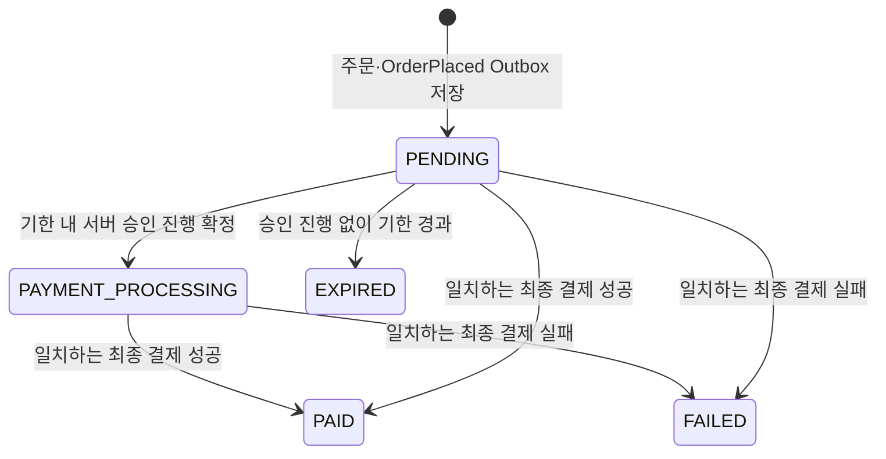

# 설계: Order

## 아키텍처 위치

- 포트 8082, 저장소 MySQL.
- `core/{domain, port, service}` + `api/{controller, listener, scheduler}` + `adapter/` + `config` 경계를 따른다. Catalog HTTP 호출·PG 결과 매핑은 `adapter/`에, 조립은 `config`가 담당한다.
- Gateway(8080)의 `/api/v1/orders/**` MEMBER 경로를 사용하고, 내부 경로(`/internal/v1/...`)는 Gateway·공개 OpenAPI에 노출하지 않는다.
- 상품 근거는 Catalog 내부 키(`CATALOG_ORDER_SERVICE_KEY`·`X-Order-Service-Key`)로 `/internal/v1/order-products/{code}`를 조회한다. 승인 진행 접수는 Payment 전용 `X-Payment-Service-Key`를 검사한다.

## 핵심 설계 결정

- **주문 당시 스냅샷을 고정한다.** 확인한 공개본의 상품 ID·코드·제목·contentVersion·정가·할인액 0·청구액·통화를 주문에 박고, 이후 Catalog 변경이나 결과 이벤트로 수정하지 않는다. amount는 **고객 청구액**이며 PG 비용·판매자 지급액과 구분한다.
- **구매자는 JWT sub.** 본문·쿼리·헤더로 선택하지 않는다. `(buyerSubject, requestId)` 유일 제약으로 멱등을 처리하며 별도 Redis 락·멱등 테이블을 두지 않는다.
- **결제 생명주기는 서버 시각 기준.** `createdAt + 30분` 고정 기한을 상태와 함께 검사한다. 30분은 서버가 승인 진행을 확정·기록할 수 있는 기한이며, 기한 내 확정된 진행은 늦은 PG 승인·통지에도 완료한다([결정 32](../../../docs/decisions.md#order-expiry-approval-admission)).
- **중복 구매 제한.** 같은 상품의 `PENDING`→409 `PURCHASE_IN_PROGRESS`, `PAID`→409 `PRODUCT_ALREADY_PURCHASED`, 최종 `FAILED`만 새 주문. 구매자·상품 ID/코드 유일 제약으로 동시 생성도 막는다.
- **결과 반영은 행 잠금·Inbox·상태 전이를 원자 처리.** 최종 상태는 덮어쓰지 않고, 최초 `PAID`에 `OrderPaid` Outbox를 함께 기록한다.
- **전액 환불은 접수/심사와 실제 실행을 분리.** Order는 접수·심사·진행을 소유하고 Payment가 PG 실행/조회, License가 실제 이용권 상태를 소유한다.

## 데이터 모델

| 테이블 | 내용 |
|---|---|
| `purchase_order` | 단일 업무 엔티티. orderNo·buyerSubject·requestId·상품 스냅샷·listAmount·discountAmount·amount·currency·status·createdAt·updatedAt·requestEventId·paymentResultEventId·paymentResult·expiresAt·승인 진행 식별자. 선택적 pgPaidAmount·pgDiscountAmount |
| `order_payment_admission` | 승인 진행 확정의 불변 영수증. admissionId·paymentId·admittedAt·원래 만료 시각 |
| `order_refund` | 환불 접수·판정·고객 상태(PENDING_REVIEW/PROCESSING/COMPLETED/FAILED/REJECTED)·첫 접수 시각·rejectionReason |
| `order_license_grant` | 실제 지급 확인 근거 |
| `order_refund_attempt` | 환불 실행 이력 |
| 환불 금액 사본 | RefundAmountProjection(주문·승인 금액과 확인된 반환 구성). 금융 완료와 별도 읽기 사본 |
| Inbox·Outbox | 기존 common:messaging 재사용. aggregateId·Kafka 키는 orderNo |

- 시각은 UTC·마이크로초 정밀도, 금액은 정수 long. 식별자 컬럼·유일 제약은 대소문자를 구분한다.
- `requestEventId`(최초 OrderPlaced.eventId)와 nullable `paymentResultEventId`에 각각 유일 제약을 둔다.
- 마이그레이션은 V10(purchase_order)부터 누적되며, V11(중복 구매 제한), V20~V23(환불·준비 이벤트), V24(승인 영수증·구매 제한 열), V27(환불 금액 상세), V31(만료 전달용 Payment 측 기록)까지 기존 버전·자료를 보존한다. 과거 자료는 자동 이관하지 않는다.

## API 계약

| 메서드 | 경로 | 역할 | 동작 |
|---|---|---|---|
| POST | `/api/v1/orders` | MEMBER | 단일 상품 주문 생성 또는 동일 요청 재조회 |
| GET | `/api/v1/orders` | MEMBER | 내 주문 페이지 목록 |
| GET | `/api/v1/orders/{orderNo}` | MEMBER | 내 주문 상세 |
| POST | `/api/v1/orders/{orderNo}/refund` | MEMBER | 서버 원금 전액 환불 접수 |
| GET | `/api/v1/orders/{orderNo}/refund` | MEMBER | 본인 환불 상태 조회 |
| GET | `/api/v1/admin/refunds` | ADMIN | 상태별 환불 목록(기본 PENDING_REVIEW) |
| GET | `/api/v1/admin/refunds/{refundId}` | ADMIN | 원구매·처리 상태·최초 판정 상세 |
| POST | `/api/v1/admin/refunds/{refundId}/decision` | ADMIN | requestId·APPROVED/REJECTED·사유로 판정 |
| POST | `/internal/v1/orders/{orderNo}/payment-admissions` | 내부 키 | Payment의 승인 진행 확정 접수 |

- 생성 입력: `requestId`(UUID)·`productCode`(`[A-Za-z0-9][A-Za-z0-9._-]{0,49}`)·`expectedContentVersion`(양수)·`expectedAmount`(0 이상). 익명 401, 역할 없음 403, 잘못된 입력 400, 없는 상품·주문 404, 기대 값·요청 ID 충돌·무료 상품 409.
- 공개 상세 허용 근거(`publicDetailAllowed`)가 false인 상품의 신규 주문은 404. 관리자 판매 BLOCKED는 새 승인 접수를 `PRODUCT_SALE_RESTRICTED` 409로 구분한다.
- 상세는 상품 스냅샷·금액 3종·통화·상태·`expiresAt`·결과 시각·실패 사유·환불 `amountDetails`를 제공하고 내부 연결 정보는 숨긴다. 민감 응답은 no-store.

## 이벤트 계약

| 방향 | 이벤트 / 토픽 | 본문 요지 |
|---|---|---|
| 발행 | `OrderPlaced` / stove.order.v1 | orderNo·buyerSubject·상품 스냅샷·listAmount·discountAmount·amount·currency |
| 발행 | `OrderPaid` / stove.order.v1 | 최초 PAID에 함께. License 지급 근거 |
| 발행 | `OrderExpired` / stove.order.v1 | orderNo·원 OrderPlaced ID·구매자·청구액·통화·고정 기한·만료 확정 시각. 금융 실패 이벤트 아님 |
| 발행 | `RefundExecutionRequested` | 실제 지급·정지 확인 뒤 Payment 환불 실행 요청 |
| 수신 | `OrderPaymentCompleted`/`OrderPaymentFailed` / stove.payment.v1 | requestEventId·orderNo·buyerSubject·amount·currency(+실패 reasonCode·reason) |

- 소비 그룹은 `order-payment-result`. `requestEventId`는 원래 OrderPlaced.eventId, `paymentId`는 Payment가 발급하는 불투명 식별자다.
- 같은 최종 결과의 재전달은 최초 eventId·본문을 유지하고 새 이벤트를 만들지 않는다. 결과 소비는 봉투/본문 검증 → 행 잠금·결과 이벤트 ID 교차 조회 → 결과 스냅샷 비교 → Inbox·상태·결과 원자 저장 순서다.
- 선택적 PG 실결제/할인 쌍과 환불 금액 스냅샷은 `OrderPaymentCompletedEvent`·환불 성공 이벤트에 담겨 읽기 사본을 보완하되, 금융 완료·원래 PAID를 덮어쓰지 않는다([결정 36](../../../docs/decisions.md#refund-amount-details)).

## 외부 연동

- Catalog 공개 상세가 아닌 `/internal/v1/order-products/{code}` 내부 근거만 읽는다. 상품 ID·코드·제목·버전·금액·통화·판매 상태·`publicDetailAllowed`만 받고 공개 본문·저장 경로는 받지 않는다.
- Catalog 호출은 Order DB 트랜잭션 밖에서 연결 3초·읽기 10초 타임아웃으로 수행한다. 404는 주문 404, 타임아웃·연결 실패·5xx는 503, 형식·필수 값 오류는 502(내부 키 미설정/거절은 연계 장애)로 처리한다.
- 승인 진행 접수는 Payment 전용 키를 검사하며 PG `paymentToken`·비밀값을 Order로 전달하지 않는다.

## 상태 전이

- `expiresAt = createdAt + 30분`. 상태가 PENDING이어도 서버 시각이 기한을 지나면 새 승인 접수를 거절하고 EXPIRED를 먼저 커밋한다.
- 기한 내 확정된 `PAYMENT_PROCESSING`은 시각 경과만으로 EXPIRED·FAILED로 바꾸지 않는다. 늦은 성공은 연결된 paymentId와 대조한다.
- `PAID`·`FAILED`·`EXPIRED`는 최종 상태다. `EXPIRED`는 구매 슬롯을 해제하고 `PENDING`/`PAYMENT_PROCESSING`/`PAID`는 슬롯을 공유한다.

## 환불 처리 요약

- 접수→(4시간 이내 자동 허용 또는 관리자 심사)→승인→실제 License 지급 확인→정지 요청→실제 정지 확인→`RefundExecutionRequested`.
- 자동 허용 자격은 최초 Payment 결과 시각부터 정확히 4시간. 관리자 API가 PG를 직접 호출하지 않는다.
- 환불 상태는 원구매 PAID와 분리 저장한다. 조회는 no-store이며 저장된 근거만 사용하고 조회 시 Payment·PG HTTP를 호출하지 않는다.

## 유스케이스 구성

| 위치 | 구성 |
|---|---|
| core.domain | Order·상품/결과/승인 값 객체·환불 집합·리포지토리, 스냅샷·최종 상태·기한 불변식 |
| core.service | CreateOrder, SearchOrders, ReadOrder, ApplyPaymentResult, RequestOrderPaymentProcessing, CloseExpiredOrder, ApplyOrderExpiry 연계, 환불 접수/조회/심사/판정 |
| core.port / adapter | 공개 상품 내부 근거 조회 포트와 Catalog HTTP 어댑터, PG 결과·환불 금액 Mapper |
| api.controller | 주문 생성·목록·상세·환불 DTO, 승인 접수 내부 컨트롤러 |
| api.listener | 결제 결과 유형 해석·PaymentResultMapper 변환 후 ApplyPaymentResult 호출 |
| api.scheduler | 만료 대상 자동 스캔(트랜잭션 유스케이스 CloseExpiredOrder 호출) |
| config | JWT·권한·Kafka·DB·HTTP 타임아웃·서비스 키 설정 조립 |

- CreateOrder는 요청 확인·Catalog HTTP 호출 뒤 TransactionTemplate으로 저장 경계를 연다(외부 동기 호출을 트랜잭션 밖에 두는 유일한 Facade 사례).
- SearchOrders·ReadOrder는 읽기 전용, ApplyPaymentResult·승인 접수·환불 판정은 행 잠금·Inbox·상태 변경을 같은 트랜잭션으로 조율한다.
- 멱등 가드·트랜잭션은 서비스가 소유하고 리스너는 역직렬화·위임만 한다.

## 미연결·후속 범위

- G1 결제 생명주기의 종료 조건(금융 보류 건의 다음 행동·실제 TEST 전체 여정 종결).
- G2 지급 확인 누락의 Order 측 복구 연계, 환불 후 재구매(P4) 정책, 반려 후 재심사 등 환불 확장.
- 장바구니·다중 통화·부분 환불·다중 PG·조사 종결 등 제품 범위·성능 고도화.
