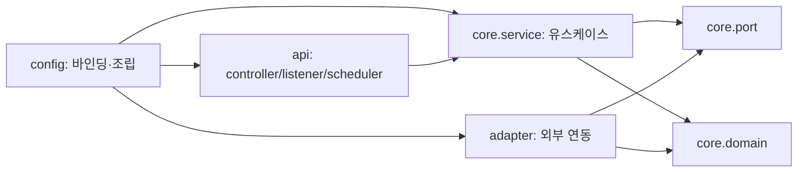

# 아키텍처와 아키텍처 검사 점검

2026-11-02. 사용자의 요청에 따라 기존 변경을 작업별로 먼저 커밋한 뒤, 프로젝트의 책임 경계·최근 검사 실패·검사의 적용 범위와 반례를 점검했다. 기준 코드는 `4e22870`이다.

**판단: 현재 구조의 큰 틀을 유지하고 검사 규칙과 등록 범위를 정비하는 것이 적절하다.** 현재 등록된 검사 477건은 통과했다. 별도 진단에서 과도한 제약 3유형과 놓치는 경계 8유형을 재현했다. 이는 현재 업무 코드의 고장 11건을 발견했다는 뜻이 아니다. 기존 업무 코드·아키텍처 규칙·테스트 등록은 변경하지 않았다. 아래 수정 방향은 검토 권고이며 새로운 합의로 기록하지 않는다.

## 1. 먼저 완료한 작업별 커밋

| 커밋 | 작업 단위 |
|---|---|
| `0f2050c` | 원본 이벤트 재처리의 발행/오프셋 보장, Order·License ADMIN 복구 경로와 검증 |
| `815b933` | 정산 매출/판매자 배분과 PG 거래/비용 분리, V8 |
| `1038242` | PortOne 원승인·지급 구성·확인된 외부 부담 혜택과 V9 |
| `d510022` | 원배분 전액 상계 정책 |
| `7e37bfe` | 최초 금융 확인 월·마감 시 현재 OPEN 월 선택 정책 |
| `9968d69` | 불변 환불 원장·월 조정·독립 PG 취소 대조와 V10 |
| `c7e68ad` | 토스페이 정산 API 수집·원본·대사·주기 조회와 V11 |
| `4231a75` | 기존 정산 여정 검증 도구의 분리된 비용 테이블 조회 |
| `4e22870` | 설계 합의·계층별 검증·한계·다음 작업 기록 |

당시 미커밋 파일 156개의 바이트를 보존했다. 정산 중간 단계는 기존 OCI 성공 검증본을 가져와 해시를 확인하고 Git 인덱스에만 단계별 내용을 등록했다. 현재 작업 파일을 이전 버전으로 덮어쓰지 않았다. 75·84·92·102·120건 검증 단계의 정산 파일 81·90·95·100·119개가 각각 해당 커밋과 일치하며, 최종 단계는 기존 144건 검증본과 일치한다. 이 과거 업무 검증 횟수를 이번 점검의 신규 실행 횟수에 합산하지 않는다.

## 2. 프로젝트 성향에 맞춰 유지할 경계

[설계 결정 1–6·13·23](decisions.md)과 [기존 업무 경계 점검](core-boundary-audit.md)을 기준으로 판단했다.

- 각 앱은 자기 업무 모델과 계약을 소유한다. 상태 변경 전파는 이벤트를 사용하고, 필요한 외부 조회는 호출 모듈의 `core.port`를 통해 수행한다.
- `core.service`는 애플리케이션 유스케이스 계층이다. 조회·잠금·트랜잭션·도메인 호출·Inbox·Outbox를 조율할 수 있다. 포트나 JPA를 사용한다는 이유만으로 서비스를 다시 분해할 필요는 없다.
- `core.domain`의 모델은 상태 전이·불변식을 맡는다. JPA 엔티티/리포지토리를 이 위치에 두는 것은 명시된 선택이다. 이번 결과는 영속 모델 일괄 분리나 모든 기능의 인터페이스화를 요구하지 않는다.
- 외부 사건의 봉투·본문·키 검증과 내부 입력 변환은 Mapper, 업무 변경의 원자성은 서비스가 담당한다. 이 경계와 기존 Kafka/DB 통합 검증은 유지해야 한다.
- config는 설정 바인딩과 객체 조립을 맡고, 실행 객체에는 값·클라이언트를 전달한다. 이 조립 역할과 런타임 업무 호출의 방향을 구분해야 한다.

개선은 이 경계의 검사 정확도를 높이는 범위부터 진행하는 것이 좋다. 별도 Admin 모듈·새 공통 실행 프레임워크·전 모듈 패키지 재배치는 이번 결과의 선행 조건이 아니다.

## 3. 최근 실패에서 재현한 과도한 제약

여기의 ‘과도함’은 규칙이 실제로 거절한다는 실행 결과에 유지보수 관점의 판단을 더한 것이다. 기존 정규식의 구현 오류와 같은 의미로 사용하지 않는다.

| 재현 | 현재 검사와 결과 | 영향과 권고 |
|---|---|---|
| A01 | [서비스 이름 규칙](../common/archunit/src/main/java/com/stove/common/archunit/ModuleHygieneRules.java#L123)이 `CollectRows`를 거절 | 동사+대상이라는 의미보다 닫힌 동사 목록을 강제한다. `Collect`·`Validate` 같은 용어가 생길 때 허용 목록 수정이나 의미가 다른 이름 선택이 반복될 수 있다. 동사 어휘는 명명 지침으로 관리하는 방향을 권고한다. |
| A02 | 같은 규칙이 서비스의 `private record RowKey`도 거절 | 유스케이스와 내부 구현 보조 타입을 같은 대상으로 검사한다. 먼저 private 중첩 보조 타입을 제외하고, 실제 업무 진입 타입을 검사하도록 대상을 좁혀야 한다. |
| A03 | [계층 규칙](../common/archunit/src/main/java/com/stove/common/archunit/ModulePackageRules.java#L70)이 config의 인바운드 스케줄러 생성도 거절 | config가 조립을 맡는 결정 13과 맞물려 정당한 조립 방법을 제한한다. Config → Inbound 조립을 허용하고 Core → Inbound 금지는 유지하는 방향을 권고한다. |

최근 정산에서 내부 키를 [공개 도메인 record](../apps/settlement/src/main/java/com/stove/settlement/core/domain/PgStatementRowKey.java)로 옮긴 것이 A02의 구체적인 사례다. 현재 사용처는 `ReconcilePgStatement` 한 곳이다. 이름 검사 통과만을 위해 지역 구현 타입을 공개 도메인 계약으로 늘리는 것은 유지보수 비용이다. 규칙 정비 뒤 private 보조 타입으로 되돌릴지 검토할 수 있다.

현재 `SynchronizePgStatements`의 config 타이머와 core 반복 처리 분리는 유효한 구현이다. A03을 정비한다고 이를 반드시 다시 옮길 필요는 없다. `@Scheduled` 인바운드나 명시적으로 조립한 진입 객체도 같은 책임 기준으로 허용할 수 있어야 한다는 판단이다.

권고하는 의존 방향은 다음과 같다. 화살표는 객체 조립/코드 의존 방향이며 실행 순서가 아니다.

## 4. 반례가 통과한 검사 공백

아래는 격리 픽스처에서 확인한 결과다. 현재 운영 코드에 같은 위반이 있다고 주장하는 목록이 아니다.

| 우선순위·재현 | 관측한 공백 | 수정 방향 |
|---|---|---|
| 높음 · A09/A11 | [순서 규칙](../common/archunit/src/main/java/com/stove/common/archunit/EventOrderingRules.java#L32)이 클래스의 `@Async`와 `ThreadPoolTaskExecutor` 타입을 놓침 | 클래스/메서드 적용 범위를 함께 검사하고 Executor 하위 타입까지 검사한다. 직접 Executor와 메서드 Async는 이미 거절하므로 이 정상 대조도 유지한다. |
| 높음 · A16 | [포트 판별자](../common/archunit/src/main/java/com/stove/common/archunit/ModulePackageRules.java#L38)는 패키지가 정확히 `.core.port`로 끝나야 함. `.core.port.pg`의 포트 구현을 core에 둬도 통과 | 나머지 포트 규칙이 쓰는 `..core.port..` 범위와 일치시킨다. 하위 패키지 정리 과정에서 구현 위치 검사가 사라지지 않아야 한다. 루트 포트의 잘못된 구현은 이미 거절하는 대조를 유지한다. |
| 높음 · A07 | [이벤트 입력 규칙](../common/archunit/src/main/java/com/stove/common/archunit/EventInputRules.java#L35)은 raw parameter type만 검사하여 `List<DomainEvent>`를 놓침 | 제네릭·배열 요소의 이벤트 타입도 검사한다. 내부 입력 배치·공유 스냅샷 값·서비스의 이벤트 발행은 계속 허용하는 대조가 필요하다. |
| 높음 · A05 | core 서비스의 `@Bean` 팩토리가 기본 구조/위생 규칙을 통과 | 앱의 Bean 팩토리 위치를 config로 검사한다. 바인딩 위치만 검사하는 것으로 객체 조립 위치까지 보장되지는 않는다. 공통 AutoConfiguration의 조립 경계는 별도로 유지한다. |
| 높음 · A06 | 컨트롤러가 `TransactionTemplate`으로 트랜잭션을 열어도 통과 | 선언적 `@Transactional`뿐 아니라 인바운드의 프로그램 방식 트랜잭션도 검사한다. 아래 Auth 프로토콜 어댑터의 범위부터 구분하고 전체 의존 금지로 확대하지 않는다. |
| 높음 · A13 | 다른 앱의 `core.domain` 타입을 직접 사용하는 서비스가 기본 구조/위생 규칙을 통과 | 계층 검사와 별도로 앱 간 코드 의존 경계를 검사한다. 공통 이벤트/스냅샷 계약과 외부 포트 사용은 허용한다. 현재 소스의 import 조사에서는 다른 앱으로의 직접 import가 발견되지 않았다. |
| 후속 · A14 | 리스너 A/B의 그룹을 서로 바꾸면 [그룹 집합 비교](../common/archunit/src/main/java/com/stove/common/archunit/ConsumerGroupRules.java#L31)는 통과 | 현재의 저비용 집합 검사는 유지하고, 각 리스너가 처리한 사건의 Inbox 그룹을 확인하는 Kafka 계약 검증을 보강한다. 집합 일치가 개별 리스너와 처리 흐름의 대응까지 증명하지는 않는다. |

Spring은 클래스 수준 Async도 지원하고, Bean 메서드는 일반 Component에서도 동작할 수 있다. 따라서 A09와 A05는 단순한 명명 차이가 아니다. [Spring Async 설명](https://docs.spring.io/spring-framework/docs/current/javadoc-api/org/springframework/scheduling/annotation/Async.html), [Bean·Configuration 설명](https://docs.spring.io/spring-framework/reference/core/beans/java/basic-concepts.html)을 대조했다. 검사 자체는 프로젝트의 ArchUnit **1.3.0**으로 실행했으며 라이브러리 업그레이드를 해결 조건으로 삼지 않는다. [해당 버전의 계층 구현](https://github.com/TNG/ArchUnit/blob/v1.3.0/archunit/src/main/java/com/tngtech/archunit/library/Architectures.java)도 확인했다.

트랜잭션 규칙은 특히 적용 범위를 정밀하게 정해야 한다. Auth의 [RotatingAuthorizationService](../apps/auth/src/main/java/com/stove/auth/adapter/oauth/RotatingAuthorizationService.java)와 [RotatingRefreshProvider](../apps/auth/src/main/java/com/stove/auth/adapter/oauth/RotatingRefreshProvider.java)는 OAuth 토큰 회전·재사용 감지의 일관성을 위해 어댑터 내부 프로그램 방식 트랜잭션을 사용한다. 업무 유스케이스 트랜잭션과 프로토콜 저장 책임을 구분하지 않은 전체 금지는 현재 구현에 불필요한 이동을 유발할 수 있다. 인바운드의 업무 트랜잭션 금지부터 보강하고, 이 예외의 책임과 검증을 명시하는 편을 권고한다.

## 5. 모듈별 등록 범위

| 대상 | 현재 등록 | 추가 진단 결과·권고 |
|---|---|---|
| Auth | [설정 경계 4개](../apps/auth/src/test/java/com/stove/auth/AuthConfigurationBoundaryTest.java) | 기본 패키지·위생 규칙 33개를 별도 적용해 모두 통과했다. 기본 구조 검사 등록을 확대할 수 있다. 33개에는 기존 설정 경계도 포함한다. |
| Settlement | [기본 규칙 39개](../apps/settlement/src/test/java/com/stove/settlement/SettlementArchitectureTest.java), EventInputRules 등록 없음 | 현재 Mapper/내부 입력 구조에 이벤트 입력 규칙 3개를 별도 적용해 모두 통과했다. 등록 누락을 보완할 수 있다. |
| Catalog·License·Order·Payment·Review·Store·Studio | 기본 규칙과 이벤트 입력 규칙 등록 | 기존 등록 검사 통과. Payment는 별도의 core 추적 라이브러리 경계 1개도 검사한다. |
| Download·Gateway | 기본 규칙 등록 | 기존 등록 검사 통과. 실제 역할에 없는 이벤트 소비를 만들거나 같은 검사 숫자를 맞출 필요는 없다. |

테스트 파일명 대신 실제 `@AnalyzeClasses`·`@ArchTest`·`ArchTests.in(...)` 등록을 조사했다. Auth를 단순히 ‘ArchitectureTest 파일이 없는 앱’으로 분류하면 이미 실행 중인 설정 경계 검사를 놓친다.

향후에는 공통 규칙 묶음 또는 작은 등록 점검으로 누락을 예방하고, 각 앱의 import 결과가 비어 있지 않은지도 확인하는 것이 좋다. `allowEmptyShould(true)`는 역할에 없는 계층을 허용하는 장치로 유지하되, 잘못된 앱 패키지를 지정한 경우까지 조용히 통과시키지 않도록 대조해야 한다.

## 6. 권장 실행 단위와 검증

| 단위 | 수정할 내용 | 확인할 것 |
|---|---|---|
| 1. 등록 누락·명확한 검사 공백 | Auth/Settlement 등록, 클래스 Async·Executor 하위 타입, 포트 하위 패키지, 제네릭 이벤트 입력 | 각 위반 형태의 독립 픽스처와 정상 대조, common ArchUnit 자체 검사, 완료 앱의 아키텍처 검사 |
| 2. 조립·명명 기준 정비 | config의 인바운드 조립 허용 범위, private 중첩 보조 타입 제외, 닫힌 동사 목록의 지침화 | Config → Inbound 조립 허용과 Core → Inbound 거절을 함께 확인. 구현 타입의 이동/이름 변경이 업무 동작을 바꾸지 않는지 관련 검사 |
| 3. 업무 경계 보강 | Bean 팩토리·인바운드 프로그램 방식 트랜잭션, 앱 간 코드 의존, 개별 리스너/Inbox 그룹 대응 | Auth 프로토콜 트랜잭션의 정당한 범위 보존. 그룹 대응은 관련 모듈의 실제 Kafka/DB 검증으로 확인 |

규칙 변경을 성공시키기 위해 기존 위반 대조를 제거하거나, 중요한 경계를 포괄 예외로 바꾸는 방식은 권고하지 않는다. 먼저 규칙이 보장하려는 성질을 한 문장으로 정하고, 허용/거절 사례를 같은 변경에 둔다. 입력 검증 내용·Inbox/Outbox 원자성·외부 호출 중 트랜잭션 유지 여부는 기존 단위·통합 검증도 함께 맡아야 한다.

## 7. 실제 실행과 증거 범위

실행은 `ssh sng`의 `/tmp/esd-architecture-audit-20261102.7d9eie0z/work`에서 수행했다. 기준 커밋의 코드/빌드 입력을 Git archive로 내보내 **1,273개 해시**를 대조했고, 원본을 변경하지 않고 진단 전용 Java 파일 **24개**만 추가했다. Windows wrapper의 체크아웃 줄바꿈 차이는 아카이브의 커밋 내용으로 해시를 정규화했으며 Java 소스 차이가 아니다.

| 실행 | 결과 | 의미 |
|---|---|---|
| 11개 앱의 현재 등록 아키텍처 검사, 공통 라이브러리 검사, 공통 규칙 자체 검사 | **477건**, 실패·오류·건너뜀 0. 58초 | 현 등록 범위의 기준선. 공통 ArchUnit 자체 검사 31건 포함 |
| `verifyCommonRuntimeDependencies` | 통과 | 기존 공통 실행 의존성 방향 유지 |
| 반례·정상 대조 진단 | **17건**, 실패·오류·건너뜀 0 | 과도한 제약 3유형·공백 8유형을 재현하고 정상 대조 6개를 확인. 통과는 문제를 수정했다는 뜻이 아님 |
| Auth 추가 구조/위생 진단 | **33건**, 실패·오류·건너뜀 0 | 현 코드에 추가 등록할 수 있는지 확인 |
| Settlement 추가 이벤트 입력 진단 | **3건**, 실패·오류·건너뜀 0 | 현 코드에 누락된 규칙을 적용해 확인 |

진단 결과가 실행 중 기존 XML을 덮어쓸 수 있어 기준선 XML을 먼저 보관했다. 이후 결과는 진단 대상 세 클래스의 XML만 별도로 추려 집계했다. 첫 반례 15개 뒤 하위 포트 패키지/정상 대조 2개를 추가한 재실행은 최종 17개 결과로 대체했으며 횟수를 중복 합산하지 않았다. 기존 업무 전체 check·DB 이행·실제 사용자/PG 여정은 이번에 반복하지 않았다.

원자료는 Git 제외 `runs/architecture-audit-20261102/`의 커밋 전 작업 파일 해시·단계별 스냅샷·소스/진단 해시·등록 인벤토리·반례 소스와 `collected/`의 로그/요약·원문 결과표·기준선/진단 XML·전후 자원 스냅샷이다. 원자료가 없는 체크아웃에서는 이 기록과 원자료의 존재를 구분한다.

공유 컨테이너 **23개**의 ID·시작 시각·재시작 횟수·실행/건강 상태·마운트와 볼륨 **57개**가 전후 동일했다. 실행 앱·금융 동작·기존 런타임 변경은 없으며 현재 업무 코드와 운영 아키텍처 규칙을 수정하지 않았다. 점검 기록과 권고만 별도 문서로 남긴다.
