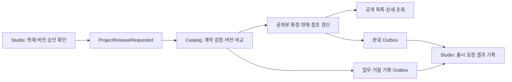

# Catalog MVP 재작성 계획

[문서 목록](README.md) · [Studio 완료 계약](studio-simplification-plan.md) · [Review 완료 계약](review-simplification-plan.md) · [유스케이스 작성 규칙](use-case-conventions.md)

2026-10-15 작성·재작성 완료. 아래 범위의 구현과 독립 검증을 완료했다. 결과는 [완료 기록](#재작성-완료-기록)을 따른다.

## 목표와 기준

창작자가 준비한 게임을 심사한 뒤 출시를 요청하면, Catalog가 승인된 스냅샷을 공개본으로 확정하고
Studio에 처리 결과를 돌려준다. 공개 상품 목록·상세 조회까지 연결해
「프로젝트 생성 → 자료·빌드 준비 → 심사 → 출시 요청 → 공개 조회」를 완성한다.

완료된 Auth·Gateway·Studio·Review와 공통 계약을 기준으로 한다.
기존 Catalog 코드는 제거·전환 대상 조사에만 사용한다. 미완료 Store·Order·Payment·License·Download·Settlement의
API·DB·이벤트 요구와 기존 Catalog API 호환성은 설계·검증 제약으로 삼지 않는다.

이 계획에서 출시는 **Catalog DB에 공개 스냅샷과 현재 공개본 참조를 원자적으로 확정하는 것**이다.
파일 복제·CDN 배포·구매자 다운로드·판매 가능 여부까지 완료했다는 의미는 아니다.

| 모듈 | 책임 |
|---|---|
| Auth·Gateway | 창작자·심사자의 인증·권한, 기존 API 라우팅과 공개 GET 접근 |
| Studio | 작업본·빌드, 현재 버전의 승인 확인, 출시 요청·재요청, 외부 결과 기록 |
| Review | 제출 스냅샷 수동 승인·반려와 판정 결과 발행 |
| Catalog | 출시 요청 처리, 불변 공개본·현재 공개본 관리, 공개 조회, 출시 결과 발행 |

Catalog는 Studio의 요청을 현재 버전의 승인 확인이 끝난 명령으로 신뢰한다.
Review 결과를 별도로 수집해 승인 사본을 만들거나 Studio·Review에 동기 조회하지 않는다.
Kafka의 Studio 토픽 생산 권한은 신뢰된 서비스에 한정한다. 이벤트 형식 검증 자체가 생산자 인증을 대신하지 않는다.

## MVP 범위와 제외 범위

- 출시 요청 수신과 입력 계약 검증, 중복 제거.
- 최초 공개와 더 높은 contentVersion의 공개본 교체, 과거 공개본 보존.
- 완료·업무 거절 결과를 Studio에 비동기 전달.
- MySQL 기반 공개 상품 목록·상세 조회. 공개 가격은 승인된 스냅샷의 KRW 정수 가격을 그대로 사용한다.

예약 출시·롤백·채널·판매 중지·관리자 강제 공개·할인·프로모션·상품군·번들·등급 업무·주문 견적·검색 색인·재색인·캐시는 제외한다.
Store용 ProductChanged 이벤트, 구매·다운로드용 내부 API는 해당 모듈 재작성 때 새로 정한다.
Catalog는 빌드 파일을 다시 검사하거나 다운로드 URL을 발급하지 않는다. Studio가 출시 요청 시 확인한 파일 참조를 보관한다.
파일이 이후 사라지는 문제는 저장소 보존·복구와 Download 단계의 검증 대상으로 남으며, Catalog의 완료 응답으로 파일 배포 성공을 주장하지 않는다.

## 최소 사용자 흐름

1. CREATOR가 Studio에서 자료·빌드를 준비하고 심사를 요청한다.
2. REVIEWER·ADMIN이 Review에서 승인하고 Studio가 해당 결과를 수신한다.
3. CREATOR가 Studio에서 출시 요청을 보낸다. Studio의 202는 접수 결과다.
4. Catalog가 ProjectReleaseRequested를 받아 요청 스냅샷으로 공개본을 확정한다.
5. 같은 트랜잭션에 기록한 완료 이벤트가 Studio에 전달된다.
6. 창작자는 Studio의 출시 요청 결과를, 방문자는 Catalog의 공개 상품 목록·상세를 확인한다.
7. 자료·빌드 변경 후에는 새 버전 심사·출시 요청을 거쳐 현재 공개본을 교체한다.

공개 조회는 Catalog 커밋 직후 가능하며 Studio 결과 반영보다 먼저 보일 수 있다.
출시 요청 후 Studio 작업본을 수정해도 이미 요청한 스냅샷은 유효하다.
Catalog가 알 수 있는 최신 버전은 수신한 출시 요청 기준이며, Studio의 미출시 작업본을 조회하지 않는다.

## 최소 저장 모델

업무 모델은 CatalogProduct와 CatalogRelease 두 개로 구성한다. 공통 Inbox·Outbox는 별도다.

| 모델 | 주요 값과 의미 |
|---|---|
| CatalogProduct | 자체 productId, 유일한 projectId·productCode, ownerSubject, currentReleaseRequestId, 최초 공개 시각·최종 갱신 시각 |
| CatalogRelease | Studio releaseRequestId를 PK로 사용, requestEventId, reviewRequestId, projectId·productCode·contentVersion, 원본 ProjectSnapshot JSON, COMPLETED/REJECTED, 거절 사유, 요청 발생 시각·처리 시각 |

CatalogRelease는 출시 요청의 최종 처리 기록이다. COMPLETED 기록의 스냅샷이 불변 공개본이며,
CatalogProduct가 가리키는 한 건이 현재 공개본이다. 거절 기록은 공개 조회에 노출하지 않는다.
동기적인 DB 처리만 있으므로 별도 영속 REQUESTED 상태나 처리 스케줄러는 두지 않는다.

- productId는 Catalog 내부에서 생성한다. releaseRequestId를 공개본 식별자로 재사용한다.
- productCode는 Studio가 제공한 값을 변경 없이 사용한다. Catalog에서 재생성하거나 slug로 변환하지 않는다.
- Studio의 productCode 자동 생성은 아직 제안이므로 이 계획의 선행 조건으로 삼지 않는다.
- projectId·productCode·ownerSubject의 최초 연결은 변경할 수 없다. 소유자 이전은 MVP 밖이다.
- 현재 공개본의 상세정보·가격·빌드 참조는 CatalogRelease의 스냅샷에서 읽는다. 작업본 수정은 공개 데이터에 영향을 주지 않는다.
- 요청 ID에는 유일 제약, 상품의 projectId·productCode에는 각각 유일 제약을 둔다.
- 공개 목록 정렬용 최초 공개 시각·productId, 이력 조회·검증용 projectId·contentVersion 인덱스를 둔다.
- 서비스 간 DB FK·조인은 사용하지 않는다.

## 순서·중복·실패 정책

버전 비교는 같은 Project의 contentVersion으로 한다. 이벤트 시각·releaseRequestId·ZIP 버전 문자열로 신구를 판정하지 않는다.

| 상황 | 처리 |
|---|---|
| 공개본이 없는 정상 요청 | 최초 상품·공개본 생성, COMPLETED |
| 현재 공개본보다 높은 버전 | 새 공개본 생성·현재 참조 교체, COMPLETED |
| 낮은 버전의 요청이 뒤늦게 도착 | STALE_CONTENT_VERSION 사유로 REJECTED, 현재 공개본 유지 |
| 같은 이벤트 재전달 | Inbox로 중복 제거, 결과 이벤트 추가 생성 없음 |
| 같은 요청 ID·같은 요청 이벤트 ID·같은 내용 재전달 | 기존 최종 결과 유지, 재공개·중복 결과 발행 없음 |
| 같은 요청 ID의 스냅샷·reviewRequestId·원본 이벤트 ID 변경 | 계약 위반, 기존 요청·공개본·결과를 덮어쓰지 않음 |
| 다른 요청 ID지만 현재 공개본과 같은 버전·동일 스냅샷 | 기존 공개본 유지, 새 요청에는 COMPLETED 회신. 현재 참조·공개 시각 유지 |
| 같은 Project·버전에 다른 스냅샷 | 계약 위반, DLT 대상으로 처리 |
| Project·상품 코드·소유자의 연결 충돌 | 계약 위반, 기존 상품 유지 |
| DB·브로커 등 일시 장애 | 업무 거절로 변환하지 않고 롤백·재시도 |

같은 버전의 스냅샷 비교는 JSON 문자열 순서가 아닌 파싱한 값으로 한다.
낮은 버전이라도 이미 처리한 동일 요청의 재전달이면 원래 결과를 유지한다. 중복 확인을 버전 비교보다 먼저 수행한다.
과거에 공개한 버전을 새 요청 ID로 다시 보내도 현재 버전보다 낮으면 거절한다. 롤백 API로 해석하지 않는다.
업무 거절은 정상 결과로 저장·회신하지만, 식별 정보가 잘못된 계약 위반에는 추측한 결과를 보내지 않는다.
DLT 건은 원인 해결 후 원본 이벤트를 재전달하며 Studio 요청은 결과 수신 전까지 REQUESTED로 남을 수 있다.

동시 요청은 READ_COMMITTED 트랜잭션과 기존 상품 행 잠금으로 직렬화한다.
출시 기록은 할당된 요청 ID를 INSERT하며 JPA merge로 기존 결과를 덮어쓰지 않는다. 최초 생성 경합은 유일 제약과 전체 트랜잭션 재시도로 해결한다.
유일 제약 예외를 실패한 트랜잭션 안에서 삼키고 계속 저장하지 않는다.
낮은 버전이 먼저 확정된 후 높은 버전이 교체하면 두 요청 모두 완료될 수 있지만, 최종 현재 공개본은 높은 버전이어야 한다.

## 이벤트와 트랜잭션

| 방향 | 계약 | 토픽 |
|---|---|---|
| 수신 | ProjectReleaseRequestedEvent | stove.studio.v1 |
| 완료 결과 | ProjectReleaseCompletedEvent | stove.release.v1 |
| 업무 거절 결과 | ProjectReleaseRejectedEvent | stove.release.v1 |

공통 이벤트의 기존 필드·토픽·팩터리를 유지한다. 새 이벤트는 MVP에 추가하지 않는다.
수신 시 봉투·본문의 이벤트 ID·유형, Kafka 키와 productCode의 일치,
요청·심사·Project·빌드 ID, 소유자, 양수 contentVersion, 상세정보·가격·KRW·빌드 크기·체크섬·저장 경로를
완료된 Studio의 입력·스냅샷 계약에 맞춰 검증한다. 가격 등에 별도의 더 강한 판매 규칙을 추가하지 않는다.

결과의 releaseRequestId·projectId·contentVersion·productCode는 저장한 요청에서 가져오고,
**requestEventId는 최초 수신한 출시 요청 이벤트의 eventId를 그대로 반환**한다.
Studio는 이 값이 원래 요청과 일치해야 결과를 반영한다. 결과 이벤트 자체의 eventId와 혼동하지 않는다.
결과 Kafka 키와 Outbox aggregateId는 productCode로 유지한다.

Inbox 마킹, 요청 최종 결과 저장, 상품·현재 공개본 변경, 결과 Outbox 기록을 하나의 DB 트랜잭션으로 묶는다.
실패하면 모두 롤백한다. 커밋 후 공통 릴레이가 결과를 전달하며 Kafka 발행을 업무 트랜잭션 안에서 기다리지 않는다.

리스너·Inbox는 새 consumer group `catalog-project-release`를 공유하고 최초 시작은 earliest로 한다.
기존 catalog 그룹이 새 요청을 무시하고 오프셋을 전진했을 가능성을 피한다.
Studio 토픽의 심사 요청·구 이벤트는 무시하며 Review 토픽은 구독하지 않는다.
처리 실패·계약 위반은 공통 재시도·DLT 경계를 사용한다. 이 작업 때문에 공통 재시도 정책을 일괄 변경하지 않는다.

## 공개 API와 보안

Gateway의 기존 `/api/v1/products/**` GET 라우트와 익명 조회 계약 안에서 두 API를 제공한다.

| 메서드 | 경로 | 응답 |
|---|---|---|
| GET | /api/v1/products | 현재 공개 상품의 페이지 목록 |
| GET | /api/v1/products/by-code/{productCode} | 해당 코드의 현재 공개 상품 상세 |

목록은 page=0, size=20, 최대 size=100으로 제한하고 최초 공개 시각 내림차순·productId 내림차순으로 안정 정렬한다.
잘못된 페이지 입력은 400, 미공개·없는 코드는 404다. 상품 변경은 출시 이벤트만으로 수행하며 HTTP 쓰기 API는 제공하지 않는다.
응답은 공통 ApiResponse와 전용 DTO를 사용하며 페이지 메타데이터도 명시한다.

목록은 productId·productCode·title·shortDescription·thumbnailUrl·price·currency·publishedAt을 제공한다.
상세는 content·videoUrl·contentVersion·buildVersion·updatedAt을 추가한다.
storagePath·ownerSubject·심사/출시 요청 ID·서명 URL은 공개 응답에 포함하지 않는다.
Gateway와 Catalog의 공개 GET 접근을 검증하고, 나머지 업무 경로는 닫는다. 완료된 Gateway의 다른 라우팅·권한 계약은 유지한다.

## 구현 구조와 기존 코드 정리

| 위치 | 구성 |
|---|---|
| core.domain | CatalogProduct·CatalogRelease·ReleaseSubmission·리포지토리, 불변 스냅샷·버전·식별 연결 규칙 |
| core.service | PublishProjectRelease, ReadPublishedProducts |
| api.listener | ProjectReleaseRequested 입력 해석·ReleaseSubmissionMapper.from 검증·내부 입력 변환·유스케이스 호출 |
| api.controller | 공개 목록·상세 DTO와 요청 파라미터 해석 |
| config | 최소 보안·Kafka·DB 설정 |

요청 처리·공개·결과 기록은 하나의 유스케이스에서 조율한다. 별도 외부 스토리지 어댑터는 추가하지 않는다.
기존 ReviewApproved·ReleasePublished 리스너, 포괄적 ProductCommandService·ProductQueryService,
Promotion·AuditLog 업무 모델·컨트롤러, 재색인·캐시, CreatorWorkspaceClient·Port를 제거·교체한다.
기존 견적·판매 시작/중지·프로모션·ID별 조회 등 API와 테스트는 새 범위로 교체한다.
미완료 모듈이 쓰는 공통 구 이벤트 타입은 Catalog에서 사용을 중단하되 이번 작업에서 일괄 삭제하지 않는다.

## DB와 전환

1. 현재 Catalog Flyway V1~V10의 체크섬을 유지한다. 구현 시작 시 추가 마이그레이션 여부를 재확인한다.
2. 다음 마이그레이션 V11에 catalog_product·catalog_release와 인덱스를 추가하고 공통 Inbox·Outbox를 재사용한다.
3. 구 product·promotion·audit_log 자료는 보존하되 신규 공개 API에서 읽지 않는다. 물리 삭제는 별도 작업이다.
4. 구 상품·시드 데이터는 새 Studio 요청 ID·승인 스냅샷과 대응이 보장되지 않으므로 자동 공개 이관하지 않는다.
5. 전환 시 Studio의 출시 요청과 Catalog 처리 기록을 대조한다. 보관된 원본 요청을 같은 eventId로 재전달한다.
6. Kafka 보관 범위 밖이면 보존한 Outbox 등 원본으로 복구한다. 원본을 복구할 수 없으면 누락을 기록하며 새 eventId를 임의 생성하지 않는다.
7. [전환 SQL](../scripts/catalog-transition.sql)로 새 릴레이를 켜기 전에 구 미발행 Outbox 건을 식별한다. 구 이벤트가 새 계약과 섞여 발행되지 않도록 보존·격리 절차를 전환 스크립트에 명시한다.

기존 배포 데이터의 전환 실행은 구현 완료와 구분한다. 기존 운영 자료를 삭제하는 스크립트를 기본 기동에 넣지 않는다.

## 구현 순서

1. **계약·모델**: 위 공개 API·버전 정책을 테스트 사례로 고정하고 새 테이블·도메인 모델을 만든다.
2. **출시 처리**: 신규 리스너·Inbox·공개본 확정·결과 Outbox와 동시성 처리를 구현한다.
3. **공개 조회**: 페이지 목록·코드별 상세·DTO·보안을 구현하고 Gateway 경유 조회를 확인한다.
4. **구 코드 정리**: 구 업무 코드·불필요 의존성·설정·테스트를 교체하고 OpenAPI 및 모델·서비스 문서를 갱신한다.
5. **실제 흐름 검증**: Auth·Gateway·Studio·Review·Catalog와 MySQL·Redis·Kafka·MinIO만으로 독립 스택·검증 스크립트를 구성한다.
6. **전환·완료 기록**: 빈 DB·기존 DB 업그레이드, 요청 대조·재전달 절차를 검증하고 결과를 문서에 기록한다.

각 단계는 빌드 가능한 상태를 유지하되 전체 새 흐름 완성을 배포 단위로 삼는다.

## 검증과 완료 조건

| 경계 | 필수 확인 |
|---|---|
| 도메인 | 최초 공개·상위 버전 교체·하위 버전 거절·동일 버전 충돌, 불변 스냅샷 |
| 실제 MySQL·Kafka | Inbox·출시 기록·현재 참조·Outbox 원자성, 실패 시 전부 롤백 |
| 중복·동시성 | 동일 요청 재전달, 최초 상품 생성 경합, 버전 역순·동시 요청, 결과 중복 발행 방지 |
| 결과 연결 | Studio의 요청 ID·버전·requestEventId와 일치하는 완료·거절 반영 |
| 실제 사용자 흐름 | 프로젝트 생성·파일 업로드·Review 승인·출시 요청·공개 조회·Studio 완료 확인 |
| 편집·재심사 | 승인 전 출시 차단, 승인 후 수정 시 재심사 필요, 새 공개 전 기존 공개본 유지 |
| 작업본 격리 | 출시 요청 후 작업본을 바꿔도 제출 스냅샷 공개, 늦은 결과는 과거 요청에만 반영 |
| 지연·복구 | 결과 발행 전 재시작·브로커 장애 뒤 복구, DLT 원본 재전달, 낮은 버전의 공개본 역전 없음 |
| API·보안 | 익명 목록·상세 조회, 비공개 내부 필드 미노출, 400/404·페이지 상한·정렬, 쓰기 경로 차단 |
| DB 전환 | 빈 DB·V10 DB의 신규 마이그레이션, 구 자료 보존·신규 공개에서 제외, 구 미발행 Outbox 격리 |
| 회귀 | 완료된 네 모듈과 사용하는 공통 계약의 관련 테스트·아키텍처·OpenAPI 검사 |

기존 공통 테스트 명령과 새 동시성·통합 테스트를 실행하고 실제 실행 결과를 기록한다.
계약 위반·역순·거절 사례는 이벤트 픽스처로 검증하고 정상 경로는 실제 Studio·Review 요청으로 검증한다.
Store·Order·Payment·License·Download·Settlement 실행이나 전체 기존 E2E 성공을 완료 조건으로 삼지 않는다.
위 조건을 통과한 뒤에만 AGENTS.md·README의 재작성 완료 목록에 Catalog를 추가한다.

## 재작성 완료 기록

2026-10-15, CatalogProduct·CatalogRelease 기반 출시 처리와 두 공개 GET API로 재작성을 완료했다.
구 심사·출시 투영, 프로모션·견적·캐시·재색인·Workspace 연동 코드를 제거하고 V11을 추가했다.
V1~V10 마이그레이션은 원문과 일치하며 구 업무 자료를 신규 공개 데이터로 자동 이관하지 않는다.

| 검증 | 단위·아키텍처 | 실제 인프라 통합 |
|---|---:|---:|
| Catalog | 37 | 12 |
| Auth | 3 | 8 |
| Gateway | 87 | 1 |
| Studio | 46 | 6 |
| Review | 50 | 12 |
| common:kafka | 147 | 이번 변경에서 실행하지 않음 |
| common:messaging | 72 | 이번 변경에서 실행하지 않음 |

총 481건이 통과했고 실패·건너뜀은 없다. 완료된 네 모듈과 공통 계약의 회귀 검사는
CI=true로 테스트 캐시·UP-TO-DATE를 배제해 실행했다.
Catalog의 OpenAPI 스냅샷을 갱신한 뒤 갱신 플래그 없이 계약 일치를 재검증했다.
공개 업무 API는 2개이며 공통 운영 API 스키마는 OpenAPI에 포함되지만 Catalog 보안 설정에서 HTTP 접근을 닫는다.

Catalog 통합 검증은 실제 MySQL·Kafka에서 최초 공개·교체·낮은 버전 거절,
중복·동시 최초 공개·동일 버전 재요청·상충 스냅샷, Outbox 실패 시 전체 롤백,
DLT 이동·원본 이벤트 ID 재전달, 공개 API 필드·페이지 상한·동률 정렬,
V10 자료 보존·V11 적용과 구 Outbox 격리 스크립트의 반복 실행을 확인했다.

[독립 검증 스크립트](../scripts/verify-catalog.py)는 다음 세 테스트 단계를 실제 다섯 앱으로 실행했고 모두 통과했다.

1. 로그인·자료 업로드·Review 승인·출시 요청·공개 조회·Studio 완료 반영.
   승인 전 출시 차단, 출시 요청 전 미공개, 중복 요청, 재심사·재출시,
   새 공개 전 기존 공개본 유지와 요청 후 작업본 변경의 격리도 확인했다.
2. Catalog 릴레이를 멈춘 상태에서 공개본·미발행 결과를 저장하고 Studio 요청이 REQUESTED로 남는지 확인했다.
3. Catalog를 실제 재시작하고 Kafka 중단 중 발행 실패·PENDING 보존을 확인한 뒤,
   Kafka를 복구해 Studio의 원래 요청이 COMPLETED가 되고 공개본이 유지되는지 확인했다.

브로커 메타데이터 조회의 동기 실패는 기존 공통 릴레이 트랜잭션을 롤백하므로 retry_count가 증가하지 않는 경로다.
검증은 횟수 증가를 전제로 삼지 않고 발행 실패 로그·PENDING 원본 보존·복구 후 실제 전달을 확인했다.
공통 릴레이 구현은 변경하지 않았다.

실행 명령은 [Catalog 실행·출시 검증](catalog-guide.md)에 정리했다.
이번 실행은 독립 스택·테스트 DB에서 수행했으며 기존 운영 DB의 전환 SQL 실행·배포는 포함하지 않는다.
Store 연동 이벤트·검색·구매·파일 배포는 이 완료 범위에 포함하지 않는다.

## Store MVP 연동 확장

위 최초 완료 기록 이후 2026-10-15 Store 재작성에서 CatalogProductPublished 공개 변경 이벤트를 추가했다.
기존 공개 HTTP API와 Studio 완료·거절 계약을 유지하고 같은 트랜잭션의 Outbox만 확장했다.
현재 공개 변경·두 Outbox의 원자성과 기존 회귀 검증 결과는 [Store 완료 기록](store-mvp-plan.md#재작성-완료-기록)을 따른다.
