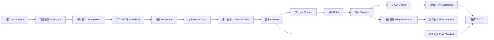

# 코드로 이해하는 도메인과 모델

이 프로젝트는 **창작자가 게임을 준비하고 심사를 거쳐 판매하면, 구매자에게 이용 권한을 주고 판매자의 몫을 계산하는 시스템**이다. 먼저 이 흐름을 이해한 뒤 각 단계가 보관하는 정보를 읽으면 된다.

이 문서는 2026-10-10, 로컬 `docs/domain-language`의 코드 `076efb1`을 기준으로 작성했다. [용어집](../domain-glossary.md)은 용어를 찾고 혼동을 푸는 색인이다. 이 안내와 모델 사전은 **어떤 객체가 어떤 속성을 가지고, 누가 언제 만들고 바꾸며, 다음 단계에서 무엇에 쓰이는지** 설명한다. 현재 구현에 대한 설명이며 업무 정책에 합의했다는 뜻은 아니다. 기존 상세 정의의 규칙 제안·사례·합의 상태도 각 모델에 모았다. 실행·설계·검증 문서는 [전체 문서 목록](../README.md)에서 찾는다.

## 처음 읽는 순서

1. 이 페이지의 업무 지도와 게임 한 개의 여정을 읽는다.
2. 관심 있는 단계의 모델 사전으로 이동한다. 처음에는 각 모델의 첫 문장과 “만들고 쓰는 때”만 읽어도 된다.
3. 낯선 필드가 나오면 속성 표를, 실제 요청 순서가 궁금하면 [대표 업무 흐름](workflows.md)을 읽는다.
4. 코드와 기대하는 동작이 다르면 [미결 질문](open-questions.md)을 확인한다. 상태 이름이나 주석만으로 지원 여부를 판단하지 않는다.

## 도메인·모델·속성을 읽는 법

| 말 | 이 프로젝트에서의 뜻 | 예 |
|---|---|---|
| 도메인 | 해결하려는 업무 영역 | 결제는 돈의 승인·환불, 정산은 판매자 몫 계산 |
| 서비스 | 독립 실행되는 프로그램. 도메인을 구현하는 배치 단위 | `apps/payment`, `apps/settlement` |
| 모델 | 업무 대상을 코드의 자료와 행동으로 표현한 것 | `Payment`는 금액·상태를 보관하고 승인 가능 여부를 검사 |
| 속성 / 필드 | 모델이 기억하는 정보 | `Payment.amount`는 결제해야 할 금액 |
| 엔티티 | ID로 구별하고 생애 동안 상태를 추적하는 객체 | 금액이 같아도 주문번호가 다르면 다른 주문 |
| 값 객체·record | 입력·결과·값의 묶음. 자체 저장 행이 없는 경우가 많음 | `Quote`는 견적 결과, `DownloadTicket`은 다운로드 응답 |
| 애그리거트 | 함께 규칙을 지키며 변경하는 객체 묶음 | `Order`가 `OrderItem` 목록과 총액을 함께 관리 |
| 리비전 / revision | 수정 전 자료를 보존하기 위한 판본 | 상점 설명 1차와 2차를 각각 저장 |
| 스냅샷 / snapshot | 특정 순간의 내용을 고정한 기록 | 주문 당시 가격. 상품 가격이 바뀌어도 과거 주문은 유지 |
| 읽기 모델·투영 / projection | 원본의 변경을 받아 조회 목적에 맞게 만든 사본 | 검색용 `ProductDocument`, 다운로드용 `Entitlement` |
| 이벤트 | 다른 서비스에 전달하는 “이미 일어난 사실” | `PaymentCompleted`: 결제 승인이 확정됨 |
| 멱등성 | 같은 요청·이벤트가 반복돼도 결과가 중복되지 않는 성질 | 같은 결제 이벤트로 이용권을 두 번 만들지 않음 |
| 트랜잭션 | 한 DB에서 함께 성공하거나 함께 취소할 변경 범위 | 주문 저장과 발송할 이벤트 저장을 함께 처리 |
| 비동기 | 요청 시점과 다른 서비스의 반영 시점이 분리됨 | 결제 완료 직후에는 다운로드 사본 반영이 아직 안 됐을 수 있음 |

모델 표의 `Long`/`long`은 정수, `String`은 문자열, `boolean`은 참·거짓, `Instant`는 시각, `BigDecimal`은 정확한 소수, `List`/`Set`은 목록/중복 없는 집합이다. 금액은 최소 화폐 단위의 정수로 다루며 현재 구매 흐름은 KRW를 전제로 한다. `Long`처럼 대문자로 시작하는 참조형은 코드상 `null`을 담을 수 있지만, 실제 필수 여부는 생성 규칙과 DB 제약도 확인해야 한다.

`id`는 각 모델을 구별하는 저장 키다. `entityVersion`은 동시에 수정한 요청의 충돌을 감지하는 번호이며 게임 버전이 아니다. `BaseTimeEntity`를 상속하는 모델에는 `createdAt`·`updatedAt`이 추가된다. 모델별 표는 직접 선언한 속성을 모두 다루고, 상속 여부는 [공통 모델](models/shared.md)에 모았다.

## 전체 업무 지도

코드에는 업무·인증 서비스 10개와 Gateway가 있다. 아래는 이해를 위한 책임 구분이며 바운디드 컨텍스트 확정은 [Q1](open-questions.md#q1)에 남아 있다.

| 영역 / 코드 | 답하는 질문 | 저장 모델 | 사전 |
|---|---|---|---|
| 계정·역할 / `auth` | 누가 요청했고 어떤 역할인가? | `UserAccount`, `RoleAuditLog` | [계정](models/identity.md) |
| 창작·출시 / `studio` | 누구의 어떤 자료·파일을 심사받아 공개하는가? | `Workspace`, `GameProject`, `BundleComponent`, `StorePageRevision`, `PricingRevision`, `RatingRevision`, `GameBuild`, `UploadSession`, `Submission`, `SubmissionBuild`, `SubmissionGate`, `Release` | [창작·출시](models/studio.md) |
| 창작 자동화·운영 / `studio` | 어떤 CI·테스터가 접근하고 어디에 결과를 알리는가? | `ProjectCredential`, `CiTrustPolicy`, `InternalTesterGrant`, `BuildWebhookSubscription`, `BuildWebhookDelivery`, `AuditLog` | [창작 운영](models/studio-operations.md) |
| 심사 / `review` | 어떤 제출 내용에 대해 무엇을 판단했는가? | `SubmissionSnapshot`, `ReviewCase`, `ReviewDecisionHistory`, 기존 `ReviewRequest`, `AuditLog` | [심사](models/review.md) |
| 상품·가격 / `catalog` | 무엇을 얼마에 팔 수 있는가? | `Product`, `Promotion`, `AuditLog` | [상품·진열](models/catalog-store.md) |
| 검색·진열 / `store` | 구매 화면에 무엇을 보여주는가? | `ProductDocument` | [상품·진열](models/catalog-store.md) |
| 주문 / `order` | 누가 무엇을 얼마에 사기로 했는가? | `Order`, `OrderItem` | [주문·결제](models/order-payment.md) |
| 결제 / `payment` | 돈의 승인·거절·환불이 어디까지 진행됐는가? | `Payment`, `SimulatedPgTransaction`, `PaymentAuditLog` | [주문·결제](models/order-payment.md) |
| 이용권 / `license` | 어떤 주문으로 이용 권한을 받았는가? | `License` | [이용·다운로드](models/fulfillment.md) |
| 파일 배포 / `download` | 지금 받을 수 있는 정확한 파일은 무엇인가? | `ProductRef`, `Entitlement`, `PatchManifest` | [이용·다운로드](models/fulfillment.md) |
| 정산 / `settlement` | 판매자에게 얼마를 배분해야 하는가? | `SettlementRecord`, `SellerSettlement` | [정산](models/settlement.md) |
| 요청 입구 / `gateway` | 요청을 어느 서비스로 보낼 것인가? | 자체 업무 엔티티 없음 | [서비스 명세](../services.md#gateway) |
| 전달·기록 / `common` | 변경 사실을 잃거나 중복 처리하지 않았는가? | `OutboxEvent`, `ProcessedEvent` 및 공유 이벤트 값 | [공통 모델](models/shared.md) |

`catalog`의 MySQL 상품은 판매 판단의 원본, `store`의 Elasticsearch 문서는 검색 사본이다. `license`의 MySQL 이용권은 지급 원본, `download`의 MongoDB 문서는 배포에 필요한 사본이다. 서비스 사이의 ID는 연결 참조이며, 여러 DB를 하나의 외래 키로 묶어 관리하는 구조는 아니다.

## 게임 한 개를 처음부터 따라가기

아래 숫자는 관계를 설명하기 위한 예시다. 실제 저장 ID나 실행 결과가 아니다. 게임 이름은 “별숲”, 상품 코드는 `STAR-FOREST`로 가정한다.

화살표는 업무상 연결이다. 모두 직접 HTTP 호출한다는 뜻은 아니다. 서비스 사이 상당수 연결은 [이벤트](workflows.md#이벤트를-업무-사실로-읽기)로 이어진다.

| 시점 | 생기거나 바뀌는 모델과 예시 | 다음 단계가 사용하는 것 |
|---|---|---|
| 창작자 가입 | Auth `UserAccount.id=11`, `subject=usr_creator`; Studio `Workspace.id=3`, `ownerSubject=usr_creator` | 프로젝트 소유자는 워크스페이스 `3`. 구매자 ID `11`과 구별 |
| 프로젝트 등록 | `GameProject.id=7`, `productCode=STAR-FOREST`, `sellerId=3` | 자료·빌드가 `gameId=7`에 속함 |
| 자료 준비 | 상점 자료 `id=101, revisionNo=2`, 가격 `id=201, price=10000`, 등급 자료 `id=301` | 제출할 때는 순번 `2`가 아니라 각각의 ID를 지정 |
| 파일 업로드 | `GameBuild.id=401, version=1.0.0`, `UploadSession` 생성·완료 후 빌드 검증 | 제출에는 `VALIDATED` 빌드가 필요 |
| 심사 제출 | `Submission.id=501`에 자료 `101/201/301`과 빌드 `401` 고정; 여섯 `SubmissionGate` 생성 | Review가 스냅샷 한 건과 유형별 사건 여섯 건 생성 |
| 전체 승인·공개 | 승인 결과 반영 후 `Submission=READY_FOR_RELEASE`; LIVE `Release.id=601` 공개 | `ReleasePublished`로 상품·배포 정보 전달 |
| 상점 반영 | Catalog `Product.id=42`, `currentReleaseId=601`; Store 검색 문서 갱신 | 주문은 `productId=42`, 다운로드는 `STAR-FOREST` 사용 |
| 구매 | 다른 구매자 `memberId=25`가 주문. `Order`·`OrderItem`에 견적 확정 | `orderNo`와 `OrderLine` 사본을 Payment로 전달 |
| 결제 완료 | `Payment=PAID` | Order는 `PAID`, License는 지급, Settlement는 매출 원장 생성. 각 서비스 반영 시점은 다를 수 있음 |
| 다운로드 | `ProductRef`로 코드→상품 `42`·릴리스 `601` 연결, `Entitlement`로 회원 `25`의 보유 확인 | 정확히 릴리스 `601`의 `PatchManifest`에서 파일을 골라 티켓 발급 |
| 환불 | Payment 환불 완료 이벤트 | 주문 취소, 이용권 회수, 보유권 회수, 음수 환불 원장 추가 |
| 월 마감 | 판매자 `3`·귀속 월별 `SellerSettlement` 생성/누적 | 원장 합계와 비교. 실제 송금 완료를 의미하지 않음 |

자료를 고치는 것과 새 버전을 배포하는 것은 별개다. 상점 설명 3차를 작성해도 기존 릴리스가 참조하는 2차 설명은 유지된다. 새 제출·심사·LIVE 공개를 거쳐야 현재 상품과 배포 파일에 반영된다.

## 비슷해 보이는 모델을 나눈 이유

| 구별할 대상 | 나누지 않으면 생기는 문제 |
|---|---|
| `GameProject` / `Product` | 작성 중인 초안이 구매 가능한 상품처럼 취급될 수 있음 |
| `GameBuild` / `Release` | 파일 업로드 완료를 고객 공개로 오해함. 검증·심사·공개 채널을 구분할 수 없음 |
| `Submission` / `ReviewCase` / `SubmissionGate` | 제출 묶음, 심사자의 판단, 출시 준비 상태가 한 상태값에 섞임 |
| `PricingRevision` / `Product.price` / `OrderItem.unitPrice` | 심사할 가격, 현재 정가, 구매 당시 실제 단가를 구별하지 못함 |
| `Order` / `Payment` | 구매 요청과 실제 대금 처리가 같은 순간에 끝난다고 가정하게 됨 |
| `License` / `Entitlement` | 다운로드 요청마다 이용권 서비스가 살아 있어야 함 |
| `SettlementRecord` / `SellerSettlement` | 개별 매출·환불 근거를 잃고 월 합계만 남음 |

“같은 값이 여러 곳에 저장됨” 자체가 모두 중복 설계 오류는 아니다. 현재 상태를 보여주는 사본도 있고, 과거 구매 조건을 보존해야 하는 기록도 있다. **언제의 사실이며 누가 원본을 바꾸는가**를 먼저 확인한다.

## 코드에서 답을 찾는 순서

| 궁금한 것 | 찾아볼 코드 | 읽는 요령 |
|---|---|---|
| 어떤 속성이 있나? | `core/domain/모델.java` | 필드와 생성 메서드, `approve()` 같은 상태 변경 메서드 |
| 언제 생성·변경하나? | `core/service/*Service.java` | 소유권·참조·상태 검사와 저장, 이벤트 적재 |
| 누가 요청하나? | `api/controller`, `api/listener`, 스케줄러 | 사용자 요청인지, 다른 서비스 이벤트인지, 예약 실행인지 |
| 외부 호출은 어떻게 엮나? | `api/application/*Facade.java` | 여러 단계를 조율하고 외부 호출·DB 변경을 구분 |
| 실제로 어디에 저장하나? | `@Table`, `@Document`, `resources/db/migration` | Java 필드명과 DB 컬럼명이 다를 수 있음 |
| 어떤 데이터를 전달하나? | `common/kafka/.../payload` | 저장 엔티티 전체가 아니라 이벤트에 담은 필드만 전달 |
| 어떤 사례를 검증했나? | `src/test`, `src/integrationTest`, `e2e/src/test` | 테스트가 다루는 입력·결과까지만 보장 범위를 해석 |

예를 들어 `GameProject.sellerId`는 DB에서 `workspace_id`에 저장된다. `Submission.metadataRevisionId`가 이벤트를 건너면 `metadataRevision`이라는 이름으로 등장해도 값은 여전히 이력 **ID**다. [식별자·버전 비교](../domain-glossary.md#identifiers)를 함께 읽는다.

## 현재 구현을 이해할 때 남겨둘 경계

- 기존 프로젝트 단위 심사(`ReviewRequest`)와 현재 제출물 단위 심사(`ReviewCase`)가 함께 있다. 새 흐름의 진행 여부를 `GameProject.status`만으로 판단하지 않는다.
- `PUBLISHED`는 상점 자료에서는 “확정됨”, 릴리스에서는 “해당 채널에 공개됨”이다. 일반 상품의 판매는 LIVE 릴리스 반영으로 시작한다. DEMO·BUNDLE의 일반 구매는 제한된다.
- 주문 취소 API와 결제 환불 API는 현재 연결이 완성되어 있지 않다. 환불 흐름은 Payment에서 시작한다. [Q9](open-questions.md#q9)
- 파일 검증·공개 전 점검은 게임을 실제 플레이해 검증하는 것과 다르다. [Q10](open-questions.md#q10)
- 정산의 `grossAmount`는 고객 결제액과 다를 수 있다. 환불 수수료를 다시 계산하는 구현에는 반올림 차이 가능성도 있다. [정산 예시](models/settlement.md#money-example), [Q12](open-questions.md#q12)
- 외부 PG·등급 기관·세금계산서 연동에는 대역 구현이 있다. DB의 성공 상태가 실제 외부 기관의 처리 완료를 증명하는 것은 아니다. [외부 연동 범위](../services.md#외부-연동-대역)

## 조사 범위와 유지 방법

`apps/*/core/domain`의 저장 모델 **40개와 직접 선언 속성 464개**를 대상으로 모델 사전을 작성했다. 공통 전달 기록 2개, 주요 입력·결과 record, 열거형의 의미도 설명한다. 저장 모델 중 업무 감사 기록은 [공통 페이지](models/shared.md)에 모았다. 모든 Controller DTO, Repository 인터페이스, 설정·지표·정렬 유틸리티, 프레임워크 소유 OAuth 테이블을 별도 업무 모델로 세지는 않았다.

근거는 로컬 모델·서비스·리스너·스키마와 기존 테스트 소스다. 이번 문서 작업의 검증은 링크·앵커·모델/필드 누락 확인이며 애플리케이션 테스트를 새로 실행한 결과가 아니다. 향후 모델 필드를 바꾸면 해당 표와 생성·사용 설명을 함께 고친다. 지원하지 않는 기능을 enum 값이나 필드의 존재만으로 “구현됨”이라고 쓰지 않는다.
