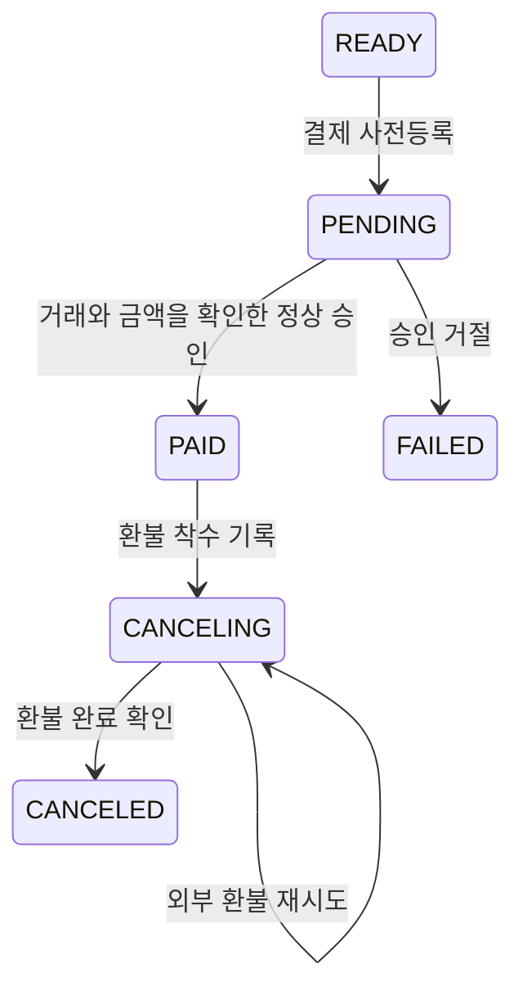

# 주문과 결제 모델

[전체 안내](../model-guide.md) · [상품 가격](catalog-store.md) · [이용권](fulfillment.md) · [정산](settlement.md)

Order는 “무엇을 얼마에 사기로 했는가”, Payment는 “그 돈을 실제로 승인·환불했는가”를 보관한다. 두 서비스는 각자 MySQL DB를 사용하고 `orderNo`로 연결한다. 같은 순간에 같은 상태가 된다고 가정하지 않는다.

## Order — 단일 상품의 주문 스냅샷과 결제 결과

저장: Order의 purchase_order. [모델](../../../apps/order/src/main/java/com/stove/order/core/domain/Order.java) · [MVP 계획](../../order-mvp-plan.md) · [실행 안내](../../order-guide.md)

| 속성 | 뜻과 사용처 |
|---|---|
| id·orderNo | DB 키와 외부 연결용 UUID 주문번호 |
| buyerSubject·requestId | JWT sub 구매자와 클라이언트 UUID. 조합 유일 제약으로 요청 중복 방지 |
| productId·productCode·title·contentVersion | Catalog 공개 상세에서 확인한 당시 상품 |
| listAmount·discountAmount·amount·currency | 정가·할인액 0·고객 청구액과 KRW. PG 비용·판매자 지급액과 구분 |
| status | PENDING, PAID, FAILED |
| requestEventId | 주문 생성과 함께 저장한 OrderPlaced 이벤트 ID |
| paymentResultEventId·paymentId·resultOccurredAt | 최초 수락한 결제 결과 이벤트·결제 식별자·결과 시각 |
| failureReasonCode·failureReason | 최종 실패의 분류·설명. 성공이면 없음 |
| createdAt·updatedAt | UTC 마이크로초 저장 시각 |

**만들고 쓰는 때:** CreateOrder가 Catalog 공개 상세를 HTTP로 읽고 기대 버전·금액을 확인한다.
주문 스냅샷과 OrderPlaced Outbox를 같이 저장한다. 이미 저장된 requestId의 같은 입력은 Catalog를 호출하지 않고 기존 주문을 반환한다.
본인 조회는 SearchOrders·ReadOrder, 결제 결과는 ApplyPaymentResult가 담당한다.

결제 결과는 원래 requestEventId·orderNo·buyerSubject·amount·currency가 일치해야 한다.
PENDING에서 PAID 또는 FAILED로 한 번 확정하며 같은 eventId·결과는 반복해도 바뀌지 않는다.
주문 행 잠금과 Inbox를 같은 트랜잭션으로 처리한다. 자동 만료·취소·환불은 이번 범위에 없다.

**사례:** 10,000원·버전 3을 주문하면 이후 Catalog가 20,000원·버전 4로 바뀌어도 기존 청구액은 10,000원이다.
새 요청이 예전 값을 보내면 409다. PG 비용을 공제한 9,800원을 승인액으로 통보해도 금액 불일치로 거절한다.

검증 근거: [도메인 테스트](../../../apps/order/src/test/java/com/stove/order/core/domain/OrderTest.java),
[실제 MySQL·Kafka·JWT 검사](../../../apps/order/src/integrationTest/java/com/stove/order/OrderIntegrationTest.java),
[독립 사용자 흐름](../../../e2e/src/test/java/com/stove/e2e/OrderPurchaseFlowTest.java).
Payment는 아직 재작성 전이며 결과 이벤트 픽스처로 경계를 검증한다.

## 구 OrderItem·OrderLine의 위치

새 Order는 상품 하나의 스냅샷을 직접 보존하고 OrderItem·Quote를 사용하지 않는다.
[OrderLine](../../../common/kafka/src/main/java/com/stove/common/kafka/contract/payload/OrderLine.java)은 미완료 Payment·Settlement의 구 계약에 남아 있는 상품·할인·정산 조건이다.
해당 타입의 존재를 새 주문·정산 연동 완료의 근거로 삼지 않는다. 할인 부담·판매자 계약은 기능을 추가할 때 별도 정의한다.

## Payment — 주문 대금의 처리 기록

아래는 미완료 Payment의 기존 구현 설명이다. 새 Order 계약과 연결되지 않으며 후속 재작성 기준으로 삼지 않는다.

저장: Payment의 `payment`. [모델](../../../apps/payment/src/main/java/com/stove/payment/core/domain/Payment.java)

| 속성 | 뜻과 사용처 |
|---|---|
| `id` (`Long`), `orderNo` (`String`), `memberId` (`Long`) | 결제 기록·연결 주문·구매자 |
| `amount` (`long`), `currency` (`String`) | 승인받을 주문 총액·통화 |
| `lines` (`List<OrderLine>`) | 주문 항목 사본. JSON으로 저장하고 완료 이벤트로 전달 |
| `status` (`PaymentStatus`) | `READY`, `PENDING`, `PAID`, `CANCELING`, `CANCELED`, `FAILED` |
| `method` (`String`), `preparedAt` (`Instant`) | 결제 수단·사전등록 시각 |
| `pgTxId` (`String`) | PG가 구분하는 거래 ID. PG는 결제 대행 시스템을 뜻함 |
| `idempotencyKey` (`String`) | 승인 콜백의 중복을 구별하는 키. 주문번호와 별도 |
| `paidAt` (`Instant`) | 승인 완료 시각 |
| `canceledAt` (`Instant`), `cancelReason` (`String`) | 환불 완료 시각·사유 |
| `cancelingSince` (`Instant`) | 최초 환불 착수 시각. 오래 미완료된 환불 탐지에 사용 |
| `cancelAttempts` (`int`), `nextCancelAttemptAt` (`Instant`) | 환불 재시도 횟수·다음 시도 예약 |
| `failedAt` (`Instant`), `failReasonCode`, `failReason` (`String`) | 승인 거절 시각·분류·설명 |

**만들고 쓰는 때:** OrderCreated 수신 시 READY를 만든다. 결제를 준비하면 PG 사전등록 거래를 보관하고 PENDING이 된다. 승인 통보를 받으면 등록 거래 ID·금액을 비교해 PAID로 확정한다. 같은 멱등키의 승인 재전송은 중복 완료 이벤트를 만들지 않는다. 현재 주문 리스너는 통화를 KRW로 지정하므로 다중 통화 지원 완료로 해석하지 않는다.

환불은 착수 기록→외부 호출→완료 기록으로 나뉜다. `CANCELING`은 환불 완료가 확인되지 않은 상태여서 CANCELED처럼 처리하면 안 된다. 실패해도 원 결제를 지우지 않고 재시도 정보를 남긴다. 이용권 지급 실패에 대한 보상도 이 환불 경로로 연결된다.

결제창 유효 시간을 넘긴 뒤 승인이 도착하면 승인 사실을 기록한 후 곧바로 환불에 착수한다. 이 경로는 `PaymentCompleted`를 보내지 않아 정상 이용권 지급·매출 기록을 시작하지 않는다. 위 그림의 정상 승인 여정과 구별한다.

근거: [PaymentService](../../../apps/payment/src/main/java/com/stove/payment/core/service/PaymentService.java), [PaymentCallbackFacade](../../../apps/payment/src/main/java/com/stove/payment/api/application/PaymentCallbackFacade.java), [RefundFacade](../../../apps/payment/src/main/java/com/stove/payment/api/application/RefundFacade.java), [OrderEventListener](../../../apps/payment/src/main/java/com/stove/payment/api/listener/OrderEventListener.java).

**업무 규칙 제안:** 사전등록한 거래·금액과 일치하는 인증된 콜백만 반영한다. 승인 거절은 실패로 끝내고, 승인된 대금의 취소는 환불 완료를 확인한 뒤 확정한다. 같은 승인 재전송으로 이용권·매출을 추가 지급하지 않는다.

**사례:** 사전등록 10,000원·거래 A에 대한 10,000원 승인은 처리한다. 거래 B 또는 9,000원 콜백은 거절한다. PG가 거절한 건은 `FAILED`이며 매출·권한 지급의 근거가 되지 않는다. 환불 중 PG 오류가 나면 완료로 표시하지 않고 `CANCELING`에서 재개한다.

**합의 상태:** 초안. 실제 PG 연동은 [기존 #82](https://github.com/tlswltjq/esd-platform/issues/82), 취소 정책·통화 전달은 [Q9](../open-questions.md#q9)의 후속 대상이다.

개발 환경에서는 [결제 시뮬레이터](../../api-demo.md#payment-simulator)로 실제 결제 없이 승인·거절·환불 흐름을 재현한다. 시뮬레이터 결과는 실제 PG 연동 완료의 근거가 아니다.

**검증 근거:** [Payment](../../../apps/payment/src/main/java/com/stove/payment/core/domain/Payment.java), [PaymentService](../../../apps/payment/src/main/java/com/stove/payment/core/service/PaymentService.java), [RefundFacade](../../../apps/payment/src/main/java/com/stove/payment/api/application/RefundFacade.java). [PaymentTest](../../../apps/payment/src/test/java/com/stove/payment/core/domain/PaymentTest.java), [PaymentGateTest](../../../apps/payment/src/integrationTest/java/com/stove/payment/core/service/PaymentGateTest.java), [PaymentCheckoutWindowTest](../../../apps/payment/src/integrationTest/java/com/stove/payment/core/service/PaymentCheckoutWindowTest.java), [StrandedRefundResumeTest](../../../apps/payment/src/integrationTest/java/com/stove/payment/core/service/StrandedRefundResumeTest.java).

## SimulatedPgTransaction — 결제 시뮬레이터의 거래

저장: Payment의 `simulated_pg_transaction`. [모델](../../../apps/payment/src/main/java/com/stove/payment/core/domain/SimulatedPgTransaction.java)

| 속성 | 뜻과 사용처 |
|---|---|
| `pgTxId` (`String`) | 시뮬레이터 거래 ID이자 저장 키 |
| `orderNo` (`String`), `amount` (`long`), `currency` (`String`) | 대역 PG에 등록한 주문·금액·통화 |
| `status` (`Status`) | `PREPARED`, `APPROVED`, `DECLINED`, `TIMED_OUT`, `CANCELED` |
| `reasonCode`, `reason` (`String`) | 거절·타임아웃의 분류·설명 |
| `createdAt` (`Instant`), `version` (`long`) | 거래 생성 시각·동시 변경 충돌 감지 번호 |

**만들고 쓰는 때:** 시뮬레이터로 결제를 준비하고 승인·거절·타임아웃·취소 결과를 재현한다. Payment가 상점 측 기록이라면 이 모델은 대역 결제 공급자 측 기록이다. 실제 외부 PG의 승인 내역은 아니다. [SimulatedPgService](../../../apps/payment/src/main/java/com/stove/payment/core/service/SimulatedPgService.java), [PaymentSimulatorFacade](../../../apps/payment/src/main/java/com/stove/payment/api/application/PaymentSimulatorFacade.java).

## PaymentAuditLog — 결제 행동의 감사 기록

저장: `payment_audit_log`. [모델](../../../apps/payment/src/main/java/com/stove/payment/core/domain/PaymentAuditLog.java)

| 속성 | 뜻과 사용처 |
|---|---|
| `id` (`Long`), `orderNo` (`String`) | 로그 ID·대상 주문 |
| `actor`, `action`, `detail` (`String`) | 행동 주체·행동명·상세 내용 |
| `occurredAt` (`Instant`) | 기록 시각 |

**만들고 쓰는 때:** 회원의 환불 요청(`REFUND_REQUESTED`)과 PG 환불 완료 반영(`REFUND_COMPLETED`) 때 근거를 남긴다. 실제 현재 결제 상태는 Payment에서 판단한다.

## 결제 처리에 쓰는 값 모델

| 모델 | 속성과 용도 |
|---|---|
| [PgPreparation](../../../apps/payment/src/main/java/com/stove/payment/core/domain/PgPreparation.java) | `pgTxId`, `redirectUrl`: PG 사전등록 결과 |
| [PaymentPreparation](../../../apps/payment/src/main/java/com/stove/payment/core/domain/PaymentPreparation.java) | `orderNo`, `pgTxId`, `amount`, `currency`, `redirectUrl`: 고객에게 줄 결제창 안내 |
| [PgApproval](../../../apps/payment/src/main/java/com/stove/payment/core/domain/PgApproval.java) | `orderNo`, `pgTxId`, `paidAmount`, `idempotencyKey`: 승인 통보 |
| [PgDecline](../../../apps/payment/src/main/java/com/stove/payment/core/domain/PgDecline.java) | `orderNo`, `pgTxId`, `reasonCode`, `reason`: 거절 통보 |
| [PaymentCancellation](../../../apps/payment/src/main/java/com/stove/payment/core/domain/PaymentCancellation.java) | `pgRefundRequired`, `pgTxId`, `amount`: DB 처리 후 외부 환불이 필요한지 전달 |
| [StrandedCancellation](../../../apps/payment/src/main/java/com/stove/payment/core/domain/StrandedCancellation.java) | `orderNo`, `reason`, `attempts`: 오래 미완료된 환불을 운영에 알릴 값 |
| [RefundRetryPolicy](../../../apps/payment/src/main/java/com/stove/payment/core/domain/RefundRetryPolicy.java) | 초기 지연·횟수별 재시도 간격을 계산하는 정책. 결제·환불 행을 추가로 저장하는 모델은 아님 |

기존 검증: [OrderTest](../../../apps/order/src/test/java/com/stove/order/core/domain/OrderTest.java), [PaymentTest](../../../apps/payment/src/test/java/com/stove/payment/core/domain/PaymentTest.java), [PaymentSimulatorFlowTest](../../../apps/payment/src/integrationTest/java/com/stove/payment/api/application/PaymentSimulatorFlowTest.java), [구매 여정](../../../e2e/src/test/java/com/stove/e2e/TrackBCommerceFlowTest.java).
