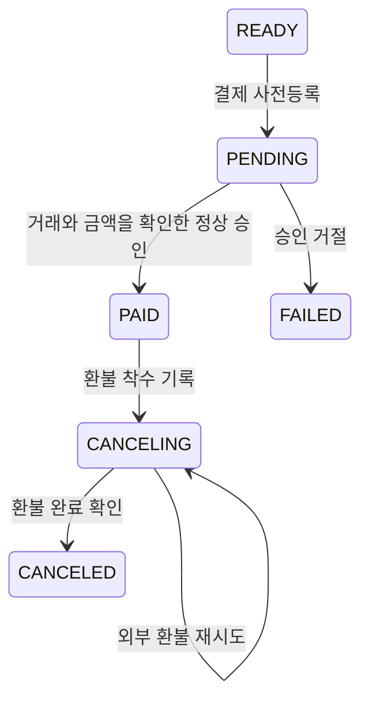

# 주문과 결제 모델

[전체 안내](../model-guide.md) · [상품 가격](catalog-store.md) · [이용권](fulfillment.md) · [정산](settlement.md)

Order는 “무엇을 얼마에 사기로 했는가”, Payment는 “그 돈을 실제로 승인·환불했는가”를 보관한다. 두 서비스는 각자 MySQL DB를 사용하고 `orderNo`로 연결한다. 같은 순간에 같은 상태가 된다고 가정하지 않는다.

## Order — 구매 요청과 확정 금액

저장: Order의 `orders`. [모델](../../../apps/order/src/main/java/com/stove/order/core/domain/Order.java)

| 속성 | 뜻과 사용처 |
|---|---|
| `id` (`Long`), `orderNo` (`String`) | DB ID와 서비스 사이에서 쓰는 주문번호 |
| `memberId` (`Long`) | 인증 정보에서 얻은 구매자 ID |
| `status` (`OrderStatus`) | `CREATED`, `PAID`, `CANCELED`, `FAILED`, `EXPIRED` |
| `totalAmount` (`long`), `currency` (`String`) | 주문 항목 실결제액 합계·통화 |
| `items` (`List<OrderItem>`) | 함께 저장하는 주문 항목 목록 |
| `paidAt` (`Instant`) | 결제 완료 이벤트로 확정한 시각 |
| `canceledAt` (`Instant`), `cancelReason` (`String`) | 취소 시각·사유 |
| `failedAt` (`Instant`), `failReason` (`String`) | 결제 실패를 반영한 시각·사유 |
| `expiredAt` (`Instant`) | 결제 대기 주문을 만료 처리한 시각 |

**만들고 쓰는 때:** 구매 요청을 받으면 Catalog 견적을 동기 호출한다. 요청자가 전달한 `expectedAmount`가 있다면 서버 견적과 비교하고, 검증한 항목으로 Order와 OrderItem을 저장한다. `OrderCreated` 이벤트를 받은 Payment가 결제 대기 기록을 만든다. [PlaceOrderFacade](../../../apps/order/src/main/java/com/stove/order/api/application/PlaceOrderFacade.java), [OrderCommandService](../../../apps/order/src/main/java/com/stove/order/core/service/OrderCommandService.java)

| 계기 | 상태 변경 |
|---|---|
| 결제 완료 | `CREATED → PAID` |
| 결제 승인 거절 | `CREATED → FAILED` |
| 취소 처리 | `CREATED/PAID → CANCELED` |
| 만료 처리 | `CREATED → EXPIRED` |

현재 주문 취소만으로 Payment 환불이 실행되지는 않는다. `OrderCanceled`를 Payment의 주문 리스너가 처리하지 않기 때문이다. 환불은 별도 Payment 경로를 사용한다. [Q9](../open-questions.md#q9)

**업무 규칙 제안:** 인증된 구매자의 주문을 서버 가격으로 계산하고, 기대 금액이 있으면 비교한다. 주문 시 고정된 항목을 결제와 정산에 사용한다. 취소·승인 거절·시간 만료를 서로 다른 업무 결과로 기록한다.

**사례:** 10,000원 상품 1개의 기대 금액을 10,000원으로 보내면 주문할 수 있다. 1,000원으로 보내거나 판매 중지 상품을 주문하면 거절된다. 같은 상품 수량·반복 구매의 이용권 의미는 [Q5](../open-questions.md#q5)에 남긴다.

**합의 상태:** 재검토 필요. 수량·지급 정책 [Q5](../open-questions.md#q5), 취소와 환불 [Q9](../open-questions.md#q9).

**검증 근거:** [Order](../../../apps/order/src/main/java/com/stove/order/core/domain/Order.java), [PlaceOrderFacade](../../../apps/order/src/main/java/com/stove/order/api/application/PlaceOrderFacade.java), [OrderCommandService](../../../apps/order/src/main/java/com/stove/order/core/service/OrderCommandService.java). [PlaceOrderFacadeTest](../../../apps/order/src/test/java/com/stove/order/api/application/PlaceOrderFacadeTest.java), [OrderTest](../../../apps/order/src/test/java/com/stove/order/core/domain/OrderTest.java), [ProductQuoteTest](../../../apps/catalog/src/integrationTest/java/com/stove/catalog/core/service/ProductQuoteTest.java)가 금액·상태·견적 조건을 검증한다. 인증은 [TrackBCommerceFlowTest](../../../e2e/src/test/java/com/stove/e2e/TrackBCommerceFlowTest.java)의 `forgedOrderBodyCannotSelectAnotherOwner`.

## OrderItem — 구매 당시 상품·가격·배분 조건

저장: Order의 `order_item`. Order에 속하며 주문 생성 때 함께 저장한다. [모델](../../../apps/order/src/main/java/com/stove/order/core/domain/OrderItem.java)

| 속성 | 뜻과 사용처 |
|---|---|
| `id` (`Long`), `order` (`Order`) | 항목 ID·부모 주문 |
| `productId` (`Long`), `productName` (`String`), `sellerId` (`Long`) | 당시 상품 ID·이름·판매자 |
| `unitPrice` (`long`) | 할인 후 한 개의 실결제 단가 |
| `listUnitPrice`, `discountPerUnit` (`long`) | 할인 전 한 개의 정가·한 개의 할인액 |
| `quantity` (`int`) | 구매 수량. 항목 결제액은 `unitPrice × quantity` |
| `promotionId` (`Long`), `discountBearer` (`String`) | 적용 행사와 `SELLER/PLATFORM` 부담자. 행사 없으면 null |
| `settlementBasis` (`Long`) | **수량을 포함한 항목 전체**의 정산 기준액 |
| `feeRate` (`BigDecimal`) | 구매 시 확정한 수수료율. `0.3000`은 30% |
| `feeAmount`, `sellerPayout` (`Long`) | 항목 전체의 수수료와 판매자 지급액. 이전 형식의 자료에는 없을 수 있음 |

**만들고 쓰는 때:** 견적을 주문에 고정하고 결제·정산에 전달할 때 사용한다. 상품명·정가·행사가 나중에 바뀌어도 이 항목을 현재 상품으로 다시 계산하지 않는다. 항목의 `lineAmount()`는 실결제액을 계산하며 별도 저장 필드는 아니다.

[OrderLine](../../../common/kafka/src/main/java/com/stove/common/kafka/contract/payload/OrderLine.java)은 같은 정보를 서비스 사이에 전달하는 record다. `id`·`order`를 제외한 위 상품·금액·수량 속성을 담는다. Catalog Quote→OrderItem→Payment.lines→PaymentCompleted→정산 원장으로 이어진다. `settlementBasis`·`feeAmount`를 단가로 오해해 다시 수량을 곱하면 금액이 부풀려진다.

관련 [Order의 Quote](../../../apps/order/src/main/java/com/stove/order/core/domain/Quote.java)는 `lines`, `totalAmount`, `currency`, [QuoteItem](../../../apps/order/src/main/java/com/stove/order/core/domain/QuoteItem.java)은 `productId`, `quantity`다. [OrderNoGenerator](../../../apps/order/src/main/java/com/stove/order/core/domain/OrderNoGenerator.java)는 주문번호를 생성하는 도구이며 저장 모델은 아니다.

## Payment — 주문 대금의 처리 기록

저장: Payment의 `payment`. [모델](../../../apps/payment/src/main/java/com/stove/payment/core/domain/Payment.java)

| 속성 | 뜻과 사용처 |
|---|---|
| `id` (`Long`), `orderNo` (`String`), `memberId` (`Long`) | 결제 기록·연결 주문·구매자 |
| `amount` (`long`), `currency` (`String`) | 승인받을 주문 총액·통화 |
| `lines` (`List<OrderLine>`) | 주문 항목 사본. JSON으로 저장하고 완료 이벤트로 전달 |
| `status` (`PaymentStatus`) | `READY`, `PENDING`, `PAID`, `CANCELING`, `CANCELED`, `FAILED` |
| `method` (`String`), `preparedAt` (`Instant`) | 결제 수단·사전등록 시각 |
| `pgTxId` (`String`) | PG가 구분하는 거래 ID. PG는 결제 대행 시스템을 뜻함 |
| `idempotencyKey` (`String`) | 승인 콜백의 중복을 구별하는 키. 주문번호와 별도 |
| `paidAt` (`Instant`) | 승인 완료 시각 |
| `canceledAt` (`Instant`), `cancelReason` (`String`) | 환불 완료 시각·사유 |
| `cancelingSince` (`Instant`) | 최초 환불 착수 시각. 오래 미완료된 환불 탐지에 사용 |
| `cancelAttempts` (`int`), `nextCancelAttemptAt` (`Instant`) | 환불 재시도 횟수·다음 시도 예약 |
| `failedAt` (`Instant`), `failReasonCode`, `failReason` (`String`) | 승인 거절 시각·분류·설명 |

**만들고 쓰는 때:** OrderCreated 수신 시 READY를 만든다. 결제를 준비하면 PG 사전등록 거래를 보관하고 PENDING이 된다. 승인 통보를 받으면 등록 거래 ID·금액을 비교해 PAID로 확정한다. 같은 멱등키의 승인 재전송은 중복 완료 이벤트를 만들지 않는다. 현재 주문 리스너는 통화를 KRW로 지정하므로 다중 통화 지원 완료로 해석하지 않는다.

환불은 착수 기록→외부 호출→완료 기록으로 나뉜다. `CANCELING`은 환불 완료가 확인되지 않은 상태여서 CANCELED처럼 처리하면 안 된다. 실패해도 원 결제를 지우지 않고 재시도 정보를 남긴다. 이용권 지급 실패에 대한 보상도 이 환불 경로로 연결된다.

결제창 유효 시간을 넘긴 뒤 승인이 도착하면 승인 사실을 기록한 후 곧바로 환불에 착수한다. 이 경로는 `PaymentCompleted`를 보내지 않아 정상 이용권 지급·매출 기록을 시작하지 않는다. 위 그림의 정상 승인 여정과 구별한다.

근거: [PaymentService](../../../apps/payment/src/main/java/com/stove/payment/core/service/PaymentService.java), [PaymentCallbackFacade](../../../apps/payment/src/main/java/com/stove/payment/api/application/PaymentCallbackFacade.java), [RefundFacade](../../../apps/payment/src/main/java/com/stove/payment/api/application/RefundFacade.java), [OrderEventListener](../../../apps/payment/src/main/java/com/stove/payment/api/listener/OrderEventListener.java).

**업무 규칙 제안:** 사전등록한 거래·금액과 일치하는 인증된 콜백만 반영한다. 승인 거절은 실패로 끝내고, 승인된 대금의 취소는 환불 완료를 확인한 뒤 확정한다. 같은 승인 재전송으로 이용권·매출을 추가 지급하지 않는다.

**사례:** 사전등록 10,000원·거래 A에 대한 10,000원 승인은 처리한다. 거래 B 또는 9,000원 콜백은 거절한다. PG가 거절한 건은 `FAILED`이며 매출·권한 지급의 근거가 되지 않는다. 환불 중 PG 오류가 나면 완료로 표시하지 않고 `CANCELING`에서 재개한다.

**합의 상태:** 초안. 실제 PG 연동은 [기존 #82](https://github.com/tlswltjq/esd-platform/issues/82), 취소 정책·통화 전달은 [Q9](../open-questions.md#q9)의 후속 대상이다.

개발 환경에서는 [결제 시뮬레이터](../../api-demo.md#payment-simulator)로 실제 결제 없이 승인·거절·환불 흐름을 재현한다. 시뮬레이터 결과는 실제 PG 연동 완료의 근거가 아니다.

**검증 근거:** [Payment](../../../apps/payment/src/main/java/com/stove/payment/core/domain/Payment.java), [PaymentService](../../../apps/payment/src/main/java/com/stove/payment/core/service/PaymentService.java), [RefundFacade](../../../apps/payment/src/main/java/com/stove/payment/api/application/RefundFacade.java). [PaymentTest](../../../apps/payment/src/test/java/com/stove/payment/core/domain/PaymentTest.java), [PaymentGateTest](../../../apps/payment/src/integrationTest/java/com/stove/payment/core/service/PaymentGateTest.java), [PaymentCheckoutWindowTest](../../../apps/payment/src/integrationTest/java/com/stove/payment/core/service/PaymentCheckoutWindowTest.java), [StrandedRefundResumeTest](../../../apps/payment/src/integrationTest/java/com/stove/payment/core/service/StrandedRefundResumeTest.java).

## SimulatedPgTransaction — 결제 시뮬레이터의 거래

저장: Payment의 `simulated_pg_transaction`. [모델](../../../apps/payment/src/main/java/com/stove/payment/core/domain/SimulatedPgTransaction.java)

| 속성 | 뜻과 사용처 |
|---|---|
| `pgTxId` (`String`) | 시뮬레이터 거래 ID이자 저장 키 |
| `orderNo` (`String`), `amount` (`long`), `currency` (`String`) | 대역 PG에 등록한 주문·금액·통화 |
| `status` (`Status`) | `PREPARED`, `APPROVED`, `DECLINED`, `TIMED_OUT`, `CANCELED` |
| `reasonCode`, `reason` (`String`) | 거절·타임아웃의 분류·설명 |
| `createdAt` (`Instant`), `version` (`long`) | 거래 생성 시각·동시 변경 충돌 감지 번호 |

**만들고 쓰는 때:** 시뮬레이터로 결제를 준비하고 승인·거절·타임아웃·취소 결과를 재현한다. Payment가 상점 측 기록이라면 이 모델은 대역 결제 공급자 측 기록이다. 실제 외부 PG의 승인 내역은 아니다. [SimulatedPgService](../../../apps/payment/src/main/java/com/stove/payment/core/service/SimulatedPgService.java), [PaymentSimulatorFacade](../../../apps/payment/src/main/java/com/stove/payment/api/application/PaymentSimulatorFacade.java).

## PaymentAuditLog — 결제 행동의 감사 기록

저장: `payment_audit_log`. [모델](../../../apps/payment/src/main/java/com/stove/payment/core/domain/PaymentAuditLog.java)

| 속성 | 뜻과 사용처 |
|---|---|
| `id` (`Long`), `orderNo` (`String`) | 로그 ID·대상 주문 |
| `actor`, `action`, `detail` (`String`) | 행동 주체·행동명·상세 내용 |
| `occurredAt` (`Instant`) | 기록 시각 |

**만들고 쓰는 때:** 회원의 환불 요청(`REFUND_REQUESTED`)과 PG 환불 완료 반영(`REFUND_COMPLETED`) 때 근거를 남긴다. 실제 현재 결제 상태는 Payment에서 판단한다.

## 결제 처리에 쓰는 값 모델

| 모델 | 속성과 용도 |
|---|---|
| [PgPreparation](../../../apps/payment/src/main/java/com/stove/payment/core/domain/PgPreparation.java) | `pgTxId`, `redirectUrl`: PG 사전등록 결과 |
| [PaymentPreparation](../../../apps/payment/src/main/java/com/stove/payment/core/domain/PaymentPreparation.java) | `orderNo`, `pgTxId`, `amount`, `currency`, `redirectUrl`: 고객에게 줄 결제창 안내 |
| [PgApproval](../../../apps/payment/src/main/java/com/stove/payment/core/domain/PgApproval.java) | `orderNo`, `pgTxId`, `paidAmount`, `idempotencyKey`: 승인 통보 |
| [PgDecline](../../../apps/payment/src/main/java/com/stove/payment/core/domain/PgDecline.java) | `orderNo`, `pgTxId`, `reasonCode`, `reason`: 거절 통보 |
| [PaymentCancellation](../../../apps/payment/src/main/java/com/stove/payment/core/domain/PaymentCancellation.java) | `pgRefundRequired`, `pgTxId`, `amount`: DB 처리 후 외부 환불이 필요한지 전달 |
| [StrandedCancellation](../../../apps/payment/src/main/java/com/stove/payment/core/domain/StrandedCancellation.java) | `orderNo`, `reason`, `attempts`: 오래 미완료된 환불을 운영에 알릴 값 |
| [RefundRetryPolicy](../../../apps/payment/src/main/java/com/stove/payment/core/domain/RefundRetryPolicy.java) | 초기 지연·횟수별 재시도 간격을 계산하는 정책. 결제·환불 행을 추가로 저장하는 모델은 아님 |

기존 검증: [OrderTest](../../../apps/order/src/test/java/com/stove/order/core/domain/OrderTest.java), [PaymentTest](../../../apps/payment/src/test/java/com/stove/payment/core/domain/PaymentTest.java), [PaymentSimulatorFlowTest](../../../apps/payment/src/integrationTest/java/com/stove/payment/api/application/PaymentSimulatorFlowTest.java), [구매 여정](../../../e2e/src/test/java/com/stove/e2e/TrackBCommerceFlowTest.java).
