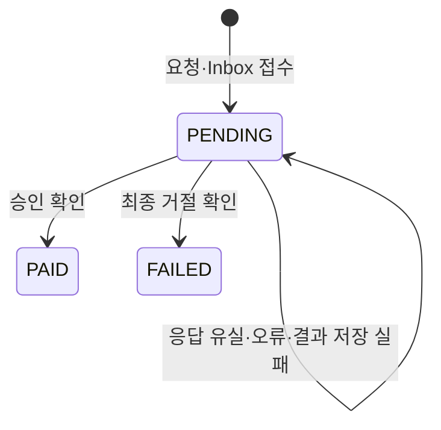

# 주문과 결제 모델

[전체 안내](../model-guide.md) · [상품 가격](catalog-store.md) · [이용권](fulfillment.md) · [정산](settlement.md)

Order는 “무엇을 얼마에 사기로 했는가”, Payment는 “확정된 주문 금액의 결제 결과가 무엇인가”를 보관한다. 두 서비스는 각자 MySQL DB를 사용하고 `orderNo`로 연결한다. 같은 순간에 같은 상태가 된다고 가정하지 않는다.

## Order — 단일 상품의 주문 스냅샷과 결제 결과

저장: Order의 purchase_order. [모델](../../../apps/order/src/main/java/com/stove/order/core/domain/Order.java) · [MVP 계획](../../order-mvp-plan.md) · [실행 안내](../../order-guide.md)

| 속성 | 뜻과 사용처 |
|---|---|
| id·orderNo | DB 키와 외부 연결용 UUID 주문번호 |
| buyerSubject·requestId | JWT sub 구매자와 클라이언트 UUID. 조합 유일 제약으로 요청 중복 방지 |
| productId·productCode·title·contentVersion | Catalog 공개 상세에서 확인한 당시 상품 |
| listAmount·discountAmount·amount·currency | 정가·할인액 0·고객 청구액과 KRW. PG 비용·판매자 지급액과 구분 |
| status | PENDING, PAID, FAILED |
| requestEventId | 주문 생성과 함께 저장한 OrderPlaced 이벤트 ID |
| paymentResultEventId·paymentId·resultOccurredAt | 최초 수락한 결제 결과 이벤트·결제 식별자·결과 시각 |
| failureReasonCode·failureReason | 최종 실패의 분류·설명. 성공이면 없음 |
| createdAt·updatedAt | UTC 마이크로초 저장 시각 |

**만들고 쓰는 때:** CreateOrder가 Catalog 공개 상세를 HTTP로 읽고 기대 버전·금액을 확인한다.
주문 스냅샷과 OrderPlaced Outbox를 같이 저장한다. 이미 저장된 requestId의 같은 입력은 Catalog를 호출하지 않고 기존 주문을 반환한다.
같은 구매자·상품의 PENDING·PAID 주문은 DB 생성 컬럼·유일 제약으로 합쳐 한 건만 허용한다. 최종 FAILED 이후 새 requestId로 다시 주문할 수 있으며, 같은 requestId 재조회는 원래 주문을 반환한다.
본인 조회는 SearchOrders·ReadOrder, 결제 결과는 ApplyPaymentResult가 담당한다.

결제 결과는 원래 requestEventId·orderNo·buyerSubject·amount·currency가 일치해야 한다.
PENDING에서 PAID 또는 FAILED로 한 번 확정하며 같은 eventId·결과는 반복해도 바뀌지 않는다.
주문 행 잠금과 Inbox를 같은 트랜잭션으로 처리한다. 자동 만료·취소·환불은 이번 범위에 없다.

**사례:** 10,000원·버전 3을 주문하면 이후 Catalog가 20,000원·버전 4로 바뀌어도 기존 청구액은 10,000원이다.
새 요청이 예전 값을 보내면 409다. PG 비용을 공제한 9,800원을 승인액으로 통보해도 금액 불일치로 거절한다.

검증 근거: [도메인 테스트](../../../apps/order/src/test/java/com/stove/order/core/domain/OrderTest.java),
[실제 MySQL·Kafka·JWT 검사](../../../apps/order/src/integrationTest/java/com/stove/order/OrderIntegrationTest.java),
[독립 사용자 흐름](../../../e2e/src/test/java/com/stove/e2e/OrderPurchaseFlowTest.java).
Order 자체의 검증은 결과 픽스처를 사용한다. 실제 Payment 연계·복구는 [Payment 검증](../../payment-mvp-plan.md)을 따른다.

## 구 OrderItem·OrderLine의 위치

새 Order는 상품 하나의 스냅샷을 직접 보존하고 OrderItem·Quote를 사용하지 않는다.
[OrderLine](../../../common/kafka/src/main/java/com/stove/common/kafka/contract/payload/OrderLine.java)은 미완료 Settlement 등의 구 계약에 남아 있는 상품·할인·정산 조건이다.
해당 타입의 존재를 새 주문·정산 연동 완료의 근거로 삼지 않는다. 할인 부담·판매자 계약은 기능을 추가할 때 별도 정의한다.

## Payment — 확정된 주문의 결제와 결과

저장: Payment의 `purchase_payment`. [모델](../../../apps/payment/src/main/java/com/stove/payment/core/domain/Payment.java) · [MVP 범위](../../payment-mvp-plan.md) · [실행 안내](../../payment-guide.md)

| 속성 | 뜻과 사용처 |
|---|---|
| id·paymentId | DB 정렬용 PK와 생성 이후 고정된 결제 UUID. PG 멱등 키로도 사용 |
| orderNo·requestEventId·orderOccurredAt | 원래 주문번호와 OrderPlaced의 ID·시각 |
| buyerSubject | 주문이 확정한 구매자. JWT sub 기준 내 결제 조회 |
| productId·productCode·title·contentVersion | 주문 당시 상품 스냅샷 |
| listAmount·discountAmount·amount·currency | 정가·할인액·고객 청구액·KRW. 공급자 수수료와 구분 |
| provider·status | SIMULATED와 PENDING/PAID/FAILED |
| providerTransactionId·providerOccurredAt | 확인된 PG 거래와 원래 결정 시각 |
| resultEventId·resultOccurredAt | 최초 확정 결과의 이벤트 ID·시각 |
| failureReasonCode·failureReason | 명시적 최종 거절 사유. 성공에는 없음 |
| nextAttemptAt·lastErrorCode | 미확정 건 재개 시각·오류 분류. 최종 상태에는 없음 |
| createdAt·updatedAt | UTC 마이크로초 시각 |

**만들고 쓰는 때:** `OrderPaymentMapper.from(...)`이 외부 이벤트를 내부 `PaymentOrderRequest`로 바꾼다.
`ReceiveOrderPayment`는 전체 스냅샷을 비교하고 새 PENDING과 Inbox를 함께 저장한다. 접수는 PG 완료를 의미하지 않는다.
`ResolvePayment`는 DB 트랜잭션 밖에서 `PgGateway`를 호출한 다음, 짧은 트랜잭션으로 행 잠금·최종 결과·Outbox를 함께 저장한다.
목록·상세는 `SearchPayments`·`ReadPayment`가 JWT sub로 제한한다.

**규칙:** PG 키·주문·청구액·통화·공급자가 일치하는 확인된 결과만 확정한다. 결과와 이벤트 ID·시각은 이후 바꾸지 않는다.
통신 오류를 결제 거절로 해석하지 않는다. 같은 paymentId로 재확인하고 한 주문에 새 결제를 만들지 않는다.
Order는 결과 이벤트의 원래 요청·구매자·금액을 검증하고 자기 상태를 변경한다.

**사례:** PG 결정은 저장됐지만 응답을 잃으면 Payment는 PENDING이다. 재시작 후 같은 키로 원래 결정을 받아 PAID를 확정한다.
결과와 Outbox 저장이 실패해도 공급자 결정은 남는다. 재시도 후 최종 결과 이벤트는 한 건만 저장한다.
할인액이 포함된 주문은 `정가 - 할인액 = 청구액`을 확인하고 청구액 그대로 결제한다. 할인 자격은 다시 판정하지 않는다.

## SimulatedPgGateway — 공급자 결정 대역

[어댑터](../../../apps/payment/src/main/java/com/stove/payment/infrastructure/pg/SimulatedPgGateway.java)는 JDBC로 `simulated_payment_charge`에 결정 한 건을 독립 커밋한다.
Payment 업무 엔티티·저장소를 사용하지 않는다. 키·주문·청구액·통화·거래 ID·결정 시각·APPROVED/DECLINED·거절 사유를 보존한다.
같은 키와 입력이면 최초 결정을 반환하고 다른 주문·금액이면 거부한다. 설정을 바꿔도 기존 결정을 바꾸지 않는다.

기본 결과는 APPROVED이며 `PAYMENT_SIMULATED_RESULT=DECLINED`로 새 결제의 거절을 재현한다.
실제 외부 PG·자금 이동은 없다. 업무 테이블과 같은 MySQL을 쓰므로 외부 PG와 DB의 독립 장애까지 보장하지 않는다.
구 payment·simulated_pg_transaction·payment_audit_log는 마이그레이션으로 보존하지만 새 코드에서 사용하지 않는다.
환불·결제창·콜백·자동 만료·이용권·정산은 후속 범위다.

## 결제 입력과 결과 값

| 값 | 용도 |
|---|---|
| [PaymentOrderRequest](../../../apps/payment/src/main/java/com/stove/payment/core/domain/PaymentOrderRequest.java) | 외부 이벤트와 분리된 원래 주문·상품·가격 입력 |
| [PgChargeRequest](../../../apps/payment/src/main/java/com/stove/payment/core/domain/PgChargeRequest.java) | 고정 paymentId·orderNo·amount·currency |
| [PgResult](../../../apps/payment/src/main/java/com/stove/payment/core/domain/PgResult.java) | 공급자·키·주문·금액·거래·시각·확정 결정 |
| [PgUnavailable](../../../apps/payment/src/main/java/com/stove/payment/core/domain/PgUnavailable.java) | 결과를 확정하지 못한 공급자 호출 오류 |

검증: [단위 테스트](../../../apps/payment/src/test/java/com/stove/payment/core/domain/PaymentTest.java),
[MySQL·Kafka·JWT 통합 테스트](../../../apps/payment/src/integrationTest/java/com/stove/payment/PaymentIntegrationTest.java),
[기존 DB 보존](../../../apps/payment/src/integrationTest/java/com/stove/payment/PaymentMigrationIntegrationTest.java),
[8개 앱 사용자 흐름](../../../e2e/src/test/java/com/stove/e2e/PaymentPurchaseFlowTest.java).
