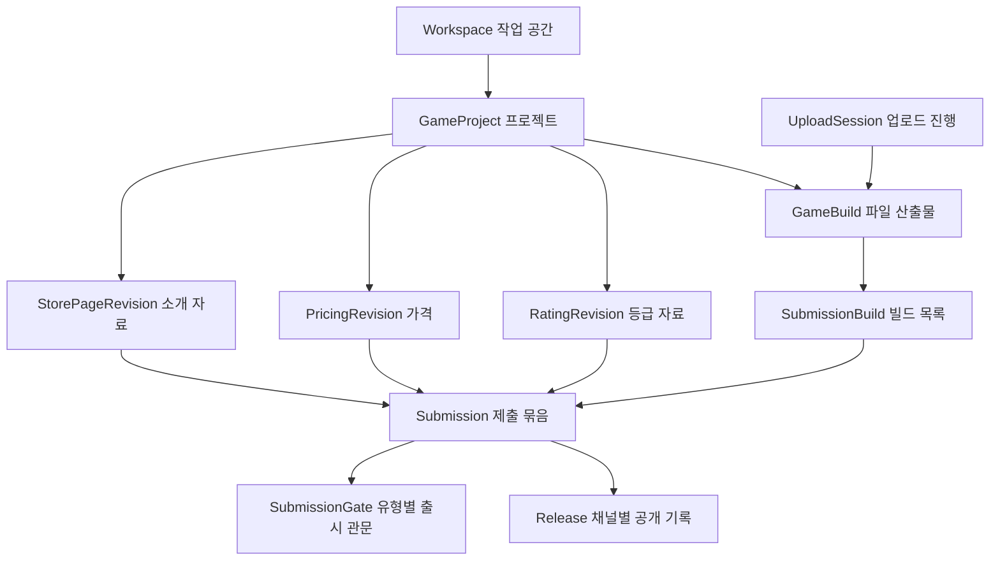

# 창작·자료·빌드·출시 모델

[전체 안내](../model-guide.md) · [CI·테스터·알림 모델](studio-operations.md)

Studio는 “출시할 내용을 준비하고 어느 판본을 공개할지 정하는 곳”이다. 아래 모델은 모두 MySQL에 저장한다. `GameProject` 하나에 자료·파일·심사·출시를 모두 덮어쓰지 않고, 자료 이력과 제출·공개 기록을 분리한다.

코드의 `core.domain`과 `core.service`는 같은 업무 이름의 하위 패키지로 묶는다. 엔티티·값 객체·저장소는 `core.domain.<업무>`, 처리 서비스는 `core.service.<업무>`에서 찾는다. 테스트도 대상 코드의 패키지에 맞춰 배치한다.

| 하위 패키지 | 담당 업무 |
|---|---|
| `project` | 작업 공간, 게임 프로젝트, 파생 상품과 번들 관계 |
| `revision` | 상점 소개·가격·등급 자료의 판본과 상점 자료 업로드 |
| `build` | 빌드 파일 업로드, 검증, 저장 용량과 보관 기간 관리 |
| `submission` | 심사 제출 묶음, 유형별 관문과 심사 결과 반영 |
| `release` | 공개 예약, 채널 승격, 롤백과 공개 전 점검 |
| `access` | 프로젝트 인증 정보, CI 신뢰 정책과 내부 테스터 권한 |
| `notification` | 빌드 웹훅 구독·발송, 서명 비밀값과 CI 결과 통보 |
| `audit` | 업무 행동의 감사 기록 |

프로젝트 하나에 각 종류의 자료 이력·빌드·제출물·릴리스가 여러 개 생긴다. 한 제출물은 상점·가격·등급 이력을 각각 하나씩, 빌드는 하나 이상 선택한다. `Release`는 그 제출물을 특정 채널에 공개한다. 그림은 업무 관계이며 모든 선이 JPA 객체 참조나 DB 외래 키라는 뜻은 아니다.

## Workspace — 창작 작업 공간

저장: `workspace`. [모델](../../../apps/studio/src/main/java/com/stove/studio/core/domain/project/Workspace.java)

| 속성 | 뜻과 사용처 |
|---|---|
| `id` (`Long`) | 작업 공간 ID. 현재 커머스의 판매자 ID로 전달됨 |
| `ownerSubject` (`String`) | Auth 계정의 `subject`. 개인 공간 소유자를 찾는 기준 |
| `status` (`WorkspaceStatus`) | `ACTIVE`로 생성. `SUSPENDED`도 정의되지만 모델에 변경 메서드는 없음 |

**만들고 쓰는 때:** 가입 이벤트 수신 또는 개인 공간 조회 시 없으면 생성한다. 프로젝트·자료·출시 요청에서 이 공간에 속한 것인지 확인한다. 현재 팀 구성원 목록이나 정산 계좌를 표현하는 모델은 아니다. [WorkspaceService](../../../apps/studio/src/main/java/com/stove/studio/core/service/project/WorkspaceService.java), [판매자 관계 Q8](../open-questions.md#q8).

## GameProject — 제작·출시 대상

저장: `game_project`. [모델](../../../apps/studio/src/main/java/com/stove/studio/core/domain/project/GameProject.java)

| 속성 | 뜻과 사용처 |
|---|---|
| `id` (`Long`) | 다른 Studio 모델이 `gameId`로 참조하는 ID |
| `productCode` (`String`) | Catalog·Download와 공유하는 상품 코드 |
| `title` (`String`) | 등록 시 프로젝트 제목. 새 출시의 공개 제목은 선택한 상점 자료에서 가져옴 |
| `sellerId` (`Long`) | 소유 워크스페이스 ID. DB 컬럼명은 `workspace_id` |
| `price` (`long`), `currency` (`String`) | 등록 가격·통화 및 기존 프로젝트 심사 경로의 가격. 새 공개 가격은 `PricingRevision`에서 가져옴 |
| `selfRated` (`boolean`) | 기존 심사 경로의 자체등급 여부. 새 제출 경로는 등급 설문·정책으로 경로 결정 |
| `status` (`ProjectStatus`) | 기존 경로의 `DRAFT`, `SUBMITTED`, `APPROVED`, `REJECTED` |
| `ratingCode`, `rejectReason` (`String`) | 기존 경로의 승인 등급·반려 사유 |
| `productKind` (`ProductKind`) | `BASIC` 기본 게임, `DEMO` 체험판, `DLC` 추가 콘텐츠, `EDITION` 에디션, `BUNDLE` 묶음 |
| `parentGameId` (`Long`) | DEMO·DLC·EDITION이 속한 BASIC 프로젝트 |
| `editionName` (`String`) | EDITION의 구분 이름 |

**만들고 쓰는 때:** 창작자가 프로젝트를 등록할 때 생성한다. 소유권 확인과 자료·빌드 묶음의 기준점으로 쓴다. DEMO·DLC·EDITION의 부모는 같은 소유자의 BASIC이어야 한다. DEMO 등록 가격은 0이며 제출 가격도 0이어야 한다. EDITION에만 에디션 이름을 지정한다.

새 제출 경로의 상태는 `Submission.status`에서 읽는다. 프로젝트가 `APPROVED`라는 것만으로 현재 빌드의 심사·공개·판매가 완료되었다고 판단할 수 없다. 근거: [GameProjectService](../../../apps/studio/src/main/java/com/stove/studio/core/service/project/GameProjectService.java).

생성 입력 [NewProject](../../../apps/studio/src/main/java/com/stove/studio/core/domain/project/NewProject.java)는 `productCode`, `title`, `sellerId`, `price`, `currency`, `selfRated`, `productKind`, `parentGameId`, `editionName`, `bundleGameIds`를 담는다. `bundleGameIds`는 구성 관계 행을 만드는 데 사용하고 GameProject의 단일 필드로 저장하지 않는다.

**업무 규칙 제안:** 창작자는 자신의 워크스페이스에서 중복되지 않는 코드로 등록하고, 관련 프로젝트를 지정한다. 제출·출시 여부는 해당 Submission·Release로 설명한다.

**사례:** 같은 창작자의 기본 게임에 DLC 프로젝트를 연결할 수 있다. 다른 창작자의 기본 게임을 부모로 연결하는 요청은 거절된다.

**합의 상태:** 초안. 기존 프로젝트 상태의 역할과 판매자 명칭은 [Q2](../open-questions.md#q2), [Q8](../open-questions.md#q8).

**검증 근거:** [GameProject](../../../apps/studio/src/main/java/com/stove/studio/core/domain/project/GameProject.java), [GameProjectService](../../../apps/studio/src/main/java/com/stove/studio/core/service/project/GameProjectService.java). [GameProjectServiceTest](../../../apps/studio/src/integrationTest/java/com/stove/studio/core/service/project/GameProjectServiceTest.java)의 `productFamilyRequiresOwnedRelations`, `duplicateProductCodeIsRejected`가 관계·중복 규칙을 확인한다.

**API에서 찾기:** `POST /api/v1/studio/games`로 등록하고, `GET /api/v1/studio/games/{gameId}/family`로 부모·자식·구성품·자신을 포함한 묶음을 조회한다. 공개된 관계는 Catalog·Store에 사본으로 전달된다.

## BundleComponent — 묶음의 구성 관계

저장: `bundle_component`. [모델](../../../apps/studio/src/main/java/com/stove/studio/core/domain/project/BundleComponent.java)

| 속성 | 뜻과 사용처 |
|---|---|
| `id` (`Long`) | 구성 관계 한 건의 ID |
| `bundleGameId` (`Long`) | BUNDLE 프로젝트 |
| `componentGameId` (`Long`) | 포함되는 프로젝트 |

**만들고 쓰는 때:** BUNDLE 등록 시 구성 상품마다 한 행을 만든다. 같은 소유자의 중복 없는 두 개 이상이어야 하고 다른 BUNDLE을 포함할 수 없다. 구성 관계를 공개 이벤트에 상품 코드 목록으로 담는다. 현재 일반 구매에서 묶음을 구성품 이용권으로 풀어 지급하는 기능은 없다.

관련 조회 값 [ProductFamily](../../../apps/studio/src/main/java/com/stove/studio/core/domain/project/ProductFamily.java)는 `product`, `parent`, `children`, `components`, `bundles`를 모은 결과다. 별도 상품 원본이 아니라 “이 프로젝트의 부모·자식·구성품·자신을 포함한 묶음” 조회용이다.

## StorePageRevision — 상점 소개 자료의 판본

저장: `store_page_revision`. [모델](../../../apps/studio/src/main/java/com/stove/studio/core/domain/revision/StorePageRevision.java)

| 속성 | 뜻과 사용처 |
|---|---|
| `id`, `gameId` (`Long`), `revisionNo` (`int`) | 이력 ID, 소속 프로젝트, 프로젝트 내 상점 자료 순번 |
| `title`, `shortDescription`, `detailedDescription` | 제목·짧은 소개·상세 소개 |
| `localizationsJson` | 언어별 제목·짧은 소개·상세 소개의 JSON 문자열 |
| `genresJson`, `tagsJson` | 장르와 검색·분류용 태그 목록 |
| `developer`, `publisher` | 표시할 개발사·배급사 이름. 판매자 식별자는 아님 |
| `screenshotsJson`, `trailersJson`, `iconUrl`, `coverUrl` | 스크린샷·영상 목록, 아이콘·커버 위치 |
| `supportedLanguagesJson`, `platform` | 지원 언어 목록과 플랫폼 설명 |
| `minimumRequirements`, `recommendedRequirements`, `featuresJson` | 최소·권장 사양, 기능 목록 |
| `supportUrl`, `privacyPolicyUrl`, `eulaUrl` | 지원·개인정보 정책·이용계약 안내 위치 |
| `salesCountriesJson`, `pricesJson` | 작성 자료의 판매 국가·통화별 가격. 현재 실제 출시 가격 선택은 별도 가격 이력에서 수행 |
| `status` (`StorePageRevisionStatus`) | 편집 가능한 `DRAFT` 또는 확정된 `PUBLISHED` |
| `publishedAt` (`Instant`) | 자료를 확정한 시각. 고객 공개 시각과 다름 |
| `entityVersion` (`long`) | 동시 수정 충돌 감지 |

타입을 생략한 내용 필드는 모두 `String`이다. `Json` 접미사는 목록·맵을 문자열 형태로 저장했다는 뜻이다.

**만들고 쓰는 때:** 창작자가 상점 설명을 작성한다. 초안은 수정할 수 있지만 확정 후에는 새 판본을 만들어야 한다. 생성 요청에서 `draft=false`이면 곧바로 확정한다. 확정·제출 시 같은 프로젝트에 업로드된 스크린샷·커버 등을 확인한다. 제출과 릴리스는 해당 판본의 ID를 가리켜 과거 자료를 보존한다. [RevisionService](../../../apps/studio/src/main/java/com/stove/studio/core/service/revision/RevisionService.java)

입력 값 [StorePageContent](../../../apps/studio/src/main/java/com/stove/studio/core/domain/revision/StorePageContent.java)는 위 내용 필드를 목록·맵으로 받는 record다. `localizations`, `genres`, `tags`, `screenshots`, `trailers`, `supportedLanguages`, `features`, `salesCountries`, `prices`를 저장할 때 각각 `*Json`으로 바꾼다. 내부 `SerializedContent`는 그 변환 결과다. [StoreAsset](../../../apps/studio/src/main/java/com/stove/studio/core/domain/revision/StoreAsset.java)의 `assetId`, `url`, `contentType`, `size`는 업로드한 이미지 결과이며 별도 JPA 엔티티는 아니다.

**업무 규칙 제안:** 초안은 편집하고, 확정 후 수정은 새 이력으로 작성한다. 심사는 확정된 내용을 기준으로 진행한다.

**사례:** 상점 자료 1차를 확정해 제출한 뒤 설명 변경은 2차에 작성한다. 제출된 1차 내용을 직접 수정하는 요청은 거절된다.

**합의 상태:** 초안. 표준 동사와 필드 명명은 [Q1](../open-questions.md#q1), [Q7](../open-questions.md#q7).

**검증 근거:** [StorePageRevision](../../../apps/studio/src/main/java/com/stove/studio/core/domain/revision/StorePageRevision.java), [RevisionService](../../../apps/studio/src/main/java/com/stove/studio/core/service/revision/RevisionService.java), [SubmissionService](../../../apps/studio/src/main/java/com/stove/studio/core/service/submission/SubmissionService.java). [StorePageRevisionTest](../../../apps/studio/src/test/java/com/stove/studio/core/domain/revision/StorePageRevisionTest.java)의 `draftBecomesImmutableRevision`.

## PricingRevision — 출시 가격의 판본

저장: `pricing_revision`. [모델](../../../apps/studio/src/main/java/com/stove/studio/core/domain/revision/PricingRevision.java)

| 속성 | 뜻과 사용처 |
|---|---|
| `id`, `gameId` (`Long`), `revisionNo` (`int`) | 가격 이력 ID, 프로젝트, 가격 이력 순번 |
| `country`, `currency` (`String`) | 적용 국가·통화. 현재 생성 서비스는 `KR`·`KRW`로 지정 |
| `price` (`long`) | 해당 판본의 출시 가격 |

**만들고 쓰는 때:** 가격 자료를 만들 때 새 행을 저장하고 Submission이 선택한다. LIVE 공개 시 선택한 가격을 `Product.price`에 반영한다. 할인 행사의 일시적 할인액은 Catalog의 `Promotion`이 관리한다. 기존 주문의 가격을 바꾸는 모델이 아니다.

## RatingRevision — 등급 설문과 판정 경로의 판본

저장: `rating_revision`. [모델](../../../apps/studio/src/main/java/com/stove/studio/core/domain/revision/RatingRevision.java)

| 속성 | 뜻과 사용처 |
|---|---|
| `id`, `gameId` (`Long`), `revisionNo` (`int`) | 등급 자료 ID, 프로젝트, 등급 자료 순번 |
| `policyVersion`, `country` (`String`) | 어떤 국가·판정 정책으로 평가했는지 보존 |
| `questionnaire` (`String`) | 등급 설문 JSON |
| `recommendedRatingCode` (`String`) | 정책의 추천 등급. DB 컬럼명 `target_rating_code` |
| `resolvedPath` (`RatingPath`) | `SELF_CLASSIFICATION` 자체등급 또는 `GRAC` 외부 심사 경로 |

**만들고 쓰는 때:** [RatingQuestionnaire](../../../apps/studio/src/main/java/com/stove/studio/core/domain/revision/RatingQuestionnaire.java)의 폭력 `violence`, 선정성 `sexualContent`, 언어 `language` 수준(`NONE/MILD/STRONG`), 약물 `drugUse`, 현금 도박 `cashGambling` 답변을 받아 정책을 평가한다. 제출 시 현재 활성 정책인지 확인한다. 최종 승인 등급·인증 증빙은 심사 결과로 Submission에 별도로 반영한다.

[KoreanRatingPolicy](../../../apps/studio/src/main/java/com/stove/studio/core/domain/revision/KoreanRatingPolicy.java)는 현재 `KR-2026-01` 규칙을 사용한다. 강한 폭력·선정성 또는 현금 도박이면 18/GRAC, 약물 또는 강한 언어이면 15, 경미한 폭력·선정성·언어이면 12, 나머지는 ALL 경로를 반환한다. **프로젝트에 구현된 규칙 설명**이며 실제 등급 기관의 법적 기준을 설명하는 문서가 아니다.

## GameBuild — 배포할 파일 산출물

저장: `game_build`. 실제 파일은 오브젝트 저장소에 있고 이 행은 파일의 위치·검증·출처를 보관한다. [모델](../../../apps/studio/src/main/java/com/stove/studio/core/domain/build/GameBuild.java)

| 속성 | 뜻과 사용처 |
|---|---|
| `id`, `gameId` (`Long`) | 빌드 ID, 프로젝트 |
| `version`, `buildNumber` (`String`) | 게임 제품 버전과 빌드 실행 추적 번호 |
| `platform`, `architecture` (`String`) | 대상 OS·CPU 아키텍처 |
| `deltaFromVersion` (`String`) | 델타 파일 적용 시작 버전. `null`은 전체 파일 |
| `fileSize` (`long`), `checksum` (`String`) | 요청자가 신고한 바이트 수·SHA-256 |
| `storagePath` (`String`) | 저장소의 파일 위치. 만료되는 다운로드 URL과 다름 |
| `actualChecksum` (`String`), `actualFileSize` (`Long`) | 서버가 확인한 체크섬·실제 크기 |
| `commitSha`, `repository`, `sourceRef` (`String`) | 어떤 소스 커밋·저장소·브랜치/태그에서 만들었는지 |
| `ciProvider`, `ciRunId` (`String`) | CI 제공자와 실행 ID. CI는 자동 빌드·검사 시스템을 뜻함 |
| `idempotencyKey` (`String`) | 같은 프로젝트의 업로드 생성 재요청을 식별 |
| `status` (`BuildStatus`) | `UPLOADING → PROCESSING → VALIDATED/FAILED`, 만료·보존 정리 시 `RETIRED` |
| `failureCode` (`String`), `validatedAt` (`Instant`) | 검증 실패 원인·통과 시각 |
| `duplicateOfBuildId` (`Long`) | 동일 산출물로 판정된 기존 빌드 참조 |
| `entityVersion` (`long`) | 검증·정리 등의 동시 변경 충돌 감지 |

**만들고 쓰는 때:** 업로드 세션 생성과 함께 `UPLOADING` 빌드를 만든다. 업로드 완료 후 검증을 거쳐 `VALIDATED`가 되어야 제출할 수 있다. 한 제출물은 같은 제품 버전의 여러 OS·아키텍처 파일을 묶을 수 있다. 기본 빌드는 전체 파일이고, 델타마다 같은 환경의 전체 파일이 있어야 한다.

기존 [GameBuildService.upload()](../../../apps/studio/src/main/java/com/stove/studio/core/service/build/GameBuildService.java)는 `GameBuild.of()`로 RETIRED 상태의 메타데이터를 만든다. 이 경로에서 등록했다는 사실을 현재 제출에 사용할 검증 완료 빌드로 해석하지 않는다.

SHA-256은 파일 내용이 같은지 확인할 지문이다. 파일 검증은 체크섬·파일 구조 등을 다루며, `BUILD_QA` 심사나 실제 게임 실행과 동일하지 않다. 현재 ZIP 검사의 `.exe` 조건은 다중 OS 지원 설명과 차이가 있다. [검증 서비스](../../../apps/studio/src/main/java/com/stove/studio/core/service/build/BuildValidationService.java), [Q10](../open-questions.md#q10).

**업무 규칙 제안:** 창작자 또는 프로젝트 범위 CI가 업로드하고, 검증을 통과한 동일 프로젝트 빌드만 제출한다. 델타에는 같은 대상 환경의 전체 빌드를 함께 제공한다.

**사례:** 제품 버전 `1.2.0`의 Windows 전체 파일과 `1.1.0 → 1.2.0` 델타를 함께 제출할 수 있다. 전체 파일 없이 델타만 제출하거나 서로 다른 대상 제품 버전을 섞으면 거절된다. Mac/Linux 파일의 실제 검증 지원은 [Q10](../open-questions.md#q10) 참고.

**합의 상태:** 재검토 필요. 플랫폼 검증의 의도와 범위는 [Q10](../open-questions.md#q10).

**검증 근거:** [GameBuild](../../../apps/studio/src/main/java/com/stove/studio/core/domain/build/GameBuild.java), [BuildValidationService](../../../apps/studio/src/main/java/com/stove/studio/core/service/build/BuildValidationService.java), [SubmissionService](../../../apps/studio/src/main/java/com/stove/studio/core/service/submission/SubmissionService.java), [업로드 스키마](../../../apps/studio/src/main/resources/db/migration/V5__build_upload_lifecycle.sql). [SubmissionBuildSetTest](../../../apps/studio/src/test/java/com/stove/studio/core/service/submission/SubmissionBuildSetTest.java)의 `acceptsMultipleOsAndDeltaWithFullFallback`, `rejectsMixedVersionsAndDeltaPrimary`는 제출 묶음의 규칙을 검증하며 실제 OS 실행 검증은 하지 않는다.

**실행 환경과 델타:** 업로드의 `platform`은 `WINDOWS`·`MACOS`·`LINUX`, `architecture`는 `X86_64`·`ARM64`다. 선택적인 `deltaFromVersion`은 대상 제품 버전과 달라야 한다. 델타 생성·클라이언트 적용은 이 서비스 밖의 책임이며, 내용상 호환성은 빌드 QA에서 확인한다.

## UploadSession — 큰 파일의 분할 업로드 진행

저장: `upload_session`. [모델](../../../apps/studio/src/main/java/com/stove/studio/core/domain/build/UploadSession.java)

| 속성 | 뜻과 사용처 |
|---|---|
| `id`, `buildId` (`Long`) | 세션 ID, 업로드할 빌드. 빌드당 세션 하나 |
| `storageUploadId` (`String`) | 저장소가 발급한 분할 업로드 식별자 |
| `partSize` (`long`), `partCount` (`int`) | 조각당 크기와 조각 수 |
| `idempotencyKey` (`String`) | 생성 재요청을 연결하는 키 |
| `status` (`UploadSessionStatus`) | `OPEN → COMPLETED/EXPIRED`. `ABORTED`도 enum에 있지만 현재 모델의 전환 메서드는 없음 |
| `expiresAt`, `completedAt` (`Instant`) | 만료 시각·완료 시각 |

**만들고 쓰는 때:** [UploadSessionService](../../../apps/studio/src/main/java/com/stove/studio/core/service/build/UploadSessionService.java)가 저장소에서 조각별 업로드 URL을 받아 세션을 만든다. 클라이언트가 저장소에 직접 올리고 조각 목록으로 완료를 요청한다. 세션 완료는 파일 전송 완료이며 빌드 검증 통과를 뜻하지 않는다.

| 관련 값 모델 | 담는 속성과 용도 |
|---|---|
| [NewUploadSession](../../../apps/studio/src/main/java/com/stove/studio/core/domain/build/NewUploadSession.java) | `productVersion`, `buildNumber`, `platform`, `architecture`, `fileName`, `fileSize`, `sha256`, `commitSha`, `repository`, `sourceRef`, `ciProvider`, `ciRunId`, `idempotencyKey`, `deltaFromVersion`: 업로드 생성 입력 |
| [CreatedUploadSession](../../../apps/studio/src/main/java/com/stove/studio/core/domain/build/CreatedUploadSession.java) | `sessionId`, `buildId`, `partSize`, `parts`, `expiresAt`: 사용자에게 반환하는 업로드 안내 |
| [MultipartUploadTicket](../../../apps/studio/src/main/java/com/stove/studio/core/domain/build/MultipartUploadTicket.java) | `storagePath`, `storageUploadId`, `partSize`, `parts`: 저장소 어댑터의 생성 결과 |
| [UploadPartUrl](../../../apps/studio/src/main/java/com/stove/studio/core/domain/build/UploadPartUrl.java) / [UploadedPart](../../../apps/studio/src/main/java/com/stove/studio/core/domain/build/UploadedPart.java) | `partNumber`와 각각 `uploadUrl`/`etag`: 올릴 위치와 완료한 조각의 저장소 확인값 |
| [StoredObjectInfo](../../../apps/studio/src/main/java/com/stove/studio/core/domain/build/StoredObjectInfo.java) | `size`, `eTag`: 저장된 객체를 조회한 결과 |
| [BuildValidationSnapshot](../../../apps/studio/src/main/java/com/stove/studio/core/domain/build/BuildValidationSnapshot.java) | `status`, `storagePath`, `expectedChecksum`, `expectedSize`, `productVersion`: 검증 작업에 전달할 값 |
| [NewBuild](../../../apps/studio/src/main/java/com/stove/studio/core/domain/build/NewBuild.java) / [UploadTicket](../../../apps/studio/src/main/java/com/stove/studio/core/domain/build/UploadTicket.java) | 기존 단일 업로드 경로의 `version`, `fileSize`, `checksum` 입력 / `storagePath`, `uploadUrl` 결과 |

## Submission — 심사받을 자료·파일 묶음

저장: `submission`. [모델](../../../apps/studio/src/main/java/com/stove/studio/core/domain/submission/Submission.java)

| 속성 | 뜻과 사용처 |
|---|---|
| `id`, `gameId`, `workspaceId` (`Long`) | 제출물·프로젝트·소유 공간 |
| `sequenceNo` (`int`) | 해당 프로젝트의 제출 차수 |
| `metadataRevisionId`, `pricingRevisionId`, `ratingRevisionId` (`Long`) | 제출 시 선택한 상점·가격·등급 이력 ID |
| `buildId` (`Long`) | 기본 빌드. 전체 빌드 목록은 `SubmissionBuild`에 저장 |
| `status` (`SubmissionStatus`) | `SUBMITTED`, `CHANGES_REQUESTED`, `READY_FOR_RELEASE`, `RELEASED`. `CANCELLED`는 정의되어 있으나 현재 모델에 취소 메서드는 없음 |
| `ratingCode`, `ratingCertificationNumber`, `ratingIssuer` (`String`), `ratingIssuedAt` (`Instant`) | 심사 결과의 승인 등급·인증번호·발급자·발급 시각 |
| `ratingCountry`, `ratingPath`, `ratingPolicyVersion` (`String`) | 승인 등급이 속한 국가·경로·정책 |
| `ratingExternalApplicationNumber`, `ratingExternalEvidenceUrl` (`String`) | 외부 등급 심사의 접수번호·증빙 |
| `entityVersion` (`long`) | 심사 결과·출시 상태의 동시 변경 충돌 감지 |

**만들고 쓰는 때:** 확정 자료와 검증된 빌드를 골라 제출하면 생성한다. 프로젝트 일치·이미지 저장·활성 등급 정책·빌드 집합을 검사하고, 여섯 관문과 `SubmissionCreated` 이벤트를 함께 저장한다. 기본 빌드 1개에 추가 빌드 최대 19개다. [SubmissionService](../../../apps/studio/src/main/java/com/stove/studio/core/service/submission/SubmissionService.java)

수정 요청이면 `CHANGES_REQUESTED`, 모든 관문 승인이면 `READY_FOR_RELEASE`, LIVE 공개 시 `RELEASED`다. 새 자료로 제출하면 새 Submission을 만들고, 같은 자료의 판단에 이의를 제기하면 기존 사건을 재검토한다. `SubmissionReviewStatus(submission, gates)`는 제출물과 관문을 함께 보여주는 조회 값이다.

**업무 규칙 제안:** 같은 프로젝트의 확정 자료와 검증된 빌드를 제출하고, 승인된 그 묶음을 출시한다. 내용을 바꾸려면 새 자료·빌드를 선택한 새 제출물을 만든다. 같은 자료의 판단에 이의를 제기할 때는 재검토를 요청한다.

**사례:** 새 설명과 새 빌드를 심사받으려면 새 Submission을 만든다. `PROCESSING` 빌드나 다른 프로젝트의 가격 이력을 선택한 제출은 거절된다. 수정 요청 상태에 뒤늦은 승인만 도착해서 출시 준비 상태로 바뀌지는 않는다.

**합의 상태:** 초안. 재검토와 새 제출의 구분 및 관문 동기화는 [Q4](../open-questions.md#q4).

**검증 근거:** [Submission](../../../apps/studio/src/main/java/com/stove/studio/core/domain/submission/Submission.java), [SubmissionService](../../../apps/studio/src/main/java/com/stove/studio/core/service/submission/SubmissionService.java), [SubmissionBuild](../../../apps/studio/src/main/java/com/stove/studio/core/domain/submission/SubmissionBuild.java). [SubmissionTest](../../../apps/studio/src/test/java/com/stove/studio/core/domain/submission/SubmissionTest.java)의 `changesRequestedIsTerminalForTheSnapshot`, `submittedCannotBeReleasedDirectly`; 빌드 집합은 [SubmissionBuildSetTest](../../../apps/studio/src/test/java/com/stove/studio/core/service/submission/SubmissionBuildSetTest.java). 테스트 이름의 “terminal”은 재검토 이벤트 경로까지 금지한다는 의미로 읽지 않는다.

## SubmissionBuild — 제출물의 빌드 구성

저장: `submission_build`. [모델](../../../apps/studio/src/main/java/com/stove/studio/core/domain/submission/SubmissionBuild.java)

| 속성 | 뜻과 사용처 |
|---|---|
| `id` (`Long`) | 구성 행의 ID. 현재 조회는 ID 순서 사용 |
| `submissionId`, `buildId` (`Long`) | 어느 제출물에 어떤 빌드를 포함했는지 |

**만들고 쓰는 때:** 제출할 때 기본 빌드와 추가 빌드 각각을 저장한다. 이후 공개 시 이 목록으로 모든 파일을 점검하고 [BuildVariant](shared.md#build-variant) 목록을 만든다. 기존 데이터에 목록이 없으면 기본 `Submission.buildId`를 사용한다.

## SubmissionGate — 유형별 출시 관문

저장: `submission_gate`. [모델](../../../apps/studio/src/main/java/com/stove/studio/core/domain/submission/SubmissionGate.java)

| 속성 | 뜻과 사용처 |
|---|---|
| `id`, `submissionId` (`Long`) | 관문 ID, 대상 제출물 |
| `reviewType` (`String`) | 등급·상점 자료·빌드 QA·법무·SDK 준수·상업 조건의 여섯 유형 |
| `status` (`SubmissionGateStatus`) | `PENDING`, `APPROVED`, `CHANGES_REQUESTED` |
| `reasonCode`, `feedback` (`String`) | 수정 요청의 분류와 외부 피드백 |
| `entityVersion` (`long`) | 동시 결과 반영 충돌 감지 |

**만들고 쓰는 때:** 제출 시 유형별 한 개씩 만든다. Review에서 보낸 승인·수정 요청·재검토 결과를 Studio가 반영하고 모든 관문이 승인됐는지 판단한다. 심사자 배정·체크리스트는 여기로 복제하지 않는다. Review의 차단·취소·만료에는 현재 대응 상태·이벤트가 없다. [SubmissionReviewProjectionService](../../../apps/studio/src/main/java/com/stove/studio/core/service/submission/SubmissionReviewProjectionService.java), [Q4](../open-questions.md#q4).

**업무 규칙 제안:** 승인된 자료·빌드가 제출물과 일치할 때 해당 관문에 반영하고 모든 필수 유형 승인 후 출시를 허용한다.

**사례:** 여섯 유형 중 다섯 유형만 승인되면 출시할 수 없다. 다른 자료 이력에 대한 승인을 현재 제출물에 반영하는 요청은 거절된다. “심사 만료”를 “Studio에서도 만료 상태”라고 설명하면 현재 구현과 다르다.

**합의 상태:** 재검토 필요. [Q4](../open-questions.md#q4), [Q11](../open-questions.md#q11).

**검증 근거:** [SubmissionGate](../../../apps/studio/src/main/java/com/stove/studio/core/domain/submission/SubmissionGate.java), [SubmissionReviewProjectionService](../../../apps/studio/src/main/java/com/stove/studio/core/service/submission/SubmissionReviewProjectionService.java). [SubmissionTest](../../../apps/studio/src/test/java/com/stove/studio/core/domain/submission/SubmissionTest.java)는 제출 상태의 일부 전이만 검증한다. [TrackACreatorFlowTest](../../../e2e/src/test/java/com/stove/e2e/TrackACreatorFlowTest.java)는 미승인 출시 거절·수정 요청 반영·전체 승인 후 출시를 검증한다. 잘못된 승인 스냅샷 대조의 직접 검증 공백은 [Q11](../open-questions.md#q11)에 기록한다.

## Release — 승인된 묶음의 채널 공개

저장: `game_release`. [모델](../../../apps/studio/src/main/java/com/stove/studio/core/domain/release/Release.java)

| 속성 | 뜻과 사용처 |
|---|---|
| `id`, `gameId`, `workspaceId`, `submissionId` (`Long`) | 공개 기록·프로젝트·소유 공간·근거 제출물 |
| `buildId`, `metadataRevisionId`, `pricingRevisionId`, `ratingRevisionId` (`Long`) | 공개할 기본 빌드·자료 ID. 제출물에서 복사 |
| `channel` (`ReleaseChannel`) | `DEV`, `TEST`, `STAGE`, `LIVE`: 개발·테스트·출시 전·고객 공개 채널 |
| `changeType` (`ReleaseChangeType`) | `INITIAL` 최초, `NORMAL_PATCH` 자료 이력 변경 없는 후속 공개, `MATERIAL_CHANGE` 자료 이력 변경, `ROLLBACK` 과거 내용 복원 |
| `previousReleaseId` (`Long`) | 같은 채널의 이전 공개 기록. 롤백에서는 복원 대상이 아니라 롤백 직전 현재 릴리스 |
| `status` (`ReleaseStatus`) | `SCHEDULED`, `PUBLISHED`, `CANCELLED`, `SMOKE_TEST_FAILED` |
| `publishAt`, `publishedAt` (`Instant`) | 예약 시각·실제 공개 시각 |
| `publishTimeZone` (`String`) | 예약 시 지정한 시간대 이름. 예: `Asia/Seoul` |
| `smokeTestStatus` (`SmokeTestStatus`) | 공개 직전 점검의 `PENDING`, `PASSED`, `FAILED` |
| `smokeTestedAt` (`Instant`), `smokeTestFailure` (`String`) | 점검 시각·실패 사유 |
| `entityVersion` (`long`) | 예약 변경·공개 등의 동시 수정 충돌 감지 |

**만들고 쓰는 때:** 출시 준비가 완료된 Submission에서 생성한다. 즉시 또는 예약 시각에 빌드·저장 객체를 점검한 뒤 공개한다. 채널 승격은 DEV→TEST→STAGE→LIVE 순서이며 LIVE 생성 자체가 이 모든 채널을 반드시 거쳐야 한다는 뜻은 아니다. LIVE일 때만 `ReleasePublished`를 발행하고 제출물을 `RELEASED`로 바꾼다. Catalog와 Download는 이 이벤트의 공개 내용을 받는다.

롤백은 과거 릴리스 내용을 사용한 새 `ROLLBACK` 기록을 만들어 공개하는 방식이다. 실패 롤백 이벤트의 의미는 [Q10](../open-questions.md#q10)의 미결 사항이다. 근거: [ReleaseService](../../../apps/studio/src/main/java/com/stove/studio/core/service/release/ReleaseService.java), [ReleaseSmokeTestService](../../../apps/studio/src/main/java/com/stove/studio/core/service/release/ReleaseSmokeTestService.java).

기존 테스트에서 확인할 사례: [자료 확정 후 변경 거절](../../../apps/studio/src/test/java/com/stove/studio/core/domain/revision/StorePageRevisionTest.java), [빌드 묶음 조건](../../../apps/studio/src/test/java/com/stove/studio/core/service/submission/SubmissionBuildSetTest.java), [제출 상태](../../../apps/studio/src/test/java/com/stove/studio/core/domain/submission/SubmissionTest.java), [공개 조건](../../../apps/studio/src/test/java/com/stove/studio/core/domain/release/ReleaseTest.java), [창작자 전체 여정](../../../e2e/src/test/java/com/stove/e2e/TrackACreatorFlowTest.java). 이 링크는 기존 테스트 소스이며 이번 작업의 실행 결과는 아니다.

**업무 규칙 제안:** 출시 준비된 제출물을 즉시 또는 지정 시각에 공개한다. 공개 직전 파일을 확인하고, 이전 공개 내용을 복원해도 새로운 공개 이력을 남긴다.

**사례:** 내일 공개할 릴리스를 오늘 강제로 공개하거나 smoke test 실패 상태로 공개할 수 없다. 과거 릴리스로 롤백해도 기존 이력을 삭제하지 않는다. 현재 롤백 서비스는 smoke 실패 후에도 `ReleaseRolledBack`을 적재할 수 있어 성공 판정은 [Q10](../open-questions.md#q10)의 후속 확인 대상이다.

**합의 상태:** 재검토 필요. 공개·판매 연동 [Q3](../open-questions.md#q3), 검증·롤백 의미 [Q10](../open-questions.md#q10).

**검증 근거:** [Release](../../../apps/studio/src/main/java/com/stove/studio/core/domain/release/Release.java), [ReleaseService](../../../apps/studio/src/main/java/com/stove/studio/core/service/release/ReleaseService.java), [ReleaseSmokeTestService](../../../apps/studio/src/main/java/com/stove/studio/core/service/release/ReleaseSmokeTestService.java). [ReleaseTest](../../../apps/studio/src/test/java/com/stove/studio/core/domain/release/ReleaseTest.java)의 `smokeTestGatesPublication`은 공개 전 검사 통과 조건을 검증한다. [TrackACreatorFlowTest](../../../e2e/src/test/java/com/stove/e2e/TrackACreatorFlowTest.java)의 `publishesPatchAndRollsBack`, `promotesChannelsAndManagesSchedule`은 정상 롤백·채널 승격·예약 변경·취소를 검증한다. 실패 롤백 검증 공백은 [Q11](../open-questions.md#q11)에 남긴다.
