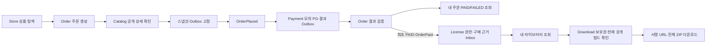

# 대표 업무 흐름

현재 완료 기준은 각 모듈의 MVP 완료 기록을 따르며, Studio는 출시 자료 관리와 심사·출시 요청·재요청 및 외부 요청 결과 기록을 담당한다. Catalog는 공개본 정본을, Store는 검색·조회 사본을 관리한다. 나머지 미완료 모듈의 흐름은 기존 구현의 참고이며 현재 검증 기준에서 제외한다.

[용어집](../domain-glossary.md) · [전체 모델 안내](model-guide.md) · [미결 질문](open-questions.md)

아래는 현재 코드에 근거한 대표 시나리오다. 정책 합의 여부는 각 정의에서 별도로 확인한다. API 요청 예제는 [API 데모](../api-demo.md), 세부 계약은 [서비스 명세](../services.md)와 각 앱의 OpenAPI 스냅샷을 사용한다.

## 창작자: 출시 자료를 관리하고 심사·출시를 요청한다

1. CREATOR 계정으로 Project를 만들고 상품 코드를 정한다.
2. 썸네일과 완성된 ZIP 하나를 업로드하고 제목·소개·영상·내용·KRW 가격을 편집한다.
3. 심사 요청에서 현재 내용과 대표 빌드를 불변 스냅샷으로 고정한다.
4. Studio는 전체 요청의 승인·반려 결과 이벤트를 반영한다. 반려 뒤 수정·재심사가 가능하다.
5. 승인된 현재 작업본의 출시를 요청한다. Studio가 출시 요청 이벤트를 발행한다.
6. Catalog의 완료·거절 결과에 맞춰 해당 출시 요청의 처리 결과를 기록한다. 실제 공개·공개본 관리에는 관여하지 않는다.
7. 상세정보를 변경하면 새 버전으로 심사 요청·출시 요청을 보낸다.

~~~mermaid
flowchart LR
 P[Project 작업본·전체 빌드] --> R[불변 심사 스냅샷]
 R --> A[외부 심사 결과]
 A --> U[상점 등록 요청]
 U --> S[등록 결과 이벤트]
 S --> P
~~~

[모델](models/studio.md) · [실행 예제](../studio-guide.md) ·
[인수 테스트](../../e2e/src/test/java/com/stove/e2e/StudioCreatorFlowTest.java)

## 심사자: Project 스냅샷을 판단한다

REVIEWER·ADMIN이 Auth에서 로그인하고 Gateway를 통해 Review의 요청 목록·상세·ZIP을 열람한다.
요청 당시 스냅샷을 승인하거나 필수 반려 사유를 입력하면 판정자·시각과 결과 Outbox를 함께 저장한다.
Studio는 같은 요청 ID·Project·버전의 승인·반려 결과를 자신의 요청 기록에 반영한다.

반려 후 재심사는 Studio가 새 요청 ID로 시작한다. 확정 판정은 변경하지 않으며 과거 자료·판정을 보존한다.
심사 중 작업본이 수정되면 과거 승인 결과는 과거 요청에만 기록되고 현재 버전의 출시 요청 조건을 충족하지 않는다.
[Review 실행·검증](../review-guide.md)은 실제 네 모듈과 Kafka로 이 흐름과 재시작 후 결과 전달을 확인한다.

## 방문자: 공개된 게임을 찾고 확인한다

Catalog는 Studio의 출시 요청 스냅샷을 공개본으로 확정하고 Studio에 결과를 보낸다.
처음 공개하거나 더 높은 버전으로 교체할 때 CatalogProductPublished도 Outbox에 함께 기록한다.
Store는 이 이벤트의 공개 데이터로 MySQL 조회 사본을 갱신한다.

방문자는 Store 목록에서 제목 검색·최신 공개순·가격순으로 찾고 코드별 상세를 확인한다.
Studio 작업본만 수정하면 Catalog와 Store는 기존 공개본을 유지하며 새 심사·출시가 끝나야 바뀐다.
Store 시작 전 공개 상품은 Catalog의 기존 목록·상세 HTTP API로 읽는다.
두 입력 경로 모두 contentVersion으로 신구를 비교하며 낮은 버전으로 되돌리지 않는다.

초기 동기화 실패는 503으로 나타나고 원인 해결 후 Store를 재시작한다.
준비된 Store는 Catalog가 잠시 중단돼도 자기 사본으로 조회한다. 구매·결제 가능 여부는 이 흐름의 범위가 아니다.
[실행·수동 확인](../store-guide.md) · [독립 인수 테스트](../../e2e/src/test/java/com/stove/e2e/StorePublicationFlowTest.java)

## 구매자: 공개 상품을 주문하고 결과를 확인한다

1. Store에서 공개 상품을 찾고 코드·contentVersion·가격을 확인한다.
2. MEMBER가 requestId·productCode·expectedContentVersion·expectedAmount로 주문한다. 구매자는 JWT sub다.
3. Order가 Catalog 공개 상세와 기존 PENDING·PAID 주문을 확인한다. 동일 상품의 추가 구매를 차단하고, 가능하면 상품·금액 스냅샷과 OrderPlaced Outbox를 함께 저장한다. 최종 FAILED 이후 새 요청은 허용한다.
4. Payment가 OrderPlaced를 내부 입력으로 바꾸고 PENDING·Inbox를 접수한다. 주기 실행이 고정 paymentId로 모의 PG를 호출하고 승인·거절 결과·Outbox를 함께 확정한다.
5. Order가 원래 주문·요청·구매자·금액·통화가 맞는 결과를 PENDING → PAID/FAILED로 반영하고 최초 PAID이면 OrderPaid Outbox를 함께 저장한다.
6. License가 OrderPaid의 출처 전체를 포함한 상품 보유권 한 행과 Inbox를 함께 저장한다. 같은 원본 재전달은 변화가 없고 다른 주문의 동일 상품은 충돌이다.
7. 구매자는 내 주문·내 결제와 내 라이브러리에서 상태·권한을 확인한다. 재출시해도 기존 스냅샷은 유지하고 Catalog 중단 중에도 기존 조회·동일 요청 재조회가 가능하다.
8. Download가 같은 사용자 JWT로 License 보유권을 조회하고 Catalog의 현재 공개 빌드와 상품 ID·코드를 대조한다.
9. 저장소 HEAD·크기 확인 후 반환한 만료 URL로 전체 ZIP을 직접 내려받고 크기·SHA-256을 확인한다. 이후 공개본도 같은 상품 보유권으로 받는다.

Order PAID와 License 지급 사이에는 이벤트 전달 지연이 있다. 추가 구매 확정 절차는 없다.
실제 PG·환불·권한 회수·정산은 후속 범위다. 다운로드 URL 발급은 License·Catalog에 동기 조회하며 파일은 저장소가 전송한다.
[주문 실행](../order-guide.md) · [Payment 검증](../payment-guide.md) · [License 조회·아홉 앱 검증](../license-guide.md) · [Download·열 앱 검증](../download-guide.md)

## 구매자·운영자: 환불하고 판매자 월 마감을 확인한다

아래는 미완료 모듈들의 재작성 전 참고 흐름이다. 현재 Order·Payment MVP는 취소·환불 API나 구 PaymentCancelled 흐름을 제공하지 않는다.

1. 구매자는 결제 서비스에 환불을 요청한다. `CANCELING`은 환불 진행 중이며 PG 완료 뒤 `CANCELED`가 된다. 사용자 주문 취소와 실제 환불 연결의 차이는 [Q9](open-questions.md#q9)를 확인한다.
2. `PaymentCancelled`를 받아 주문을 취소하고, 이용권을 회수하고, 원매출에 대응하는 환불 원장을 추가한다. `LicenseRevoked`는 보유권 사본에 반영된다. 원장 매출 행은 환불로 삭제하지 않는다.
3. 운영자는 PG 오류로 남은 `CANCELING`의 재시도 결과와 이벤트 반영 상태를 확인한다. 지급 최종 실패 보상도 같은 환불 경로를 사용한다. 결제창 만료 후 승인은 `PaymentCompleted` 없이 자동 환불하므로 정상 매출·지급 흐름과 다르다.
4. 운영자는 판매자·귀속 월별 [월 마감](models/settlement.md#seller-settlement)을 수행한다. 미마감 원장만 합산하고, 양수 정산액에 계산서 번호가 없으면 별도 발행을 시도한다.
5. 같은 월의 미마감 원장이 나중에 생기면 재마감 시 기존 합계에 더하고 `adjustment*`에 기록한다. 최초 `base*` 금액은 유지하며, 마감 매출의 환불에는 `adjustmentForMonth`로 원래 월을 연결한다. 대사 API로 원장·마감 차이를 확인한다. 실제 수정계산서, 월 경계 지연, 송금과 이월 정책은 [Q6](open-questions.md#q6)에서 결정한다.

**중단·예외:** PG 오류 응답 뒤 환불 완료로 표시하지 않는다. 원장 합계가 음수라고 다음 달 원장으로 자동 이월된 것으로 표현하지 않는다. 판매 중지 자체는 기존 구매 이용권을 회수하지 않는다.

근거: 구 Payment 환불 실험(현재 제거됨), `LicenseIdempotencyTest`(재작성 전 테스트, 현재 제거됨), [SettlementCloseTest](../../apps/settlement/src/integrationTest/java/com/stove/settlement/core/service/SettlementCloseTest.java). 장애 운영은 [복원 시나리오](../resilience-scenarios.md), [이용권 복구 절차](../runbooks/license-db-loss.md)를 참고한다.

## 이벤트를 업무 사실로 읽기

이벤트 이름은 명령이나 수신 서비스 전체의 완료 응답이 아니다. 발신 측의 사실을 수신 측이 자기 업무 기록에 반영한다. 전송·중복·순서 조건은 [event-ordering.md](../event-ordering.md)에 정리되어 있다.

| 이벤트 | 발생한 업무 사실 | 수신 측에 반영되는 의미 |
|---|---|---|
| `SubmissionCreated` | 자료·빌드 묶음에 심사를 요청함 | Review가 스냅샷과 유형별 심사 사건 생성 |
| `SubmissionReviewApproved` | 한 유형의 심사를 승인함 | Studio가 같은 스냅샷인지 확인하고 관문 승인 반영 |
| `ReviewChangesRequested` / `ReviewAppealed` | 보완을 요청함 / 같은 사건의 재검토를 시작함 | Studio가 관문과 제출 상태 갱신 |
| `BuildValidated` | 업로드 파일 검증을 통과함 | 검증 완료 알림에 사용. 이 사실만으로 구매자 공개·이용권 지급이 되지 않음 |
| `ReleaseScheduled` | 릴리스 공개 시각을 예약함 | 예약 사실을 알림. 공개·판매 완료가 아님 |
| `ReleasePublished` (구 계약) | 재작성 전 LIVE 공개 | 현재 Catalog·Download는 소비하지 않음 |
| `CatalogProductPublished` | Catalog 최초 공개·현재 공개본 교체 | Store가 공개 상품 사본 갱신 |
| `ProductChanged` (구 계약) | 재작성 전 상품 마스터 변경 | 재작성 전 참고 계약. 현재 Catalog·Store·Download에서는 사용하지 않음 |
| `OrderPlaced` | 단일 상품 주문·정가·할인액·청구액 고정 | Payment의 결제 접수·공급자 호출 근거 |
| `OrderPaymentCompleted` / `OrderPaymentFailed` | 원래 주문 요청에 대한 최종 결제 결과 계약 | Order가 연결·금액 검증 후 PAID/FAILED 반영 |
| `OrderPaid` | Order가 최초 결제 완료 결과를 자기 주문과 대조해 PAID 반영 | License가 상품별 권한·주문별 구매 근거 저장 |
| `OrderCreated` (구 계약) | 재작성 전 주문 항목·금액 고정 | 현재 Payment는 소비하지 않는 구 계약 |
| `PaymentCompleted` | 정상 승인 금액을 결제 완료로 기록함 | 재작성 전 License·Settlement 입력. 현재 License·Order·Payment는 사용하지 않음 |
| `PaymentFailed` | PG 승인 거절을 기록함 | 구 주문 결과 계약. 새 Order에서는 사용하지 않음 |
| `LicenseIssued` / `LicenseRevoked` (구 계약) | 이용권 지급 / 회수를 기록함 | 제거된 Download 사본의 구 계약. 현재 License는 발행하지 않고 Download도 소비하지 않음 |
| `PaymentCancelled` | PG 환불 완료를 기록함 | 재작성 전 License 회수·Settlement 환불 원장 기록의 구 계약 |
| `LicenseIssueFailed` | 이용권 지급이 최종 실패함 | 구 Payment 보상 입력. 현재 Payment는 소비하지 않음 |

구현 계약: [이벤트 payload](../../common/kafka/src/main/java/com/stove/common/kafka/contract/payload/), [Studio의 심사 결과 반영](../../apps/studio/src/main/java/com/stove/studio/core/service/review/RecordProjectReviewResult.java), [Download 동기 조회](../../apps/download/src/main/java/com/stove/download/core/service/ReadBuildDownload.java).

`GameRegistered → ReviewApproved/ReviewRejected`, `BuildUploaded`는 프로젝트 단위의 기존 호환 경로다. 새 자료·빌드 묶음의 심사·LIVE 공개를 설명할 때 이 이벤트만으로 대체하지 않는다. 경로 유지·폐기 결정은 [Q2](open-questions.md#q2), `ReleaseRolledBack`의 성공 의미는 [Q10](open-questions.md#q10)에 남긴다.
