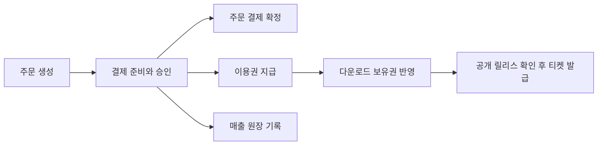

# 대표 업무 흐름

현재 완료 기준은 Auth·Gateway이며, Studio는 출시 자료 관리와 심사·출시 요청·재요청 및 외부 요청 결과 기록을 담당한다. 다른 모듈의 흐름은 기존 구현의 참고이며 현재 검증 기준에서 제외한다.

[용어집](../domain-glossary.md) · [전체 모델 안내](model-guide.md) · [미결 질문](open-questions.md)

아래는 현재 코드에 근거한 대표 시나리오다. 정책 합의 여부는 각 정의에서 별도로 확인한다. API 요청 예제는 [API 데모](../api-demo.md), 세부 계약은 [서비스 명세](../services.md)와 각 앱의 OpenAPI 스냅샷을 사용한다.

## 창작자: 출시 자료를 관리하고 심사·출시를 요청한다

1. CREATOR 계정으로 Project를 만들고 상품 코드를 정한다.
2. 썸네일과 완성된 ZIP 하나를 업로드하고 제목·소개·영상·내용·KRW 가격을 편집한다.
3. 심사 요청에서 현재 내용과 대표 빌드를 불변 스냅샷으로 고정한다.
4. Studio는 전체 요청의 승인·반려 결과 이벤트를 반영한다. 반려 뒤 수정·재심사가 가능하다.
5. 승인된 현재 작업본의 출시를 요청한다. Studio가 출시 요청 이벤트를 발행한다.
6. 현재 등록 성공 결과에 맞춰 해당 출시 요청의 처리 결과를 기록한다. 실제 공개·공개본 관리에는 관여하지 않는다.
7. 상세정보를 변경하면 새 버전으로 심사 요청·출시 요청을 보낸다.

~~~mermaid
flowchart LR
 P[Project 작업본·전체 빌드] --> R[불변 심사 스냅샷]
 R --> A[외부 심사 결과]
 A --> U[상점 등록 요청]
 U --> S[등록 결과 이벤트]
 S --> P
~~~

[모델](models/studio.md) · [실행 예제](../studio-guide.md) ·
[인수 테스트](../../e2e/src/test/java/com/stove/e2e/StudioCreatorFlowTest.java)

## 심사자: Project 스냅샷을 판단한다

현재 Studio는 심사 요청 스냅샷을 발행하고 승인·반려 결과 이벤트를 반영한다.
결과에는 요청 ID·Project·작업본 버전과 처리자·피드백을 포함한다.
실제 심사 서비스는 미완료 모듈이며 해당 HTTP API는 현재 구현·검증 기준에 포함하지 않는다.
테스트는 실제 Kafka의 결과 픽스처로 현재 요청·버전 확인과 지연·중복 응답 처리를 검증한다.

## 구매자: 주문·결제 후 이용한다

예시: 구매자 지수는 판매 중인 `GAME-A` 한 개를 구매한다.

1. 상품을 조회하고 Catalog의 `productId`로 [주문](models/order-payment.md#order)한다. 서버가 판매 상태와 활성 할인 행사를 확인하고, 결제액·할인 부담·정산 금액 사본을 고정한다. 구매자는 로그인 정보로 정한다.
2. `OrderCreated`가 전달되면 [결제](models/order-payment.md#payment) 대기가 생성된다. 결제를 준비해 PG 사전등록 거래와 금액을 정한다.
3. 인증된 승인 콜백의 거래·금액이 일치하면 정상 결제 완료 사실을 발행한다. 주문은 `PAID`, [이용권](models/fulfillment.md#license)은 `ACTIVE`, [정산 원장](models/settlement.md#settlement-record)은 `SALE`로 각각 반영된다.
4. 라이브러리에서 이용권을 확인한다. `LicenseIssued`가 전달되면 Download의 [보유권 사본](models/fulfillment.md#entitlement)이 활성화된다.
5. 상품 코드로 다운로드 티켓을 요청한다. 보유권과 공개 릴리스가 준비되어 있으면 등록된 전체 빌드의 파일 URL을 받는다. 기존 플랫폼 변형 다운로드는 과거 공개 자료의 호환 경로다.

**중단·예외:** 기대 금액 불일치나 판매 중지 상품은 주문 단계에서 거절한다. 승인 거절은 `FAILED`로 끝나며 이용권을 지급하지 않는다. 결제 성공 뒤 이용권이나 보유권 반영이 지연될 수 있다. 지급 최종 실패의 보상은 환불 경로를 사용한다. 늦은 승인·취소·환불은 아래에서 따로 확인한다.

근거: [TrackBCommerceFlowTest](../../e2e/src/test/java/com/stove/e2e/TrackBCommerceFlowTest.java), [TrackCFulfillmentFlowTest](../../e2e/src/test/java/com/stove/e2e/TrackCFulfillmentFlowTest.java), [PaymentFailurePathTest](../../e2e/src/test/java/com/stove/e2e/PaymentFailurePathTest.java). 인증 요청 형식은 [인증·권한 계약](../security.md).

## 구매자·운영자: 환불하고 판매자 월 마감을 확인한다

1. 구매자는 결제 서비스에 환불을 요청한다. `CANCELING`은 환불 진행 중이며 PG 완료 뒤 `CANCELED`가 된다. 사용자 주문 취소와 실제 환불 연결의 차이는 [Q9](open-questions.md#q9)를 확인한다.
2. `PaymentCancelled`를 받아 주문을 취소하고, 이용권을 회수하고, 원매출에 대응하는 환불 원장을 추가한다. `LicenseRevoked`는 보유권 사본에 반영된다. 원장 매출 행은 환불로 삭제하지 않는다.
3. 운영자는 PG 오류로 남은 `CANCELING`의 재시도 결과와 이벤트 반영 상태를 확인한다. 지급 최종 실패 보상도 같은 환불 경로를 사용한다. 결제창 만료 후 승인은 `PaymentCompleted` 없이 자동 환불하므로 정상 매출·지급 흐름과 다르다.
4. 운영자는 판매자·귀속 월별 [월 마감](models/settlement.md#seller-settlement)을 수행한다. 미마감 원장만 합산하고, 양수 정산액에 계산서 번호가 없으면 별도 발행을 시도한다.
5. 같은 월의 미마감 원장이 나중에 생기면 재마감 시 기존 합계에 더하고 `adjustment*`에 기록한다. 최초 `base*` 금액은 유지하며, 마감 매출의 환불에는 `adjustmentForMonth`로 원래 월을 연결한다. 대사 API로 원장·마감 차이를 확인한다. 실제 수정계산서, 월 경계 지연, 송금과 이월 정책은 [Q6](open-questions.md#q6)에서 결정한다.

**중단·예외:** PG 오류 응답 뒤 환불 완료로 표시하지 않는다. 원장 합계가 음수라고 다음 달 원장으로 자동 이월된 것으로 표현하지 않는다. 판매 중지 자체는 기존 구매 이용권을 회수하지 않는다.

근거: [StrandedRefundResumeTest](../../apps/payment/src/integrationTest/java/com/stove/payment/core/service/StrandedRefundResumeTest.java), [LicenseIdempotencyTest](../../apps/license/src/integrationTest/java/com/stove/license/core/service/LicenseIdempotencyTest.java), [SettlementCloseTest](../../apps/settlement/src/integrationTest/java/com/stove/settlement/core/service/SettlementCloseTest.java). 장애 운영은 [복원 시나리오](../resilience-scenarios.md), [이용권 복구 절차](../runbooks/license-db-loss.md)를 참고한다.

## 이벤트를 업무 사실로 읽기

이벤트 이름은 명령이나 수신 서비스 전체의 완료 응답이 아니다. 발신 측의 사실을 수신 측이 자기 업무 기록에 반영한다. 전송·중복·순서 조건은 [event-ordering.md](../event-ordering.md)에 정리되어 있다.

| 이벤트 | 발생한 업무 사실 | 수신 측에 반영되는 의미 |
|---|---|---|
| `SubmissionCreated` | 자료·빌드 묶음에 심사를 요청함 | Review가 스냅샷과 유형별 심사 사건 생성 |
| `SubmissionReviewApproved` | 한 유형의 심사를 승인함 | Studio가 같은 스냅샷인지 확인하고 관문 승인 반영 |
| `ReviewChangesRequested` / `ReviewAppealed` | 보완을 요청함 / 같은 사건의 재검토를 시작함 | Studio가 관문과 제출 상태 갱신 |
| `BuildValidated` | 업로드 파일 검증을 통과함 | 검증 완료 알림에 사용. 이 사실만으로 구매자 공개·이용권 지급이 되지 않음 |
| `ReleaseScheduled` | 릴리스 공개 시각을 예약함 | 예약 사실을 알림. 공개·판매 완료가 아님 |
| `ReleasePublished` | LIVE에 자료·빌드 묶음을 공개함 | Catalog가 상품·판매 상태 반영, Download가 릴리스 매니페스트 반영 |
| `ProductChanged` | 상품의 가격·상태·릴리스 참조 등이 바뀜 | Store가 진열 사본, Download가 상품 코드↔ID·릴리스 참조 갱신 |
| `OrderCreated` | 주문 항목·금액이 고정됨 | Payment가 결제 대기 생성 |
| `PaymentCompleted` | 정상 승인 금액을 결제 완료로 기록함 | Order 결제 확정, License 이용권 지급, Settlement 매출 기록 |
| `PaymentFailed` | PG 승인 거절을 기록함 | Order가 실패로 종료 |
| `LicenseIssued` / `LicenseRevoked` | 이용권 지급 / 회수를 기록함 | Download가 보유권 사본에 반영 |
| `PaymentCancelled` | PG 환불 완료를 기록함 | Order 취소, License 회수, Settlement 환불 원장 기록 |
| `LicenseIssueFailed` | 이용권 지급이 최종 실패함 | Payment 보상 환불 경로의 시작점 |

구현 계약: [이벤트 payload](../../common/kafka/src/main/java/com/stove/common/kafka/contract/payload/), [Studio의 심사 결과 반영](../../apps/studio/src/main/java/com/stove/studio/core/service/review/RecordProjectReviewResult.java), [Download 리스너](../../apps/download/src/main/java/com/stove/download/api/listener/DownloadEventListener.java).

`GameRegistered → ReviewApproved/ReviewRejected`, `BuildUploaded`는 프로젝트 단위의 기존 호환 경로다. 새 자료·빌드 묶음의 심사·LIVE 공개를 설명할 때 이 이벤트만으로 대체하지 않는다. 경로 유지·폐기 결정은 [Q2](open-questions.md#q2), `ReleaseRolledBack`의 성공 의미는 [Q10](open-questions.md#q10)에 남긴다.
