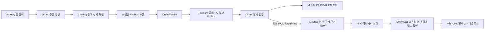

# 대표 업무 흐름

현재 완료 기준은 각 모듈의 MVP 완료 기록을 따르며, Studio는 출시 자료 관리와 심사·출시 요청·재요청 및 외부 요청 결과 기록을 담당한다. Catalog는 공개본 정본을, Store는 검색·조회 사본을 관리한다. 나머지 미완료 모듈의 흐름은 기존 구현의 참고이며 현재 검증 기준에서 제외한다.

[용어집](../domain-glossary.md) · [전체 모델 안내](model-guide.md) · [미결 질문](open-questions.md)

아래는 현재 코드에 근거한 대표 시나리오다. 정책 합의 여부는 각 정의에서 별도로 확인한다. API 요청 예제는 [API 데모](../api-demo.md), 세부 계약은 [서비스 명세](../services.md)와 각 앱의 OpenAPI 스냅샷을 사용한다.

## 창작자: 출시 자료를 관리하고 심사·출시를 요청한다

1. CREATOR 계정으로 Project를 만들고 상품 코드를 정한다.
2. 썸네일과 완성된 ZIP 하나를 업로드하고 제목·소개·영상·내용·KRW 가격을 편집한다.
3. 심사 요청에서 현재 내용과 대표 빌드를 불변 스냅샷으로 고정한다.
4. Studio는 전체 요청의 승인·반려 결과 이벤트를 반영한다. 반려 뒤 수정·재심사가 가능하다.
5. 승인된 현재 작업본의 출시를 요청한다. Studio가 출시 요청 이벤트를 발행한다.
6. Catalog의 완료·거절 결과에 맞춰 해당 출시 요청의 처리 결과를 기록한다. 실제 공개·공개본 관리에는 관여하지 않는다.
7. 상세정보를 변경하면 새 버전으로 심사 요청·출시 요청을 보낸다.

~~~mermaid
flowchart LR
 P[Project 작업본·전체 빌드] --> R[불변 심사 스냅샷]
 R --> A[외부 심사 결과]
 A --> U[상점 등록 요청]
 U --> S[등록 결과 이벤트]
 S --> P
~~~

[모델](models/studio.md) · [실행 예제](../../.kiro/specs/studio/design.md#사용-안내) ·
[인수 테스트](../../e2e/src/test/java/com/stove/e2e/StudioCreatorFlowTest.java)

## 심사자: Project 스냅샷을 판단한다

REVIEWER·ADMIN이 Auth에서 로그인하고 Gateway를 통해 Review의 요청 목록·상세·ZIP을 열람한다.
요청 당시 스냅샷을 승인하거나 필수 반려 사유를 입력하면 판정자·시각과 결과 Outbox를 함께 저장한다.
Studio는 같은 요청 ID·Project·버전의 승인·반려 결과를 자신의 요청 기록에 반영한다.

반려 후 재심사는 Studio가 새 요청 ID로 시작한다. 확정 판정은 변경하지 않으며 과거 자료·판정을 보존한다.
심사 중 작업본이 수정되면 과거 승인 결과는 과거 요청에만 기록되고 현재 버전의 출시 요청 조건을 충족하지 않는다.
[Review 실행·검증](../../.kiro/specs/review/design.md#사용-안내)은 실제 네 모듈과 Kafka로 이 흐름과 재시작 후 결과 전달을 확인한다.

## 방문자: 공개된 게임을 찾고 확인한다

Catalog는 Studio의 출시 요청 스냅샷을 공개본으로 확정하고 Studio에 결과를 보낸다.
처음 공개하거나 더 높은 버전으로 교체할 때 CatalogProductPublished도 Outbox에 함께 기록한다.
Store는 이 이벤트의 공개 데이터로 MySQL 조회 사본을 갱신한다.

방문자는 Store 목록에서 제목 검색·최신 공개순·가격순으로 찾고 코드별 상세를 확인한다.
Studio 작업본만 수정하면 Catalog와 Store는 기존 공개본을 유지하며 새 심사·출시가 끝나야 바뀐다.
Store 시작 전 공개 상품은 Catalog의 기존 목록·상세 HTTP API로 읽는다.
두 입력 경로 모두 contentVersion으로 신구를 비교하며 낮은 버전으로 되돌리지 않는다.

초기 동기화 실패는 503으로 나타나고 원인 해결 후 Store를 재시작한다.
준비된 Store는 Catalog가 잠시 중단돼도 자기 사본으로 조회한다. 구매·결제 가능 여부는 이 흐름의 범위가 아니다.
[실행·수동 확인](../../.kiro/specs/store/design.md#사용-안내) · [독립 인수 테스트](../../e2e/src/test/java/com/stove/e2e/StorePublicationFlowTest.java)

## 구매자: 공개 상품을 주문하고 결과를 확인한다

1. Store에서 공개 상품을 찾고 코드·contentVersion·가격을 확인한다.
2. MEMBER가 requestId·productCode·expectedContentVersion·expectedAmount로 주문한다. 구매자는 JWT sub다.
3. Order가 Catalog 공개 상세와 기존 PENDING·PAID 주문을 확인한다. 동일 상품의 추가 구매를 차단하고, 가능하면 상품·금액 스냅샷과 OrderPlaced Outbox를 함께 저장한다. 최종 FAILED 이후 새 요청은 허용한다.
4. Payment가 OrderPlaced를 내부 입력으로 바꾸고 PENDING·Inbox를 접수한다. 주기 실행이 고정 paymentId로 모의 PG를 호출하고 승인·거절 결과·Outbox를 함께 확정한다.
5. Order가 원래 주문·요청·구매자·금액·통화가 맞는 결과를 PENDING → PAID/FAILED로 반영하고 최초 PAID이면 OrderPaid Outbox를 함께 저장한다.
6. License가 OrderPaid의 출처 전체를 포함한 상품 보유권 한 행과 Inbox를 함께 저장한다. 같은 원본 재전달은 변화가 없고 다른 주문의 동일 상품은 충돌이다.
7. 구매자는 내 주문·내 결제와 내 라이브러리에서 상태·권한을 확인한다. 재출시해도 기존 스냅샷은 유지하고 Catalog 중단 중에도 기존 조회·동일 요청 재조회가 가능하다.
8. Download가 같은 사용자 JWT로 License 보유권을 조회하고 Catalog의 현재 공개 빌드와 상품 ID·코드를 대조한다.
9. 저장소 HEAD·크기 확인 후 반환한 만료 URL로 전체 ZIP을 직접 내려받고 크기·SHA-256을 확인한다. 이후 공개본도 같은 상품 보유권으로 받는다.

Order PAID와 License 지급 사이에는 이벤트 전달 지연이 있다. 추가 구매 확정 절차는 없다.
실제 PG·환불·권한 회수·판매자 송금은 후속 범위다. Settlement는 OrderPaid를 받아 PG·Catalog 근거를 대조하고 매출·월 합계를 기록한다. 다운로드 URL 발급은 License·Catalog에 동기 조회하며 파일은 저장소가 전송한다.
[주문 실행](../../.kiro/specs/order/design.md#사용-안내) · [Payment 검증](../../.kiro/specs/payment/design.md#사용-안내) · [License 조회·아홉 앱 검증](../../.kiro/specs/license/design.md#사용-안내) · [Download·열 앱 검증](../../.kiro/specs/download/design.md#사용-안내)

## 운영자: PG 명세를 대사하고 판매자 금액을 마감한다

1. Settlement가 OrderPaid의 전체 입력과 외부 PG 승인·비용, Catalog 불변 소유자를 대조하고 매출·월 합계·Inbox를 함께 저장한다.
2. 외부 모의 PG가 미정산 승인 거래의 지급 명세를 자기 DB에 확정한다. 검증 운영자가 PG 제어 API로 회차를 실행하며 Payment·Settlement가 생성하지 않는다.
3. ADMIN이 기존 정산번호로 명세를 수집하면 Settlement가 공급자 원문 값 전체를 보존하고 매출과 대조한다.
4. 내부 매출이 없으면 REPORTED_PAID로 기다리고 값이 다르면 MISMATCH로 남긴다. 모든 항목이 일치하면 SIMULATED_RECEIVED로 모의 수령을 한 번 확정한다.
5. ADMIN은 현재 KST 월보다 이전 월을 판매자별로 마감한다. CLOSED 이후 지연 매출은 현재 월에 기록하고 원래 saleMonth를 보존한다.

PG 회차·플랫폼 모의 수령·판매자 월 마감은 별개의 주기와 상태다. 실제 은행 입금·판매자 송금·환불·계산서·재마감은 후속 범위다.
실행·복구는 [정산 안내](../../.kiro/specs/settlement/design.md#사용-안내), 모델은 [정산 모델](models/settlement.md)을 따른다.

## 이벤트를 업무 사실로 읽기

이벤트 이름은 명령이나 수신 서비스 전체의 완료 응답이 아니다. 발신 측의 사실을 수신 측이 자기 업무 기록에 반영한다. 전송·중복·순서 조건은 [event-ordering.md](../event-ordering.md)에 정리되어 있다.

| 이벤트 | 발생한 업무 사실 | 수신 측에 반영되는 의미 |
|---|---|---|
| `SubmissionCreated` | 자료·빌드 묶음에 심사를 요청함 | Review가 스냅샷과 유형별 심사 사건 생성 |
| `SubmissionReviewApproved` | 한 유형의 심사를 승인함 | Studio가 같은 스냅샷인지 확인하고 관문 승인 반영 |
| `ReviewChangesRequested` / `ReviewAppealed` | 보완을 요청함 / 같은 사건의 재검토를 시작함 | Studio가 관문과 제출 상태 갱신 |
| `BuildValidated` | 업로드 파일 검증을 통과함 | 검증 완료 알림에 사용. 이 사실만으로 구매자 공개·이용권 지급이 되지 않음 |
| `ReleaseScheduled` | 릴리스 공개 시각을 예약함 | 예약 사실을 알림. 공개·판매 완료가 아님 |
| `ReleasePublished` (구 계약) | 재작성 전 LIVE 공개 | 현재 Catalog·Download는 소비하지 않음 |
| `CatalogProductPublished` | Catalog 최초 공개·현재 공개본 교체 | Store가 공개 상품 사본 갱신 |
| `ProductChanged` (구 계약) | 재작성 전 상품 마스터 변경 | 재작성 전 참고 계약. 현재 Catalog·Store·Download에서는 사용하지 않음 |
| `OrderPlaced` | 단일 상품 주문·정가·할인액·청구액 고정 | Payment의 결제 접수·공급자 호출 근거 |
| `OrderPaymentCompleted` / `OrderPaymentFailed` | 원래 주문 요청에 대한 최종 결제 결과 계약 | Order가 연결·금액 검증 후 PAID/FAILED 반영 |
| `OrderPaid` | Order가 최초 결제 완료 결과를 자기 주문과 대조해 PAID 반영 | License가 상품별 권한·구매 근거 저장, Settlement가 매출·배분 기록 |
| `OrderCreated` (구 계약) | 재작성 전 주문 항목·금액 고정 | 현재 Payment는 소비하지 않는 구 계약 |
| `PaymentCompleted` | 정상 승인 금액을 결제 완료로 기록함 | 재작성 전 License·Settlement 입력. 현재 License·Order·Payment·Settlement는 사용하지 않음 |
| `PaymentFailed` | PG 승인 거절을 기록함 | 구 주문 결과 계약. 새 Order에서는 사용하지 않음 |
| `LicenseIssued` / `LicenseRevoked` (구 계약) | 이용권 지급 / 회수를 기록함 | 제거된 Download 사본의 구 계약. 현재 License는 발행하지 않고 Download도 소비하지 않음 |
| `PaymentCancelled` | PG 환불 완료를 기록함 | 재작성 전 License 회수·Settlement 환불 원장 기록의 구 계약 |
| `LicenseIssueFailed` | 이용권 지급이 최종 실패함 | 구 Payment 보상 입력. 현재 Payment는 소비하지 않음 |

구현 계약: [이벤트 payload](../../common/kafka/src/main/java/com/stove/common/kafka/contract/payload/), [Studio의 심사 결과 반영](../../apps/studio/src/main/java/com/stove/studio/core/service/review/RecordProjectReviewResult.java), [Download 동기 조회](../../apps/download/src/main/java/com/stove/download/core/service/ReadBuildDownload.java).

`GameRegistered → ReviewApproved/ReviewRejected`, `BuildUploaded`는 프로젝트 단위의 기존 호환 경로다. 새 자료·빌드 묶음의 심사·LIVE 공개를 설명할 때 이 이벤트만으로 대체하지 않는다. 경로 유지·폐기 결정은 [Q2](open-questions.md#q2), `ReleaseRolledBack`의 성공 의미는 [Q10](open-questions.md#q10)에 남긴다.

## 모듈 간 돈 불변식 (결정 143 2부)

이 절은 다음 단계인 불변식 검사기(`tools/verification/`)의 명세다. 행마다 하나의 검사가 된다. 새 정책이 아니라 main `7f3617e1`의 코드·이행 파일이 이미 지키는 것만 옮겼다([결정 143](../decisions.md#money-spec-first)). 지금 보장되지 않는 것은 표에 넣지 않고 아래 "확인되지 않은 것"에 적었다. 각 모듈 집합체의 상태와 전이는 [Payment](../../.kiro/specs/payment/design.md#상태이벤트-표-코드-기준-결정-143)·[Order](../../.kiro/specs/order/design.md#상태이벤트-표-코드-기준-결정-143)·[License](../../.kiro/specs/license/design.md#상태이벤트-표-코드-기준-결정-143)·[Settlement](../../.kiro/specs/settlement/design.md#상태이벤트-표-코드-기준-결정-143)의 상태×이벤트 표를 따른다.

- DB는 같은 MySQL 서버의 모듈별 스키마(`stove_order`·`stove_payment`·`stove_license`·`stove_settlement`)다. 아래 SQL은 모든 스키마를 읽을 수 있는 읽기 전용 계정에서 스키마 이름을 붙여 쓰며, 결과 행이 0이어야 통과다. 실제 실행으로 확인하지는 않았다.
- 모듈 사이 반영은 이벤트 전달 뒤에 일어난다. 그래서 표는 "뒤 모듈의 기록이 있으면 앞 모듈의 근거가 있다"(역방향)를 적는다. "앞 모듈 기록이 있으면 뒤 모듈도 반드시 반영된다"(정방향)는 보장되지 않아 "확인되지 않은 것" U4에 둔다.
- "지금 지키는 곳"은 이번에 코드·이행 파일을 직접 읽어 확인했다. 상태×이벤트 표만 보고 적은 것은 "(표 기준)"으로 표시했다.

| 번호 | 불변식 | 걸친 모듈 | 지금 지키는 곳 | 확인 방법 | 근거 |
|---|---|---|---|---|---|
| I1 | 청구액은 주문 때 한 번 고정되고(`purchase_order.amount = list_amount − discount_amount > 0`), 같은 `order_no`의 `purchase_payment.amount`·`currency`와 같다. PG 결과는 이 금액·통화에 대해서만 확정되고(`purchase_payment.status`=`PAID`), PG 결제 구성은 `pg_paid_amount + pg_discount_amount = amount`다. Order는 금액·통화가 같은 결과만 `PAID`/`FAILED`로 반영한다 | Order·Payment | DB `chk_purchase_order_price`·`chk_purchase_payment_price`·`ck_payment_provider_amounts`·`ck_order_provider_amounts`. 코드 `Payment.confirm` → `PgResult.requireRequest`, `PgPaymentAmounts.requireTotal`(`PgResult` 생성자), `Order.apply` → `Order.requireConnection`, `ProviderPaymentAmounts.requireTotal`(`PaymentResult`) | `SELECT o.order_no FROM stove_order.purchase_order o JOIN stove_payment.purchase_payment p ON p.order_no=o.order_no WHERE o.amount<>p.amount OR o.currency<>p.currency OR (o.status='PAID' AND (p.status<>'PAID' OR o.payment_id<>p.payment_id))` | Order R4.1·R4.5, Payment R3.1·R3.10 |
| I2 | 환불은 원결제 전액이다. `refund_execution.amount`는 `PAID` 결제의 `amount`와 같고, 금융 확인(`refund_confirmed_at`)은 취소 합계가 원결제액과 같을 때만 생긴다. Order `order_refund`의 `COMPLETED`는 확인 금액 = `purchase_order.amount`일 때만 되고, Settlement `settlement_refund`의 `amount`·`platform_fee_amount`·`seller_payout_amount`는 원매출 `settlement_sale`의 값과 같다 | Order·Payment·Settlement | 코드 `RefundExecution.receive` → `Payment.requireRefundRequest`, `PgRefundConfirmation`(합계 ≠ `purchase.amount`면 거절), `RefundExecution.confirmCancellationSuccess`(취소 1건·금액 = `amount`), `Refund.confirmPayment` → `verifyPaymentIdentity`, `ConfirmedRefund.requireSale`, `ReverseOriginalFullRefundPolicy.allocate`. DB `chk_refund_execution_price`, `ck_refund_money`, `fk_refund_sale` | `SELECT r.refund_id FROM stove_settlement.settlement_refund r JOIN stove_settlement.settlement_sale s ON s.order_no=r.order_no WHERE r.amount<>s.amount OR r.platform_fee_amount<>s.platform_fee_amount OR r.seller_payout_amount<>s.seller_payout_amount`; `SELECT e.attempt_id FROM stove_payment.refund_execution e JOIN stove_payment.purchase_payment p ON p.payment_id=e.payment_id WHERE e.amount<>p.amount OR p.status<>'PAID'` | Payment R7.1·R7.4, Order R7.1, Settlement R6.3·R6.4, 결정 41 |
| I3 | 보유권 `license_registration.status`=`ACTIVE`이면 그 `license_id`의 `product_license.status`=`REGISTERED`이고, 그 구매 근거는 `OrderPaid`로만 생겼으며(주문당 1행), Order의 같은 `order_no`는 `PAID`·같은 `payment_id`다. 고객·상품당 `ACTIVE`는 1개, 구매 근거당 열린 보유권은 1개다 | Order·License | 코드 `ApplyPaymentResult.execute`(첫 `PAID` 반영 때만 `OrderPaid` Outbox), `GrantLicense.execute`·`License.grant`(구매 근거는 `OrderPaid`에서만 생성), `License.register`(`STORED`만), `License.suspend`·`restore`·`refund`(보유권은 구매 근거 메서드 안에서만 바뀜). DB `fk_license_registration_purchase`, `uk_license_registration_active`, `uk_license_registration_open`, `uk_product_license_order`·`uk_product_license_payment`·`uk_product_license_result` | `SELECT r.registration_id FROM stove_license.license_registration r JOIN stove_license.product_license l ON l.license_id=r.license_id LEFT JOIN stove_order.purchase_order o ON o.order_no=l.order_no WHERE r.status='ACTIVE' AND (l.status<>'REGISTERED' OR o.status IS NULL OR o.status<>'PAID' OR o.payment_id<>l.payment_id)` | License R1-1·R10-3, 결정 93·95 |
| I4 | 환불 완료는 앞 모듈의 금융 확인 없이 생기지 않는다. Order `order_refund.status`=`COMPLETED`이면 같은 `refund_id`의 `refund_execution.refund_confirmed_at`이 있다. License `product_license.status`=`REFUNDED`이면 Order의 그 주문 환불이 `COMPLETED`다. `settlement_refund` 행이 있으면 같은 `refund_id`의 `refund_execution.refund_confirmed_at`이 있다 | Order·Payment·License·Settlement | 코드 `RefundExecution.confirmRefund`·`confirmCancellationSuccess`(첫 금융 확인), 그 뒤에만 `RefundPaymentConfirmed` Outbox를 쓰는 `ReconcileRefundPayment.execute`(`RefundConfirmationOutbox.recordUnattributed`)·`RecordRefundCancellationSuccess.execute`, `ApplyRefundPaymentConfirmation.execute`(`Refund.confirmPayment`가 바뀐 때만 `PurchaseRefunded` Outbox), `License.refund`(`SUSPENDED`이고 `suspensionRequestEventId` 일치), `RecordConfirmedRefund.record`(`ConfirmedRefund.requireSale`·`PgRefund.requireConfirmation`). Order가 실행을 요청하는 것은 `LicenseSuspended` 뒤뿐이다(`ApplyRefundSuspension.execute`). DB `chk_order_refund_payment_confirmation`, `chk_refund_payment_confirmation` | `SELECT o.refund_id FROM stove_order.order_refund o LEFT JOIN stove_payment.refund_execution e ON e.refund_id=o.refund_id AND e.refund_confirmed_at IS NOT NULL WHERE o.status='COMPLETED' AND e.refund_id IS NULL`; `SELECT l.order_no FROM stove_license.product_license l LEFT JOIN stove_order.order_refund o ON o.order_no=l.order_no AND o.status='COMPLETED' WHERE l.status='REFUNDED' AND o.order_no IS NULL`; `settlement_refund`와 `refund_execution`을 `refund_id`로 같은 방식으로 대조 | Order R7.1·R9.3, License R11-1, Settlement R6.3, 결정 29·96·97 |
| I5 | 판매자 월 순액 = 매출 배분 − 환불 조정이고, 지급 기준액은 이월을 더해 정한다. CLOSED `seller_monthly_settlement`의 `seller_payout_amount`·`refunded_seller_payout_amount`(와 건수)는 그 월(`settlement_month`)의 `settlement_sale.seller_payout_amount`·`settlement_refund.seller_payout_amount` 합계와 같다. `settlement_seller_carryover`에서 `net_seller_payout_amount + carried_in = payable + carried_out`, `payable = max(0, net + carried_in)`, `carried_in`은 앞의 마지막 CLOSED 월(`source_month`)의 `carried_out`(없으면 0)이다 | Settlement(입력: Order `OrderPaid`·Payment `RefundPaymentConfirmed`) | 코드 `SellerMonthlySettlement.close`(원장 합계·건수와 월 합계가 다르면 409), `SellerMonthlySettlement.getNetSellerPayoutAmount`, `CloseSellerMonth.close`·`carry`, `SellerMonthBalance.settle`·`of`. DB `ck_month_allocation`, `ck_month_refund_allocation`, `ck_seller_carryover_amount`, `ck_seller_carryover_source`, `uk_seller_carryover_month`, `uk_seller_carryover_source`(V15) | CLOSED 월마다 `SUM(settlement_sale.seller_payout_amount)`·`SUM(settlement_refund.seller_payout_amount)`를 `(seller_subject, settlement_month)`로 묶어 월 행과 대조. 이월은 `SELECT c.* FROM stove_settlement.settlement_seller_carryover c LEFT JOIN stove_settlement.settlement_seller_carryover s ON s.seller_subject=c.seller_subject AND s.settlement_month=c.source_month WHERE c.source_month IS NOT NULL AND (s.id IS NULL OR c.carried_in<>s.carried_out)`(V13 이전 마감 월은 `SellerMonthBalance.of`처럼 원장 없이 `carried_in = 0`으로 계산해 제외) | Settlement R3.9·R3.10, 결정 121·130, D-046 |
| I6 | 마감된 월은 덮어쓰지 않는다. `seller_monthly_settlement.status`=`CLOSED`인 행의 합계와 최초 `closed_at`은 바뀌지 않고, CLOSED→OPEN 전이는 없다. 마감 뒤 도착한 매출·환불은 현재 KST OPEN 월에 붙고 원래 `sale_month`·`refund_month`는 보존된다(반영 월이 원래 월보다 앞서지 않는다) | Settlement | 코드 `SellerMonthlySettlement.add`·`addRefund`(CLOSED면 409), `SellerMonthlySettlement.close`(이미 CLOSED면 그대로), `RecordPaidSale.record`·`RecordConfirmedRefund.record`(원래 월이나 뒤 월이 CLOSED면 현재 월로), `SellerLockRepository.lock`(반영·마감 직렬화). DB `ck_month_closed` | `SELECT id FROM stove_settlement.settlement_sale WHERE settlement_month < sale_month`; `settlement_refund`도 `settlement_month < refund_month`로 같은 검사. 합계 변경은 I5의 CLOSED 월 대조가 잡는다. 검사기는 마감 직후 `closed_at`·합계를 기록해 두고 다음 회차에 비교한다 | Settlement R3.4·R3.5·R6.5·R6.12, 결정 42·130, D-045 |
| I7 | PG 비용이 확인되지 않으면 0원이 아니라 NULL이다. Payment `purchase_payment.pg_fee_*`는 공급자가 비용을 보고했을 때만 한꺼번에 채워진다. Settlement에서 `settlement_pg_fee` 행이 없으면 매출의 `pgCostStatus`=`UNCONFIRMED`이고 `platformNetAmount`는 NULL이다. 월에 미확정 비용이 하나라도 있으면 월의 `pgFeeAmount`·`platformNetAmount`가 NULL이다. 비용 응답의 세 값이 모두 비어 있으면 비용을 만들지 않는다. 판매자 월 마감은 PG 비용을 읽지 않는다 | Payment·Settlement | DB `ck_payment_pg_fee`(세 열 모두 NULL 또는 모두 값), `ck_pg_fee_money`. 코드 `SettlementSaleView.platformNetAmount`·`pgCostStatus`, `SellerMonthView.pgFeeAmount`·`platformNetAmount`·`pgCostStatus`, `HttpValues`의 비용 해석(`pgFeePolicyId`·`pgFeeRateBps`·`pgFeeAmount`가 모두 없으면 `PgCost` 없음), `CloseSellerMonth`(비용 참조 없음) | ADMIN 매출·월 응답(`AdminSaleResponse`·`AdminMonthResponse`)에서 `pgCostStatus`≠`CONFIRMED`인데 `platformNetAmount`·`pgFeeAmount`가 NULL이 아닌 항목이 없어야 한다. SQL: `SELECT s.id FROM stove_settlement.settlement_sale s LEFT JOIN stove_settlement.settlement_pg_fee f ON f.payment_id=s.payment_id WHERE f.payment_id IS NULL`로 미확정 매출을 고른 뒤 응답 값이 NULL인지 본다 | Settlement R4.7, 결정 39·142 |
| I8 | 같은 금융 사건은 한 번만 반영된다. 모든 소비자는 `processed_event (event_id, consumer_group)`을 업무 변경과 같은 트랜잭션에 쓰고, 업무 기록도 사건 식별자로 유일하다: 주문 결과(`uk_purchase_order_result`), 구매 근거(`uk_product_license_order`·`_result`·`_payment`), 매출(`uk_sale_order_no`·`uk_sale_payment_result_event_id`), 환불 정산(`uk_refund_order`·`uk_refund_event`·`uk_refund_id`), Order 환불 완료(`uk_order_refund_order`·`uk_order_refund_payment_confirmation`), Payment 결제·환불 실행(`uk_purchase_payment_order`·`uk_refund_execution_request`·`uk_refund_execution_confirmation`), 이월(`uk_seller_carryover_month`·`uk_seller_carryover_source`) | Order·Payment·License·Settlement | DB 위 유일 키와 네 모듈 V1의 `uk_processed_event`. 코드 `ProcessedEventGuard`(common messaging), 재전달 대조 `GrantLicense.verifyRedelivery`, `RecordPaidSale.existing`, `RecordConfirmedRefund.existing`, `Order.apply`(저장 결과와 다르면 409), `Refund.confirmPayment`(지문 대조), `Payment.confirm`(`supplierResult` 대조) | `information_schema.TABLE_CONSTRAINTS`에서 위 제약이 네 스키마에 모두 있는지 확인한다. 금액 중복은 I5의 월 합계·건수 대조가 잡는다 | Order R4.3·R7.2, License R3-1, Settlement R1.4·R6.9·R9.1, Payment R3.7, [이벤트 순서](../event-ordering.md) |
| I9 | License는 다른 모듈이 찍은 시각(요청 `occurredAt`)과 자기 시각의 선후로 복구·승인 정정을 거부하지 않는다. 같은 정지인지는 식별자(`licenseId`·`suspensionRequestEventId`·`suspensionEventId`·`refundId`)로만 대조한다 | Order·License | 코드 `ApplyLicenseRestoration.execute`, `ApplyApprovalCorrection.execute`, `LicenseRestoration.record`, `LicenseApprovalCorrection.record`(시각 비교 없음, `apps/license/src/main/java`에서 `occurredAt` 선후 비교 0건). 이행 `V12__restoration_cross_module_time.sql`이 `chk_license_restoration_time`·`chk_license_correction_time`을 지웠다 | `SELECT CONSTRAINT_NAME FROM information_schema.CHECK_CONSTRAINTS WHERE CONSTRAINT_SCHEMA='stove_license' AND CONSTRAINT_NAME IN ('chk_license_restoration_time','chk_license_correction_time')`가 0행. 회귀 테스트 `LicenseRestorationIntegrationTest`·`LicenseApprovalCorrectionIntegrationTest`의 시계 차이 4건 | License R8-3, [D-052](../defects.md#d-052) |
| I10 | 이미 보류된 승인(`payment_approval.status`=`REVIEW_REQUIRED`)의 사유 `last_error_code`와 `review_started_at`은 처음 보류 때 값을 유지한다. 바뀌는 것은 `PAID_WITHOUT_ADMISSION`으로 한 번 올라가는 경우뿐이고, 그 뒤에는 바뀌지 않는다. 버린 사유는 로그로 남는다 | Payment(고객 안내 `reviewNotice`, R11.8 자동 만료, 보류 목록·게이지가 이 값을 읽는다) | 코드 `PaymentApproval.stopPosts`(보류 중이면 `PAID_WITHOUT_ADMISSION`일 때만 사유 교체, `reviewStartedAt`은 처음 보류 때만), `ResolvePaymentApproval`의 `Held approval keeps its first reason` 로그 | DB에는 사유 이력이 없어 SQL로 확인할 수 없다. 단위 테스트 `PaymentApprovalTest`(결정 144)와 로그 `Held approval keeps its first reason: id=…, reason=…, ignored=…`로 확인한다. 보조 SQL: `SELECT approval_id FROM stove_payment.payment_approval WHERE status='REVIEW_REQUIRED' AND (last_error_code IS NULL OR review_started_at IS NULL)`(옛 행의 `review_started_at` NULL은 결정 122대로 허용되므로 결과를 따로 본다) | Payment R12.10, [결정 144](../decisions.md#held-approval-keeps-first-reason) |

### 확인되지 않은 것

지금 코드·계약이 보장하지 않거나 보장 여부를 확인하지 못한 것이다. 정책을 새로 정하지 않았다. 고치려면 결함 대장이나 `[결정 필요]`로 따로 다룬다.

| 번호 | 무엇이 | 왜 확인하지 못했나 | 영향 |
|---|---|---|---|
| U1 | 결제가 `PAID`이면 열린 승인 보류(`payment_approval.status`=`REVIEW_REQUIRED`·`admitted_at` 있음)가 남지 않는다 | main에서는 보장하지 않는다. 웹훅·결제 재조회 경로(`ResolvePayment.confirm`)가 결제만 `PAID`로 바꾸고, 승인은 다음 보류 재조회(최대 10분, 결정 122) 때 `ResolvePaymentApproval.cycle`이 닫는다. 수정은 [PR #184](https://github.com/tlswltjq/esd-platform/pull/184)(D-051)에 있고 아직 병합되지 않았다. 병합되면 I 행으로 옮긴다. 확인 SQL: `SELECT a.approval_id FROM stove_payment.payment_approval a JOIN stove_payment.purchase_payment p ON p.payment_id=a.payment_id WHERE p.status='PAID' AND a.status IN ('ADMITTED','REVIEW_REQUIRED') AND a.admitted_at IS NOT NULL` | 그동안 고객 안내가 옛 관측을 보인다(예: `NOT_CHARGED` "새 주문으로 다시 구매"). ADMIN 보류 목록·게이지에도 남는다. 돈은 움직이지 않는다 |
| U2 | Order는 결과가 연결된 진행에서 왔을 때만 `PAID`로 반영한다 | `Order.apply`는 `PENDING` 주문의 결과에서 기한과 `paymentId`를 대조하지 않는다(대조는 `PAYMENT_PROCESSING`일 때만). 기한이 지났지만 아직 `EXPIRED`가 아닌 `PENDING` 주문, 시도 실패로 `PENDING`에 돌아온 주문(`payment_id` NULL)에 이전 시도의 늦은 `OrderPaymentCompleted`가 오면 `PAID`·`OrderPaid`가 된다. Payment가 그런 결과를 보낼 수 있는지는 확인하지 못했다(order design 찾은 불일치 2) | 불명. 생기면 보유권 지급과 정산 매출이 생긴다. I1은 금액만 보장한다 |
| U3 | Order·Payment도 다른 모듈의 시각을 거부 조건으로 쓰지 않는다(I9를 네 모듈로 넓힌 것) | 코드에 다른 모듈 시각과의 선후 비교가 남아 있다. Order: `Refund.recordFailure`·`Refund.verifyPaymentIdentity`(`input.occurredAt().isBefore(attempt.getStartedAt())`, Payment 시각 vs Order 시각), `RefundAttempt.recordRefundFailure`(`at.isBefore(input.occurredAt())`), `RefundAttempt.recordRestoration`·`RefundApprovalStop.observeRestored`(License 시각 vs `restorationRequestedAt`), `RefundAttempt.recordCancellationSuccess`, `RefundAttempt.afterRetrySuspension`, `RefundApprovalStop.observeSuspension`. Payment: `ReceiveRefundExecution`(요청 `occurredAt` vs `failureConfirmedAt`). 시계 차이로 재현하지 않았고, 이 비교가 낡은 요청을 막는 다른 역할이 있는지도 확인하지 못했다 | 불명. D-052와 같은 모양이면 호스트 시계가 어긋날 때 환불 완료·실패·복구 이벤트가 재시도 뒤 DLT로 가 환불이 진행 중 상태에 남는다(추정) |
| U4 | 앞 모듈 기록이 있으면 뒤 모듈이 결국 반영한다(I3·I4의 정방향: `PAID` → 구매 근거·매출, `COMPLETED` → `REFUNDED`·환불 정산) | 반영은 Kafka 전달에 달려 있고 처리 예외는 공통 재시도 뒤 DLT로 간다. DLT에 간 사건을 다시 반영하는 일반 경로, 모듈 사이 누락을 세는 게이지는 이번에 확인하지 못했다(결정 125·129의 지급·정지·복구 대기 게이지는 Order 쪽 일부 단계만 센다) | 누락되면 고객 보유권 미지급, 정산 매출·환불 조정 누락. 검사기는 정방향 차이를 "지연"으로 세고 기준 시간을 따로 정해야 한다(새 정책 필요) |
| U5 | 환불 완료가 정산에 반영된다(SIMULATED 공급자) | `pg-provider=SIMULATED`면 Settlement가 `RefundPaymentConfirmed`를 `UPSTREAM_UNAVAILABLE`로 거절하고(`UnavailablePgRefunds.require`) 재시도 뒤 DLT로 간다(settlement design 찾은 불일치 7). 의도된 미연동이다 | SIMULATED 환경의 환불은 판매자 월 환불 합계에 들어가지 않아 순액이 크게 남는다. I4의 정산 쪽 검사는 PORTONE_TEST에서만 의미가 있다 |
| U6 | 늦은 `RefundExecutionSucceeded`(귀속 보강)가 정산에 반영된다 | Settlement 리스너는 `RefundPaymentConfirmed`만 처리한다(`RefundEventListener`). 정산 금액은 첫 금융 확인(`RefundPaymentConfirmed`) 하나로 정해지므로 금액에는 영향이 없어 보이지만, 설계·요구사항(Settlement R6)이 말하는 보강 처리가 필요한지 확인하지 못했다(settlement design 찾은 불일치 6) | 불명. 금액 영향은 없을 것으로 본다(추정) |
| U7 | 판매자 월 마감은 PG 비용 확정 여부와 무관하고, 운영 경로에서 PG 비용이 확정될 수 있다 | 마감은 비용을 읽지 않는다(I7). 그러나 비용 연결 `MATCHED_REPORTED`는 `PORTONE_LIVE`·`LIVE`를 요구하는데 `PgEvidence`·`PgFunding`이 이를 만들지 못해, 지금 코드로는 토스페이 수집본 비용이 확정될 수 없다(settlement design 찾은 불일치 5). G7 범위다(결정 142) | 지금은 비용이 계속 미확정(NULL)으로 남는다. I7은 지켜진다 |
