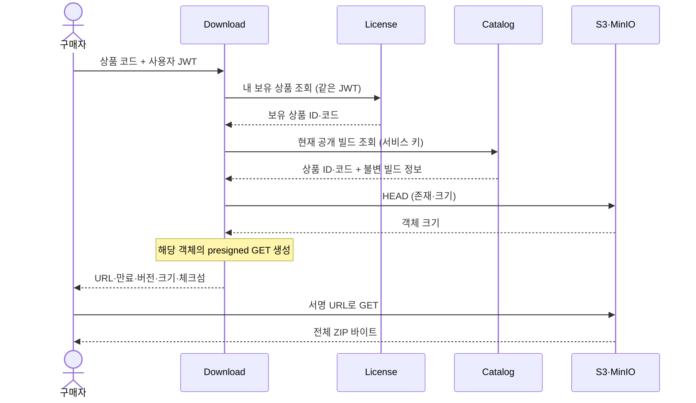

# Download MVP 재작업 계획·완료 기록

[문서 목록](README.md) · [작업 기준·순서](../AGENTS.md) · [License 완료 범위](license-mvp-plan.md#통합-수정-완료-기록) · [Catalog 완료 범위](catalog-mvp-plan.md) · [유스케이스 작성 규칙](use-case-conventions.md)

2026-10-18 계획 작성·최소 범위 재작업·로컬 OrbStack 검증을 완료했다. 실제 결과는 [완료 기록](#재작업-완료-기록)을 따른다.
Download의 기존 기능을 아래 최소 흐름으로 축소한다. 완료된 아홉 모듈의 계약을 기준으로 하며,
미완료 Download·Settlement의 기존 API·모델·이벤트·테스트는 호환성 요구나 완료 기준으로 삼지 않는다.

## 목표와 책임

구매자가 자신이 보유한 상품의 **현재 공개된 전체 ZIP 빌드 한 개**를 실제로 내려받는 흐름을 완성한다.
이를 직접 구현·실행하며 인증, 상품 보유권, 공개본, 파일 접근의 책임과 데이터 흐름을 설명할 수 있게 한다.

| 주체 | 소유하는 책임 |
|---|---|
| Auth·Gateway | 사용자 인증·역할, 기존 로그인·토큰 전달과 다운로드 API 라우팅 |
| Studio | 작업본·전체 빌드 업로드, 심사·출시 요청과 결과 기록 |
| Review | 제출된 불변 스냅샷의 수동 승인·반려 |
| Catalog | 공개 상품·현재 공개본 확정, 확정 스냅샷의 빌드 참조 제공 |
| Order·Payment | 기존 단일 상품 주문·모의 PG 결제·최종 결과 반영 |
| License | 구매 출처와 구매자·상품별 영구 보유권, JWT sub 기준 내 라이브러리 조회 |
| Download | 요청자의 보유권·현재 공개 빌드 확인, 해당 파일의 만료 URL 발급 |
| S3·MinIO | 파일 보관, 서명·만료 검증과 실제 바이트 전송 |

Download는 License의 보유권과 Catalog의 공개본을 조회한다. 다른 모듈의 DB를 직접 읽지 않는다.
보유권 생성·회수, 결제 재판단, 출시 승인·공개본 변경, 빌드 업로드는 각 소유 모듈의 책임으로 유지한다.

## 이번 MVP와 후속 범위

| 이번에 포함 | 최소 구현 |
|---|---|
| 본인 확인 | 유효한 MEMBER JWT의 sub 사용 |
| 보유권 확인 | 기존 License 내 라이브러리 상세 API에 사용자 access token 전달 |
| 공개본 확인 | Catalog의 접근 제한된 내부 API에서 현재 공개 빌드 조회 |
| 파일 확인 | 허용 버킷·객체 키 검증, HEAD로 존재·파일 크기 확인 |
| 파일 접근 | S3·MinIO presigned GET 한 가지 방식, URL·만료·버전·크기·체크섬 응답 |
| 실제 연계 | 기존 아홉 앱 + Download에서 구매·지급·실제 ZIP 다운로드 확인 |

Download는 **업무 DB·저장 엔티티·Kafka 소비/발행·Inbox·Outbox가 없는 무상태 서비스**로 구성한다.
요청마다 License·Catalog를 순서대로 조회하고 저장소를 확인한다. 조회 캐시·보유권 사본·공개본 사본을 두지 않는다.

다음은 후속 범위다.

- 과거 버전 선택·패치 이력 API·델타 패치·OS/아키텍처별 빌드·채널·예약 배포·롤백.
- 다운로드 이력·횟수 제한·다운로드 완료 이벤트·재개 위치 관리·운영자 발급 API.
- DRM·기기/좌석 제한·일회용 URL·URL 공유 차단·사용자별 CDN 토큰과 자체 파일 중계.
- 환불·회수·기간제·무료 지급·선물·정산 연계와 기존 결제의 소급 지급.
- License·Catalog 장애 중 새 URL을 계속 발급하기 위한 사본·동기화·다중 인스턴스 조율.
- 전용 서비스 인증 플랫폼·클라이언트 자격증명 발급 서버·키 관리 API와 부하/성능 실험.

## 최소 사용자 흐름과 정책

1. 기존 Studio·Review·Catalog 흐름으로 전체 ZIP 빌드를 공개한다.
2. 구매자가 기존 Order·Payment 흐름으로 결제하고 License의 보유권 지급을 기다린다.
3. MEMBER가 상품 코드로 Download에 URL을 요청한다.
4. Download가 같은 사용자 JWT로 License의 보유 상품 상세를 조회한다.
5. 보유가 확인되면 Catalog에서 해당 상품의 현재 공개 빌드를 읽고 상품 ID·코드를 대조한다.
6. Download가 저장소에서 파일 존재·크기를 확인하고 그 파일의 서명 URL을 발급한다.
7. 클라이언트가 URL로 저장소에서 파일을 받아 크기·SHA-256을 확인한다.



- 권한은 상품 단위 영구 보유권이다. 구매 당시 contentVersion으로 받을 빌드를 제한하지 않는다.
- 현재 공개본은 **Catalog 조회 시점에 CatalogProduct가 가리킨 공개본**이다. 버전 문자열·시각·최대 ID로 추측하지 않는다.
- 미출시 작업본·심사 중 빌드는 제공하지 않는다. 새 공개본 확정 후 새 요청은 새 빌드를 받는다.
- 조회 직후 공개본이 교체되어도 이미 읽은 불변 빌드로 발급할 수 있다. 서비스 간 잠금·분산 트랜잭션을 추가하지 않는다.
- URL 발급은 보유권을 소모하지 않는다. 반복 요청·만료 후 재요청을 허용하고 발급 이력은 저장하지 않는다.
- Order가 PAID여도 License 지급 전이면 미보유로 처리한다. Order·Payment를 조회해 임시 권한을 만들지 않는다.
- License·Catalog 장애 중에는 새 URL을 발급하지 않는다. 이미 발급한 URL은 저장소와 해당 파일이 유지되는 동안 만료 전 사용 가능하다.

## Download API와 접근 권한

| 메서드 | 경로 | 응답 |
|---|---|---|
| GET | `/api/v1/downloads/{productCode}/ticket` | 현재 공개 전체 빌드의 다운로드 정보 |

- Gateway의 기존 다운로드 라우트·MEMBER 조건과 BFF의 access token 전달을 사용한다.
- Download도 공통 ApiJwtSecurity로 서명·issuer·만료·aud=esd-api·MEMBER를 검증한다.
- 주체는 JWT sub다. X-Member-Id·member_id나 별도 buyer 값으로 사용자를 선택하지 않는다.
- API는 쿼리 파라미터를 받지 않는다. 구 platform·architecture·fromVersion을 포함해 쿼리를 보내면 400이다.
- productCode는 완료된 Catalog·License와 같은 `[A-Za-z0-9][A-Za-z0-9._-]{0,49}` 형식이며 원문을 유지한다.
- 응답은 ApiResponse 안의 productCode·version·fileSize·checksum·downloadUrl·expiresAt 여섯 필드다.
- 응답에 구매 출처·buyerSubject·저장 자격증명·내부 출시/심사/빌드 ID를 추가하지 않는다. 별도 storagePath 필드도 제공하지 않는다.
- 서명 URL에는 객체 경로가 나타날 수 있다. URL·토큰·서비스 키는 애플리케이션 로그와 검증 요약에 남기지 않는다.
- URL 응답에는 `Cache-Control: no-store`를 적용한다. 업무 경로는 위 GET만 허용하며 나머지는 기본 거부한다.
- health·API 문서 공개 범위는 완료 모듈의 최소 구성에 맞추고 Download 운영 API는 만들지 않는다.

## License 조회 계약

기존 `GET /api/v1/library/{productCode}`를 그대로 사용한다. License API·스키마·OrderPaid·지급 처리는 변경하지 않는다.

- Download는 검증한 원래 사용자 access token을 고정된 License base URL에만 Bearer로 전달한다.
- 사용자·URL·대상 서비스 주소를 요청 파라미터에서 받지 않는다. 사용자 토큰을 Catalog·저장소에 전달하지 않는다.
- ApiResponse의 성공 여부·본문 타입, 양수 productId·일치하는 productCode 등 사용할 값을 HTTP 어댑터에서 검증한다.
- HTTP 응답 DTO를 도메인 입력으로 그대로 전달하지 않고, 생성 시 유효성을 보장하는 보유 상품 값으로 변환한다.
- License의 404는 해당 사용자에게 보유권이 없다는 의미로 Download의 403에 대응한다. 타인의 보유권을 추가 조회하지 않는다.
- 연결 오류·타임아웃·5xx·형식이 잘못된 성공 응답을 미보유로 바꾸지 않는다.

## Catalog에 추가할 내부 빌드 조회 계약

현재 공개 API·CatalogProductPublished에는 저장 경로·크기·체크섬이 없으므로 **내부 GET 하나**를 추가한다.
기존 공개 API와 이벤트의 필드·출시 처리·DB 스키마는 유지한다.

| 메서드 | 경로 | 성공 응답 |
|---|---|---|
| GET | `/internal/v1/products/{productCode}/build` | ApiResponse 안의 현재 공개 빌드 |

응답 필드는 productId·productCode·releaseRequestId·contentVersion·buildId·version·fileSize·checksum·storagePath다.
CatalogProduct의 currentReleaseRequestId로 선택한 COMPLETED CatalogRelease의 불변 ProjectSnapshot에서 구성한다.
상품 연결·완료 상태·필수 빌드 값의 일관성을 확인하고, 파일 존재 확인·URL 생성은 Download가 맡는다.
현재 참조를 읽은 뒤 더 높은 공개본이 확정되어도 처음 선택한 공개본의 값을 하나의 응답으로 유지한다.

- Gateway에 `/internal/**` 라우트를 추가하지 않으며 이 API를 공개 OpenAPI에 포함하지 않는다.
- Catalog·Download 사이에 명시적으로 설정한 전용 공유 키 하나를 사용한다. 헤더는 `X-Download-Service-Key`다.
- 설정 값은 두 앱에 주입하는 `CATALOG_DOWNLOAD_SERVICE_KEY`다. 공통 기본 키·리포지터리에 저장한 키를 사용하지 않는다.
- Catalog는 키가 미설정·공백이면 내부 경로를 닫고 기존 공개 조회·출시 처리는 유지한다.
- 키가 설정된 경우에도 헤더가 없거나 다르면 401로 거절한다. 일반 사용자 JWT로는 이 API에 접근할 수 없다.
- 키를 검증한 위 GET만 허용한다. 내부 키로 다른 Catalog 경로의 권한이 생기지 않게 한다.
- 내부 연결은 기존 OrbStack 호스트/컨테이너 사설망 안에서 사용한다. 키를 다루는 경로를 외부 네트워크에 공개하지 않는다.
- 없는/미공개 상품은 404, 잘못된 상품 코드는 400이다. 저장된 공개본의 불일치는 성공 응답으로 감추지 않는다.

Download 어댑터는 봉투·필드 타입과 값 규칙을 검증하여 내부 PublishedBuild 값으로 변환한다.
요청 코드 = License 상품 코드 = Catalog 상품 코드이고 License productId = Catalog productId여야 발급한다.
상품 연결이 다르거나 내부 응답이 잘못되면 연계 오류로 종료하고 저장소·서명 단계를 실행하지 않는다.

## 저장소 접근과 URL 정책

- 현재 Studio가 저장하는 `s3://버킷/객체키` 참조를 사용한다. 설정한 빌드 버킷과 비어 있지 않은 키만 허용한다.
- Catalog가 준 참조를 SDK의 bucket/key 값으로 사용한다. 임의 HTTP URL에 접속하거나 경로를 추측·대체하지 않는다.
- Download 전용 읽기 전용 계정을 명시적으로 설정한다. 기존 Review와 같은 MinIO 정책 구성 방식을 사용한다.
- 허용 버킷의 GetObject와 HEAD의 누락 판별에 필요한 읽기 권한만 부여한다. 쓰기·삭제·버킷 생성 권한은 부여하지 않는다.
- Download 시작 시 버킷·파일을 만들지 않는다. 필요한 계정·버킷 준비는 실행 환경의 책임이다.
- SDK HEAD의 파일 크기를 공개 스냅샷과 비교한 후 GET URL을 서명한다. 누락·크기 불일치에는 URL을 반환하지 않는다.
- checksum은 공개 스냅샷의 SHA-256이다. 매 요청마다 전체 파일을 다시 읽어 해시를 계산하지 않는다.
- 파일은 기존 Studio의 고유 객체 키에 보관된 내용을 유지한다. 같은 크기의 내용 변조는 HEAD만으로 검출되지 않으며 실제 다운로드 검증에서 해시를 대조한다.
- HEAD와 GET 사이에 파일이 삭제되는 경우까지 원자적으로 막지는 않는다. 이미 공개한 빌드 보존은 저장소 운영 조건이다.
- URL 유효기간 기본값은 5분, 설정 허용 범위는 1초~15분이다. expiresAt은 SDK 서명 결과의 실제 expiration을 사용한다.
- 내부 SDK endpoint와 클라이언트가 접속할 presign endpoint를 구분한다. 생성 후 URL의 host·port를 바꾸지 않는다.
- URL은 만료 전 가진 사람이 사용할 수 있고 여러 번 GET할 수 있다. JWT sub에 묶인 URL·일회용 URL로 설명하지 않는다.
- 만료는 URL의 새 GET 요청에 적용된다. 이미 시작한 전송의 강제 종료나 License 영구 보유권의 만료를 뜻하지 않는다.

## 오류와 장애 처리

| 상황 | Download 응답·처리 |
|---|---|
| JWT 없음·잘못된 서명/issuer/audience·만료 | 401, 업무 조회·발급 없음 |
| MEMBER 없음 | 403, 업무 조회·발급 없음 |
| 상품 코드 형식·쿼리 입력 오류 | 400 |
| License 404, 지급 전·미보유 | 403, Catalog·저장소 조회 없음 |
| License가 사용자 토큰에 401/403 반환 | 같은 인증/권한 오류로 종료 |
| 보유 확인 후 Catalog에 현재 공개 상품 없음 | 404, URL 발급 없음 |
| License·Catalog 타임아웃/연결 실패/5xx·잘못된 응답 | 503, 미보유로 처리하지 않음 |
| Catalog 서비스 키 거절·상품 ID/코드 불일치·잘못된 저장 참조 | 503, URL 발급 없음 |
| 공개본이 참조한 객체 없음·파일 크기 불일치 | 409, 다른 빌드로 대체하지 않음 |
| 저장소 중단·자격증명 거절·SDK 통신 오류 | 503, URL 발급 없음 |

HTTP·SDK 연결·읽기에 유한한 제한 시간을 둔다. 초기 HTTP 연결 2초·읽기 5초, 저장소 API 전체 호출 5초를 기준으로 설정한다.
HTTP 재시도·배경 작업을 추가하지 않고 SDK 재시도도 전체 제한 시간 안에 둔다. 사용자가 다시 요청하면 처음부터 확인한다.
외부 조회를 묶는 DB 트랜잭션은 없으며 실패·재시작으로 주문·보유권·공개본을 변경하지 않는다.
라이브러리 조회는 Catalog·Download 중단 중에도 기존 계약대로 가능해야 한다.

## 구현 구성과 기존 코드 정리

| 위치 | 최소 구성 |
|---|---|
| Download core.domain | 보유 상품·공개 빌드·서명 URL·다운로드 결과 값, 모듈 내부 값 검증 |
| Download core.service | ReadBuildDownload 한 개가 보유 확인·공개본 대조·파일 접근을 조율 |
| Download core.port | License 보유 조회·Catalog 빌드 조회·빌드 저장소 접근 경계 |
| Download infrastructure | RestClient 기반 HTTP 어댑터 두 개, HEAD·presigned GET 저장소 어댑터 한 개 |
| Download api.controller | 단일 ticket GET·응답 DTO·no-store, 인증된 요청의 입력 해석 |
| Download config | 보안·HTTP/SDK 클라이언트·설정 검증·객체 조립 |
| Catalog | 내부 GET·전용 DTO·읽기 유스케이스·공유 키 접근 제한 |

설정 바인딩은 config에 둔다. 업무 코드·어댑터에는 값·Duration·구성된 클라이언트만 전달한다.
Download의 License·Catalog base URL, Catalog 서비스 키, 읽기 전용 저장소 자격증명·버킷은 필수 설정으로 검증한다.
누락·공백·잘못된 TTL/주소에는 기동을 거절하고 root 저장소 계정이나 기본 공유 키로 대체하지 않는다.
사용자 access token은 HTTP 경계에서 준비하며 Spring Jwt·서블릿 요청 객체·외부 응답 DTO를 도메인에 전달하지 않는다.
Java 지역·반복·리소스 변수는 명시적 타입으로 선언하고 값 검증은 의미별 메서드로 나눈다.

정리 대상은 다음과 같다.

- DownloadEventListener, Entitlement·ProductRef·PatchManifest와 저장소, 관련 Service·DTO·구 테스트를 제거·교체한다.
- CdnUrlSigner·CdnProperties·전략 선택과 memberId 기반 URL 발급 인자를 제거한다.
- MongoDB·spring-kafka·common:kafka의 Download 운영 의존성, Mongo/Kafka·CDN 설정과 Download 전용 배포 환경변수를 제거한다.
- 공통 테스트 지원이 사용하는 Kafka 의존성과 다른 앱이 쓰는 공유 인프라는 별도로 구분한다. Download 운영 JAR·기동에 MongoDB·Kafka가 필요하지 않음을 확인한다.
- 구 manifests API·플랫폼/델타 선택 계약을 새 OpenAPI에서 제거한다. 공유 구 이벤트 타입은 남은 사용처를 조사하며 이 작업의 호환성 요구로 삼지 않는다.
- 기존 MongoDB 자료·소비 그룹 오프셋은 보존하고 신규 업무에서 사용하지 않는다. 물리 삭제·자동 이관은 수행하지 않는다.
- 같은 `download` 앱에 두 구현을 동시에 실행하지 않는다. 기존 인스턴스를 중단한 뒤 새 무상태 앱으로 교체한다.

Catalog의 Flyway·공개 이벤트·기존 공개 API와 License의 DB·지급·조회 계약은 유지한다.
Download 전용 신규 마이그레이션은 없다. 공유 DB 전환·자료 정리는 이번 구현 완료와 구분한다.

## 진행 순서와 문서 갱신

1. **계약:** 단일 외부 API·Catalog 내부 DTO/인증·License 오류 변환과 대표 성공/거절 사례를 고정한다.
2. **Catalog:** 현재 공개본 조회·키 접근 제한과 공개 API/출시 처리 회귀 검증을 구현한다.
3. **Download:** 값·포트·ReadBuildDownload, HTTP 어댑터·저장소 접근·JWT 보안·설정 조립을 구현한다.
4. **축소:** 구 코드·의존성·설정·테스트를 교체하고 배포 구성에 내부 연계 키·읽기 전용 저장소 자격증명을 연결한다.
5. **OrbStack 검증:** 모듈 단위/통합·OpenAPI·관련 완료 모듈 회귀와 아래 열 앱의 실제 구매·파일 흐름을 실행한다.
6. **완료 기록:** 실제 명령·실행 건수·실패/건너뜀·증거·제한을 기록한 뒤 Download를 완료 목록에 추가하고 다음 대상을 Settlement로 변경한다.

구현 시 서비스/API 명세·보안·모델 사전·구매 흐름·테스트 문서를 새 동작으로 갱신하고 `docs/download-guide.md`를 작성한다.
계획 단계에서는 현행 구 구현 설명을 완료된 새 동작으로 바꾸지 않는다. 과거 완료·검증 기록은 당시 근거로 유지한다.

## OrbStack 검증과 완료 조건

2026-10-18 실행 지시에 따라 검증 환경을 로컬 OrbStack으로 변경했다. 모든 빌드·단위/통합·앱 실행을 로컬에서 수행하며 검증 자원을 격리한다.

| 검증 경계 | 반드시 확인할 내용 |
|---|---|
| 값·유스케이스 | 코드/값 검증, License→Catalog→저장소 순서, 상품 ID/코드 대조, 각 실패 이후 후속 호출 없음 |
| HTTP 어댑터 | 실제 HTTP로 사용자 JWT·서비스 키 분리, 리다이렉트로 자격증명 유출 없음, 필드 타입·성공 봉투·오류/타임아웃 처리 |
| Catalog 통합 | 실제 DB의 현재 COMPLETED 공개본, 작업본/거절/과거 공개본 격리, 조회 중 교체 일관성·없는 상품·읽기만 수행 |
| 내부 API 보안 | 키 없음/오류/일반 사용자 JWT 거절, 키 미설정 시 닫힘, 올바른 키의 지정 GET만 허용, Gateway·공개 OpenAPI 미노출 |
| Download API | 실제 JWT·MEMBER·sub, 헤더/쿼리 위조·구 API 거절, 400/401/403/404/409/503, no-store·응답 여섯 필드 |
| 저장소 통합 | 실제 MinIO의 읽기 전용 계정, 파일 GET·크기·SHA-256, 무서명 GET·URL 변조/만료 거절, 쓰기/삭제 불가 |
| 저장소 실패 | 잘못된 버킷/빈 키·객체 누락·크기 불일치·통신 실패·읽기 권한 거절 시 URL 없음 |
| 설정·기동 | 명시적 키/저장 자격증명·TTL/주소 검증, MongoDB·Kafka 없이 Download 단독 기동·재시작 |
| 회귀·산출물 | 완료 모듈의 관련 단위/통합·아키텍처·공개 OpenAPI, 모든 앱/E2E 소스 컴파일, Download 운영 JAR의 구 구현·운영 의존성 제거 |

Download 독립 검증은 License·Catalog HTTP 픽스처와 실제 MinIO를 사용한다. 사용자의 정상 경로는 픽스처 통과와 구분해
`tools/verification/verify-download.py`·`DownloadPurchaseFlowTest`·`:e2e:downloadE2eTest`를 새로 작성한다.
실제 스택은 Auth·Gateway·Studio·Review·Catalog·Store·Order·Payment·License·Download **열 앱**과
MySQL·Redis·Kafka·MinIO로 구성하며 MongoDB·Settlement를 실행하지 않는다.

실제 흐름에서 다음을 확인한다.

1. 실제 가입·업로드·심사·출시·주문 후 PENDING/FAILED·미보유 사용자에게 URL이 발급되지 않는다.
2. 결제 완료·보유권 지급 후 Gateway 경유 발급 URL로 ZIP을 내려받고 업로드 원본 바이트·크기·SHA-256을 대조한다.
3. 다른 사용자의 JWT·위조 헤더/쿼리로 구매자의 보유권을 사용할 수 없다.
4. 작업본 수정·새 빌드 업로드·심사 중에는 기존 공개 빌드를 유지하고, 새 버전 승인·출시 후에는 같은 보유권으로 새 빌드를 받는다.
5. 짧은 검증용 TTL의 실제 만료 후 새 GET이 거절되고, 다시 발급하면 동일 보유권으로 다운로드할 수 있다.
6. License·Catalog 중단 중 새 발급은 503이고, 이미 발급한 URL은 만료 전 저장소에서 사용 가능하다. 복구 후 재요청이 성공한다.
7. 저장소 중단·참조 파일 누락/크기 불일치에서 새 발급을 거절하고, 검증용 원본을 복원한 뒤 다시 발급한다.
8. Download 중단·재시작 후 별도 동기화 없이 발급된다. 기존 주문·보유권·공개본과 그 수는 다운로드 요청/실패로 바뀌지 않는다.

파일 누락·변조·복원과 읽기 전용 권한 실험은 격리된 검증 버킷·객체에서만 수행한다.
기존 검증 스크립트와 같은 독립 포트·DB·컨테이너/볼륨 방식을 사용하고 종료 후 이번 실행의 자원만 정리한다.
실제 MinIO를 사용하는 통합 검증과 Download 단독 기동에서는 MongoDB·Kafka 의존 제거를 별도로 입증한다.

구현 후 우선 실행할 명령은 다음과 같다. 아래는 계획 당시의 검증 명령이다. 실제 실행 범위·결과·정확한 명령은 아래 완료 기록을 따른다.

```bash
# 로컬 저장소에서 OrbStack을 사용해 실행
./gradlew :apps:download:test :apps:download:integrationTest :apps:catalog:test :apps:catalog:integrationTest :apps:gateway:test :apps:gateway:integrationTest :apps:license:test :apps:license:integrationTest verifyCommonRuntimeDependencies -Pstove.infraTest.maxParallel=1 --no-daemon
python3 tools/verification/verify-download.py
```

OpenAPI 스냅샷은 OrbStack에서 생성·회수하고 갱신 옵션 없이 재검증한다.
기존 Order·Payment·License 구매 흐름에 영향이 있는 변경은 해당 OrbStack 회귀도 실행한다.
실행한 태스크·단계별 건수와 실패·오류·건너뜀, ZIP 해시·버전·만료/장애 근거를 OrbStack `runs/`에 보존한다.
위 필수 검증을 마친 뒤에만 완료 기록과 재작성 완료 목록을 갱신한다.


## 재작업 완료 기록

2026-10-18 구현과 로컬 OrbStack 검증을 완료했다. 사용자 실행 지시에 따라 OCI 대신 로컬 OrbStack을 사용했다.
Download를 재작성 완료 목록에 추가했으며 다음 대상은 Settlement다.

### 구현 결과

- Download의 업무 DB·MongoDB 저장소·권한/상품/매니페스트 사본·Kafka 리스너를 제거했다.
- 단일 ticket GET에서 MEMBER JWT sub와 원래 사용자 access token으로 기존 License 상세를 조회한다.
- Catalog에 서비스 키로 보호한 내부 현재 공개 빌드 GET을 추가했다. 키 미설정 시 닫고 Gateway·공개 OpenAPI에서는 노출하지 않는다.
- ReadBuildDownload가 License·Catalog의 상품 ID·코드를 대조한 후 읽기 전용 저장소 HEAD·크기 확인과 presigned GET을 조율한다.
- URL 응답은 여섯 필드·no-store이며 기본 TTL 5분이다. 구 manifests·플랫폼/델타 선택·CDN 전략·memberId 발급 계약을 제거했다.
- Catalog의 공개 API·이벤트·출시 처리·DB와 License·Order·Payment의 업무 계약은 유지했다. 신규 Flyway 마이그레이션은 없다.
- 구 MongoDB 자료·그룹 오프셋의 자동 이관·물리 삭제와 공유 DB 전환은 수행하지 않았다.

### 단위·통합·컴파일 결과

**BUILD SUCCESSFUL. 단위 961건·관련 통합 67건, 실패·오류·건너뜀 모두 0건.**

| 범위 | 실제 검증 |
|---|---|
| 완료된 열 앱·공통 모듈 | 단위 961건. 소스가 없는 태스크는 실행 건수에서 제외 |
| Download | 단위 93건·통합 8건. 실제 HTTP·JWT·MinIO, 오류 분리·자격증명 분리·읽기 전용 권한·URL 만료 |
| Catalog | 단위 47건·통합 17건. 내부 키·기본 닫힘·현재 완료 공개본·조회 중 교체·저장 값 불일치·기존 출시 회귀 |
| Gateway·License | 통합 각각 1건·41건. 내부 경로 라우팅 차단과 기존 BFF·라이브러리/지급 계약 |
| 전체 소스 | 모든 앱·공통·E2E의 운영/단위/통합 소스 컴파일. 미완료 Settlement 업무 실행은 완료 기준으로 삼지 않음 |
| 공통·산출물 | verifyCommonRuntimeDependencies 통과. Download 운영 JAR의 MongoDB·Kafka·Messaging·JPA 의존성과 구 클래스 없음 |

OpenAPI를 실제 기동 구성에서 생성한 뒤 갱신 옵션 없이 통합 회귀로 대조했다.
Download 명세는 GET 한 개·상품 코드 경로 인자 한 개·응답 여섯 필드이며 운영 DLT API·선택 쿼리는 없다.
Catalog 내부 API·DTO는 기존 공개 명세에 추가 노출되지 않는다.

### 실제 열 앱 15단계

`python3 tools/verification/verify-download.py`를 로컬 OrbStack에서 실행했다.
각 단계는 JUnit 검사 한 건이며 **총 15건, 실패·오류·건너뜀 0건**이다.

| 단계 | 확인 결과 |
|---|---|
| 1 | 실제 가입·파일 업로드·심사·출시·주문, PENDING 시 다운로드 403 |
| 2~3 | PAID·지급 후 원본 ZIP 바이트/크기/SHA-256 일치. FAILED·미보유·타인 헤더/쿼리·익명·역할 없음 거절 |
| 4~5 | 작업본·미출시 새 빌드에는 기존 파일 유지, 새 승인·출시 후 같은 보유권으로 버전 2 ZIP 다운로드 |
| 6 | 실제 짧은 TTL 만료 후 새 GET 403, 재발급 후 같은 보유권으로 다운로드 성공 |
| 7~10 | License·Catalog 중단 전에 발급한 URL은 계속 사용 가능. 중단 중 새 발급 503, Catalog 중단 중 기존 라이브러리 유지 |
| 11~13 | MinIO 중단 503, 참조 파일 누락·크기 변경 409. 다른 파일/버전으로 대체하지 않음 |
| 14~15 | 검증 원본 복원 후 정상 다운로드, Download 재시작 후 사본 동기화 없이 재발급 |

최종 PAID 주문 1건·FAILED 1건, 상품 보유권·License Inbox 각 1건, 확정 공개본 2건이다.
결제 접수·모의 PG 결정은 각각 2건이며 과거 license_purchase 신규 행은 0건이다.
다운로드 요청·실패·재시작으로 주문·보유권이 추가되지 않았고, 기존 라이브러리 응답의 공개 ID·상품 정보·획득 시각이 유지됐다.
버전 2 ZIP 170바이트의 원본 SHA-256은 `0b209f6fd8c099316c6c1009d89ac912b94b9a096d6d05507a4fc5735ce04390`이다.

### 실행 근거·적용 범위

로컬 저장소의 무시 경로에 원자료를 보존했다.

- `runs/stove-download-check-5ubb0p_r/`: 열 앱 로그, 단계별 JUnit XML, summary.json·verification-counts.json, 검증용 원본 정보.
- 같은 경로의 containers-before.txt·containers-after.txt: 실행 전후 공유 컨테이너 목록 동일. 이번 앱·컨테이너·볼륨 정리 완료.
- 같은 경로의 download-business-classes.json: 실제 흐름에서 사용한 Download 업무/어댑터 클래스 해시.
- `runs/download-regression-20261018/`: 정확한 Gradle 명령 JSON·회귀 로그·모듈별 XML·test-counts.json·artifact-checks.json.

최종 운영 JAR의 업무/어댑터 클래스 해시는 실제 열 앱 검증에 사용한 것과 동일하다.
전체 회귀는 CI 환경변수로 테스트 캐시·UP-TO-DATE 생략을 끄고 실행했다. OpenAPI 갱신은 별도 단계로 실행하고 최종 회귀에는 갱신 플래그를 사용하지 않았다.

검증용 격리 DB·버킷·포트만 사용했다. 공유 배포 환경의 키·읽기 전용 계정 준비와 실제 교체는 별도 적용 작업이다.
URL 공유/반복 사용 제한·전체 파일의 매 요청 해시 재계산·환불/권한 회수·실제 PG·정산은 후속 범위다.
