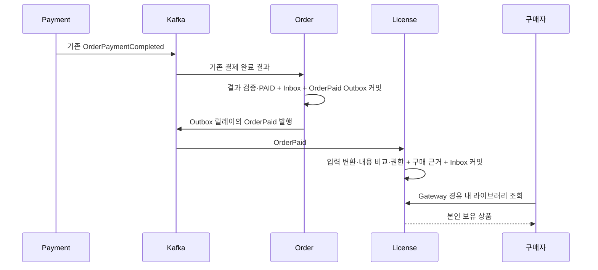

# License MVP 재작성 계획·완료 기록

[문서 목록](README.md) · [작업 기준·순서](../AGENTS.md) · [Order 완료 범위](order-mvp-plan.md) · [Payment 완료 범위](payment-mvp-plan.md) · [유스케이스 작성 규칙](use-case-conventions.md)

2026-10-17 최초 설계·구현·OCI 검증 완료. License를 재작성 완료 목록에 추가했다.

이후 본인용 동일 상품은 한 번만 구매하도록 정책을 정하고, `LicensePurchase`를 `License`에 통합했다. 2026-10-18 [통합 수정의 OCI 검증](#통합-수정-완료-기록)까지 완료했다. 아래 최초 설계와 완료 기록의 반복 구매·복수 근거 동작은 **통합 전 기록**이다. 다음 재작성 대상은 Download다.

## 목표와 책임

결제 완료된 주문을 근거로 상품 이용 권한을 부여하고, 구매자가 자신의 보유 상품을 조회하는 최소 흐름을 완성한다.
기준은 재작성 완료된 Auth·Gateway·Studio·Review·Catalog·Store·Order·Payment의 계약이다.
미완료 License·Download·Settlement의 기존 모델·이벤트·API·테스트는 새 설계의 호환성 요구나 완료 기준으로 삼지 않는다.

| 주체 | 소유하는 책임 |
|---|---|
| Payment | 기존 모의 PG 승인·거절 결과 저장, `OrderPaymentCompleted`·`OrderPaymentFailed` 발행 |
| Order | 기존 결제 결과를 자기 주문과 대조하여 PAID/FAILED 반영, PAID가 된 주문 정보를 새 `OrderPaid`로 발행 |
| License | 결제 완료된 주문의 구매 근거 보존, 구매자·상품별 이용 권한 부여, 내 라이브러리 조회 |
| 후속 Download | 이용 권한을 확인한 빌드 다운로드 제공. 확인 방식과 실제 빌드 제공은 해당 단계에서 설계 |
| 후속 Settlement | 판매자 매출·정산. 이번 계약에 판매자·수수료·정산 조건을 미리 추가하지 않음 |

**추가 결제 승인·고객의 구매 확정 절차는 없다.** Payment와 Order의 현재 상태를 그대로 사용한다.
`OrderPaid`는 Order가 기존 결제 완료 결과를 검증·반영했다는 사실이며, 새 주문 상태나 별도 승인 업무가 아니다.
License는 PG를 호출하거나 결제 성공 여부를 다시 판단하지 않는다.

## 이번 MVP와 후속 범위

| 이번에 포함 | 최소 구현 |
|---|---|
| 상품 이용 권한 | 구매자·상품별 영구 보유권 한 개. 만료·기기 수·좌석 제한 없음 |
| 구매 근거 | 결제 완료된 주문마다 입력 전체를 불변으로 보존 |
| 반복 구매 | 다른 주문으로 같은 상품을 다시 결제해도 이용 권한 한 개를 유지하고 구매 근거만 추가 |
| 내 라이브러리 | JWT sub 기준 목록·상품 코드별 상세 조회 |
| 신뢰성 | 이벤트 경계 검증, 전체 내용 비교, Inbox·권한·구매 근거의 같은 트랜잭션, 재전달·재시작 복구 |
| 실제 연계 | 완료된 여덟 앱 + License를 OCI에서 실행해 결제 완료 → 보유 상품 조회 확인 |

소량의 개발·학습 데이터와 단일 License 인스턴스로 시작한다. 결제는 기존 모의 PG이며 실제 자금 이동은 없다.

다음 항목은 후속 범위다.

- 환불·주문 취소·권한 회수·기간제·구독·체험판·선물·양도·외부 CD키·DRM·기기 인증.
- 보유 상품의 추가 구매 차단, 구매 전 보유 여부 확인과 동시 구매 제어, 중복 결제 자동 환불.
- 무료 상품 지급·운영자 수동 지급·묶음 상품·수량별 권한·별도 에디션 정책.
- 빌드 URL·다운로드 토큰·플랫폼 선택·다운로드 권한 사본과 그 동기화 방식.
- Catalog 변경에 따른 라이브러리 제목·이미지의 실시간 갱신, 검색·추천·사용 이력.
- 기존 구매의 자동 소급 지급, License DB 유실 뒤 전량 재구축, 전용 운영 API·스케줄러·성능 실험.

권한은 상품 단위다. 구매 시 `contentVersion`은 근거 보존용이며 특정 빌드나 해당 버전만 허용한다는 조건으로 사용하지 않는다.
상품의 후속 공개본에도 같은 보유권을 사용한다. 제공할 공개본·플랫폼·빌드와 URL의 유효성은 Download 단계에서 정의한다.

## 최소 업무 정책

### 권한 한 개와 구매 근거 여러 개

`License`는 구매자·상품의 이용 권한이고, `LicensePurchase`는 해당 권한의 근거가 된 결제 완료 주문이다.
한 이용 권한에 여러 구매 근거가 연결될 수 있다. 유효기간·회수가 없으므로 이번에는 ACTIVE/REVOKED 상태나 상태 전이 열을 두지 않는다.

| 입력 상황 | 처리 |
|---|---|
| 처음 구매한 상품의 유효한 OrderPaid | 이용 권한 한 개 + 구매 근거 한 개 + Inbox 한 개 |
| 같은 이벤트의 같은 입력 재전달 | 기존 licenseId·구매 근거·획득 시각 유지 |
| 같은 주문의 이벤트 ID·본문·발생 시각 변경 | 충돌. 새 구매나 정상 중복으로 처리하지 않음 |
| 다른 주문으로 같은 상품 구매 | 기존 이용 권한에 새 구매 근거와 Inbox 추가 |
| 다른 구매자의 같은 상품 구매 | 그 구매자의 별도 이용 권한 생성 |
| PENDING 또는 FAILED 주문 | 권한 부여 입력이 없으므로 지급 없음 |
| 신규 입력의 상품·구매자·가격 등 필수 값 오류 | 저장 전 거부. 정상 권한·Inbox 없음 |

현재 Order는 새 requestId의 같은 상품 주문을 허용한다. 이 동작은 유지하며 License가 Order 생성이나 Payment 실행을 차단하지 않는다.
추가 구매가 같은 상품의 두 번째 이용권·좌석·환불 권리를 만들지는 않는다. 각 결제 완료 주문은 구매 근거로 남긴다.

### 상품 식별과 표시 정보

- 보유권의 업무 키는 `(buyerSubject, productId)`다. productCode는 Catalog가 부여한 상품 코드이며 정확히 비교한다.
- 같은 구매자의 기존 productId에 다른 productCode가 오거나 같은 productCode에 다른 productId가 오면 충돌이다.
- 제목은 최초로 권한을 부여한 주문의 스냅샷이다. 조회 때 Catalog·Store를 호출하지 않는다.
- `acquiredAt`은 License가 최초로 권한을 부여한 시각이다. OrderPaid의 발생 시각과 구분한다.
- 다른 주문이 늦게 도착해도 최초 licenseId·제목·acquiredAt은 덮어쓰지 않는다. 각 주문의 제목·버전·금액·발생 시각은 구매 근거에 각각 남긴다.
- License에는 판매자·공개본·실행 파일 경로를 저장하지 않는다. Catalog가 중단되거나 상품 정보가 변경돼도 기존 권한 조회는 가능하다.

## 입력 계약 선택

현재 [OrderPaymentCompletedEvent](../common/kafka/src/main/java/com/stove/common/kafka/contract/payload/OrderPaymentCompletedEvent.java)는
orderNo·requestEventId·paymentId·buyerSubject·amount·currency를 담지만 상품 식별자는 없다.
[OrderPlacedEvent](../common/kafka/src/main/java/com/stove/common/kafka/contract/payload/OrderPlacedEvent.java)는 상품 스냅샷을 담지만 결제 완료를 뜻하지 않는다.

이번에는 **Order가 결제 완료 주문의 자기 스냅샷을 `OrderPaid`로 발행하고 License가 이를 소비하는 방식**을 선택한다.

| 방식 | 판단 |
|---|---|
| 새 OrderPaid 한 종류 소비 | 선택. 기존 Order의 구매자·상품·금액 및 결과 검증을 사용하고 License 입력을 한 종류로 유지 |
| Payment 완료 이벤트에 상품 필드 추가 | 미선택. 이번에 기존 Payment 결과 계약을 변경할 필요가 없음 |
| OrderPlaced와 결제 완료 이벤트를 License에서 조합 | 미선택. 두 입력의 저장·순서 역전·미결 상태 관리가 추가됨 |
| 결제 완료 수신 후 Order 조회 | 미선택. 기존 사용자 조회 API를 비동기 내부 조회로 재사용할 수 없고 서비스 간 인증·장애 처리가 추가됨 |

기존 Order·Payment HTTP API와 결제 요청·결과 이벤트의 필드는 유지한다. 필요한 변경은 OrderPaid 계약과 Order의 결과 Outbox 기록에 한정한다.

## 새 OrderPaid 계약

`common/kafka`에 `OrderPaidEvent`와 `EventType.ORDER_PAID = "OrderPaid"`를 추가한다.
전달 토픽은 기존 `Topics.ORDER`(`stove.order.v1`), Kafka 키와 Outbox aggregateId는 orderNo다.

| 필드 | 의미·값 규칙 |
|---|---|
| eventId | 새 OrderPaid의 식별자. 공백이 아닌 최대 64자 |
| occurredAt | Order가 최초 PAID를 반영한 `updatedAt`. UTC Instant·마이크로초 정밀도 |
| orderNo | 기존 주문 UUID |
| requestEventId | 원래 OrderPlaced.eventId. 구매자의 주문 요청 requestId와 구분 |
| paymentResultEventId | Order에 반영된 OrderPaymentCompleted.eventId |
| paymentId | Payment가 접수 시 발급한 고정 결제 ID. 공백이 아닌 최대 64자 |
| buyerSubject | Auth JWT sub에서 유래한 구매자. 공백이 아닌 최대 100자 |
| productId | 주문 당시 Catalog 상품 ID. 양수 |
| productCode | 주문 당시 상품 코드. `[A-Za-z0-9][A-Za-z0-9._-]{0,49}` |
| title | 주문 당시 제목. 공백이 아닌 최대 200자 |
| contentVersion | 주문 당시 상품 콘텐츠 버전. 양수 |
| amount | Order가 확정하고 Payment 결과와 대조한 고객 청구액. 양수 정수 |
| currency | 이번에는 KRW |

requestEventId·paymentResultEventId도 공백이 아닌 최대 64자다. 금액은 판매자 수령액이나 수수료 차감액이 아니다.
Order의 저장된 값을 사용하며 현재 Catalog 가격·제목·버전으로 교체하지 않는다. 별도 status 필드는 두지 않는다.
발생 시각의 모듈 간 선후관계나 수신 시각만으로 정상 입력을 거부하지 않는다.

### Order의 최소 변경

기존 [ApplyPaymentResult](../apps/order/src/main/java/com/stove/order/core/service/ApplyPaymentResult.java)의 트랜잭션에 다음 동작을 추가한다.

1. 기존처럼 주문 행 잠금, 결과 식별자 재사용·구매자·요청·금액·통화·기존 최종 결과를 비교한다.
2. 최초 결제 결과이면 기존 Inbox를 기록하고 `order.apply(result)`로 현재 상태를 반영한다.
3. 최초 PAID 반영인 경우에만 OrderPaid를 만들어 `OutboxRecorder.record("Order", orderNo, event)`를 호출한다.
4. 주문 변경·결제 결과 Inbox·OrderPaid Outbox를 함께 flush·커밋한다. FAILED에는 OrderPaid를 기록하지 않는다.

동일한 최종 결과 재전달은 기존 결과를 비교한 뒤 종료하며 새 이벤트를 만들지 않는다.
상충 결과는 기존처럼 거부한다. 주문 행 잠금이 최초 상태 전이와 발행을 직렬화한다.

새 eventId는 최초 PAID 반영 트랜잭션에서 생성하고, occurredAt과 본문은 Outbox에 함께 보존한다.
롤백된 후보 eventId는 발행된 결과가 아니다. 재시도 후 정상 커밋한 Outbox만 유효하다.
릴레이 재시도·DEAD 재큐잉·재전달은 저장된 eventId·키·본문을 사용한다. 조회나 중복 결제 결과 수신으로 이벤트를 재생성하지 않는다.
별도 발행 상태를 Order 모델에 추가하지 않으며, 이 변경만을 위한 Order DB 마이그레이션도 필요하지 않다.

Payment는 기존처럼 OrderPlaced만 처리한다. 같은 토픽의 OrderPaid를 무시하여 새 결제나 PG 호출을 만들지 않는지 회귀 검증한다.

## 전체 처리 흐름



License는 Payment·Order·Catalog·Auth의 업무 DB를 읽지 않는다. 지급 트랜잭션 안에 외부 HTTP 호출을 두지 않는다.
Order PAID와 License 지급 사이에는 전달 지연이 있다. 지연 중에는 라이브러리에 상품이 아직 없을 수 있다.
조회는 권한을 생성하거나 Kafka 처리를 재촉하지 않는다. 클라이언트는 주문의 PAID를 권한 조회 성공으로 간주하지 않는다.

## 외부 입력 경계와 내부 입력

`api.listener.OrderEventListener`가 OrderPaid를 골라 역직렬화하고 `LicenseOrderMapper.from(envelope, event)`를 호출한다.
신규 소비 그룹은 `license-paid-order`이며 기존 License 소비 그룹·구 이벤트와 분리한다.
OrderPlaced와 그 밖의 정상적인 비대상 종류는 처리하지 않는다.

Mapper는 예상 이벤트 종류, 봉투·본문 eventId, Kafka 키와 orderNo 일치를 검증한 뒤 내부 `PaidOrder`로 변환한다.
내부 입력은 위 13개 필드의 값 자체가 유효하도록 생성 시 검증한다. 필수 값 누락·금액/ID 범위 오류·잘못된 코드·시각 정밀도 오류는 저장 전에 거부한다.
config에서 기존 Order·Payment처럼 소수의 정수 절삭을 비활성화한다.

- `GrantLicense`와 도메인 모델은 EventEnvelope·OrderPaidEvent 전체를 입력받지 않는다.
- 내부 입력의 검증은 이벤트 식별·주문/결제 연결·구매자/상품·금액·시각 등 의미별 메서드로 나눈다.
- 공통 값 규칙은 모듈 내부의 작은 `LicenseValues`에 둔다. 다른 모델이 PaidOrder의 검증 함수·상수에 의존하지 않게 한다.
- 기존 구매 근거·보유권과 비교해야 알 수 있는 충돌은 서비스·도메인에서 검증한다.
- 서비스에는 이벤트 ID·발생 시각 등 중복 판정에 필요한 값을 내부 입력으로 전달한다.

## 데이터 모델과 제약

기존 License V1~V3의 마이그레이션 파일·체크섬은 보존하고, `V4__product_license.sql`로 두 새 테이블을 추가한다.
기존 `license` 테이블의 숫자 member_id·license_key·회수 상태를 새 자료로 자동 변환하지 않는다.

| 모델·테이블 | 저장할 값·제약 |
|---|---|
| License / product_license | 내부 id, 공개 licenseId(UUID), buyerSubject, productId, productCode, 최초 제목, acquiredAt |
| LicensePurchase / license_purchase | 연결된 License id, OrderPaid 입력 13개 필드 전체, receivedAt |
| 기존 processed_event | 새 소비 그룹의 이벤트 접수 기록. 새 업무 변경과 같은 트랜잭션 |

product_license에는 다음 제약·인덱스를 둔다.

- licenseId 유일, `(buyer_subject, product_id)` 유일, `(buyer_subject, product_code)` 유일.
- 본인 목록용 `(buyer_subject, acquired_at, id)` 인덱스.
- buyerSubject는 정확히 비교하는 utf8mb4_bin, UUID·productCode·currency는 기존 Order처럼 ASCII binary 비교를 사용한다. 대소문자를 임의로 정규화하지 않는다.

license_purchase에는 orderNo·OrderPaid eventId·requestEventId·paymentResultEventId·paymentId 각각의 유일 제약을 둔다.
이들은 현재 Order·Payment에서 한 주문의 불변 연결 정보이며, 다른 주문으로 재사용될 수 없다.
License 내부 id에 외래 키를 두고, 연결한 권한의 구매자·상품 ID·코드와 입력의 일치를 확인한다.
구매 근거의 입력은 수정하지 않는다. 같은 입력 재전달로 receivedAt을 갱신하지 않는다.
시각은 DATETIME(6)으로 보존하고 입력·저장 왕복 뒤 동일 비교가 가능하게 한다.

공개 licenseId는 조회용 식별자다. 비밀 CD키·PG 거래 키·다운로드 인증 토큰을 뜻하지 않는다.
이번에는 License가 발행할 후속 업무 이벤트가 필요하지 않으므로 LicenseIssued·LicenseIssueFailed·LicenseRevoked와 License Outbox 기록을 추가하지 않는다.
기존 License Outbox 릴레이는 비활성화하여 구 PENDING/DEAD 이벤트가 새 모듈 기동으로 발행되지 않게 한다. 기존 자료는 보존한다.

## 지급 트랜잭션과 중복·동시 처리

`GrantLicense.execute(PaidOrder)`를 READ_COMMITTED 쓰기 트랜잭션으로 처리한다.

1. 기존 orderNo의 구매 근거와 이벤트·요청·결제 식별자 재사용을 확인한다.
2. 같은 주문이면 **입력 전체를 먼저 비교**한다. 같지 않으면 충돌이다. 같으면 연결된 권한과 기존 Inbox도 일치하는지 확인하고 정상 중복으로 종료한다.
3. 신규 주문이면 Inbox의 firstDelivery를 확인한다. Inbox만 있고 구매 근거가 없으면 정상 중복으로 숨기지 않는다.
4. 구매자와 상품 ID·코드로 기존 권한 후보를 잠금 조회하고 두 상품 식별자의 짝을 대조한다. 기존 권한이 없으면 새 License를 생성한다.
5. 권한에 연결한 구매 근거를 저장한다. 기존 권한의 식별자·제목·획득 시각은 유지한다.
6. 권한·구매 근거·Inbox를 함께 flush·커밋한 뒤 리스너가 반환한다.

기존 구매 근거만 있고 Inbox가 없거나, 연결된 권한이 없거나 일치하지 않으면 자료 불일치로 거부한다.
동일 주문의 새 eventId, 같은 eventId의 다른 본문·발생 시각, 다른 주문의 결제 ID 재사용은 모두 충돌이다.
먼저 Inbox를 검사하여 내용 비교를 생략하는 래퍼를 사용하지 않는다.

다른 orderNo는 Kafka 파티션이 다를 수 있다. 같은 구매자의 같은 상품 주문들이 순서대로 도착한다고 가정하지 않는다.
권한이 없는 상태의 동시 생성은 유일 제약으로 최종 보호한다. 경합에서 진 트랜잭션은 전체 롤백하고 Kafka 재전달의 **새 트랜잭션**에서 기존 권한을 재조회하여 수렴한다.
동일 트랜잭션에서 유일 제약 예외를 잡고 계속 저장하거나, 모든 중복 키 오류를 정상 중복으로 삼지 않는다.
기존 권한이 있으면 행 잠금으로 연결 검증을 조율한다. 전역 잠금·분산 임대·메모리 기반 중복 집합은 추가하지 않는다.

## 오류와 복구

| 상황 | 기대 동작 |
|---|---|
| Order의 결과 Outbox 기록 실패 | 주문 PAID 반영과 결제 결과 Inbox도 롤백. Payment의 기존 결과를 다시 받아 처리 |
| OrderPaid 발행 지연·브로커 중단 | Order PAID·Outbox 보존. 릴레이 복구 후 기존 이벤트 전달 |
| License 중단 | Kafka에 남은 이벤트를 재시작 후 접수. Order·Payment 상태는 유지 |
| 권한/구매 근거/Inbox 저장 실패 | 함께 롤백. 공통 Kafka 재시도에서 새 트랜잭션으로 재처리 |
| License 커밋 직후 ACK 전 종료 | 재전달 입력 전체를 비교하여 기존 licenseId·구매 근거 유지 |
| 이벤트 오류·충돌 또는 재시도 소진 | 기존 공통 DLT에 보존. 권한 지급 완료나 결제 실패로 해석하지 않음 |
| Order Outbox DEAD | 원래 행을 재큐잉. 새 OrderPaid ID·본문을 만들지 않음 |

기술적인 지급 오류가 Payment FAILED·자동 환불·LicenseIssueFailed를 만들지는 않는다.
재투입 검증에서는 원래 OrderPaid의 eventId·키·헤더·본문을 보존한다. 충돌을 피하려고 새 eventId만 붙여 재발행하지 않는다.
소비 그룹·Kafka 보존 기간과 운영 복구는 영구 백업을 대신하지 않는다. DB 유실·기존 전체 구매의 재구축은 이번 재시작 복구와 구분한다.
공통 운영 HTTP API는 `stove.messaging.ops.enabled=false`로 닫고, 재시도·DLT·재큐잉은 공통 구성과 검증 픽스처를 사용한다.

## 조회 API와 보안

| 메서드 | 경로 | 응답 |
|---|---|---|
| GET | `/api/v1/library?page=0&size=20` | 내 보유 상품 페이지 |
| GET | `/api/v1/library/{productCode}` | 본인이 보유한 상품 한 개 |

- Gateway의 기존 Library 라우트·MEMBER 조건을 사용한다. License도 `ApiJwtSecurity`로 서명·issuer·만료·aud=esd-api·MEMBER를 검증한다.
- 조회 주체는 `CurrentSubject`의 JWT sub다. 본문·쿼리·X-Member-Id·member_id로 주체를 선택하지 않는다.
- 익명 401, MEMBER 없음 403, 타인/없는 보유 상품 404, 잘못된 페이지·상품 코드 형식 400이다.
- 목록은 본인 자료만 반환한다. page ≥ 0, 1 ≤ size ≤ 100, `acquiredAt DESC, id DESC`를 고정한다.
- `ApiResponse<LicensePage>`와 `LicenseResponse`를 사용한다. 페이지는 content·page·size·totalElements·totalPages를 제공한다.
- 상품 응답은 licenseId·productId·productCode·title·acquiredAt이다. title은 최초 지급 주문의 스냅샷이다.
- buyerSubject·주문별 구매 근거·금액·이벤트 ID·paymentId·Inbox·DB 내부 id는 응답에 노출하지 않는다.
- 공개 health·API 문서와 두 GET만 허용하고 기본 거부한다. 회원·관리자용 지급·회수·결과 주입 API를 만들지 않는다.

Order가 PAID여도 이벤트 전달 중이면 목록에 없고 상세는 404일 수 있다. 별도 PENDING License나 조회 시 자동 지급은 두지 않는다.
후속 Download는 이 보유권을 기준으로 자체 확인 계약을 설계하고 우선 픽스처로 검증한다. 현재의 구 Download 구현에 맞춘 동기/비동기 계약을 미리 확정하지 않는다.

## 기존 구현과 전환

새 유스케이스·모델·테스트로 기존 LicenseService, 구 PaymentEventListener, memberId 기반 API·DTO·Security 설정과 지급 실패 보상용 오류 처리를 교체한다.
구 ACTIVE/REVOKED·licenseKey·PaymentCompleted/PaymentCancelled·LicenseIssued/Revoked/IssueFailed 기반 업무와 테스트를 새 완료 조건으로 유지하지 않는다.
미완료 Download·Settlement가 참조하는 구 공통 이벤트 타입은 이번에 일괄 삭제하지 않는다.

빈 DB와 기존 License V3 DB에서 V4 적용 및 구 자료 보존을 검증한다. Order V10 스키마에는 새 테이블·열을 요구하지 않는다.
새 License 소비 그룹은 기존 그룹을 재사용하지 않는다. 구 Outbox는 릴레이를 끈 상태로 보존하고 구 업무 자료·Inbox를 새 자료로 자동 이관하지 않는다.

**OrderPaid 발행을 도입하기 전에 이미 PAID였던 주문은 자동 소급 지급하지 않는다.**
스키마 적용·기존 결제 결과 재전달·조회가 그 주문의 새 OrderPaid를 만들어서는 안 된다.
현재 완료 모듈의 공유 데이터에 적용하려면 기존 PAID 목록·미발행 Outbox·소비 오프셋과 소급 지급 필요성을 별도로 확인해야 한다.
이는 새 모듈의 빈 검증 환경 실행과 구분하며, 소급 발행·자료 전환을 일반 기동 코드에 숨기지 않는다.

이번 완료 검증은 기존 OCI 인스턴스의 **독립된 빈 업무 DB·Kafka·포트와 아홉 앱**으로 수행한다.
기존 공유 스택·중지된 프로세스·자료 볼륨은 사용하거나 정리하지 않는다. 검증이 만든 자원만 정리한다.
기존 [License DB 유실 런북](runbooks/license-db-loss.md)은 재작성 전 계약의 참고 기록이며 새 MVP의 복구 절차가 아니다.

## 구현 구성과 진행 순서

| 위치 | 최소 구성 |
|---|---|
| common/kafka | OrderPaidEvent·ORDER_PAID 상수. 기존 토픽·이벤트 필드는 유지 |
| Order core.service | ApplyPaymentResult의 최초 PAID 처리에 OrderPaid Outbox 기록 추가 |
| License core.domain | License, LicensePurchase, PaidOrder, LicenseValues, 각 Repository |
| License core.service | GrantLicense, SearchLicenses, ReadLicense |
| api.listener | OrderEventListener, LicenseOrderMapper |
| api.controller | LibraryController, LicenseResponse, LicensePage |
| config | JWT·정수 역직렬화·DB·Kafka·공통 운영 HTTP/구 Outbox 비활성화 설정 |
| DB | License V4의 새 두 테이블·제약·인덱스 |

유스케이스는 동사 + 대상 이름과 execute 진입점을 사용한다. 입력 변환·저장 단계마다 위임 클래스를 추가하지 않는다.
환경값 바인딩과 객체 조립은 config에서 맡고 업무 코드·어댑터에 바인딩 객체를 전달하지 않는다.
Java 지역 변수·반복 변수·리소스 변수는 명시적 타입으로 선언한다. 공통 프레임워크를 재설계하지 않는다.

1. **계약·Order 확장:** OrderPaid와 최초 PAID의 Outbox 원자성·동시 중복·FAILED 무발행을 구현한다.
2. **입력·데이터:** PaidOrder 값 검증, mapper, License V4·도메인·구매 근거 비교를 구현한다.
3. **지급·재처리:** Inbox·권한·구매 근거의 원자성, 같은 상품 반복 구매·생성 경합·DLT를 검증한다.
4. **조회·기존 정리:** JWT sub 두 GET, 페이지·소유권·OpenAPI, 구 업무·설정 제거를 검증한다.
5. **OCI 실제 연계:** 기존 여덟 앱 + License의 승인·거절·미확정·지연·재시작·중복 구매를 확인한다.
6. **완료 기록:** 실행 건수·명령·증거·제한을 기록한 뒤에만 License를 완료 목록에 추가하고 다음 대상을 Download로 바꾼다.

## OCI 검증 계획과 완료 조건

로컬은 코드·문서 편집과 동기화에 사용한다. 빌드·테스트·서비스 실행은 기존 OCI 인스턴스에서 수행한다.
아래는 주요 변경 범위의 검증 명령이다. 전체 회귀와 실제 프로세스 검증의 실행 결과는 아래 완료 기록에 정리했다.

```sh
./scripts/remote.sh gradle compileJava compileTestJava compileIntegrationTestJava :apps:license:test :apps:license:integrationTest :apps:order:test :apps:order:integrationTest :apps:payment:test :apps:payment:integrationTest :apps:gateway:test :common:kafka:test :common:messaging:test :common:security:test :common:archunit:test -Pstove.infraTest.maxParallel=1 --no-daemon
```

위 검증 뒤 완료된 여덟 앱과 공통 라이브러리의 기존 단위·통합·계약 회귀를 실행한다.
새 이벤트 계약으로 공통 코드가 변경되므로 전체 소스 컴파일도 확인한다. 미완료 앱의 기존 업무 실행·전체 구 E2E 성공을 완료 기준으로 삼지 않는다.
License OpenAPI는 OCI에서 생성·회수하고 갱신 플래그 없이 재검증한다. 기존 Order·Payment API 스냅샷도 유지되는지 확인한다.

| 검증 계층 | 필수 확인 |
|---|---|
| 입력·경계 | 봉투/본문/키·종류 일치, 필수 값·양수·KRW·코드·시각, 소수 절삭 거부, 서비스·도메인의 외부 이벤트 입력 금지 |
| Order 결과 | 최초 PAID에서 한 OrderPaid, 동시 동일 결과에도 한 건, FAILED 무발행, 결과 전체 비교 뒤 중복 종료, 기존 PAID 소급 발행 없음 |
| Order 원자성 | OrderPaid 기록 직후 예외·flush/커밋 실패에서 주문·결과 Inbox·Outbox 함께 롤백, 재전달로 한 건 수렴 |
| 이벤트 격리 | Payment가 OrderPaid를 무시하고 추가 결제·PG 호출을 만들지 않음 |
| License 동일 입력 | 같은 이벤트·주문 반복에도 권한/근거/Inbox 한 건, licenseId·시각 불변 |
| License 충돌 | 같은 주문의 eventId/시각/본문 변경, 다른 주문의 이벤트·요청·결제 ID 재사용, 상품 ID/코드 불일치 거부 |
| 자료 불일치 | Inbox만 있음·구매 근거만 있음·권한 연결 불일치가 정상 중복으로 숨겨지지 않음 |
| 원자성 | 권한 생성·구매 근거·Inbox 저장 뒤 각각 장애를 주입해 전체 롤백·새 트랜잭션 재개 확인 |
| 반복·동시 구매 | 다른 주문 두 건이 같은 구매자·상품에 동시 도착해 권한 한 개·근거 두 개·Inbox 두 개로 수렴 |
| 순서·불변 | 더 이른 주문이 늦게 와도 최초 권한 정보 유지, 각 주문의 스냅샷 전체 보존, 다른 구매자 권한 분리 |
| 보안·조회 | 실제 서명 JWT·401/403·타인 404, 소유자 쿼리/헤더 위조 무효, 페이지 상한·동률 정렬·정확한 코드 비교 |
| 전환·정리 | 빈 DB·V3→V4·구 자료 보존, 구 Outbox 무발행·숫자 memberId 경로와 구 보상 업무 제거 |

`scripts/verify-payment.py`의 독립 실행 방식을 참고해 `scripts/verify-license.py`와 License 전용 E2E 태그·태스크를 작성한다.
실제 프로세스 검증의 최소 여정은 다음과 같다.

1. 실제 로그인·심사·출시·Store 탐색·주문 → 모의 PG 승인 → Order PAID → OrderPaid → 내 라이브러리 한 개.
2. 모의 PG 거절 주문과 미확정 PENDING 주문에는 이용 권한·구매 근거가 없음을 확인.
3. 같은 구매자가 같은 상품을 새 주문으로 결제해 라이브러리 한 개·구매 근거 두 개를 확인. 다른 구매자의 구매는 별도 권한으로 확인.
4. License를 중지한 상태에서 결제 완료 후 재시작하여 Kafka 접수 재개·원래 이벤트 지급 확인.
5. 지급 커밋 직후 ACK 전 프로세스 종료와 재시작으로 중복 지급·새 licenseId·획득 시각 갱신이 없음을 확인.
6. OrderPaid 릴레이 중지·Kafka 중단·Order 재시작 후 복구하여 원래 Outbox ID·본문으로 지급 확인. DEAD 재큐잉은 별도 통합 검사로 확인.
7. 잘못된 입력의 DLT와 원본 OrderPaid 재투입, DB 쓰기 롤백 후 재처리·동시 생성 경합을 통합 검사와 격리된 장애 픽스처로 확인.
8. Catalog 중단 후 기존 권한 조회 가능, 조회에 의한 지급 없음, Gateway 경유 소유권·차단 경로·OpenAPI 확인.

장애 주입은 통합 테스트·독립 검증 픽스처에 격리하고 업무 HTTP API나 운영 bootJar에 넣지 않는다.
완료 기록에는 각 단계의 실제 테스트 수·실행 명령·증거 경로와 아홉 앱의 실행·재시작 결과를 남긴다.
기존 PAID 주문 소급 지급·실제 PG·환불·권한 회수·Download 완료를 검증한 것으로 설명하지 않는다.

## 재작성 완료 기록

2026-10-17 기존 OCI 인스턴스에서 구현·검증을 완료했다. 로컬에서는 편집·동기화·문서 연결 확인만 수행했다.
기존 공유 스택·자료는 사용하거나 전환하지 않았다. 독립 검증이 만든 프로세스·컨테이너·볼륨만 정리했다.

### 구현 결과

- Order가 최초 PAID 반영·결제 결과 Inbox·OrderPaid Outbox를 함께 저장한다. FAILED·동일 결과 재전달·기존 PAID 조회에는 새 이벤트가 없다.
- LicenseOrderMapper가 봉투·본문·키를 검증해 유효한 PaidOrder 13개 값으로 변환한다. 소수의 정수 절삭을 비활성화했다.
- GrantLicense가 입력 전체·출처 ID 재사용·기존 권한·Inbox 일치를 확인하고 권한·구매 근거·Inbox를 함께 저장한다.
- 반복 구매는 같은 권한에 근거만 추가한다. 최초 licenseId·제목·acquiredAt은 유지하며 다른 구매자는 별도 권한을 받는다.
- JWT sub·MEMBER 기준 목록과 상품 코드별 상세를 제공한다. 공개 응답은 다섯 필드이며 페이지·소유권·닫힌 경로를 검증했다.
- V1~V3·구 자료를 보존하고 V4로 새 두 테이블을 추가했다. 구 지급 실패 보상·회수 업무와 전용 오류 핸들러를 제거하고 구 Outbox 릴레이를 비활성화했다.
- OrderPaid를 공통 이벤트 카탈로그에 등록해 직렬화 왕복·메타데이터·추가 필드·토픽 계약 검사에 포함했다. 업무 유스케이스 명명 규칙에 Grant를 추가했다.

### 전체 컴파일·단위·통합 회귀

OCI 원격 작업 디렉터리에서 아래 범위로 실행했다. CI=true로 테스트의 UP-TO-DATE·캐시 복원을 막고 인프라 검사 병렬도를 1로 제한했다.
미완료 Download·Settlement는 소스 컴파일만 확인했으며 기존 업무 테스트를 새 기준에 포함하지 않았다.

```sh
CI=true STOVE_TEST_MINIO_IMAGE=stove/minio:RELEASE.2025-04-22T22-12-26Z-local ./gradlew \
  compileJava compileTestJava compileIntegrationTestJava \
  :apps:auth:test :apps:auth:integrationTest \
  :apps:gateway:test :apps:gateway:integrationTest \
  :apps:studio:test :apps:studio:integrationTest \
  :apps:review:test :apps:review:integrationTest \
  :apps:catalog:test :apps:catalog:integrationTest \
  :apps:store:test :apps:store:integrationTest \
  :apps:order:test :apps:order:integrationTest \
  :apps:payment:test :apps:payment:integrationTest \
  :apps:license:test :apps:license:integrationTest \
  :common:web:test :common:web:integrationTest \
  :common:security:test :common:security:integrationTest \
  :common:jpa:test :common:jpa:integrationTest \
  :common:kafka:test :common:kafka:integrationTest \
  :common:messaging:test :common:messaging:integrationTest \
  :common:archunit:test :common:archunit:integrationTest \
  :common:test:test :common:test:integrationTest \
  :common:testcontainers:test :common:testcontainers:integrationTest \
  -Pstove.infraTest.maxParallel=1 --no-daemon
```

**BUILD SUCCESSFUL, 8분 20초. 단위 864건·통합 146건, 실패·오류·건너뜀 모두 0건.**
소스가 없는 공통 모듈 태스크의 NO-SOURCE는 실행 건수에 포함하지 않았다.

| 모듈 | 단위 | 통합 |
|---|---:|---:|
| Auth | 7 | 8 |
| Gateway | 90 | 1 |
| Studio | 61 | 6 |
| Review | 57 | 12 |
| Catalog | 44 | 14 |
| Store | 47 | 10 |
| Order | 67 | 26 |
| Payment | 58 | 22 |
| License | 72 | 34 |
| common:web | 68 | 0 |
| common:security | 22 | 0 |
| common:kafka | 167 | 1 |
| common:messaging | 74 | 12 |
| common:archunit | 27 | 0 |
| common:test | 3 | 0 |
| 합계 | 864 | 146 |

Order는 최초 PAID 한 건·동시 동일 결과·FAILED 무발행·과거 PAID 무소급·Outbox 실패·최종 flush 뒤 커밋 중단·DEAD 재큐잉을 확인했다.
License는 입력 전체 충돌·출처 재사용·고아 Inbox·누락/불일치 권한·각 저장 단계 뒤 실패·flush 뒤 중단·동시 최초 생성·재전달을 확인했다.
동시 최초 생성은 실제 유일 제약 경합에서 패자를 전체 롤백한 뒤 새 트랜잭션으로 권한 한 개·근거 두 개·Inbox 두 개에 수렴했다.
오류의 공통 DLT 보존과 원래 OrderPaid 재투입도 확인했다.

실제 RSA 서명 JWT로 issuer·audience·만료·서명·역할·소유권·쿼리/헤더 위조·페이지와 코드 비교를 검사했다.
빈 DB의 앱 기동과 V3→V4 구 자료 보존·Flyway 검증을 통과했다.
License OpenAPI는 OCI에서 생성·회수하고 갱신 옵션 없이 재검증했으며 Order·Payment 스냅샷도 변경 없이 통과했다.

### 실제 아홉 앱의 13단계

```sh
python3 scripts/verify-license.py
```

실행별 빈 DB·Kafka·앱 포트(기본 오프셋 31000)로 Auth·Gateway·Studio·Review·Catalog·Store·Order·Payment·License를 실행했다.
모든 단계는 전용 licenseE2eTest의 검사 한 건을 실제 실행했으며 실패·건너뜀은 0건이다.

| 단계 | 확인 결과 |
|---|---|
| 1 | 실제 가입·로그인·심사 승인·출시·Store 탐색·주문. PENDING에 권한·근거·Inbox 모두 0건 |
| 2~3 | 모의 PG 승인 → Order PAID → OrderPaid → 권한·근거·Inbox 한 건. 거절은 추가 지급 없음 |
| 4~5 | 같은 구매자의 반복 구매는 권한 한 개·근거 두 개. 다른 구매자는 별도 권한 |
| 6~7 | License 중지 중 결제 완료, 재시작 후 원래 이벤트를 접수해 근거 추가 |
| 8~9 | 지급 커밋 직후 ACK 전 JVM을 종료 코드 91로 종료. 재시작 후 같은 이벤트 재전달, 권한 ID·획득 시각·근거 ID·수신 시각 유지 |
| 10~12 | Order 릴레이 중지 → OrderPaid PENDING 보존 → Kafka·Catalog 중지·Order 재시작 → 기존 라이브러리 조회 → 복구 후 원래 ID·본문 발행·재투입. 소비 오프셋 진행 확인 |
| 13 | 재시작 후 기존 두 구매자의 권한·소유권·페이지·차단 경로·Gateway 경유 OpenAPI 유지 |

최종 주문 7건 중 PAID 6건·FAILED 1건, License 권한 2개·구매 근거와 Inbox 각각 6건이다.
Payment 접수·모의 PG 결정·결과 Outbox는 각각 7건이며 OrderPaid 소비로 추가 결제를 만들지 않았다.
OrderPaid Outbox는 6건, License Outbox는 0건이다. 거절 주문의 구매 근거는 없다.

ACK 전 종료 이벤트는 `d0288e30-290e-410a-8e38-41833afa5504`, 브로커 복구·재투입 이벤트는 `399f1d99-fda0-45a1-8d7d-dcb3a6a28c83`이다.
재투입은 Kafka에서 읽은 원문 본문과 필수 이벤트 헤더·키를 사용했다.
장애 주입 클래스는 integrationTest에 격리했으며 운영 bootJar에 포함되지 않음을 별도로 확인했다.

### 실행 근거와 남은 범위

OCI 원격 작업 디렉터리의 `runs/license-mvp-20261017/`에 다음을 보존했다.

- `process-verification/`: 13단계 JUnit XML, 아홉 앱 로그, license.json·summary.json, ACK 전 종료·재전달 기록.
- `regression/`: 완료된 아홉 앱과 공통 모듈의 단위·통합 JUnit XML.
- `test-counts.json`, `artifact-checks.json`, `esd-license-regression-command.txt`, `esd-license-regression-final.log`, `esd-license-flow.log`.

기존 PAID 주문 자동 소급 지급·공유 환경 자료 전환·DB 유실 뒤 전량 재구축은 수행하지 않았다.
실제 PG·자금 이동·환불·권한 회수·Download·Settlement는 후속 범위다.
다음 재작성 대상은 Download이며 현재 License의 보유권·조회 계약을 기준으로 설계한다.

## 통합 및 중복 구매 제한 수정 계획

2026-10-17 수립·구현, 2026-10-18 **OCI 검증 완료**. 실제 결과는 [통합 수정 완료 기록](#통합-수정-완료-기록)을 따른다. 이 절은 위 최초 설계의 반복 구매 정책과 License·LicensePurchase 분리 모델을 대체할 목표를 정의한다.

### 결정한 정책과 책임

구매자는 자기 이용 목적으로 동일 상품을 하나만 구매할 수 있다. 선물·추가 수량·양도는 후속 범위다.
**Order가 결제 요청을 만들기 전에 중복 구매를 차단하고, License는 완료 주문 하나의 출처와 이용 권한을 한 엔티티에 보존한다.**
Order는 자기 주문 상태를 기준으로 판단한다. 비동기로 늦게 생성될 수 있는 License를 조회하여 구매 가능 여부를 판단하지 않는다.

| 상황 | 변경 후 처리 |
|---|---|
| 같은 구매자·requestId·같은 요청 내용 | 상태와 관계없이 기존 주문 반환. Catalog 재조회·결제 재요청 없음 |
| 같은 구매자·requestId·다른 요청 내용 | 기존처럼 409 |
| 새 requestId, 같은 상품의 PENDING 주문 존재 | 409 `PURCHASE_IN_PROGRESS`. 신규 주문·OrderPlaced 없음 |
| 새 requestId, 같은 상품의 PAID 주문 존재 | 409 `PRODUCT_ALREADY_PURCHASED`. License 지급 지연 중에도 차단 |
| 같은 상품의 주문이 모두 최종 FAILED | 새 requestId로 새 주문 허용. 실패한 주문·결제 기록은 보존 |
| 다른 구매자 또는 다른 상품 | 각각 독립 구매 가능 |
| 주문 후 상품의 제목·가격·contentVersion 변경 | 동일 상품의 추가 구매를 허용하는 근거로 사용하지 않음 |
| 결제 미확정·일시 오류·처리 지연 | PENDING 유지, 구매 제한 유지. 시간만으로 해제하지 않음 |

새 오류 코드는 `OrderErrorCode`에 두고 둘 다 HTTP 409로 반환한다. 같은 requestId의 재조회·입력 충돌 판정을 상품 중복 판정보다 먼저 수행한다.
PAID·FAILED의 최종성, 새 주문의 새 orderNo·requestEventId·paymentId 원칙은 유지한다.

### Order 변경: 동시 주문까지 한 건으로 제한

대상은 `CreateOrder`, `OrderRepository`, `OrderErrorCode`와 새 Flyway V11이다.
상품의 업무 식별은 `(buyerSubject, productId)`이며 `(buyerSubject, productCode)`도 일관되게 보호한다.

1. 기존 구매자·requestId를 먼저 확인한다. 동일 요청이면 기존 주문을 반환한다.
2. 신규 요청은 기존처럼 DB 트랜잭션 밖에서 Catalog 공개 상세를 읽는다.
3. 저장 트랜잭션 안에서 requestId를 다시 확인하고, 같은 구매자의 productId 또는 productCode가 연결된 PENDING·PAID 주문을 확인한다. ID·코드가 불일치하면 정상 재구매로 처리하지 않는다.
4. 차단 주문이 없으면 기대 버전·금액을 검증하고 신규 주문·OrderPlaced Outbox를 함께 저장한다.
5. 동시 삽입 경합은 아래 DB 제약으로 한 건만 커밋한다. 패자는 전체 트랜잭션을 종료한 뒤 새 조회로 동일 requestId인지, 상품 중복인지 구분한다.

`purchase_order`에 다음 의미의 nullable 생성 컬럼과 두 유일 인덱스를 추가한다. 생성 컬럼은 DB가 status에서 계산하며 JPA의 쓰기 필드로 추가하지 않는다.

```sql
purchase_guard TINYINT GENERATED ALWAYS AS (
    CASE WHEN status IN ('PENDING', 'PAID') THEN 1 ELSE NULL END
) STORED

UNIQUE (buyer_subject, product_id, purchase_guard)
UNIQUE (buyer_subject, product_code, purchase_guard)
```

PENDING과 PAID는 모두 값 1을 사용하므로 두 상태를 합쳐 한 주문만 존재한다. FAILED는 NULL이므로 실패 이력을 여러 건 보존하면서 새 주문을 만들 수 있다.
기존 식별자 컬럼의 대소문자 구분을 그대로 사용한다. 단순 조회 후 저장이나 격리 수준 변경만으로 동시 구매를 막는다고 가정하지 않는다.

`ApplyPaymentResult`의 PENDING → FAILED 커밋 시 구매 제한도 같은 DB 변경으로 해제된다. PENDING → PAID에서는 제한이 유지된다.
별도 구매 예약 테이블·분산 잠금·License 동기 조회는 추가하지 않는다. READ_COMMITTED와 기존 결제 결과 처리·Outbox 원자성은 유지한다.

`CreateOrder`의 충돌 처리는 동일 요청 확인, 상품 구매 가능 여부 확인처럼 의미별 메서드로 정리한다.
알려진 구매 유일 제약의 충돌만 구매 오류로 변환한다. 다른 무결성 오류까지 일괄적으로 '이미 구매함'으로 숨기지 않는다.
재시도가 필요한 일시적 잠금 경합에는 기존의 유한 재시도를 적용하고, 롤백된 트랜잭션 안에서 처리를 계속하지 않는다.

### License 변경: 권한과 출처를 한 엔티티에 보존

업무 엔티티와 저장·조회 경로를 `License` 하나로 통합한다. 새로운 출처 엔티티·테이블·범용 지급 계층은 만들지 않는다.
`PaidOrder`는 값 자체가 유효한 내부 입력으로 유지하며 JPA 엔티티로 바꾸지 않는다.

| 통합 후 License의 값 | 처리 |
|---|---|
| id·licenseId | 내부 DB ID와 공개 UUID 유지 |
| buyerSubject·productId·productCode·title | 기존 권한과 구매 근거의 중복 필드를 한 벌로 저장 |
| eventId·occurredAt·orderNo | 최초 OrderPaid와 출처 주문을 불변으로 저장 |
| requestEventId·paymentResultEventId·paymentId | 기존 구매·결제 연결을 불변으로 저장 |
| contentVersion·amount·currency | 구매 당시 버전·청구액·통화 보존 |
| acquiredAt·receivedAt | 기존 두 시각은 그대로 보존. 신규 지급은 같은 마이크로초 시각으로 생성 |

`License.grant(PaidOrder)`가 권한 식별자와 출처 전체를 한 번에 초기화한다.
`paidOrder()`·`verify(PaidOrder)`로 저장된 출처를 재구성하고 **13개 입력 필드 전체**를 비교한다. orderNo나 eventId만 비교하여 정상 중복으로 넘기지 않는다.
기존의 권한↔구매 근거 FK 확인과 두 객체 사이의 구매자·상품 연결 확인은 한 행으로 통합되므로 제거한다.

- `LicensePurchase`·`LicensePurchaseRepository`를 제거한다.
- 출처 주문 조회와 출처 식별자 재사용 조회를 `LicenseRepository`로 옮긴다.
- `(buyerSubject, productId)`, `(buyerSubject, productCode)`, 공개 licenseId 유일 제약을 유지한다.
- orderNo·eventId·requestEventId·paymentResultEventId·paymentId의 각각의 유일 제약을 `product_license`로 옮긴다.
- 기존 권한에 새 구매를 연결하는 쓰기 경로가 없어지므로 `lockCandidates`의 비관적 쓰기 잠금을 제거하고 충돌 조회로 바꾼다. 동시 최초 생성의 최종 방어는 DB 제약이 맡는다.

### GrantLicense 처리 순서

`LicenseOrderMapper.from(...) → PaidOrder → GrantLicense` 경계와 `license-paid-order` 소비 그룹을 유지한다.
READ_COMMITTED 트랜잭션 한 개에서 다음을 수행한다.

1. orderNo로 기존 License를 찾는다. 있으면 13개 입력을 대조하고, 해당 Inbox가 이미 존재하는 경우에만 정상 재전달로 종료한다. 권한만 있고 Inbox가 없는 경우에는 충돌로 롤백한다.
2. 다른 주문에서 eventId·requestEventId·paymentResultEventId·paymentId를 이미 사용했으면 충돌로 처리한다.
3. 같은 구매자의 productId 또는 productCode가 기존 권한과 연결되어 있으면 충돌로 처리한다. 새 출처로 교체하거나 구매 근거를 추가하지 않는다.
4. Inbox를 접수한다. 기존 Inbox만 있고 일치하는 License가 없으면 충돌이다.
5. 출처를 포함한 License 한 행을 생성·flush하고 Inbox와 함께 커밋한다.

동시 최초 지급에서 유일 제약에 진 트랜잭션은 전체 롤백한다. 기존 공통 Kafka 재시도가 새 서비스 트랜잭션에서 다시 판단하게 한다.
같은 이벤트·입력이면 기존 권한 한 개로 수렴하고, 다른 주문의 같은 상품이면 충돌로 남는다.
처리 불가능한 입력은 기존 재시도·DLT 경로로 보존한다. 지급 오류를 주문 FAILED나 자동 환불로 변환하지 않는다.

정상 흐름의 중복 결제 예방은 Order 책임이다. License의 유일 제약은 과거 메시지·잘못된 입력에 대한 마지막 방어이며 이미 일어난 결제를 되돌리는 기능은 아니다.
OrderPlaced·OrderPaid·결제 결과 이벤트의 필드·토픽·키는 유지한다. Payment 업무 처리에는 중복 구매 정책을 추가하지 않는다.
`SearchLicenses`·`ReadLicense`와 HTTP 응답의 licenseId·productId·productCode·title·acquiredAt은 유지한다. 출처 필드를 사용자 응답에 추가하지 않는다.

### 기존 자료와 적용 순서

이미 OCI에서 검증한 V4·V10을 수정하지 않고 **Order V11·License V5**로 전진한다. 기존 마이그레이션 체크섬은 유지한다.
구 License V1~V3의 자료·Inbox·Outbox도 기존처럼 보존한다.

공유 환경 적용 전 [읽기 전용 점검 SQL](../scripts/license-merge-preflight.sql)과 전달 대기 자료를 확인한다. SQL의 적용 대상은 전환 전 Order V10·License V4다.

| 대상 | 통과 조건 |
|---|---|
| Order 구매 제한 | 동일 구매자·productId와 동일 구매자·productCode 각각에서 PENDING·PAID 합계가 최대 1건 |
| License 출처 | 모든 product_license 행에 연결된 license_purchase가 정확히 1건. 두 테이블이 모두 빈 경우도 허용 |
| 공통 필드·Inbox | 구매자·상품 ID/코드·제목 일치, 출처와 license-paid-order Inbox의 식별자·유형 대응 |
| 전달 대기 자료 | 미발행 OrderPaid Outbox·미소비 Kafka·재투입 대상에 같은 구매자·상품의 다른 완료 주문이 남아 있는지 대조 |

기존 검증의 '권한 2개·근거 6개'와 같은 자료는 새 1:1 모델에 손실 없이 통합할 수 없다.
복수 근거를 임의로 하나 선택하거나, 주문을 삭제·실패 처리하여 제약을 통과시키지 않는다. 조건을 만족하지 않으면 진단 결과를 남기고 자료 전환을 중단한다.
이 자료의 별도 보존·전환 정책은 실제 대상 자료를 확인한 뒤 정한다. 독립 검증은 매번 새 DB를 사용하며 공유 DB를 초기화하지 않는다.

조건을 통과한 환경의 적용 순서는 다음과 같다.

1. 자료를 백업하고 Order의 신규 주문·결과 소비, License 소비 및 관련 릴레이를 중지해 전환 중 쓰기·전달을 멈춘다.
2. Order V11로 구매 제한 생성 컬럼·유일 제약을 추가한다.
3. License V5로 출처 컬럼을 추가하고, 사전 조건을 다시 확인한 뒤 1:1 자료를 복사한다. 공개 licenseId·내부 id·acquiredAt·receivedAt·13개 원본 값을 보존하고 NOT NULL·유일 제약을 적용한다.
4. 통합 코드로 기동하고 Order 결과 소비·릴레이, License 소비를 재개한 뒤 신규 주문을 연다. 기존 이벤트는 원래 ID·키·본문으로 처리한다.
5. 전환 후 기존 `license_purchase`는 읽기·쓰기를 하지 않는 과거 자료로 보존한다. 첫 수정에서 DROP하지 않는다. 운영 저장 모델은 `product_license`만 사용한다.

MySQL DDL의 자동 커밋을 고려하여 실패 시 DB 변경 전체가 자동 롤백된다고 가정하지 않는다. 중간 실패 위치 확인·백업 복구 절차를 함께 기록한다.
과거 PAID의 자동 소급 지급이나 소비 그룹·오프셋 초기화는 추가하지 않는다.

### 구현과 검증 순서

| 순서 | 작업·완료 조건 |
|---|---|
| 1 | Order 오류·구매 충돌 조회·V11·CreateOrder 변경. 서로 다른 requestId의 동시 구매도 주문·OrderPlaced가 한 건만 커밋되는지 확인 |
| 2 | License 필드·출처 비교·저장소·GrantLicense·V5 통합. LicensePurchase 클래스·저장소와 런타임 참조 제거 |
| 3 | Order·License 단위/통합·이벤트·마이그레이션 검사와 장애 주입 픽스처 갱신 |
| 4 | Order·Payment·License의 실제 구매 검증에서 같은 구매자·상품 재사용을 없애고 새 정책·장애 복구 시나리오 실행 |
| 5 | 완료된 아홉 앱·관련 공통 모듈 회귀 검증, OpenAPI 계약 확인, 실행 근거·문서 갱신 |

로컬에서는 코드·문서 편집과 정적 확인·동기화만 한다. 아래 빌드·테스트·서비스 실행은 기존 OCI에서 수행한다.

Order에서 반드시 확인할 항목은 다음과 같다.

- 같은 requestId의 순차·동시 재전달은 한 주문·한 OrderPlaced에 수렴하고, 다른 입력은 409다.
- 서로 다른 requestId의 같은 상품 동시 생성은 하나만 성공한다. 거절된 시도는 주문·Outbox·Payment 접수·모의 PG 결정을 추가하지 않는다.
- PENDING·PAID일 때 차단하고, License가 중단되어 지급되지 않았어도 PAID 주문으로 차단한다.
- 최종 FAILED 이후 새 주문은 허용하되 실패한 requestId 재조회는 원래 실패 주문을 반환한다.
- FAILED 반영과 신규 주문이 경합하거나 결과 저장이 롤백될 때 구매 제한이 DB에 커밋된 상태와 일치한다.
- 다른 구매자·다른 상품은 독립적이며, 제목·가격·버전 변경으로 동일 상품을 다시 구매할 수 없다.
- OrderPlaced Outbox 실패 시 신규 주문·구매 제한이 함께 롤백되고, OrderPaid Outbox 실패 시 PAID 반영·Inbox도 함께 롤백된다.
- V10 자료의 V11 전환에서 FAILED 이력·기존 주문/Inbox/Outbox를 보존하고, 중복 PENDING·PAID 자료에는 유일 제약 추가가 실패하는지 확인한다.

License에서 반드시 확인할 항목은 다음과 같다.

- 최초 지급은 License 한 행·Inbox 한 행이다. 같은 원본 이벤트를 반복 전달해도 공개 ID·출처·획득/수신 시각이 유지된다.
- 13개 필드별 변조, 다른 주문의 출처 ID 재사용, 다른 주문의 동일 구매자·상품, 상품 ID·코드 불일치는 충돌이다.
- License 없는 Inbox와 Inbox 없는 License를 정상 중복으로 넘기지 않는다.
- Inbox 기록·License 삽입·flush·최종 커밋 실패에서 부분 저장이 없고, 동시 동일 입력은 새 트랜잭션 재처리 후 한 건으로 수렴한다.
- 커밋 직후 ACK 전 프로세스 종료·재전달, License 중단 후 접수 재개, 브로커·Catalog 중단 중 기존 라이브러리 조회를 유지한다.
- 빈 DB, V4 1:1 자료의 V5 전환, 복수/누락/불일치 출처의 전환 거부, V1~V3 자료 보존과 Flyway 체크섬을 확인한다.
- 보존한 license_purchase에 런타임 신규 쓰기가 없고, 라이브러리 인증·소유권·페이지·응답 계약이 유지된다.

검증 코드의 구체적인 수정 대상은 다음과 같다.

- `apps/license`의 테스트·`LicenseFixtures`·`LicenseFaultConfiguration`: 삭제될 저장소 주입·두 단계 저장 실패 주입을 통합 저장에 맞춘다.
- `OrderPurchaseFlowTest`·`PaymentPurchaseFlowTest`·`LicensePurchaseFlowTest`: 이미 PAID인 구매자에게 같은 상품을 주문시키던 픽스처를 서로 다른 구매자 또는 별도 공개 상품으로 바꾼다. FAILED 재시도는 같은 구매자·상품으로 확인한다.
- `scripts/verify-order.py`·`scripts/verify-payment.py`·`scripts/verify-license.py`: 픽스처·SQL·건수·재시작 이후 검사를 갱신한다. 이전 13단계·권한 2개/근거 6개 수치를 새 정책의 목표로 재사용하지 않는다.
- 독립 아홉 앱 검증에서 전달이 끝난 최초 구매들의 PAID 주문 수 = License 수 = license-paid-order Inbox 수를 대조한다. PENDING·FAILED·중복 거절 요청은 지급을 만들지 않는다.

실제 검증 후 `AGENTS.md`, README, Order·License 안내, 서비스/API 명세, 모델 사전·구매 흐름·미결 정책·테스트 문서를 새 동작으로 갱신한다.
이 문서의 최초 검증 수치·이벤트 ID·실행 근거는 당시 기록으로 남기고, 새 명령·실행 건수·결과·OCI 근거 경로를 별도 완료 기록에 추가한다.
**통합 전 864건·146건과 13단계 통과는 이 수정의 검증 결과가 아니다.** 통합 검증 결과는 아래 완료 기록을 따른다.


## 통합 수정 완료 기록

2026-10-18 통합 구현·전체 회귀와 License·Order·Payment의 실제 구매 검증을 완료했다. **총 30단계, 실패·건너뜀 0건**이다.
이 기록의 기준은 본인용 동일 상품 한 번 구매와 출처를 포함한 License 한 행이다. 앞의 최초 MVP 검증은 분리 모델 당시 기록으로 보존한다.

### 구현 결과

- `LicensePurchase`·저장소를 제거하고 OrderPaid의 13개 출처 값을 License에 통합했다. 신규 지급은 `product_license` 한 행·Inbox 한 행이다.
- 같은 원본은 13개 값을 모두 비교하고 ID·출처·시각을 유지한다. 다른 주문의 같은 상품과 출처 식별자 재사용은 충돌이다.
- Order는 PENDING·PAID를 합친 구매 유일 제약으로 동시 추가 구매를 막는다. 최종 FAILED 이후 새 requestId만 새 주문을 만들 수 있다.
- Order V11·License V5를 추가했다. 기존 V4·V10은 수정하지 않았다. V5는 전환 전 1:1·동일 상품·Inbox 대응을 검사하고 부적합 자료에는 업무 컬럼 추가 전에 실패한다.
- 기존 license_purchase는 과거 자료로 보존하며 런타임에서 읽거나 쓰지 않는다. V1~V3 구 자료·구 소비 그룹도 변환하지 않는다.
- 라이브러리 응답은 기존 다섯 필드다. OrderPlaced·OrderPaid·Payment 결과 계약과 Payment 업무 처리도 유지한다.

### OCI 회귀 결과

전체 앱·E2E의 소스·테스트 소스 컴파일과 완료된 아홉 앱·여덟 공통 모듈의 단위·통합 검사를 실행했다.
**BUILD SUCCESSFUL, 8분 35초. 단위 864건·통합 162건, 실패·오류·건너뜀 모두 0건.**
Order는 단위 67건·통합 35건, License는 단위 72건·통합 41건이다. 소스가 없는 NO-SOURCE 태스크는 실행 건수에서 제외했다.
정확한 전체 명령·모듈별 XML과 집계는 아래 OCI 근거 경로에 보존했다.

Order는 실제 MySQL 유일 제약을 경합시키는 서로 다른 requestId의 동시 생성, 동일 요청 재조회, PENDING·PAID 차단,
FAILED 커밋 전/후·롤백·동시 요청, 상품 ID/코드 불일치, 다른 무결성 오류 보존과 Outbox 원자성을 확인했다.
V11 전환은 FAILED 이력을 보존하고, 기존 PENDING·PAID 중복에는 자료를 바꾸지 않고 거부했다. 상품 ID와 코드의 두 제약을 각각 확인했다.

License는 13개 값의 비교·출처 충돌·같은 상품의 다른 주문 거부, 고아 Inbox·누락 Inbox,
저장·flush·커밋 실패의 전체 롤백, 동시 지급·재전달과 DLT 원본 재투입을 확인했다.
V5는 기존 공개/내부 ID·획득/수신 시각·출처 전체를 보존했다. 복수/누락 출처·상품/제목 불일치·누락/고아/다른 유형 Inbox는 전환을 거부했다.
V1~V3는 Git 원본과 바이트 단위로 같게 보존하고, 그 원본으로 마이그레이션 9건을 추가 재검증했다(실패·오류·건너뜀 0건). 새 License JAR의 과거 SQL도 소스와 같으며 업무 클래스 내용은 재빌드 전후 동일했다.
실제 JWT·소유권·페이지·차단 경로도 통과했다. OpenAPI는 OCI 생성 형식으로 맞췄으며 JSON 계약 내용은 같고, 갱신 옵션 없이 전체 회귀에서 재검증했다.

### 실제 아홉 앱 13단계

`python3 scripts/verify-license.py`가 독립 DB·Kafka·앱 포트에서 각 단계의 검사 한 건씩을 실제 실행했다. 실패·건너뜀은 0건이다.

| 단계 | 확인 결과 |
|---|---|
| 1 | 실제 가입·로그인·심사·출시·주문. PENDING 지급 없음, 다른 requestId의 동일 상품 주문 409 |
| 2~3 | 승인 → 출처 포함 권한 한 행·Inbox 한 행. 승인 후 추가 구매 409, 별도 구매자의 거절은 무지급 |
| 4~5 | 이미 구매한 사용자 재구매 거절. FAILED 구매자는 새 주문으로 구매·지급, 기존 실패 보존. 다른 구매자에게 별도 권한 |
| 6~7 | License 중지 중 PAID 추가 구매 차단. 재시작 후 원래 이벤트로 해당 사용자의 권한 최초 지급 |
| 8~9 | 지급 커밋 후 ACK 전 종료 코드 91. 같은 이벤트의 실제 재전달과 권한 ID·출처 이벤트 ID·획득/수신 시각 불변 |
| 10~12 | OrderPaid Outbox 발행 중지·브로커/Catalog 중단·Order 재시작, 기존 라이브러리 조회, 복구 후 원래 Outbox 발행·원문 두 번 재투입과 소비 완료 |
| 13 | 재시작 후 여섯 구매자의 권한, 소유권·페이지·금지 경로와 Gateway OpenAPI 유지 |

최종 주문 7건 중 PAID 6건·FAILED 1건이다. **PAID 주문 6건 = License 6건 = license-paid-order Inbox 6건**이며,
각 License의 13개 출처 값을 Order의 저장 값·OrderPaid Outbox와 대조했다.
Payment 접수·모의 PG 결정·결과 Outbox는 각각 7건, OrderPaid Outbox는 6건, License Outbox와 과거 license_purchase 신규 행은 0건이다.
거절된 중복 구매 요청은 주문·결제·지급을 추가하지 않았다. 최종 FAILED 주문에는 권한이 없다.

ACK 전 종료 이벤트는 `29a05302-aeff-4472-a39f-ccdc8afc69d5`, Outbox 복구·재투입 이벤트는 `4d64aa63-d938-4e5e-8532-a753e1c92b5e`다.
첫 보유권 공개 ID는 `5c210afb-96e1-41ba-a0ca-d7f41f5078ad`이며 획득 시각은 UTC `2026-10-17 16:25:07.401179`이다.

### 기존 Order·Payment 흐름의 추가 회귀

같은 구매자·상품을 반복 구매하던 픽스처를 새 정책에 맞추었다. 정상적인 추가 승인 시나리오는 별도 구매자를 사용하고, FAILED 이후 재구매는 같은 구매자로 확인했다.

| 실제 흐름 | 단계·결과 |
|---|---|
| License·아홉 앱 | 13단계 통과. 단일 구매·권한 지급·소유권·중단/재시작·ACK 전 종료·원본 재전달 |
| Order·일곱 앱 | 6단계 통과. 재출시 스냅샷·원래 이벤트·결과 픽스처·DLT·Catalog/브로커 중단·FAILED 이후 신규 주문 |
| Payment·여덟 앱 | 11단계 통과. 승인/거절·고정 결제 ID·PG 응답 유실·결과/Outbox 롤백·Order/Catalog/브로커 중단·원본 요청/결과 재전달 |
| 합계 | 30단계. 각 단계의 JUnit 검사 한 건, 실패·오류·건너뜀 0건 |

실행 명령은 각각 `python3 scripts/verify-license.py`, `python3 scripts/verify-order.py`, `python3 scripts/verify-payment.py`다. 모두 OCI 원격 저장소에서 실행했다.
Payment 독립 흐름은 주문·결제·PG 결정·결과 Inbox/Outbox 각각 5건을 보존했고, 재전달 뒤에도 새 결제를 만들지 않았다.

운영 License bootJar에는 장애 주입 픽스처와 삭제한 LicensePurchase·저장소 클래스가 없고, Order V11·License V5가 해당 bootJar에 포함됨을 확인했다.
실행별 임시 컨테이너·네트워크·볼륨이 정리됐으며, 검증 전후 공유 컨테이너 목록은 동일했다.

### 실행 근거와 적용 범위

작업 시작일 기준 OCI 경로 `runs/license-merge-20261017/`에 다음을 보존한다.

- `regression-command.txt`, `regression.log`, `test-counts.json`, `regression/`: 전체 회귀 명령·모듈별 단위/통합 XML·집계.
- `license-flow.log`, `license-flow/`: 아홉 앱 로그·13단계 XML·요약·원본 재투입·ACK 전 종료와 재전달 근거.
- `order-flow.log`, `order-flow/`, `payment-flow.log`, `payment-flow/`: 별도 Order·Payment 흐름 로그·증거·단계별 XML.
- `flow-counts.json`: 세 실제 흐름의 단계·실행 건수와 실패 여부.
- `immutable-migrations.log`, `immutable-migrations.json`, `immutable-migrations/`: V1~V3 원본 기준 마이그레이션 재검증 XML·SQL 해시·JAR 확인.
- `artifact-checks.json`, `containers-before.txt`, `containers-after.txt`: JAR의 클래스/마이그레이션 포함 여부·실행 자원 정리·공유 컨테이너 보존 확인.

공유 DB의 자료 전환·초기화는 수행하지 않았다. 적용 전 [읽기 전용 점검 SQL](../scripts/license-merge-preflight.sql)과 Kafka 대기·DLT·재투입 자료를 대조해야 한다.
기존 복수 구매 근거를 한 출처로 임의 축약하거나 PAID 주문을 삭제/실패 처리하지 않는다.
기존 PAID 자동 소급 지급·실제 PG·환불·권한 회수·선물·Download 연계·정산은 후속 범위다.
