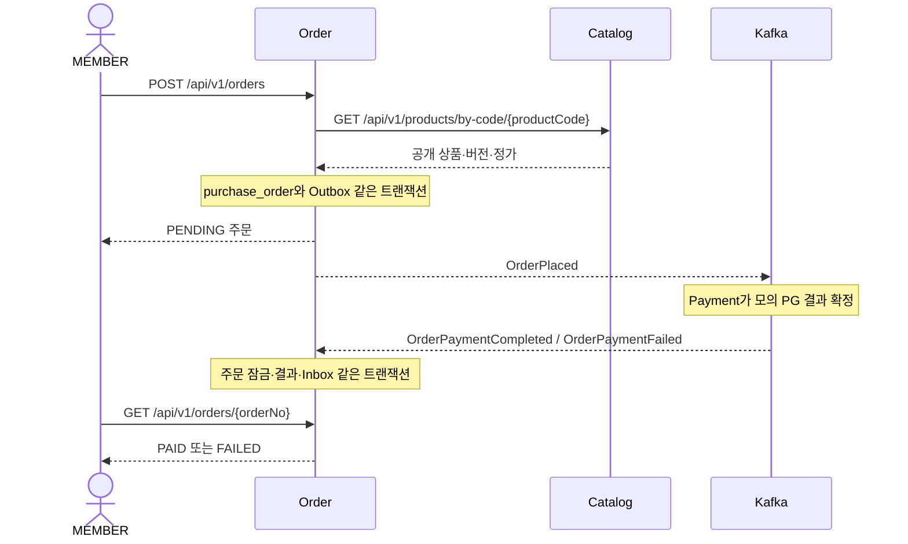

# Order 실행·주문 스냅샷·결제 결과 확인

[문서 목록](README.md) · [MVP 범위·검증 기록](order-mvp-plan.md) · [Store 실행 안내](store-guide.md)

Order는 **누가 어떤 공개 상품을 얼마에 주문했는가**를 보존한다.
상품 하나·수량 하나·양수 KRW 정가만 주문하며 결제 결과에 따라 PENDING → PAID/FAILED로 전이한다.
현재 고객 전액 환불 접수/조회와 ADMIN의 최초 승인/반려도 제공한다. [현재 환불 계약·환경](refund-session-handoff.md), [API 명세](services.md#order)를 따른다. 정산 환불 조정은 후속 범위다. 이용 권한은 [License](license-guide.md)가 담당한다. Order 독립 검증은 이벤트 픽스처를 사용하며, 실제 모의 PG 연계는 [Payment 안내](payment-guide.md)를 따른다.

## 코드와 데이터 흐름

| 유스케이스 | 책임 |
|---|---|
| CreateOrder | 구매자별 중복 요청 확인 → Catalog 공개 상세 HTTP → 동일 상품의 PENDING·PAID 확인 → 기대 값 비교 → 주문·Outbox 저장 |
| SearchOrders | 구매자의 주문만 최신 생성순 페이지 조회 |
| ReadOrder | 구매자·주문번호로 상세 조회, 타인·없는 주문은 404 |
| ApplyPaymentResult | 결제 결과 연결·금액 검증, 행 잠금·Inbox·최종 상태 반영 |



구매자는 Auth JWT의 sub다. 요청 본문·X-Member-Id로 구매자를 고르지 않는다.
Auth의 창작자 가입은 MEMBER·CREATOR를 함께 부여하므로 창작자도 자기 주문을 생성할 수 있다.
MEMBER가 없는 심사자 등은 주문 경로에서 403이다.

신규 업무 행은 purchase_order에만 저장한다. 주문 스냅샷·금액·requestId·원래 요청 이벤트 ID는 바뀌지 않는다.
listAmount는 정가, discountAmount는 현재 0, amount는 고객 청구액이다.
PG 공제 후 입금액이나 판매자 지급액을 결제 승인액으로 보내면 주문 금액 불일치로 거절한다.
할인·결제 수단·수수료 확장의 경계는 [계획의 확장 기준](order-mvp-plan.md#pricing-extension)을 따른다.

## API 확인

업무 API는 다음 세 개이며 MEMBER access token이 필요하다.

| 메서드 | 경로 | 응답 |
|---|---|---|
| POST | /api/v1/orders | 신규 또는 동일 요청의 현재 주문, 200 |
| GET | /api/v1/orders?page=0&size=20 | content·page·size·totalElements·totalPages |
| GET | /api/v1/orders/{orderNo} | 본인 주문의 공개 DTO |

실행 중인 Gateway 주소와 로그인으로 받은 TOKEN을 사용한다. 인증 절차는 [Auth·Gateway 안내](auth-bff.md)를 따른다.
먼저 Store 상세의 productCode·contentVersion·price를 확인하고 다음 JSON으로 생성한다.

```json
{
  "requestId": "9924a677-58a0-4be1-aeca-d3fb9b31713a",
  "productCode": "demo-game",
  "expectedContentVersion": 3,
  "expectedAmount": 10000
}
```

- 같은 구매자·requestId·입력으로 다시 요청하면 Catalog를 호출하지 않고 같은 주문의 현재 상태를 반환한다.
- 같은 requestId에 다른 상품·버전·금액을 보내면 409다. 응답을 잃었으면 원래 입력으로 재조회한다.
- Catalog 공개본이 바뀌어 기대 버전·금액이 다르면 409다. 현재 정보를 확인하고 새 requestId로 요청한다.
- 무료 상품은 409, 없는 공개 상품은 404, Catalog 중단·타임아웃은 503, 잘못된 Catalog 응답은 502다.
- page < 0, size가 1~100 밖, 필수 값 누락·잘못된 형식·소수 금액은 400이다.
- 목록·상세는 내부 이벤트 ID·구매자 식별자·Inbox/Outbox를 노출하지 않는다.
- 주문 취소·결과 주입·공통 운영 HTTP API는 제공하지 않는다. 결과는 Payment가 Kafka로 전달한다.

Catalog 중단 중에도 기존 주문 조회·동일 요청 재조회는 가능하다. 신규 주문은 정가 확인이 필요하므로 503이다.
결과가 없으면 PENDING을 유지하며 자동 만료하지 않는다.

## OCI 검증

로컬에서 편집하고 원격 Gradle 경로로 검증한다.

```sh
./tools/remote/remote.sh gradle :apps:order:test :apps:order:integrationTest :common:kafka:test :common:messaging:test :common:archunit:test -Pstove.infraTest.maxParallel=1 --rerun-tasks
```

독립 사용자 흐름은 먼저 `./tools/remote/remote.sh sync`로 동기화한 뒤 **OCI의 원격 저장소 디렉터리에서** 실행한다.

```sh
python3 tools/verification/verify-order.py
```

스크립트는 현재 소스로 일곱 앱을 빌드하고 임시 MySQL·Redis·Kafka·MinIO와 함께 실행한다.
기본 앱 포트 오프셋은 30000이며 ORDER_TEST_PORT_OFFSET으로 변경할 수 있다.
기존 전체 스택은 필요 없고 기존 데이터 볼륨은 건드리지 않는다. 종료 시 이 실행이 만든 자원만 정리한다.

검증 단계는 다음과 같다.

1. 릴레이를 끈 Order에서 실제 상품 공개·Store 조회·주문·소유권·재출시 스냅샷을 확인한다.
2. Kafka를 중단하고 Order를 재시작해 주문 조회·중복 재조회와 미발행 Outbox 보존을 확인한다.
3. Kafka 복구 후 원래 OrderPlaced를 확인하고 성공·실패 결과 픽스처를 보낸다. 수수료를 공제한 잘못된 결과의 DLT도 확인한다.
4. Catalog를 중단해 기존 조회·중복 재조회 유지와 신규 주문 503을 확인한다.
5. Catalog가 중단된 채 Order를 재시작해 PAID·FAILED·PENDING 보존과 원래 결과 재전달을 확인한다.
6. Catalog 복구 후 신규 주문과 이벤트 발행을 확인한다.

로그·주문 JSON·단계별 JUnit XML은 스크립트가 출력하는 OCI 임시 디렉터리에 남는다.
결제 ID의 fixture 접두어와 결과 이벤트는 검증 대역이며 실제 PG 승인·대금 입금의 증거가 아니다.

## 기존 DB 전환과 재전달

기존 Flyway V1~V10과 자료는 보존한다. V10에 추가한 purchase_order는 V11에서 PENDING·PAID 구매 유일 제약을 적용한다.
구 orders·order_item·shedlock 등은 남지만 새 업무에서는 사용하지 않으며 자동 이관하지 않는다.

기존 DB 전환 시 모든 구 Order 쓰기·릴레이를 중지한 뒤 [전환 SQL](../tools/migrations/order/order-transition.sql)을 명시적으로 실행한다.
구 미발행 Outbox는 원본을 order_legacy_outbox_archive에 보존하고 DEAD로 격리한다. 새 OrderPlaced는 격리하지 않는다.
스크립트 마지막의 unexpected_legacy_pending이 0인지 확인한 뒤 새 릴레이를 켠다. 기본 기동은 이 전환 SQL을 실행하지 않는다.

Kafka 장애 중에도 주문·미발행 이벤트는 DB에 남고 공통 릴레이가 발행을 재시도한다.
재시도 소진으로 DEAD가 된 새 이벤트는 원인을 해결하고 원래 eventId·본문을 유지해 공통 Outbox 복구 절차로 회수한다.
격리된 구 이벤트는 새 흐름으로 재투입하지 않는다.
결과 DLT는 원래 주문·요청과의 연결을 복구한 뒤 원본 이벤트로 재전달한다. 새 주문번호나 이벤트 ID를 임의로 발급해 맞추지 않는다.
상충하는 최종 결제 결과는 먼저 확정한 결과를 보존하므로 원인을 조사하고 거래 기록을 대조해야 한다.

## 2026-10-17 License 연계 확장

최초 PAID 반영에서 Order의 상품·청구액·결제 연결 정보를 OrderPaid로 만들어 같은 트랜잭션의 Outbox에 저장한다.
이 연계 확장에서는 기존 Order HTTP·OrderPlaced·Payment 결과 계약과 purchase_order 스키마를 유지했다. 이후 동일 상품 구매 제한은 아래 V11 범위를 따른다.
동일 결과 재전달·조회는 새 이벤트를 만들지 않고 FAILED에는 OrderPaid가 없다.
Outbox 삽입·flush·커밋 실패는 PAID 반영·결제 결과 Inbox도 함께 롤백한다.

발행 도입 전에 이미 PAID였던 주문은 자동 소급 지급하지 않는다.
공유 데이터의 전환과 과거 구매 소급 처리는 별도 판단이며 [License 범위·검증](license-mvp-plan.md)을 따른다.

## 동일 상품 구매 제한

본인용 동일 상품은 한 번만 구매한다. 선물·추가 수량은 후속 범위다.
같은 requestId·같은 입력은 원래 주문을 반환하고, 새 requestId에 대해 같은 구매자·상품의 PENDING은 409 PURCHASE_IN_PROGRESS, PAID는 409 PRODUCT_ALREADY_PURCHASED다.
최종 FAILED만 새 requestId의 새 주문을 허용한다. 미확정·시간 경과로 구매 제한을 풀지 않는다.
판정은 Order 자기 상태와 V11의 유일 제약으로 수행하며, License 지급 지연·중단 중에도 PAID 추가 구매를 막는다.
[범위·자료 전환·동시성 검증](license-mvp-plan.md#통합-및-중복-구매-제한-수정-계획)을 따른다.
