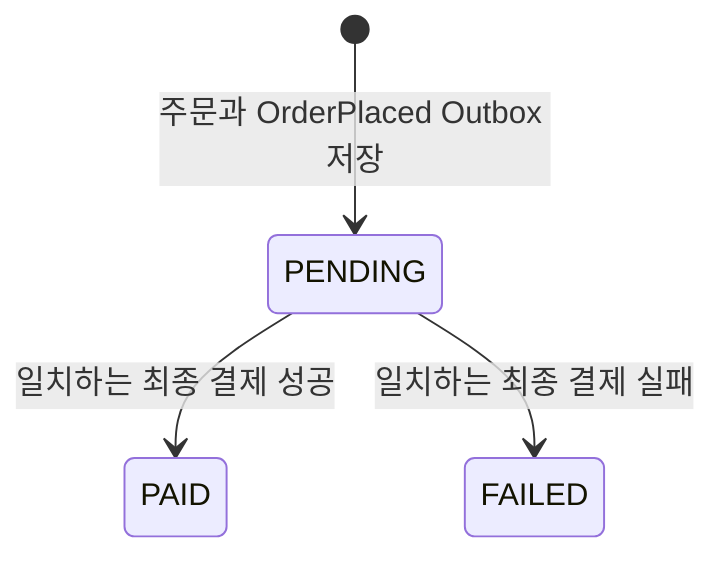

# Order MVP 재작성 계획·완료 기록

[문서 목록](README.md) · [작업 기준·순서](../AGENTS.md) · [Catalog 완료 범위](catalog-mvp-plan.md) · [Store 완료 범위](store-mvp-plan.md) · [유스케이스 작성 규칙](use-case-conventions.md)

2026-10-16 계획 작성·재작성 완료. 아래 최소 범위를 구현하고 OCI에서 검증했다. 실제 결과는 [완료 기록](#재작성-완료-기록)을 따른다.

후속 Payment MVP의 모의 PG 연계도 완료했다. 현재 실행은 [Payment 안내](payment-guide.md), 실제 연계·복구 근거는 [Payment 완료 기록](payment-mvp-plan.md#재작성-완료-기록)을 따른다. 아래 Order 최초 완료 기록의 결제 결과는 계약 픽스처로 검증했다.

## 목표와 기준

최소 MVP를 직접 구현·실행하면서 **상품 탐색, 주문 금액 확정, 실제 결제의 책임 차이와 코드 흐름을 설명할 수 있게 만드는 것**이 목표다.
구매자가 Store에서 찾은 공개 상품 하나를 주문하고, 주문 당시의 상품·금액을 보존하며, 결제 결과에 따라 주문이 확정되는 흐름을 완성한다.

완료된 Auth·Gateway·Studio·Review·Catalog·Store의 현재 계약을 기준으로 한다.
미완료 Order·Payment·License·Download·Settlement의 기존 API·상태·이벤트·테스트는 호환성 요구나 완료 기준으로 삼지 않는다.
후속 순서는 Order → Payment → License → Download → Settlement다. 이번에는 Order를 구현하고 Payment는 이벤트 계약 경계에서 검증한다.

| 모듈 | 이번 흐름에서 맡는 책임 |
|---|---|
| Auth·Gateway | 기존 로그인·MEMBER 권한, JWT 전달과 주문 경로 라우팅 |
| Studio | 작업본·빌드·심사/출시 요청과 결과 기록 |
| Review | 제출된 불변 스냅샷의 수동 승인·반려와 결과 발행 |
| Catalog | 공개 상품·현재 공개본·KRW 정가의 정본, 기존 공개 상세 API |
| Store | 공개 상품 탐색·목록·상세를 위한 조회 사본 |
| Order | 주문 당시 구매자·상품·금액 보존, 결제 요청의 근거 발행, 결제 결과 반영·내 주문 조회 |
| Payment | 후속 재작성 대상. 실제 대금 처리와 결과 발행을 소유 |

## 이번 MVP와 후속 개발

| 이번 MVP에 포함 | 최소 구현 |
|---|---|
| 주문 생성 | MEMBER 사용자, 공개 상품 하나·수량 하나·KRW 양수 정가 |
| 주문 내용 확정 | 기존 Catalog 공개 상세를 읽고 사용자가 확인한 버전·금액과 비교 |
| 주문 스냅샷 | 상품 ID·코드·제목·contentVersion·정가·할인액·청구액·통화를 주문 시점에 고정. 이번 할인액은 0 |
| 요청 중복 방지 | 구매자별 requestId 유일 제약과 동일 요청 재조회 |
| 내 주문 조회 | 본인 주문 목록·상세, 최신 생성 순 페이지 조회 |
| 결제 연동 경계 | 주문 생성 이벤트 발행, 성공·실패 결과 검증과 단방향 상태 전이 |

소량의 개발·학습용 데이터와 Order 단일 인스턴스를 전제로 한다.
다음 항목은 후속 개발로 남긴다.

- 장바구니·복수 상품·수량 선택·선물·쿠폰·할인·다중 통화·무료 상품 지급.
- 미결제 주문 취소·결제 재시도·자동 만료·예약·재고·가격 보장 기한.
- PG·결제창·콜백·환불·보상 트랜잭션·Saga·이용권 지급·다운로드·정산 계산.
- 이미 보유한 상품의 구매 제한과 다른 requestId로 만든 반복 구매의 차단.
- 주문용 상품 사본·캐시·견적 서비스·별도 Catalog 견적 API, 전용 감사·운영 화면·성능 실험.
- 서비스별 DB 계정·별도 서비스 인증·Kafka 생산자 권한 분리와 다중 인스턴스 운영 설계.

Catalog는 0원 상품도 공개할 수 있지만 이번 주문 API는 양수 가격만 받는다. 무료 상품은 409로 거절하고 별도 지급 정책은 후속 설계한다.
PENDING 주문은 결과가 없으면 그대로 남는다. 시간 경과만으로 취소·실패·완료로 바꾸지 않는다.
같은 주문의 실패는 최종 결과다. 다시 시도하려면 새 requestId로 새 주문을 만든다.

## 사용자 흐름과 가격 확정

1. 기존 Studio → Review → Catalog 출시와 Store 반영을 거쳐 공개 상품을 준비한다.
2. MEMBER가 Store 상세에서 상품 코드·contentVersion·가격을 확인한다.
3. 주문 생성에 requestId·productCode·expectedContentVersion·expectedAmount를 보낸다.
4. Order가 JWT의 sub로 구매자를 식별하고, 동일 구매자·requestId의 기존 주문을 먼저 확인한다.
5. 신규 요청이면 `GET /api/v1/products/by-code/{productCode}`로 Catalog의 현재 공개 상세를 읽는다.
6. 상품 코드·양수 ID/버전·제목·양수 가격·KRW를 검증하고 기대 버전·금액과 비교한다.
7. 일치하면 정가·할인액 0·청구액을 계산하고 주문 스냅샷·PENDING 상태와 주문 생성 Outbox를 같은 트랜잭션으로 저장하고 응답한다.
8. 후속 Payment가 이 이벤트의 고정 금액으로 결제를 처리한다. 이번 검증에서는 결과 이벤트 픽스처를 보낸다.
9. Order가 연결 정보와 금액을 검증해 PAID 또는 FAILED로 전이하고, 구매자는 내 주문에서 결과를 확인한다.

Store 사본이 늦어 기대 버전·금액이 Catalog와 다르면 409다. 서버가 새 금액으로 조용히 주문하지 않는다.
클라이언트는 현재 공개 정보를 확인한 뒤 **새 requestId**로 다시 요청한다. 실패해 저장되지 않은 요청은 주문이나 Outbox를 남기지 않는다.
제목·금액·버전의 저장 값은 Catalog 응답에서 얻는다. 기대 값은 비교에만 사용하며 구매자·수량·총액을 클라이언트가 지정하지 않는다.

가격 확정의 기준은 **이번 HTTP 상세 응답의 공개본**이다. HTTP 호출과 Order DB 저장 사이의 Catalog 재출시까지 하나의 트랜잭션으로 묶지 않는다.
확인한 공개본을 주문에 고정하고 이후 Catalog 가격·제목·버전이 바뀌어도 기존 주문과 결제 요청을 다시 계산하지 않는다.
contentVersion은 주문 근거를 보존하는 값이다. 특정 빌드만 이용할 권리나 후속 업데이트 권한의 정책을 뜻하지 않는다.

Catalog 호출은 Order DB 트랜잭션 밖에서 수행하고 연결 3초·읽기 10초의 유한한 타임아웃을 둔다.
Catalog의 404는 주문 생성 404로, 타임아웃·연결 실패·5xx는 503으로, 형식·필수 값이 잘못된 응답은 502로 처리한다.
Catalog가 중단되면 신규 주문은 실패하지만 이미 저장한 주문의 조회와 동일 요청의 재조회는 계속 제공한다.
타 서비스의 DB나 Store 사본을 조회해 주문 금액을 확정하는 우회 경로는 두지 않는다.

<a id="pricing-extension"></a>

### 할인·결제 수단·수수료의 확장 기준

금액마다 의미와 확정 시점을 구분한다. **Order의 amount는 고객에게 청구할 금액**이며 PG 비용이나 판매자 지급액을 차감한 금액이 아니다.

| 책임 | 보존할 값과 확장 위치 |
|---|---|
| Catalog | 공개 상품의 정가. 구매자별 쿠폰·PG 선택과 분리 |
| Order | 주문 당시 정가·할인액·최종 청구액. 주문 확정 전 금액 계산 단계에 할인 정책을 추가 |
| Payment | 확정 청구액의 승인·실패, 결제 수단·PG·거래 식별자. PG 추가는 외부 결제 어댑터에서 처리 |
| Settlement | 거래 조건과 실제 비용에 따른 배분·판매자 지급액. 플랫폼 수수료·PG 비용의 부담 주체를 구분 |

이번 MVP는 listAmount=Catalog.price, discountAmount=0, amount=listAmount-discountAmount로 계산한다.
세 값은 같은 주문에 함께 저장한다. 별도 할인 서비스·정책 엔진·가상의 수수료 조건은 만들지 않는다.
가격 계산은 CreateOrder의 주문 확정 전 단계에서 시작하고, 실제 할인 정책이 생기면 해당 계산 책임을 협력 객체로 분리한다.

후속 기능은 다음 기준으로 확장한다.

- **할인:** 정책 추가 시 할인 내역·부담 주체·정책 식별자/버전·실제 적용 금액을 함께 보존한다. 합계가 같은 판매자 부담 할인과 플랫폼 부담 할인도 정산 근거는 다르다. 적용 순서·반올림 기준이 있으면 그 근거도 남긴다.
- **결제 수단:** Payment가 여러 PG·결제 시도를 조율하고 Order에는 최종 결과를 보고한다. 청구액이 같다면 PG 변경 때문에 Order의 상태를 늘리지 않는다.
- **수단별 가격:** 결제 수단 할인이나 고객 부담 수수료로 청구액이 달라지면 주문 확정 전에 선택 조건과 금액을 확인해야 한다. 필요할 때 견적·만료·예약 절차를 추가하며, 이미 확정한 주문 금액은 덮어쓰지 않는다.
- **수수료·정산:** 거래에 적용할 계약 조건은 해당 조건의 확정 시점에 보존한다. 실제 PG 비용을 나중에 알게 되면 결제 거래·정산 자료에 추가하고 주문 청구액은 유지한다. 수수료 부담과 공제 기준은 계약에 따라 정하며 일률적인 차감식을 가정하지 않는다.
- **과거 거래:** 최신 정책으로 과거 주문·수수료를 다시 계산하지 않는다. 확정 금액·당시 적용 조건을 사용하고 환불·추가 비용은 연결된 별도 기록으로 표현한다.
- **계약 변경:** 새 금액 내역·견적 조건이 필요하면 DB·API·이벤트 계약을 함께 확장한다. 기존 amount의 의미를 바꾸지 않으며 의미가 달라지는 계약은 버전을 구분한다.

이 기준은 후속 변경의 위치를 정하는 것이다. 쿠폰 수량·예산 제한, 여러 수단의 분할 결제, 부분 환불은 각 기능을 도입할 때 추가 설계·검증한다.

## 저장 모델과 중복 요청

업무 엔티티는 **Order 하나**, 새 업무 테이블은 `purchase_order` 하나로 시작한다.
상품 하나의 스냅샷을 Order의 값 객체와 컬럼으로 저장하며 별도 OrderItem 목록·테이블은 만들지 않는다.
이벤트 신뢰성에는 기존 common:messaging의 Outbox·Inbox 테이블을 재사용한다.

| 값 | 의미 |
|---|---|
| id·orderNo | DB ID와 외부 연결용 UUID 주문번호. orderNo는 유일하며 변경하지 않음 |
| buyerSubject·requestId | JWT sub 구매자와 클라이언트 UUID 요청 식별자. 두 값의 조합에 유일 제약 |
| productId·productCode·title·contentVersion | Catalog에서 확인한 주문 당시 상품 스냅샷 |
| listAmount·discountAmount | 주문 당시 정가와 할인 합계. 이번에는 Catalog.price와 0 |
| amount·currency | 고객에게 청구할 확정 금액과 KRW. 기대 금액과 일치한 값이며 PG 비용·정산액과 구분 |
| status·createdAt·updatedAt | PENDING/PAID/FAILED와 저장 시각 |
| requestEventId | 최초 OrderPlaced 이벤트 ID. 결제 결과를 원래 요청에 연결 |
| paymentResultEventId·paymentResult | 최초 수락한 결과 이벤트 ID와 결과 스냅샷. 결제 ID·결과 시각·실패 사유 포함 |

결과 스냅샷은 paymentId·resultOccurredAt·실패 사유 등의 컬럼으로 보존하고 paymentResult() 값 객체로 재구성한다. 별도 결과 테이블이나 원문 JSON 저장은 두지 않는다.

requestEventId와 nullable paymentResultEventId에도 각각 유일 제약을 둔다.
요청·구매자·상품 코드는 원문 기준으로 비교하고, 식별자 컬럼과 유일 제약은 대소문자를 구분하게 한다.
시각은 UTC·마이크로초 정밀도로 맞춰 저장·재조회·이벤트 비교의 정밀도 차이를 피한다.
금액은 정수 long을 사용하며 소수 입력을 정수로 절삭해 받지 않는다.

| 요청 | 처리 |
|---|---|
| 새 구매자·requestId | Catalog 확인 후 주문·Outbox 한 번 생성 |
| 같은 구매자·requestId, 같은 코드·기대 버전·기대 금액 | Catalog를 다시 호출하지 않고 기존 주문의 현재 상태 반환 |
| 같은 구매자·requestId, 다른 입력 | 409, 기존 주문 보존 |
| 다른 구매자, 같은 requestId | 서로 다른 요청으로 처리 |
| 같은 요청의 동시 생성 | DB 유일 제약으로 한 건만 확정, 패한 트랜잭션 종료 후 기존 주문을 다시 읽어 위 규칙 적용 |

requestId는 별도 Redis 락·멱등 테이블 없이 Order 자체에서 처리한다.
저장 트랜잭션에서도 기존 키를 재확인한다. 동시에 저장을 시도하면 먼저 커밋한 주문을 보존하고 스냅샷·이벤트를 덮어쓰지 않는다.
Catalog 조회·기대 값 검증 실패 중에도 다른 요청이 먼저 확정됐을 수 있으므로 기존 키를 다시 확인한다. 주문이 있으면 동일 입력/충돌 규칙을 적용하고 없으면 원래 오류를 반환한다.
Outbox 기록이 실패하면 주문도 롤백한다. HTTP 응답을 잃었으면 같은 requestId로 확정 여부를 확인할 수 있다.

## 결제 이벤트 계약과 상태

신규 계약은 common:kafka의 DomainEvent·EventEnvelope를 따른다. 기존 미완료 구매 계약과 구분하는 새 eventType을 사용한다.
수신 어댑터의 PaymentResultMapper가 봉투·본문·키를 검증하고 내부 PaymentResult로 변환한다. 업무 서비스는 이벤트 종류 문자열과 내부 결과를 받으며 외부 이벤트 전체나 EventEnvelope를 받지 않는다.
이번에 발행하는 업무 이벤트는 OrderPlaced 하나이며, 결과 반영 뒤 후속 License·Settlement용 이벤트를 미리 추가하지 않는다.

| eventType / record | 방향·토픽 | 본문 |
|---|---|---|
| OrderPlaced / OrderPlacedEvent | Order → 후속 Payment, stove.order.v1 | eventId·occurredAt·orderNo·buyerSubject·productId·productCode·title·contentVersion·listAmount·discountAmount·amount·currency |
| OrderPaymentCompleted / OrderPaymentCompletedEvent | 후속 Payment → Order, stove.payment.v1 | eventId·occurredAt·orderNo·requestEventId·paymentId·buyerSubject·amount·currency |
| OrderPaymentFailed / OrderPaymentFailedEvent | 후속 Payment → Order, stove.payment.v1 | 완료 결과와 같은 연결·금액 필드 + reasonCode·reason |

- 모든 Kafka 키와 Outbox aggregateId는 orderNo다. 신규 소비 그룹은 `order-payment-result`이며 유스케이스의 CONSUMER_GROUP 상수를 리스너와 Inbox에서 공유한다.
- requestEventId는 원래 OrderPlaced.eventId다. paymentId는 Payment가 발급하는 불투명 문자열 식별자이며 Order가 대신 발급하지 않는다.
- 같은 최종 결제 결과의 재전달에는 최초 eventId와 본문을 그대로 유지한다. 재전송마다 새 이벤트를 생성하지 않는다.
- eventId·requestEventId·paymentId는 최대 64자, buyerSubject는 최대 100자, 상품 코드·제목은 Catalog의 길이 계약을 따른다.
- 실패 reasonCode는 최대 100자, reason은 최대 500자의 필수 값이다. 성공 결과에 실패 사유를 섞지 않는다.
- 주문의 금액·통화·구매자는 생성 이후 고정이다. 결과 이벤트로 상품 정보를 수정하지 않는다.
- 완료 결과의 amount는 고객에게 승인된 금액이다. PG 수수료 공제 후 입금액이나 판매자 지급액과 비교하지 않는다.
- 새 유형만 소비하며 기존 OrderCreated·PaymentCompleted·PaymentFailed 등 구 유형은 새 흐름에서 사용하지 않는다.
- 구 공통 타입은 미완료 모듈의 컴파일을 위해 남길 수 있다. 그 모듈을 새 계약에 맞추어 수정·실행하는 작업은 이번 범위에 넣지 않는다.



결과 소비는 다음 순서로 하나의 DB 트랜잭션에서 처리한다.

1. 봉투·본문의 ID/유형, Kafka 키·주문번호와 필수 값·길이·금액·통화를 검증한다.
2. 주문 행을 잠그고 paymentResultEventId로도 조회해 다른 주문에서 사용한 이벤트 ID는 Inbox 중복 판단 전에 거절한다.
3. 이미 반영한 결과가 있으면 eventId와 결과 스냅샷 모두 같은 경우에만 변경 없이 성공한다. 내용·이벤트 ID·결제 ID가 다르거나 상충하는 결과는 실패시킨다.
4. 공통 Inbox 가드와 같은 트랜잭션에서 requestEventId·buyerSubject·amount·currency를 대조하고 최초 결과를 저장·상태 전이한다. 결과 스냅샷·상태·Inbox는 함께 커밋하거나 롤백한다. Inbox만 있고 일치하는 저장 결과가 없으면 정상 중복으로 넘기지 않는다.

결과 스냅샷 비교는 결과 유형·연결 정보·paymentId·금액·통화·결과 시각·사유를 기준으로 한다.
동일 eventId·동일 결과의 재전달은 상태를 다시 바꾸지 않는다. PAID·FAILED는 최종 상태이며 새 결과로 덮어쓰지 않는다.
paymentResultEventId를 다른 주문에서 재사용한 경우도 유일 제약과 저장 결과 비교로 거절한다.
서로 다른 주문에서 같은 eventId로 경합해도 한 건만 커밋되며, 실패한 건은 재전달 때 연결 충돌로 남아야 한다.
동시에 도착한 성공·실패는 행 잠금으로 직렬화하고 먼저 수락한 최종 결과를 보존한다.

Payment는 주문당 하나의 최종 결제 결과를 보낸다는 계약이다. 개별 PG 시도의 실패를 최종 실패 이벤트로 발행하지 않는 것은 후속 Payment의 책임이다.
없는 주문·연결 불일치·결과 충돌은 주문을 바꾸지 않고 실패시킨다. 공통 Kafka 재시도·DLT를 사용하며 임의 성공이나 별도 복구 스케줄러를 만들지 않는다.
결제 결과를 직접 주입하는 업무 HTTP API는 제공하지 않는다. 검증 픽스처는 테스트 소스와 임시 Kafka에서만 사용한다.

## 주문 API와 최소 보안

기존 Gateway의 `/api/v1/orders/**` MEMBER 경로를 사용한다. Order도 같은 역할과 JWT 검증을 적용한다.

| 메서드 | 경로 | 역할 |
|---|---|---|
| POST | /api/v1/orders | 단일 상품 주문 생성 또는 동일 요청 재조회 |
| GET | /api/v1/orders | 내 주문 페이지 목록 |
| GET | /api/v1/orders/{orderNo} | 내 주문 상세 |

생성 요청 예시는 다음과 같다.

```json
{
  "requestId": "9924a677-58a0-4be1-aeca-d3fb9b31713a",
  "productCode": "demo-game",
  "expectedContentVersion": 3,
  "expectedAmount": 10000
}
```

- productCode는 Catalog의 `[A-Za-z0-9][A-Za-z0-9._-]{0,49}` 규칙, 기대 버전은 양수·기대 금액은 0 이상, requestId는 UUID 형식으로 검증한다.
- 구매자는 common:security의 CurrentSubject로 JWT sub에서 직접 얻는다. 요청 본문·쿼리·X-Member-Id 등으로 선택하지 않는다.
- JWT 서명·issuer·만료·aud=esd-api와 MEMBER 역할은 기존 ApiJwtSecurity를 재사용한다. Auth의 member_id 매핑이나 회원 DB 조회를 추가하지 않는다.
- 익명 401, MEMBER 역할 없음 403, 잘못된 입력 400, 없는 상품·주문 404, 기대 값·요청 ID 충돌·무료 상품 409다.
- 타인 주문은 404로 처리하고 목록은 buyerSubject로 제한한다. 본문에 구매자·상태를 보내도 주문 소유자·상태에 반영되지 않음을 검증한다.
- 페이지 기본값 page=0·size=20, page >= 0·1 <= size <= 100, createdAt 내림차순·id 내림차순으로 정렬한다.
- 공통 ApiResponse와 전용 DTO를 사용한다. 생성·중복 재조회는 200, 목록은 content·page·size·totalElements·totalPages를 반환한다.
- 상세는 orderNo·상품 스냅샷·정가·할인액·청구액·통화·상태·생성/갱신 시각·결과 시각·실패 사유를 제공한다. 내부 eventId·Inbox·Outbox·결과 내부 연결 정보는 노출하지 않는다.
- 업무 API는 위 세 경로·메서드만 허용하고 health·문서 경로 외에는 닫는다. 공통 운영 HTTP API는 stove.messaging.ops.enabled=false로 끈다.

Catalog 호출은 기존 공개 상세 경로를 사용한다. 별도 서비스 인증이나 Gateway 보안 범위 확장은 필요 없다.
Gateway의 기존 BFF 세션·CSRF·토큰 전달 규칙은 그대로 검증한다.

## 구현 구성과 기존 코드·DB 전환

| 위치 | 구성 |
|---|---|
| core.domain | Order·상품/결과 값 객체·리포지토리, 스냅샷·최종 상태 불변식 |
| core.service | CreateOrder, SearchOrders, ReadOrder, ApplyPaymentResult |
| core.port / infrastructure | 공개 상품 상세 조회 포트와 Catalog HTTP 어댑터 |
| api.controller | 생성·목록·상세 DTO, 입력 해석·구매자 전달 |
| api.listener | 새 결제 결과 유형 해석·PaymentResultMapper.from 변환 후 내부 결과로 ApplyPaymentResult.execute 호출 |
| config | 최소 JWT·권한·Kafka·DB·HTTP 타임아웃 설정 |

CreateOrder는 기존 요청 확인·Catalog HTTP 호출 뒤 TransactionTemplate으로 저장 경계를 연다.
HTTP 조회를 분리하려고 단순 위임용 Facade나 저장 단계마다 별도 유스케이스를 만들지 않는다.
SearchOrders·ReadOrder는 읽기 전용, ApplyPaymentResult는 행 잠금·Inbox·상태 변경을 같은 트랜잭션으로 처리한다.
common:web·security·jpa·kafka·messaging을 필요한 범위로 사용하고 공통 프레임워크를 재설계하지 않는다.

1. 기존 Flyway V1~V9의 파일·체크섬을 유지한다. 구현 시작 시 신규 마이그레이션 여부를 재확인한다.
2. 다음 V10에 purchase_order와 인덱스·유일 제약을 추가하고 기존 Outbox·Inbox를 재사용한다.
3. 구 orders·order_item·shedlock 등의 자료·테이블은 보존하되 새 업무 경로에서 읽거나 갱신하지 않는다.
4. 구 주문은 JWT sub·새 요청·이벤트와 대응이 보장되지 않으므로 자동 이관하지 않는다.
5. 기존 DB 전환 절차는 구 Order 쓰기·릴레이 중지 → 미발행 구 이벤트 확인·원본 보관·격리 → 새 앱 시작 순서다.
6. Catalog 전환 SQL처럼 Order 전용 스크립트에 구 Outbox 원본 보관과 DEAD 격리·잔여 PENDING 확인을 명시한다. 기본 기동에서 자동 실행하지 않는다.

구 Quote·QuoteItem·OrderItem, PlaceOrderFacade·포괄적 Command/QueryService, 만료 Sweeper·ShedLock·Redis·주문 전용 지표·취소 API를 제거·교체한다.
구 계약 테스트를 새 범위로 바꾸고 OpenAPI·서비스·모델·실행 문서를 갱신한다. 공통 지표와 기본 로그는 재사용한다.
신규 스키마 생성과 기존 DB 업그레이드는 임시 DB에서 검증한다. 기존 개발·운영 DB 전환 실행은 구현 완료와 구분한다.
판매자·수수료·정산 조건은 현재 Catalog 공개 API에 없다. 임의 값을 채우지 않고 Settlement 단계에서 필요한 계약을 별도로 검토한다.

## OCI 구현·검증 순서

로컬은 편집·정적 점검·동기화에 사용하고 빌드·단위·아키텍처·통합 테스트·서비스 실행은 모두 OCI에서 수행한다.
scripts/remote.sh와 기존 로컬 Git 설정으로 커밋 전 작업본을 동기화한다. 머신별 접속 값은 문서에 쓰지 않는다.

1. **계약·모델:** 요청 DTO·새 이벤트 세 개·상태 규칙·단일 주문 테이블과 중복 정책을 정의한다.
2. **주문 생성:** 기존 Catalog 상세 어댑터·기대 값 비교·중복 재조회·주문과 Outbox 원자성을 구현한다.
3. **조회·보안:** 본인 목록·상세·페이지·JWT·MEMBER와 Gateway 경유 접근을 구현한다.
4. **결과 반영:** 이벤트 연결·금액 검증·행 잠금·결과 비교·Inbox·최종 상태를 구현한다.
5. **정리·전환:** 구 코드·설정·테스트를 교체하고 V9→V10·구 Outbox 격리, OpenAPI와 안내 문서를 검증한다.
6. **실제 흐름:** scripts/verify-store.py를 참고해 `scripts/verify-order.py`·독립 Order E2E 태스크를 작성하고 OCI에서 실행한다.

모듈 검증은 다음 원격 명령으로 시작한다.

```sh
./scripts/remote.sh gradle :apps:order:test :apps:order:integrationTest :common:kafka:test :common:messaging:test :common:archunit:test -Pstove.infraTest.maxParallel=1 --rerun-tasks
```

완료된 여섯 모듈의 단위·통합 회귀 검사도 같은 원격 경로로 실행한다. 공통 계약 확장의 기존 계약 비침범을 확인한다.
OpenAPI는 OCI에서 생성·회수하고 갱신 플래그 없이 계약 일치를 재검증한다.

독립 검증은 **Auth·Gateway·Studio·Review·Catalog·Store·Order**와 MySQL·Redis·Kafka·MinIO만 사용한다.
Payment·License·Download·Settlement와 기존 전체 앱 E2E의 실행·성공은 완료 조건에 넣지 않는다.
모듈 통합 테스트는 실제 MySQL·Kafka와 Catalog HTTP 스텁을, 정상 사용자 흐름은 실제 완료 모듈을 사용한다.
결제 결과 픽스처는 OrderPlaced를 읽어 같은 requestEventId·구매자·금액을 담아 임시 브로커에 보낸다. 실제 결제 성공으로 기록하지 않는다.

기존 중지 스택과 데이터 볼륨은 보존한다. 임시 포트·DB·컨테이너로 검증하고 그 실행이 만든 자원만 정리한다.
현재 동기화한 소스를 빌드해 사용하며 실행 로그·JUnit XML·API 응답·이벤트를 증거로 남긴다.

## 검증과 완료 조건

| 경계 | 필수 확인 |
|---|---|
| 생성·상품 | 공개 상품 주문, 미공개/없는 코드·무료 상품·잘못된 통화·타임아웃·잘못된 Catalog 응답 거절과 주문 미생성 |
| 가격·스냅샷 | 정가·할인액 0·청구액의 일치, 기대 버전/금액 불일치 409, 주문 후 재출시·가격 변경에도 기존 주문·요청 이벤트 값 유지 |
| 중복·원자성 | 같은 요청·다른 입력·타 사용자 키·동시 생성, 주문 한 건·Outbox 한 건, Outbox 실패 시 전체 롤백 |
| 소유권·API | JWT 검증·401/403, 본인만 조회·타인 404, 소유자/상태 위조 무효, 페이지 상한·동률 정렬·OpenAPI |
| 결과·연결 | 성공/실패 전이, 수수료 공제 후 금액을 승인액으로 보낸 결과 등 연결·금액·통화·봉투 불일치 거절, 주문 정보 보존 |
| 중복·경합 | 같은 eventId·결과의 재전달 무효과, 변경된 본문·새 최종 이벤트·다른 주문의 ID 재사용 거절, 동시 상충 결과에 최종 상태 한 번 확정 |
| 트랜잭션 | 결과 저장·상태·Inbox 함께 롤백, 재전달 후 정상 반영, 계약 위반 DLT와 원본 재전달 |
| 재시작·장애 | 미발행 Outbox 보존·재시작 뒤 발행, 결과 재소비 시 상태 유지, Catalog 중단 중 기존 주문 조회·중복 재조회 |
| DB·회귀 | 빈 DB·V9 업그레이드·구 자료 보존·구 Outbox 격리 스크립트 반복 실행, 완료 여섯 모듈·변경 공통 계약 회귀 |

독립 실행에서 실제 공개 → Store 탐색 → 회원 주문 → OrderPlaced 확인 → 결과 픽스처 → 내 주문 PAID/FAILED를 확인한다.
다른 회원의 접근 차단, 재출시 전후 주문 스냅샷, Catalog 중단·Order 재시작도 같은 검증 스크립트의 단계로 확인한다.
완료 기록에는 실제 실행한 테스트 수·실패/건너뜀·명령·증거 위치와 Payment는 픽스처라는 한계를 함께 남긴다.
구현·OCI 검증·문서 갱신을 마친 뒤에만 AGENTS.md·README의 재작성 완료 목록에 Order를 추가한다.

## 재작성 완료 기록

2026-10-16, purchase_order 단일 업무 테이블과 네 유스케이스로 재작성을 완료했다.
CreateOrder·SearchOrders·ReadOrder·ApplyPaymentResult가 주문 생성·내 조회·결제 결과 반영을 담당한다.
Catalog의 기존 공개 상세 API를 사용하며 완료된 여섯 앱의 업무 계약은 변경하지 않았다.
정가·할인액 0·고객 청구액을 나눠 보존하고, 구매자별 requestId로 생성 경합·재요청을 처리한다.
새 공통 계약은 OrderPlaced·OrderPaymentCompleted·OrderPaymentFailed 세 개다. 구 공통 타입과 미완료 하류 구현은 변경하지 않았다.

구 견적·항목 목록·판매자/정산 조건·Redis·ShedLock·만료·취소·전용 주문 지표를 제거했다.
기존 V1~V9의 내용·체크섬을 그대로 유지하고 V10에 새 업무 테이블을 추가했다.
구 자료는 자동 이관하지 않으며 명시적 전환 SQL의 원본 보관·DEAD 격리·반복 실행을 임시 DB에서 확인했다.

빌드·단위·아키텍처·실제 인프라 통합·서비스 실행은 모두 OCI에서 수행했다.
최종 회귀 검사는 --rerun-tasks로 캐시·UP-TO-DATE를 배제하고 78개 Gradle 태스크를 실제 실행했다. 소요 시간은 5분 50초였다.

| 모듈 | 단위·아키텍처 | 실제 인프라 통합 |
|---|---:|---:|
| Auth | 3 | 8 |
| Gateway | 87 | 1 |
| Studio | 46 | 6 |
| Review | 50 | 12 |
| Catalog | 37 | 14 |
| Store | 40 | 10 |
| Order | 56 | 21 |
| common:kafka | 163 | 이번 변경에서 실행하지 않음 |
| common:archunit | 19 | 해당 없음 |
| common:messaging | 72 | 이번 변경에서 실행하지 않음 |
| common:test | 3 | 해당 없음 |

JUnit XML 집계는 총 **648건 통과, 실패·오류·건너뜀 0건**이다.
검사 대상 결과 파일의 생성 시각도 이번 실행과 일치하는지 확인했다.
Order OpenAPI를 OCI에서 생성해 회수한 뒤 갱신 플래그 없이 계약 일치를 검증했다. 업무 경로는 두 개, 메서드 기준 API는 세 개다.

Order 통합 검사는 실제 MySQL·Kafka에서 다음을 확인했다.

- 중복·동시 생성에 주문·Outbox 한 건, Catalog 호출 중 활성 Order 트랜잭션 없음, Catalog 실패 중 다른 요청이 확정됐을 때 기존 주문 반환.
- 신규 공개·가격 변경 이후 기존 스냅샷 유지, 무료 상품·미공개·잘못된 upstream과 기대 값 불일치 시 주문 미생성.
- 실제 RSA JWT의 서명·issuer·audience·만료·역할, 본인 조회·타인 404·요청 본문의 소유자/상태 위조 무효, 페이지·정렬·정수 입력.
- 최초 성공/실패와 원본 재전달, 같은 이벤트의 변경·새 최종 결과·다른 주문의 이벤트 ID 재사용 거절, 동시 상충 결과 한 번 확정.
- 서로 다른 주문에서 같은 결과 이벤트 ID의 동시 경합, Inbox 삽입 뒤 실패와 최종 상태 flush 뒤 실패의 전체 롤백.
- 없는 주문의 결과 DLT 이동과 원래 주문 복구 후 같은 이벤트 ID 재전달, 빈 DB·V9→V10 전환과 구 자료 보존.

[독립 검증 스크립트](../scripts/verify-order.py)는 일곱 앱과 임시 MySQL·Redis·Kafka·MinIO로 다음 **6단계를 모두 통과**했다.

1. 실제 가입·로그인·업로드·심사 승인·출시·Store 조회 → 주문, 본인 조회·중복 요청과 재출시 후 과거 주문 보존.
2. Kafka 중단 중 Order 재시작 → 저장된 주문 조회·재요청과 원래 미발행 Outbox 세 건 보존.
3. Kafka 복구 → 원래 OrderPlaced 세 건 발행, 성공/실패 결과 픽스처 반영, 수수료 공제 후 금액을 보낸 결과의 DLT.
4. Catalog 중단 → 준비된 Store 조회·기존 주문·동일 요청 유지, 신규 주문 503.
5. Catalog 중단 중 Order 재시작 → PAID·FAILED·PENDING 보존과 원래 성공 결과 재전달.
6. Catalog 복구 → 신규 주문·이벤트 발행, 기존 성공 결과·Inbox 건수 유지.

단계별 JUnit XML 여섯 개·앱 로그·order.json은 이번 OCI 실행의 /tmp/stove-order-check-4roa2hre에 보존했다.
다시 실행하면 새 임시 디렉터리를 출력하고 단계별 XML을 별도로 보존한다.
검증 프로세스·임시 컨테이너는 종료 시 정리하며 기존 중지 스택과 데이터 볼륨은 보존했다.
기존 개발 DB 전환 SQL 실행·배포와 실제 PG·이용권·정산 연동은 이번 완료 범위에 포함하지 않는다.
실행·수동 확인·복구 절차는 [Order 실행 안내](order-guide.md)를 따른다.
