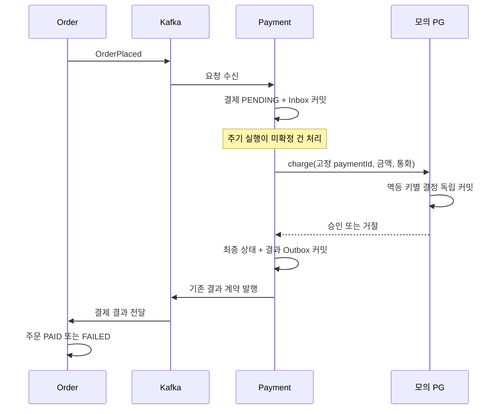
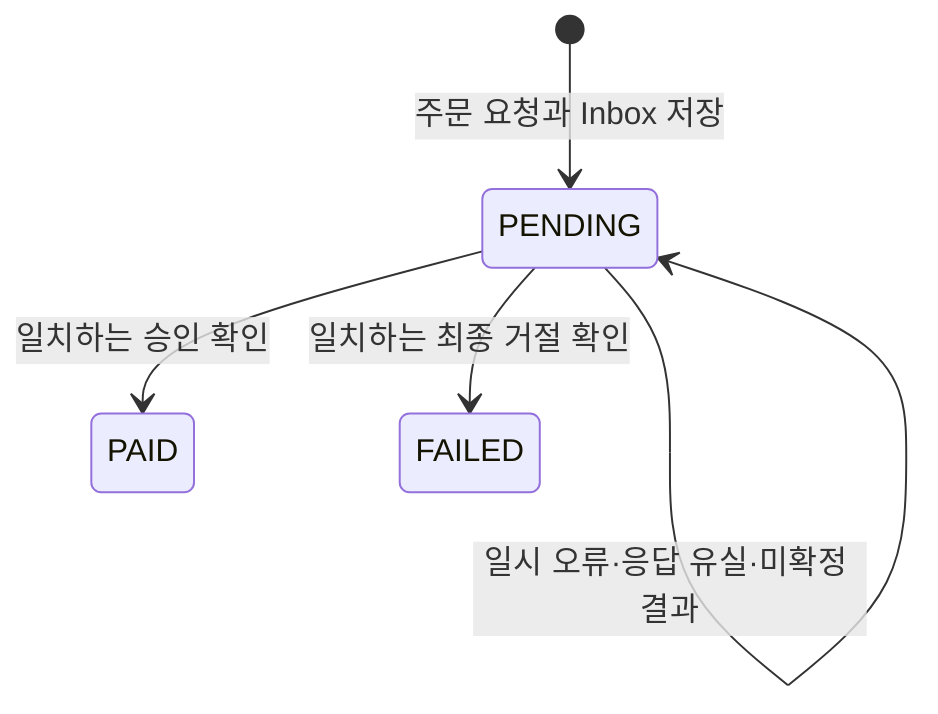

# Payment MVP 재작성 계획

[문서 목록](README.md) · [작업 기준·순서](../AGENTS.md) · [Order 완료 범위](order-mvp-plan.md) · [유스케이스 작성 규칙](use-case-conventions.md) · [이벤트 경계 개선](core-boundary-audit.md#이벤트-수신-경계-수정-기록)

2026-10-16 계획 작성·구현·OCI 검증 완료. 아래 범위와 [재작성 완료 기록](#재작성-완료-기록)을 기준으로 한다. 실제 PG·자금 이동은 포함하지 않는다.

## 목표와 책임

최소 MVP를 구현·실행하며 **주문 금액 확정, 결제 공급자 호출, 결제 결과 확정과 주문 상태 반영의 책임 차이**를 설명할 수 있게 한다.
현재 결과 픽스처로 검증한 Order에 Payment를 연결해 주문 → 결제 → 주문 결과 반영을 실제 서비스 간 흐름으로 완성한다.

Auth·Gateway·Studio·Review·Catalog·Store·Order의 완료된 계약을 기준으로 한다. 기존 Payment·License·Download·Settlement의 API·모델·이벤트·테스트는 호환성 요구나 설계 제약으로 삼지 않는다.

| 주체 | 소유하는 책임 |
|---|---|
| Order | 주문 생성, 구매자·상품·금액 확정, 내 주문 조회, 결제 결과를 검증한 자기 주문 상태 변경 |
| Payment | 확정된 주문의 결제 요청 보존, 공급자 호출과 미확정 건 재개, 최종 결제 결과·이벤트·내 결제 조회 |
| 모의 PG | 같은 결제 키에 대한 승인·거절 결정을 독립적으로 보존하고 반복 호출에 같은 결정 반환 |
| 후속 License·Download·Settlement | 이용 권한, 다운로드, 판매자 매출·정산. 이번 구현·검증 대상에 포함하지 않음 |

Payment는 Catalog·Store에서 가격을 다시 조회하지 않는다. Order DB나 주문 상태를 직접 변경하지 않는다.
Payment의 최종 결과 저장과 Order의 결과 반영 사이에는 이벤트 전달 지연이 있다.

## 이번 MVP와 후속 개발

| 이번에 포함 | 최소 구현 |
|---|---|
| 요청 접수 | 새 `OrderPlaced` 수신·입력 변환, 주문당 결제 한 건과 Inbox 저장 |
| 결제 실행 | 주문 접수 후 모의 PG로 자동 처리. 결제창·결제 수단 입력 없이 학습용 승인·거절 실행 |
| 미확정 건 재개 | DB의 PENDING을 주기적으로 읽고 같은 결제 키로 재처리, 재시작 후에도 계속 처리 |
| 결과 확정 | 확인된 승인·거절만 PAID/FAILED로 확정하고 결과 Outbox를 같은 트랜잭션에 저장 |
| 내 결제 조회 | JWT sub 기준 본인 목록·주문번호별 상세 |
| 실제 연계 | 완료된 일곱 앱 + Payment를 OCI에서 실행해 출시·주문·결제·주문 결과 반영 확인 |

소량의 개발·학습 데이터와 Payment 단일 인스턴스를 전제로 한다. 모의 PG 결과이며 실제 자금 이동은 없다.
기본 시나리오는 승인이다. 거절과 통신 장애·응답 유실은 공급자 설정과 검증 픽스처로 재현한다. 회원이 HTTP 요청으로 승인·거절 결과를 주입하는 API는 두지 않는다.

후속 개발로 남기는 항목:

- 실제 PG 계약·결제 수단·인증·결제창·콜백·카드 정보·고객의 실제 지불 승인 절차.
- 같은 주문의 새 결제 시도, 수단 변경, 주문 취소·자동 만료·환불·보상·Saga.
- 할인 자격 판정·쿠폰·다중 통화·무료 상품 지급·복수 상품·수량 선택.
- PG 수수료 계산·판매자 정보 보충·정산 원장·이용권 지급·다운로드 연동.
- 결제 시도 이력 테이블, 다중 워커·분산 임대·ShedLock·전용 운영 API·지표·성능 실험.

Order의 PAID·FAILED는 현재 최종 상태다. 결제 거절 후 다시 구매하려면 새 requestId로 새 주문을 만든다.
공급자에 같은 결제를 재확인하는 기술적 재처리는 새로운 구매 시도가 아니다.

## 전체 처리 흐름

1. MEMBER가 기존 Order API로 공개 상품 하나를 주문한다. Order가 PENDING과 `OrderPlaced` Outbox를 커밋한다.
2. Payment 리스너가 `OrderPaymentMapper.from(...)`으로 봉투·본문·키를 검증하고 내부 `PaymentOrderRequest`로 변환한다.
3. `ReceiveOrderPayment`가 기존 요청과 내용·이벤트 ID 재사용을 비교한다. 신규이면 PENDING 결제와 Inbox를 함께 커밋한다.
4. 리스너는 요청의 내구성 있는 저장 뒤 반환한다. 이 시점에 PG 호출이나 최종 결과가 완료됐다는 의미는 아니다.
5. 주기 실행이 처리 시각에 도달한 PENDING의 식별자를 유스케이스에 요청한다. 새 결제도 이 경로에서 자동 처리한다.
6. `ResolvePayment`가 저장된 확정 입력을 읽고 DB 트랜잭션·행 잠금 밖에서 `PgGateway.charge(...)`를 호출한다.
7. 같은 paymentId를 공급자 멱등 키로 유지한다. 확인된 결과가 오면 짧은 쓰기 트랜잭션에서 결제 행을 잠근다.
8. 공급자 결과와 저장된 요청을 대조하고 PAID/FAILED와 결과 Outbox를 함께 커밋한다. 미확정이면 PENDING을 유지한다.
9. Outbox 릴레이가 `OrderPaymentCompleted` 또는 `OrderPaymentFailed`를 발행한다.
10. 기존 Order가 원래 요청·구매자·청구액·통화를 검증해 자기 상태를 변경한다. 구매자는 내 주문·내 결제에서 각각 결과를 조회한다.



## 이벤트 계약과 입력 경계

새 공통 업무 이벤트를 추가하지 않고 [Order의 세 계약](order-mvp-plan.md#결제-이벤트-계약과-상태)을 사용한다.

| 이벤트 | 방향·토픽 | 연결과 금액 |
|---|---|---|
| [OrderPlacedEvent](../common/kafka/src/main/java/com/stove/common/kafka/contract/payload/OrderPlacedEvent.java) | Order → Payment, `stove.order.v1` | eventId·occurredAt·orderNo·buyerSubject·상품 스냅샷·listAmount·discountAmount·amount·currency |
| [OrderPaymentCompletedEvent](../common/kafka/src/main/java/com/stove/common/kafka/contract/payload/OrderPaymentCompletedEvent.java) | Payment → Order, `stove.payment.v1` | eventId·occurredAt·orderNo·requestEventId·paymentId·buyerSubject·amount·currency |
| [OrderPaymentFailedEvent](../common/kafka/src/main/java/com/stove/common/kafka/contract/payload/OrderPaymentFailedEvent.java) | Payment → Order, `stove.payment.v1` | 완료 결과와 같은 연결·금액 + 필수 reasonCode·reason |

- 신규 소비 그룹은 `payment-order-request`로 두고 `ReceiveOrderPayment.CONSUMER_GROUP`를 리스너·Inbox에서 공유한다. 구 `payment` 그룹 기록을 지우거나 재사용하지 않는다.
- Kafka 키와 결과 Outbox aggregateId는 orderNo다. requestEventId는 원래 **OrderPlaced.eventId**이며 구매자가 Order에 보낸 requestId와 다르다.
- paymentId는 Payment가 접수 시 발급하는 UUID 문자열이다. 공급자의 거래 ID와 구분한다.
- eventId·requestEventId·paymentId는 최대 64자, buyerSubject는 최대 100자다. orderNo는 기존 UUID 형식, 상품 코드는 기존 50자 패턴, 제목은 200자 이하를 따른다.
- 입력의 상품 ID·contentVersion은 양수다. 금액은 정수 long·양수 청구액·KRW다. 정가는 양수, 할인액은 0 이상·정가 이하이고 `listAmount - discountAmount == amount`여야 한다.
- 현재 Order는 할인액 0을 발행한다. 위 검사는 가격 구조의 일관성 확인이며 Payment가 할인 자격·정책을 재판정하는 것은 아니다.
- 원래 주문 시각과 결과 시각은 UTC 마이크로초로 보존한다. 재조회 과정의 정밀도 차이로 같은 요청을 다른 요청으로 판단하지 않게 한다.
- 최종 실패 사유는 reasonCode 100자·reason 500자 이하의 필수 값이며 성공에는 실패 사유를 섞지 않는다.

`OrderPaymentMapper`는 봉투/본문 ID·종류·키 일치를 검증한다. 내부 입력은 생성 시 값 자체의 유효성을 보장한다.
이벤트 역직렬화에서도 금액·ID·버전의 소수 입력을 정수로 절삭해 받지 않는다. 잘못된 숫자 형식은 결제·Inbox 저장 전에 거부하는 검사를 포함한다.
업무 서비스와 도메인 모델은 `EventEnvelope`·`OrderPlacedEvent` 전체를 입력받지 않는다. 모델에 `.from(외부 이벤트)`를 추가하지 않는다.
`EventInputRules`를 Payment에도 적용한다. 결과 이벤트 생성과 Outbox 기록은 유스케이스가 담당한다.

## 최소 모델과 영속성

Payment의 새 업무 테이블은 `purchase_payment` 하나다. 공급자 대역의 독립 결정을 보관하기 위한 `simulated_payment_charge`는 별도의 기술 원장이다.
기존 `payment`, `simulated_pg_transaction`, `payment_audit_log`는 신규 흐름의 저장·조회 대상으로 사용하지 않는다.

| purchase_payment 값 | 의미 |
|---|---|
| id·paymentId | 내부 정렬용 PK와 외부 결제 식별자. paymentId는 생성 이후 고정 |
| orderNo·requestEventId·orderOccurredAt | 원래 주문과 요청 이벤트의 연결. 원문 그대로 보존 |
| buyerSubject | Order가 확정한 구매자. 내 결제 조회의 소유권 기준 |
| productId·productCode·title·contentVersion | 원래 상품 스냅샷. 조회와 중복 입력 비교에 사용 |
| listAmount·discountAmount·amount·currency | 원래 주문의 가격 구조와 고객 청구액. 결제 후에도 변경하지 않음 |
| provider | 이번에는 `SIMULATED`. 기존 결제를 다른 공급자에서 새로 승인하지 않음 |
| status | PENDING, PAID, FAILED |
| providerTransactionId·providerOccurredAt | 확인된 공급자 결정의 식별자·원래 시각 |
| resultEventId·resultOccurredAt | 최초 커밋한 최종 결과 이벤트의 ID·시각 |
| failureReasonCode·failureReason | 확인된 최종 거절 사유. 승인에는 없음 |
| nextAttemptAt·lastErrorCode | 미확정 건의 다음 처리 시각과 내부 오류 분류. 최종 상태면 다음 처리 시각 없음 |
| createdAt·updatedAt | UTC 마이크로초 저장 시각 |

paymentId·orderNo·requestEventId·nullable resultEventId에는 각각 유일 제약을 두고, nullable `(provider, providerTransactionId)`도 유일하게 보존한다.
문자열 식별자와 유일 제약은 대소문자를 구분하고 `(status, nextAttemptAt, id)`, `(buyerSubject, id)` 조회를 지원한다.
요청 스냅샷은 필요한 스칼라 컬럼으로 보존하며 원문 이벤트 JSON·별도 PaymentAttempt·상품별 정산 항목 테이블은 추가하지 않는다.

| 요청 접수 | 처리 |
|---|---|
| 새 orderNo·새 requestEventId | 결제 PENDING·Inbox 한 번 생성 |
| 같은 이벤트 ID·같은 전체 입력 | 기존 결제 보존, 새 공급자 결정·결제·Outbox 생성 없음 |
| 같은 이벤트 ID·다른 주문 또는 입력 | 계약 충돌, 신규 결제·Inbox 변경 없음 |
| 같은 주문·새 이벤트 ID | 금액이 같아도 새 결제 요청으로 수락하지 않음. 기존 Order는 요청 ID를 유지해야 함 |
| PENDING 요청 재전달 | 접수 중복으로 종료하되, DB의 미확정 처리 대상은 유지 |
| 이미 최종인 요청 재전달 | 원래 입력 일치 확인 후 기존 결과 보존 |
| 동시 최초 접수 | DB 유일 제약으로 한 건만 확정. 패한 트랜잭션 종료 후 재전달에서 기존 입력과 비교 |

**기존 요청 내용과 이벤트 ID 재사용 확인은 Inbox 중복 생략보다 먼저 한다.** 비교에는 원래 이벤트 시각과 상품·가격 스냅샷 전체를 포함한다.
Inbox만 있고 해당 결제가 없거나 기존 결제와 접수 기록이 맞지 않으면 정상 중복으로 숨기지 않는다. 신규 접수의 결제와 Inbox는 함께 롤백된다.
접수 이벤트 자체가 충돌하면 수신 경로의 공통 재시도·DLT를 사용한다. 공급자 장애의 재개는 이미 저장된 PENDING 처리 경로가 담당한다.

## 상태와 최종 결과



PENDING에는 아직 호출하지 않은 결제와 호출했지만 결과를 확인하지 못한 결제가 포함된다.
MVP에서는 READY·PROCESSING·UNKNOWN 등을 별도 상태로 나누지 않는다. 시간 경과나 재시도 횟수만으로 FAILED로 바꾸지 않는다.
PAID·FAILED는 최종 상태다. 이미 확정된 결과를 다른 공급자 거래·금액·결과로 덮어쓰지 않는다.
최종 상태에는 공급자 거래·결정 시각과 결과 이벤트 ID·시각이 함께 있어야 한다. PAID에는 실패 사유가 없고 FAILED에는 유효한 사유가 있어야 하며, 확정 시 미확정 재시도 예약·오류 분류를 정리한다.

| 관측한 상황 | Payment 처리 |
|---|---|
| 공급자가 같은 키·주문·금액·통화의 승인을 확인 | PAID + OrderPaymentCompleted Outbox |
| 같은 연결 정보로 명시적 최종 거절을 확인 | FAILED + OrderPaymentFailed Outbox |
| 예외·연결 실패·응답 유실·아직 미확정 | PENDING 유지, 다음 처리 예약. 실패 결과 이벤트 없음 |
| 결과 키·주문·금액·통화 불일치 또는 필수 값 누락 | PENDING 유지·오류 분류 기록. 승인이나 거절로 임의 해석하지 않음 |
| 공급자는 확정했으나 Payment 결과 트랜잭션 실패 | PENDING으로 남음. 같은 공급자 키로 재확인 후 결과 저장 재시도 |
| 동시 처리의 동일한 최종 공급자 결과 | 먼저 커밋한 상태·결과 이벤트를 유지하고 추가 Outbox 없음 |
| 최종 저장 결과와 상충하는 공급자 결과 | 기존 최종 상태 보존, 충돌 기록. 반대 결과를 발행하지 않음 |

결과의 `amount`는 고객 청구·승인액이다. PG 수수료 공제 후 입금액이나 판매자 지급액이 아니다.
최종 거절 이벤트는 개별 호출 예외를 의미하지 않는다. 이번 주문의 결제가 거절로 끝났다는 확인된 결정만 전달한다.

## 트랜잭션과 미확정 건 재개

처리는 세 경계로 나눈다.

1. **접수 트랜잭션:** 요청 비교 → 결제 생성 → Inbox 기록 → 커밋. PG를 호출하지 않는다.
2. **공급자 호출:** 저장된 고정 입력으로 호출한다. Payment의 DB 트랜잭션·잠금·커넥션을 유지하지 않는다.
3. **결과 트랜잭션:** 결제 행 잠금 → 결과 연결·금액 검증 → 모델 상태 전이 → 결과 메타데이터·Outbox 저장 → 커밋.

`ResolvePayment`가 프로그램 방식 트랜잭션으로 읽기/결과 저장과 외부 호출을 조율할 수 있다. 단계마다 위임 클래스를 의무적으로 만들지 않는다.
접수·결과 쓰기는 READ_COMMITTED와 필요한 행 잠금을 사용한다. 오류 뒤 다음 시도를 예약하는 쓰기도 짧은 트랜잭션에서 PENDING을 재확인하며, 동시에 확정된 결제를 덮어쓰지 않는다. 예약 저장 자체가 실패해도 원래 PENDING은 보존해 다음 순회에서 다시 처리한다.
새 결과 이벤트 ID·시각은 최종 결과 Outbox와 같은 트랜잭션에서 최초 한 번만 확정한다. Outbox 재발행은 저장된 ID·본문을 그대로 사용한다.
결과 트랜잭션이 롤백돼 발행된 적 없는 후보 ID는 최종 결과가 아니다. 이후 정상 커밋한 결과만 보존한다.
릴레이 재시도 예산이 소진돼 DEAD가 된 결과는 보존하며 새 결과 이벤트를 만들지 않는다. 필요한 재발행은 기존 행을 재큐잉하는 공통 처리·검증 픽스처로 확인하고, 업무 결과를 다시 확정하는 API는 추가하지 않는다.

주기 실행은 단일 인스턴스의 fixed-delay 방식으로 시작한다. 기본 주기는 1초, 배치는 20건으로 두고 due인 PENDING을 `nextAttemptAt, id` 순서로 고른다.
`stove.payment.processing-enabled`는 기본 true로 두며 검증에서는 false로 기동해 접수만 저장한 뒤, true로 재시작해 주기 처리를 재개할 수 있게 한다. 이 설정을 회원 HTTP API로 노출하지 않는다.
일시 오류·미확정·잘못된 공급자 응답은 다음 시도를 기본 5초 뒤로 예약한다. 오류 하나가 나머지 배치를 막지 않게 결제별로 처리한다.
설정은 양수·상한을 검증한다. 주기·배치·재시도 지연을 조정하는 것은 결제 실패 정책을 변경하는 것이 아니다.

재시작 후 주기 실행이 DB의 PENDING을 다시 읽는다. Inbox가 이미 커밋됐거나 Kafka 재시도가 끝났어도 재개할 수 있다.
스케줄러는 리포지토리·Inbox·트랜잭션을 직접 사용하지 않고 유스케이스에 위임한다. 조회 API는 결제를 실행하지 않는다.
원자성은 같은 DB 안의 상태·Outbox에 적용된다. 공급자 결정과 Payment DB를 하나의 트랜잭션으로 묶거나 exactly-once 전달을 가정하지 않는다.

중복 공급자 호출 자체는 발생할 수 있다. 같은 키의 공급자 멱등 처리와 최종 행 잠금으로 중복 승인·중복 결과를 막는다.
다중 인스턴스의 작업 분배·임대는 후속 범위다. 동시 호출 시험은 멱등성과 최종 결과 유일성을 검증하기 위해 포함한다.

## 모의 PG 포트와 기술 원장

`core.port.PgGateway`는 `charge(PgChargeRequest)`를 제공한다. 요청은 paymentId·orderNo·amount·currency를 담는다.
반환하는 내부 결과는 같은 연결·금액과 공급자 거래 ID·결정 시각·승인/거절·거절 사유를 담는다. 기술 예외·미확정 응답은 최종 거절과 구분한다.

멱등 키는 **접수 시 저장한 paymentId**다. 재시작·응답 유실·DB 롤백·동시 호출 때 새 키를 만들지 않는다.
같은 키의 다른 주문·금액·통화는 공급자 대역에서도 거부한다.

`infrastructure.pg.SimulatedPgGateway`는 `simulated_payment_charge`를 JDBC로 관리한다.
원장은 paymentId 유일 키, 주문번호·금액·통화, 유일한 공급자 거래 ID, APPROVED/DECLINED, 사유·결정 시각을 보존한다.
최초 호출의 결정만 저장하고 반복 호출은 기존 결정 전체를 반환한다. 최초 생성 경합도 유일 제약과 기존 값 재조회로 수렴시킨다.

- 모의 원장은 Payment 엔티티나 리포지토리를 참조하지 않는다. 공급자의 내부 구현을 Payment의 `core.domain`·`core.service`에 두지 않는다.
- Payment 업무 트랜잭션과 독립적으로 커밋한다. 어댑터 내부의 별도 트랜잭션은 기술 원장의 내구성을 위한 것이며 Payment 결과 저장에 합류하지 않는다.
- 같은 MySQL 인스턴스를 사용해 최소 인프라로 구현하되, Payment 결과 롤백과 모의 공급자 결정 롤백을 혼동하지 않는다. 실제 외부 PG나 독립 공급자의 장애 격리를 검증한 것으로 설명하지 않는다.
- `stove.payment.pg-provider=simulated` 조건으로 어댑터를 명시적으로 등록한다. 모의 결과 설정은 기본 APPROVED이며 검증에서는 DECLINED도 사용한다.
- 공급자 결정이 저장된 뒤 설정을 바꿔도 같은 키의 결과는 바뀌지 않는다. 금액·상품 코드의 특정 값으로 성공/실패를 숨겨 결정하지 않는다.
- 응답 유실은 공급자 원장 커밋 직후 예외, 결과 저장 실패는 Payment 결과 트랜잭션의 장애 주입으로 검증한다. 주입 장치는 테스트/독립 검증 픽스처에 격리한다.

별도 모의 결제창·콜백 서버·관리용 승인/거절 HTTP API를 만들지 않는다. 실제 PG를 추가할 때 공급자의 멱등 승인·거래 조회 계약과 결제 수단/인증 절차를 새로 설계한다.

## 조회 API와 최소 보안

| 메서드 | 경로 | 의미 |
|---|---|---|
| GET | `/api/v1/payments` | 내 결제 페이지 목록 |
| GET | `/api/v1/payments/{orderNo}` | 본인 주문의 결제 상세 |

- Gateway의 기존 Payment 라우트·MEMBER 경로와 Payment의 `ApiJwtSecurity`를 사용한다. JWT 서명·issuer·만료·aud=esd-api·MEMBER를 확인한다.
- 구매자는 `CurrentSubject`의 JWT sub다. `memberId`, 요청 헤더·쿼리의 소유자 지정, Auth 회원 DB 조회를 사용하지 않는다.
- 익명 401, 역할 없음 403, 타인/없는 결제 404, 잘못된 페이지 400이다. 아직 OrderPlaced를 접수하지 못한 주문도 404이며 조회가 결제를 생성하지 않는다.
- `page=0`, `size=20`, page ≥ 0·1 ≤ size ≤ 100, `createdAt DESC, id DESC` 정렬과 동률 정렬을 고정한다.
- 전용 DTO·공통 ApiResponse를 사용한다. 목록은 content·page·size·totalElements·totalPages를 제공한다.
- 본인 응답에는 paymentId·orderNo·상품 스냅샷·정가/할인/청구액·통화·상태·생성/갱신/결과 시각·실패 사유와 `provider=SIMULATED`를 제공한다.
- requestEventId·resultEventId·Inbox·Outbox·공급자 요청 원문·재시도/내부 오류 정보는 업무 응답에서 숨긴다. 공개하는 paymentId는 공급자 멱등 키로도 재사용하며, PG 거래 ID는 내부 추적 값으로 보존한다.
- Payment의 구 prepare·callback·cancel·simulator 업무 엔드포인트를 제거하고 나머지 경로는 닫는다. 모의 결과를 회원이 바꾸는 API는 제공하지 않는다.
- Gateway에서도 구 Payment callback 익명 허용·CSRF 예외와 simulator 전용 권한 예외를 정리한다. 기존 로그인·MEMBER 라우팅·다른 완료 모듈 계약은 유지하고 회귀 검증한다.
- 공개 health·API 문서와 필요한 기존 관측 설정만 남긴다. 공통 운영 HTTP API는 `stove.messaging.ops.enabled=false`로 닫고 공통 Kafka 재시도·DLT와 Outbox는 사용한다.

## 기존 구현과 DB 전환

기존 V1~V10 파일·체크섬은 보존하고 `V11__purchase_payment.sql`로 새 업무 테이블과 모의 공급자 원장을 추가한다.
빈 DB와 기존 V10 DB에서 적용을 검증한다. 구 payment·감사·모의 PG·ShedLock·Inbox 자료를 삭제하거나 새 승인으로 자동 변환하지 않는다.

구 OrderCreated·PaymentCompleted/Failed/Cancelled·OrderLine·숫자 memberId, 사전등록·콜백 서명·환불·만료·License 보상·환불 스위퍼·ShedLock·전용 감사/지표 구현과 해당 설정을 교체·제거한다.
클래스 기준으로 PaymentService·SimulatedPgService·세 파사드·구 두 리스너·구 simulator 컨트롤러·콜백 인증 필터·RefundSweeper 등이 대상이다.
구 Payment 테스트는 새 범위의 도메인·계약·통합 검사로 교체한다. 미완료 모듈이 사용하는 구 공통 이벤트 타입은 일괄 삭제하지 않는다.
Compose의 구 callback-secret·simulator-base-url 설정도 정리하되 이번 검증에 미완료 앱을 함께 실행하지 않는다.

기존 Payment Outbox의 구 PENDING/DEAD 이벤트는 원본 보관과 발행 격리 절차를 별도 전환 SQL로 검증한다. 자동 기동으로 구 결과를 재발행하지 않는다.
신규 소비 그룹을 기존 Kafka에 연결하면 과거 OrderPlaced도 보일 수 있다. 이미 결과 픽스처로 확정한 주문을 새 모의 결제로 처리하지 않도록, 기존 공유 스택 전환에서는 구 주문·미발행 Outbox·소비 시작 오프셋을 함께 정해야 한다.
이번 완료 검증은 **독립된 빈 업무 DB·Kafka에서 시작**한다. 기존 공유 자료의 자동 전환·재기동은 완료 범위에 포함하지 않고, 실제 전환은 위 자료·오프셋 확인 뒤 별도로 진행한다.

## 구현 구성과 순서

| 위치 | 최소 구성 |
|---|---|
| core.domain | Payment·PaymentStatus·PaymentOrderRequest·PG 요청/결과 값·PaymentRepository |
| core.port | PgGateway |
| core.service | ReceiveOrderPayment, ResolvePayment, SearchPayments, ReadPayment |
| api.listener | OrderEventListener, OrderPaymentMapper |
| api.scheduler | PendingPaymentScheduler — 유스케이스 호출만 수행 |
| api.controller | 본인 조회 두 API·전용 응답 DTO |
| infrastructure | 조건부 SimulatedPgGateway·독립 원장의 JDBC 구현 |
| config | JWT·PG 선택·스케줄·DB·Kafka의 최소 설정 |

1. **입력·접수:** 새 입력 값과 상태 모델·V11, mapper, 내용 비교·Inbox·접수 경합을 구현한다.
2. **공급자 대역:** 고정 키·내구성 있는 결정·동시 중복·응답 유실을 검증할 포트/어댑터를 구현한다.
3. **처리·복구:** 트랜잭션 밖 호출·최종 행 잠금·결과 Outbox·주기 재개·동시 결과 비교를 구현한다.
4. **조회·정리:** JWT sub 목록·상세, 구 경로·설정 제거, Gateway의 Payment 예외 정리와 OpenAPI를 검증한다.
5. **OCI 연계:** 완료된 일곱 앱 + Payment로 승인·거절·중단·재시작·결과 전달 복구를 검증한다.
6. **완료 기록:** 실제 테스트 수·명령·증거·모의 PG 한계를 문서화한 뒤에만 재작성 완료 목록에 Payment를 추가한다.

## OCI 검증과 완료 조건

로컬은 코드·문서 편집과 동기화에 사용한다. 빌드·테스트·프로세스 실행은 기존 OCI 인스턴스에서 수행한다.

```sh
./scripts/remote.sh gradle :apps:payment:test :apps:order:test :common:archunit:test :common:kafka:test :common:messaging:test :apps:payment:integrationTest :apps:order:integrationTest -Pstove.infraTest.maxParallel=1 --rerun-tasks --no-daemon
```

위 모듈 검증 뒤 Gateway 변경을 포함한 완료 일곱 모듈의 단위·통합·계약 회귀를 OCI에서 실행한다. 기존 미완료 전체 앱 E2E를 검증 기준으로 삼지 않는다.
OpenAPI는 OCI에서 생성·회수하고 갱신 플래그 없이 두 조회 API의 계약을 재검증한다.

| 검증 계층 | 확인할 내용 |
|---|---|
| 모델·입력 | 필수 값·금액 구조·소수 절삭 거부·KRW·시각 정밀도, 확정 요청·결과 불변, 외부 이벤트 입력 의존 금지 |
| 접수·MySQL·Kafka | 동일 요청·변경 본문·교차 주문 이벤트 ID 재사용, 다른 요청 ID의 같은 주문, 동시 접수 한 건, Inbox/결제 불일치 검출·롤백·DLT |
| 공급자 포트 | 실제 호출 직전 Payment 트랜잭션/잠금 없음, 같은 키·같은 결정, 키 재사용 충돌, 공급자 원장의 독립 커밋 |
| 결과·원자성 | 승인·거절 각각 한 최종 이벤트, 결과/Outbox 실패 동시 롤백, 미확정·잘못된 결과의 실패 이벤트 부재, DEAD 재큐잉 시 원래 결과 ID·본문 유지 |
| 동시 처리 | 같은 결제를 겹쳐 처리해 공급자 결정 한 건·최종 Outbox 한 건, 상충 결과로 최종 상태 변경 없음 |
| 복구 | 수신 ACK 후 처리 전 종료, 공급자 결정 후 응답 유실, 결과 저장 전 종료·롤백, 재시작 후 같은 키로 재개 |
| 조회·보안 | 실제 서명 JWT, 401/403·타인 404, 소유자 위조 차단, 페이지·동률 정렬, 조회의 결제 실행 없음 |
| 전환·정리 | 빈 DB·V10→V11·구 자료 보존·구 Outbox 격리, 제거된 prepare/callback/cancel/simulator 경로 부재 |

`scripts/verify-order.py`를 참고해 독립 Payment 검증 스크립트와 E2E 태그/태스크를 작성한다. 별도 임시 DB·Kafka·포트에서 다음 여정을 실제 프로세스로 확인한다.

1. 실제 로그인·출시·Store 탐색·주문 → Payment 승인 → Order PAID. 양쪽 금액·연결·공급자 원장·결과 한 건 확인.
2. 신규 주문의 모의 PG 거절 → Payment FAILED·Order FAILED, 사유 보존. 승인·거절 결정의 변경 없음 확인.
3. 요청 저장·Inbox 커밋 뒤 Payment 종료, 재시작 후 Kafka 재전달 없이 PENDING 재개 확인.
4. 공급자 결정 커밋 후 응답 유실·Payment 결과 저장 실패를 재현하고 동일 paymentId로 재개해 중복 승인·결과가 없는지 확인.
5. 결과 릴레이를 일시 중지해 Payment 결과 Outbox를 미발행 상태로 둔 뒤 Kafka 중단·Payment 재시작 → 저장된 결제 조회 가능 → 복구 후 릴레이를 재개해 원래 ID·본문으로 Order에 전달. 재시도 소진은 별도 통합 검사에서 DEAD 보존·재큐잉으로 확인.
6. Order 중단 중 결제 확정 → Order 재시작 후 반영, 원래 주문 요청·결과 재전달 후 상태·공급자 결정·Outbox 수 보존.
7. Catalog 중단 후 이미 생성한 주문의 결제·조회가 계속되고 가격을 다시 조회하지 않음을 확인.
8. 타인 접근·제거된 결과 주입 경로 차단, 전환·마이그레이션과 모의 결과 한계를 함께 기록.

기존 중지 스택·데이터 볼륨은 보존하고 검증이 만든 프로세스·컨테이너·볼륨만 정리한다.
주기 작업의 비결정적인 대기를 줄이기 위해 테스트에서는 실행을 제어하고, 독립 여정에서는 실제 주기 실행과 프로세스 재시작을 검증한다.
검증 결과를 기록하기 전까지 이 문서를 구현·실제 PG 연동 완료의 근거로 사용하지 않는다.

## 재작성 완료 기록

2026-10-16 OCI에서 구현·검증을 완료했다. 실행은 [Payment 안내](payment-guide.md)를 따른다.
Payment를 재작성 완료 목록에 추가했고 다음 진행 대상은 License다.

### 구현 결과

- core.service는 ReceiveOrderPayment·ResolvePayment·SearchPayments·ReadPayment 네 개다. 외부 입력은 api.listener의 OrderPaymentMapper에서 PaymentOrderRequest로 변환한다.
- PENDING·Inbox 접수와 PG 호출, 최종 결과·Outbox 저장을 나눴다. 실제 PG 호출 직전에 Payment 트랜잭션이 없는지 검사하며 접수 시 발급한 paymentId를 재시작·응답 유실 뒤에도 유지한다.
- SimulatedPgGateway는 JDBC 원장에 최초 승인·거절을 별도 트랜잭션으로 커밋한다. Payment 결과가 롤백돼도 원래 결정은 보존한다. 같은 키의 동시 호출은 같은 거래·결정으로 수렴한다.
- 확인된 승인·거절만 PAID/FAILED로 확정한다. 일시 오류·잘못된 결과·결과 저장 실패는 PENDING을 유지한다. 다른 건의 오류가 다음 건 처리를 막거나 늦은 오류가 확정 상태를 되돌리지 않는다.
- 본인 목록·주문번호별 상세 두 GET만 제공한다. 실제 서명 JWT·sub·MEMBER, 타인 404·페이지 정렬과 공개 DTO를 검증했다. OpenAPI는 OCI 생성 후 회수하고 갱신 플래그 없이 비교했다.
- 구 prepare·콜백·시뮬레이터·환불·보상·스위퍼·ShedLock·전용 감사/지표 코드를 제거했다. Gateway의 콜백 익명·CSRF 예외와 simulator 예외, Compose 설정도 정리했다. 구 콜백의 익명 POST는 기본 CSRF 정책으로 403이다.
- V1~V10의 SHA-256이 모두 원본과 같다. V11은 두 새 테이블을 추가한다. V10 자료·구 PG 거래를 보존하고 전환 SQL을 두 번 적용해도 원본 보관·격리가 유지되는지 확인했다.

### OCI 회귀 검증

최초 컴파일·집중 검사 뒤 CI=true로 아래 검사를 실제 실행했다. JUnit XML의 합산 값이며 실패·오류·건너뜀은 모두 0이다.

| 범위 | 실행 건수 |
|---|---:|
| Auth·Gateway·Studio·Review·Catalog·Store·Order·Payment 단위·구조 | 406 |
| 같은 8개 모듈의 MySQL·Kafka·JWT·OpenAPI·마이그레이션 통합 | 94 |
| common Kafka·Messaging·ArchUnit·Security·Web | 343 |
| 합계 | **843** |

Payment 자체는 단위·구조 55건, 통합 22건이다. 서비스 코드의 읽기 흐름을 정리한 뒤 같은 77건과 bootJar 생성을 다시 통과했다.
검사에는 변경 입력·교차 주문 ID 재사용·접수 경합·Inbox 롤백/DLT, 할인된 청구액 보존, PG 독립 커밋·응답 유실,
결과/Outbox 롤백, 잘못된 공급자·키·주문·금액·null 결과, 동시 처리와 거래 ID 충돌,
지연된 오류·다음 결제 계속 처리·처리 예정 시각, DEAD 회수 시 원래 ID·본문 보존이 포함된다.

회귀 명령은 OCI 원격 작업본에서 실행했다.

```sh
CI=true ./gradlew :apps:auth:test :apps:auth:integrationTest :apps:gateway:test :apps:gateway:integrationTest :apps:studio:test :apps:studio:integrationTest :apps:review:test :apps:review:integrationTest :apps:catalog:test :apps:catalog:integrationTest :apps:store:test :apps:store:integrationTest :apps:order:test :apps:order:integrationTest :apps:payment:test :apps:payment:integrationTest :common:kafka:test :common:messaging:test :common:archunit:test :common:security:test :common:web:test :common:jpa:test -Pstove.infraTest.maxParallel=1 --no-daemon
```

common:jpa:test는 소스가 없어 실행 건수에 포함하지 않았다. 최종 Payment 재검사는 다음 명령을 사용했다.

```sh
./scripts/remote.sh gradle :apps:payment:test :apps:payment:integrationTest :apps:payment:bootJar :apps:payment:writeVerificationClasspath --no-daemon
```

### 8개 앱 실제 연계·재시작

[검증 스크립트](../scripts/verify-payment.py)와 [사용자 흐름](../e2e/src/test/java/com/stove/e2e/PaymentPurchaseFlowTest.java)의 **11단계를 모두 통과**했다.
실제 로그인·상품 심사/출시·Store 조회·Order 생성과 모의 PG·이벤트 릴레이·Order 결과 반영을 사용했다.

| 단계 | 확인 결과 |
|---|---|
| 1 | 자동 처리를 끈 상태에서 결제·Inbox 접수, PG 미호출, 소유권·역할·구 경로 차단 |
| 2 | Payment 재시작 후 저장된 PENDING을 같은 paymentId로 승인, Order PAID |
| 3 | 새 주문의 명시적 거절, Payment·Order FAILED와 사유 보존, 이전 승인 불변 |
| 4~5 | PG 원장 커밋 뒤 응답 유실, PENDING·결과 이벤트 부재, 재시작 후 같은 키로 원래 승인 복구 |
| 6~7 | Outbox 삽입 후 결과 트랜잭션 롤백, PG 원장만 보존, 재시작 뒤 최종 결과 한 건 |
| 8~9 | 접수 뒤 Order·Catalog 중단 중 결제 확정, 릴레이 중지·Kafka 중단·Payment 재시작 후 조회·원래 결과 ID 보존 |
| 10 | Kafka·Order 복구 후 원래 결과 발행·반영, 원래 주문 요청과 결제 결과 각각 반복 재전달 |
| 11 | Order·Payment 재시작 후 모든 스냅샷·최종 상태·응답 시각 보존 |

최종 주문·결제·PG 결정·Payment 결과 Outbox는 각각 5건, Order와 Payment의 Inbox도 각각 5건이다.
승인은 4건, 거절은 1건이며 재전달로 결제·공급자 결정·결과 이벤트를 추가하지 않았다.
프로세스 장애 주입은 integrationTest 전용 PaymentFaultConfiguration으로 수행하며 운영 bootJar·업무 API에는 포함하지 않았다.

OCI 증거 경로는 `/tmp/stove-payment-check-4x4i1vxc`다. payment.json, 앱 로그와 junit-단계명별 XML을 보존했다.
전체 회귀 로그·합산 결과도 같은 디렉터리에 보존했다. 검증 프로세스와 해당 실행이 만든 컨테이너·볼륨은 정리했다.

### 완료 범위의 한계

실제 자금 이동·PG 인증·결제창·환불·이용권·다운로드·정산은 이번 완료 범위가 아니다.
모의 PG 원장과 Payment 업무 테이블은 같은 MySQL이므로 서로 다른 외부 시스템의 장애 격리까지 입증하지 않는다.
기존 공유 스택·데이터 볼륨은 사용하지 않았고 자동 전환하지 않았다. 공유 환경 적용은 과거 OrderPlaced·미발행 Outbox·기존 결과와 소비 시작 오프셋을 대조한 뒤 별도로 수행한다.
