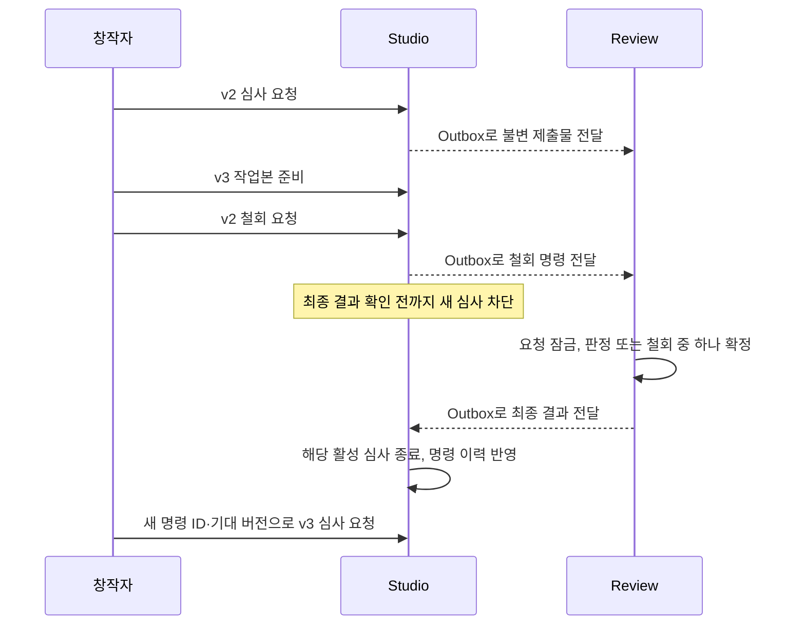
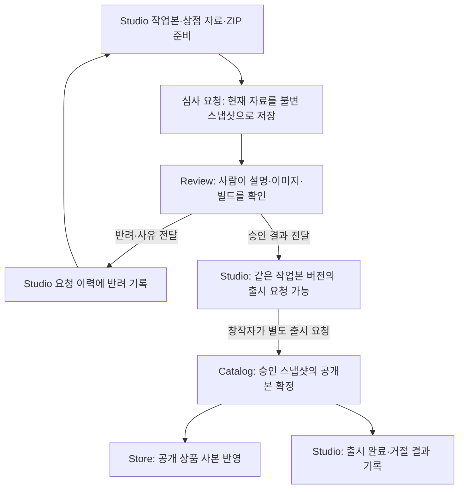

# 프로젝트별 단일 심사·명시적 철회 분석

**현재 적용할 결정과 완료:** 심사 철회 후 동일 자료의 재신청을 허용하는 [결정 59](decisions.md#review-withdrawal-allow-unchanged-resubmission)가 앞선 결정 55의 B안을 대체한다. 진행 중 심사·출시는 각각 프로젝트별 1건이며 업데이트는 반복 출시할 수 있다. 아래 과거 B안 검토·구현 전/진행 중 문구는 당시의 이력이다. 2026-11-03 구현과 OCI 모듈별 최종 검사 695건·실제 역할별 여정 3건을 완료했다. [최신 구현·검증·이행 기록](project-review-withdrawal-verification.md)을 우선하며 G4 전체 완료와 구분한다. [즉시 공개와 철회 시간의 차이](#17-즉시-공개와-출시-철회의-설계-재점검)도 함께 확인한다.

| 항목 | 최신 선택과 근거 |
|---|---|
| 기능 범위 | 심사 요청·출시 요청 철회 모두 포함 — [결정 56](decisions.md#review-and-release-withdrawal-scope) |
| 심사 판정과 철회 경쟁 | Review에서 먼저 확정된 결과 유지 — [결정 53](decisions.md#review-withdrawal-first-committed-result) |
| 심사 철회 허용 시점 | 검토 착수 여부와 관계없이 최종 판정 전까지 — [결정 60](decisions.md#review-withdrawal-until-final-decision) |
| 심사 철회 응답 | 내구 접수 후 처리 중 응답, 최종 결과는 별도 확인 — [결정 54](decisions.md#review-withdrawal-async-acceptance) |
| 심사 철회 후 동일 자료 | 새 명령·새 요청으로 정상 심사 허용 — [결정 59](decisions.md#review-withdrawal-allow-unchanged-resubmission) |
| 출시 철회 범위 | Catalog의 공개 확정 전까지만 허용 — [결정 57](decisions.md#release-withdrawal-before-publication) |
| 출시 철회 후 동일 승인본 | 기존 승인으로 새 출시 요청 허용 — [결정 58](decisions.md#release-withdrawal-reuse-review-approval) |
| 실제 공개 실행 | Catalog 내구 접수와 자동 공개 작업 분리, 고정 대기시간 없음 — [결정 62](decisions.md#catalog-durable-publication-work) |
| 심사·출시 철회 사유 | 선택 입력. 행위자·대상·시각·결과는 항상 기록 — [결정 61](decisions.md#review-release-withdrawal-optional-reason) |

출시 철회의 공개 후 되돌리기·예약·대기 단계는 도입하지 않는다. 수정한 작업본에는 기존대로 현재 버전의 새 승인이 필요하다. 프로젝트별 동시 심사 1건과 명시적 철회 후 새 요청이라는 사용자 제안 아래에서 남은 정책을 하나씩 구체화한다.

2026-11-02, `5c08fb1`의 코드와 현재 완료 모듈의 계약을 기준으로 작성했다. 선택되지 않은 추천은 결정으로 취급하지 않으며 정책 합의 뒤 구현·검증한다.

[전체 일반화 계획](platform-generalization-plan.md)의 G4에 해당한다. Studio는 창작자의 요청과 결과 사본을, Review는 불변 제출물의 심사와 최종 결과를 소유하는 기존 경계를 유지한다.

검증 결과 재사용은 재신청 허용과 별도 책임이다. 결정 59에 따라 동일 자료 차단을 위한 신규 내용 해시·동일성 비교기는 이번 기능의 필수 범위에서 제외한다. 고비용 자동 검사·캐시도 이번 선택으로 신규 구현하지 않는다.

## 1. 제안의 의미와 기본 비용

단일 심사는 **프로젝트의 모든 버전을 통틀어 종료되지 않은 요청이 최대 1건**이라는 의미로 해석하는 것을 추천한다. Studio에서 요청을 저장하고 Review에 전달되기를 기다리는 동안도 포함한다. 철회를 요청했으나 철회 또는 판정의 최종 결과가 확인되지 않은 동안에도 자리를 유지한다.

예를 들어 v2 심사 중 v3를 준비할 수 있지만, v3 심사를 요청하려면 v2가 판정으로 종료되거나 철회 완료가 확인돼야 한다. 반려된 심사는 이미 종료됐으므로 다시 철회할 필요가 없다. 승인된 심사를 취소해 판정을 뒤집는 기능과도 구분한다.

**철회 허용 시점 선택:** 결정 60에 따라 심사자가 검토에 착수한 뒤에도 최종 판정 전까지 철회를 허용한다. 판정·철회의 경쟁은 결정 53을 적용하고, 별도 착수 상태로 철회를 제한하지 않는다. 이미 진행한 심사 작업이 낭비될 수 있다는 비용을 설명하고 선택했다.

| 관점 | 기대 효과 | 수용해야 할 비용 |
|---|---|---|
| 창작자 | 유효한 심사가 명확하고 잘못 제출한 요청을 명시적으로 교체 | 병렬 심사가 불가능하고 철회 결과를 기다려야 함 |
| 심사자·운영자 | 이전 버전과 새 버전의 중복 심사 감소, 교체 경위 추적 | 철회 대기·전달 실패를 확인하고 복구하는 절차 필요 |
| 개발 | 프로젝트 단위로 요청 흐름을 설명·검증 가능 | 요청 생성, 상태 조회, 판정, 이벤트, DB 제약과 API 계약을 함께 변경 |

현재 구조는 한 프로젝트의 현재 공개본과 작업본을 관리하므로 이 비용을 수용할 만하다. 플랫폼별 병렬 심사나 다중 출시 채널이 필요해지면 심사 독점 단위를 별도로 재검토할 수 있다.

## 2. 현재 코드에서 확인한 사실

| 코드 | 현재 동작과 변경 시 주의점 |
|---|---|
| [RequestProjectReview](../apps/studio/src/main/java/com/stove/studio/core/service/review/RequestProjectReview.java) | Project 행을 잠그지만 현재 버전의 요청만 확인한다. 다른 버전의 미판정 요청을 차단하지 않는다. 저장소 크기 조회도 이 트랜잭션 안에서 실행한다. |
| [ReadProjects](../apps/studio/src/main/java/com/stove/studio/core/service/project/ReadProjects.java) | 연결된 심사 요청의 contentVersion이 현재 작업본과 다르면 현재 심사 조회에서 제외한다. |
| [ProjectController](../apps/studio/src/main/java/com/stove/studio/api/controller/ProjectController.java) | 심사 요청 POST에 사용자 요청 식별자나 기대 contentVersion이 없다. 호출 시점의 현재 작업본을 제출한다. |
| [ProjectReviewRequest](../apps/studio/src/main/java/com/stove/studio/core/domain/review/ProjectReviewRequest.java) | REQUESTED·APPROVED·REJECTED를 문자열로 보관한다. REQUESTED가 아니면 이후 결과를 무시한다. 원요청 eventId는 별도 필드로 보관하지 않는다. |
| [ReceiveProjectReview](../apps/review/src/main/java/com/stove/review/core/service/ReceiveProjectReview.java) | 요청 ID와 스냅샷으로 중복을 처리한다. 프로젝트별 활성 심사 유일성 검사는 없다. |
| [DecideProjectReview](../apps/review/src/main/java/com/stove/review/core/service/DecideProjectReview.java) | 요청 행 잠금과 판정·Outbox를 같은 트랜잭션에서 처리한다. 철회와 판정을 한곳에서 조정할 기반이다. |
| [ProjectReview](../apps/review/src/main/java/com/stove/review/core/domain/ProjectReview.java) | 최종 판정만 허용하고 동일 판정 재전송은 최초 결과를 유지한다. 철회 상태·명령은 없다. |
| [ProjectReviewResult](../apps/studio/src/main/java/com/stove/studio/core/domain/review/ProjectReviewResult.java) | approved 불리언으로 승인·반려만 표현한다. 철회를 false로 전달하면 반려로 잘못 해석한다. |
| [RequestProjectRelease](../apps/studio/src/main/java/com/stove/studio/core/service/release/RequestProjectRelease.java) | 현재 작업본 버전과 일치하는 승인 스냅샷으로만 출시 요청을 발행한다. |
| [Review의 StudioEventListener](../apps/review/src/main/java/com/stove/review/api/listener/StudioEventListener.java)·[Studio의 ProjectResultListener](../apps/studio/src/main/java/com/stove/studio/api/listener/ProjectResultListener.java) | 알려진 이벤트만 분기한다. 구 소비자에 새 철회 이벤트가 전달되면 업무 처리 없이 소비가 끝날 수 있다. |

## 3. 작업본 버전과 진행 중인 심사의 분리

### 사례와 문제

v2 요청을 발행한 뒤 작업본을 v3로 수정하면 currentReviewRequest가 null이 된다. 여기에서만 단일 심사를 검사하면 v2가 진행 중인데 v3 요청을 추가할 수 있다. 화면에서도 진행 중 심사가 없는 것처럼 보인다.

### 대안과 트레이드오프

| 방법 | 장점 | 비용·한계 |
|---|---|---|
| 심사 중 작업본 수정 금지 | 작업본과 심사 버전의 관계가 단순 | 심사를 기다리는 동안 다음 업데이트 준비가 막힘 |
| 작업본 수정 허용, 진행 중 심사는 버전과 독립 조회 | 현재 편집 기능 유지, 진행 중 요청을 항상 확인 가능 | 현재 버전의 심사 결과와 프로젝트의 진행 중 심사를 구분해야 함 |
| 작업본 수정 시 자동 철회 | 별도 철회 조작 감소 | 사소한 수정도 심사 취소가 되고 사용자의 명시적 철회 의도와 어긋남 |

**추천:** 수정은 허용하고 진행 중 심사를 독립 조회한다. 예를 들어 현재 작업본 버전, 활성 심사 ID·제출 버전, 철회 처리 상태, 현재 버전 출시 가능 여부를 함께 제공한다. 과거 버전의 승인은 기존대로 현재 버전의 출시 자격이 되지 않는다.

## 4. 동시에 들어오는 신규 심사 요청

### 사례와 문제

두 탭에서 거의 동시에 제출하면 모두 “진행 중 심사 없음”을 읽을 수 있다. 단순 존재 조회나 JVM 내부 synchronized는 여러 앱 인스턴스에 걸친 규칙을 보장하지 못한다.

### 대안과 트레이드오프

| 방법 | 장점 | 비용·한계 |
|---|---|---|
| Project 행 잠금 후 활성 요청 확인·생성 | 기존 Studio 코드와 자연스럽게 연결, 최초 요청에도 잠글 Project 행이 존재 | 모든 생성·종료 경로가 동일한 잠금 규칙을 따라야 함 |
| 프로젝트별 활성 요청을 DB에서도 유일하게 제한 | 누락된 코드 경로에도 최종 방어, 실제 동시 요청 검증 가능 | 활성 상태 정의·이행과 제약 충돌의 업무 오류 변환 필요 |
| 낙관적 잠금과 충돌 재시도 | 잠금 대기 대신 충돌 감지 | 재시도 시 스냅샷·명령·Outbox가 중복 생성되지 않도록 재검증 필요 |

**추천:** 기존 Project 잠금을 유지하고 DB 제약으로 보강한다. DB 표현은 활성 요청만 projectId를 갖는 유일 키 또는 projectId를 기본 키로 하는 별도 활성 요청 테이블을 비교할 수 있다. 전자는 상태 추가 시 조건을 함께 바꿔야 하고, 후자는 이력과 활성 슬롯을 함께 갱신해야 한다. 둘을 중복 도입할 필요는 없다.

Studio의 프로젝트 잠금만으로 Review DB의 두 요청 행을 잠그는 것은 아니다. Review에도 프로젝트별 활성 요청 검증·제약을 두어 잘못된 입력을 감지할 수 있다. Review에는 별도 Project 행이 없으므로 존재하지 않는 심사 행을 잠그는 방식으로 프로젝트 전체의 유일성을 보장할 수는 없다.

활성 참조를 종료 시 해제한다면 **종료된 요청 ID가 현재 활성 요청 ID와 같은 경우에만** 해제해야 한다. 과거 요청의 중복 결과가 새 요청의 자리를 비우면 안 된다. Studio의 잠금 순서도 Project → 요청처럼 통일해 교착 위험을 줄인다.

저장소 HEAD가 느릴 때 Project 잠금까지 오래 유지되는 현재 구조도 고려한다. 필요하면 파일 확인은 짧은 DB 트랜잭션 밖에서 수행하고 잠금 뒤 버전·빌드·소유권을 재확인한다. 대신 확인과 저장 사이에 파일이 변하는 문제까지 원자적으로 해결되는 것은 아니며, 기존 불변 객체 보존 계약이 필요하다.

## 5. 철회와 승인·반려의 경쟁

### 사례와 문제

창작자가 철회 버튼을 누르는 순간 심사자가 승인할 수 있다. Studio에서 WITHDRAWN으로 바꾸고 Review에서 APPROVED로 바꾸면 서로 다른 최종 결과가 생긴다. 브라우저 시각이나 서로 다른 서버의 타임스탬프 비교로는 원자적인 우선순위를 정할 수 없다.

### 정책 대안

| 방법 | 고객·운영 효과 | 개발 비용·제약 |
|---|---|---|
| **Review에서 먼저 확정된 결과 유지** | 이미 확정한 판정을 보존. 클릭이 먼저여도 전달이 늦으면 철회가 거절될 수 있음 | 같은 요청 행 잠금과 상태·감사·Outbox의 원자 저장으로 조정 가능 |
| **Studio의 철회 접수가 먼저면 철회 우선** | 창작자의 Studio 접수 순서를 보장 | 철회 접수와 판정도 공통된 원자적 조정 절차를 거쳐야 함. 독립 DB의 시각 비교만으로는 보장 불가 |
| 심사 시작 전까지만 철회 허용 | 심사자의 착수 이후 작업 보호 | 현재 없는 심사 시작 상태·권한·착수 시점 정책이 추가되고 잘못 제출한 자료의 회수 범위가 좁아짐 |

**추천:** 첫 번째다. Review의 요청 행에서 승인·반려·철회가 같은 종료 경계를 사용한다. 여기서 확정은 잠금 획득이나 버튼 클릭이 아니라 **상태 변경·감사·결과 Outbox의 커밋**이다. 먼저 잠근 처리가 롤백되면 다른 처리가 확정할 수 있다.

**2026-11-02 선택:** 사용자는 첫 번째 A안을 선택했다. 별도 선택 이유는 덧붙이지 않았다. Studio의 철회 접수나 브라우저 클릭이 먼저여도 Review에서 판정이 먼저 확정되면 판정을 유지한다. 후속 결정 54에서 비동기 접수·결과 확인을, 결정 60에서 검토 착수 후에도 최종 판정 전까지 철회 허용을 별도로 선택했다.

## 6. 철회 요청을 Review에 전달하는 방식

### 사례와 문제

Studio의 DB 커밋과 Review의 DB 커밋은 별개다. 철회 HTTP의 타임아웃은 철회 실패의 증거가 아니고, Kafka 발행 성공도 Review의 철회 완료를 뜻하지 않는다.

| 방식 | 개발·운영 장점 | 고객·운영 비용 |
|---|---|---|
| Studio → Review 동기 HTTP | 정상 시 응답에서 결과를 빨리 확인, 철회 접수의 강한 의미를 구성하기 쉬움 | Review 장애가 API에 직접 영향. 응답 유실·Studio 결과 저장 실패에 대비한 명령 보관·재조회가 여전히 필요 |
| **Studio Outbox → Review → 결과 Outbox → Studio** | 기존 요청/판정 전달 구조와 일치, 일시 장애에도 의사를 내구 저장 | 접수와 완료가 분리되고 왕복 지연·미완료 건 복구가 필요 |
| 내구 명령을 먼저 저장하고 HTTP로 빠르게 시도, 이벤트로 복구 | 정상 시 지연과 장애 복구를 함께 다룸 | 두 전달 경로가 같은 명령으로 수렴해야 하고 호출·감사·복구 검증이 늘어남 |

**추천:** 현재 규모와 구조에는 이벤트 왕복이 적합하다. 철회 접수는 202와 조회 가능한 영수증으로 제공하고, Review가 확정한 뒤 완료를 표시한다. 결과가 올 때까지 해당 프로젝트의 새 심사를 막는다. 정상 지연이 실제 사용에 문제가 되는지 측정한 뒤 동기 경로 추가를 판단할 수 있다.

**2026-11-02 선택:** 사용자는 최종 결과를 기다리는 응답 대신 **내구 접수 후 처리 중 응답, 최종 결과는 이후 조회로 확인**하는 A안을 선택했다. 별도 선택 이유는 덧붙이지 않았다. 접수 성공은 철회 완료의 보장이 아니며, Review에서 먼저 판정이 확정되면 기존 결정 53에 따라 판정을 유지하고 철회 거절을 안내한다. 전달은 기존 Outbox·이벤트 왕복 구조로 연결하는 방향으로 구체화한다.

시간이 지났다는 이유만으로 철회 성공 처리하거나 활성 자리를 해제하지 않는다. 명령·결과 전달의 어느 단계가 막혔는지 조회하고 기존 근거를 재전달하는 복구가 필요하다. 단순 장애를 해결하려고 새 철회 ID를 계속 만들지 않는다.

## 7. 요청 재전송이 새 심사를 만드는 문제

### 사례와 문제

현재 제출 POST는 본문이 없고 현재 작업본을 사용한다. 새 구현에서 철회된 요청 뒤 재신청을 허용하기만 하면 다음 문제가 생긴다.

1. v2 제출 POST의 응답을 잃어 브라우저가 재시도를 준비한다.
2. 사용자가 v2를 철회하고 v3를 준비한다.
3. 늦게 도착한 과거 POST가 v3의 새 심사를 만들어 버린다.

같은 프로젝트·버전이라는 조건만으로는 “과거 명령의 재시도”와 “새로운 재심사 의사”를 구분하지 못한다. Inbox는 Kafka eventId의 중복을 다루므로 HTTP 재전송 문제를 대신 해결하지 않는다.

| 방법 | 장점 | 비용·한계 |
|---|---|---|
| 프로젝트·버전으로만 중복 처리 | API 변경이 적음 | 같은 버전의 철회 후 재신청과 오래된 HTTP 재시도를 구분하기 어려움 |
| **명령 requestId + 기대 contentVersion** | 같은 명령은 같은 요청으로 수렴하고 사용자가 본 버전만 제출 | 클라이언트 계약·명령 영수증·내용 충돌 검사 필요 |
| 서버 발급 일회용 제출 토큰 | 제출 대상과 의도를 서버에서 묶을 수 있음 | 토큰 발급·유효기간·소비 절차가 추가됨 |

**추천:** 제출과 철회에 명령 식별자를 두고 제출에 기대 버전을 받는다. 동일 명령의 재전송은 최초 접수 요청을 가리키고, 같은 식별자에 다른 대상·내용을 넣으면 충돌로 처리한다. 소유권 확인 뒤 기존 명령을 먼저 확인해 작업본이 바뀌어도 과거 영수증을 재현한다. 새 명령에 대해서만 기대 버전과 활성 요청을 검사한다.

철회 대상에는 명시적 reviewRequestId를 사용한다. “현재 심사를 철회”라는 뜻만 보내면 늦은 재전송이 다음 심사를 철회할 수 있다. 사용자 명령 ID, 심사 요청 ID, Kafka eventId는 역할이 달라 서로 대체하지 않는다.

**2026-11-02 원선택과 변경:** 처음에는 동일 자료의 재신청을 허용하는 A안을 추천했으나, 사용자는 검증 자원 비용과 상점 설명의 부적절한 내용도 고려해 B안을 선택했다. 이후 심사·출시 전체 흐름을 구분해 재점검하고 **동일 자료 재신청 허용 A안으로 변경했다.** 현재는 철회 완료 후 새 명령·새 심사 ID로 정상 심사한다. 승인 취소나 기존 반려 후 재신청 계약은 변경하지 않는다.

### 제출물의 동일성과 검증 재사용

아래는 결정 55의 B안을 검토하던 당시의 비교다. 결정 59에 따라 자료 변경 여부는 현재 재신청 조건이 아니며, 비교용 해시 구현을 이번 기능에 요구하지 않는다. 검사 결과 재사용에 관한 설명은 향후 설계 참고로 보존한다.

현재 Build는 서버에서 계산한 SHA-256을 저장한다. 그러나 contentVersion은 설명·가격 변경이나 다른 빌드 선택에도 증가하고, 같은 ZIP을 다른 빌드 ID로 등록해도 증가할 수 있다. 따라서 단순 버전 증가와 실제 제출 내용의 변경을 구분해야 한다.

| 판단 | 비교할 근거의 방향 | 목적 |
|---|---|---|
| 철회 후 새로운 심사 자료인가 | 빌드 내용과 설명·이미지 등 심사 대상 정보의 동일성 | B안의 동일 자료 재신청 차단 |
| 고비용 자동 검증을 재사용할 수 있는가 | 해당 검증의 실제 입력과 검사 도구·규칙 버전 등 실행 조건 | 변경되지 않은 대상의 불필요한 검사 반복 감소 |

게임 파일은 같아도 상점 설명을 수정했다면 제출물은 달라질 수 있다. 이 경우 새 심사 요청을 허용하는 방향이 B안의 취지에 맞다. 향후 파일 검사 결과는 재사용하고 수정한 설명은 다시 검사하도록 분리할 수 있다. 검증 재사용은 동일 자료 재신청을 허용하는 정책에서도 가능하며, B안의 추가 효과는 변경 없는 반복 심사 접수까지 제한하는 것이다.

변경 여부 검사만으로 부적절한 설명을 탐지하거나 수정 완료를 보장하지는 않는다. 예를 들어 문제 문구를 남긴 채 가격만 바꿔도 제출물 일부는 달라질 수 있다. 이때도 실제 설명 검사·심사는 필요하다. 해시는 내용의 동일성을 판별하는 근거이고 내용의 적절성 자체에 대한 판정은 아니다.

동일성 비교에서 요청 ID·contentVersion·스토리지 경로 같은 관리용 값만 바뀐 경우를 내용 변경으로 인정하지 않는 방향을 추천한다. 정확한 비교 필드·정규화·공백 변경의 취급과 이미지·영상의 내용 식별은 구현 전 구체화한다. 향후 자동 검증 캐시의 범위·유효기간·규칙 변경에 따른 무효화는 별도 설계이며 이번 기능에 자동 추가하지 않는다.

## 8. 이벤트 중복·순서 역전·원본 재처리

### 사례와 문제

원심사 요청이 실패해 DLT로 빠진 뒤 철회 요청이 처리될 수 있다. 정상 경로에서 같은 토픽·키를 사용하더라도 DEAD 건너뛰기와 원본 재투입까지 업무 순서가 보장되는 것은 아니다. 뒤늦은 원요청이 철회한 심사를 다시 활성화하면 단일 심사 규칙이 무너진다.

| 방법 | 장점 | 비용·한계 |
|---|---|---|
| 원요청이 없으면 실패시키고 원요청부터 복구 | 기존 DLT·재투입 활용, 업무 저장 구조가 작음 | 의존성 복구 순서를 운영자가 맞춰야 하고 사용자의 철회 대기가 길어짐 |
| **먼저 온 철회 의사를 내구 보관하고 원요청 수신 때 대조** | 순서가 뒤집혀도 철회 의사가 사라지지 않고 원요청 복구 후 자동 진행 가능 | 원요청 없는 명령의 식별·검증·조회와 동시 수신 조정 필요 |
| 원요청 없이도 즉시 철회 확정 표시 | 빠르게 재신청 가능 | 검증되지 않은 요청의 종료를 확정할 수 있고, 뒤늦은 원요청 처리까지 보장하지 못하면 위험 |

**추천:** 먼저 온 철회 의사를 저장하고 원요청과 대조해 확정한다. 원요청 도착 전에는 원래 스냅샷·소유자를 검증할 수 없으므로 정상 심사 행을 가짜 자료로 채우지 않는다. 원요청과 철회가 동시에 처음 들어오는 경우도 단순 “상대 행 없음” 조회에 의존하지 않도록 같은 요청 ID를 기준으로 조정한다.

Mapper에서 봉투·본문·상품 키를 검사하고 내부 입력으로 변환한다. 명령에는 대상 요청·프로젝트·버전·상품 코드·행위자와 명령 ID 등 필요한 대조 근거를 둔다. 원요청 eventId를 연결 기준으로 쓰기로 한다면 현재 Studio 요청 모델에도 해당 근거의 명시적 보관이 필요하다.

수신 서비스가 Inbox·잠금·명령/심사 변경·결과 Outbox를 원자 처리한다. 같은 eventId뿐 아니라 다른 eventId로 재전달한 같은 명령도 최초 결과로 수렴해야 한다. 종료한 요청의 스냅샷과 결과는 재전달로 다시 열지 않는다. 상충 결과는 조용히 성공 처리하지 않고 조사 가능한 계약 오류로 구분한다.

## 9. 심사 결과와 철회 처리 상태의 모델링

### 문제와 대안

승인·반려는 심사의 최종 결과다. 철회 요청은 창작자의 명령이고 접수만으로 성공한 결과가 아니다. 이를 모두 같은 상태값에 넣으면 접수 이후 승인 결과가 오는 정상 경쟁도 복잡해진다.

| 모델 | 장점 | 비용 |
|---|---|---|
| 심사 상태에 WITHDRAWAL_REQUESTED와 WITHDRAWN 추가 | 한 상태 필드로 고객 진행을 설명 | Studio의 의사와 Review의 사실이 섞여 전이·이벤트 매핑이 늘어남 |
| **심사 결과와 철회 명령/영수증을 분리** | REQUESTED에서 APPROVED·REJECTED·WITHDRAWN으로 종료. 철회 접수/거절·재전송 감사는 별도 보존 | 명령 모델·조회 조합이 추가됨 |

**추천:** 두 번째다. 명칭과 필드 구조는 구현 전에 정하되, 고객에게는 “철회 처리 중”, “철회 완료”, “판정이 먼저 확정되어 철회 불가”처럼 설명한다. 심사의 최종 결과가 확인되지 않은 동안에는 Studio에서 심사 결과가 REQUESTED로 남아 있어도 중복 철회·새 심사를 제한할 수 있다. 승인·반려가 먼저 확정됐다는 정본 근거가 반영됐다면 심사 자체는 종료로 취급하고, 철회 명령의 처리 이력은 별도로 보존한다.

현재 approved 불리언 입력은 철회를 표현할 수 없다. 철회 전용 내부 입력 또는 명시적 결과 타입으로 확장해야 한다. Review의 decide도 현재 APPROVED가 아니면 반려 이벤트를 만드는 분기가 있으므로 enum에 WITHDRAWN만 추가하는 변경은 충분하지 않다. 승인·반려 명령의 허용 값을 좁히고 철회 전이를 의미별 동작으로 표현한다.

판정이 먼저 확정됐다면 철회 명령의 거절 근거와 실제 심사 결과를 Studio에서 함께 확인할 수 있어야 한다. 거절 이벤트만 받고 판정 이벤트 전달이 막혀 영원히 REQUESTED로 남지 않도록, 정본 결과의 재전달 또는 조회 복구 경로를 설계한다.

## 10. 출시·파일·권한에 미치는 영향

| 문제 | 권장 경계 | 남는 비용·선택 |
|---|---|---|
| 철회한 심사의 승인으로 출시할 위험 | WITHDRAWN은 출시 자격이 아님. 현재 버전과 일치하는 APPROVED만 사용하는 기존 규칙 유지 | 철회·판정 우선순위에 따라 승인 확정 여부를 올바르게 반영해야 함 |
| 이전 공개본·출시 요청까지 취소할 위험 | 새 심사의 철회는 기존 Catalog 공개본·판매/노출 설정을 변경하지 않음 | 출시 요청 철회·승인 취소는 별도 정책과 Catalog 조정이 필요 |
| 철회 시 빌드 삭제 | 불변 제출 스냅샷·빌드는 보존, 감사·기존 공개본의 참조를 훼손하지 않음 | 보존 기간·정리 정책은 별도 검토 |
| 심사자가 열어둔 화면에서 계속 판정 | 화면 갱신 여부와 관계없이 서버에서 최신 종료 상태 검사 | 이미 읽은 자료나 진행한 심사 노동은 되돌릴 수 없음 |
| 철회 뒤 심사용 ZIP 열람 | 역할별 이력 열람과 신규 URL 발급을 구분해서 정책 선택 | 발급된 presigned URL·이미 받은 파일을 상태 변경만으로 회수할 수 없음 |
| 타인의 요청 철회 | Studio에서 CREATOR JWT sub·프로젝트 소유권·대상 요청의 프로젝트 일치 검사. Review도 전달된 대상·소유 근거 대조 | 관리자 강제 철회와 창작자 철회는 권한·감사·정책을 별도로 정해야 함 |

창작자가 Review의 심사자 경로를 직접 호출하도록 권한을 넓힐 필요는 없다. 기존 Gateway의 Studio 경로에서 접수하고 Review는 자신의 정본을 처리하도록 유지할 수 있다. HTTP를 선택한다면 호출 모듈의 core.port, adapter 구현, config 조립 경계를 따른다.

## 11. 기존 데이터와 배포

현재 스키마에는 프로젝트별 활성 심사의 유일 제약이 없으므로 실제 DB에 여러 REQUESTED가 있는지 먼저 확인해야 한다. 새 checkout의 빈 상태나 Git 이력만으로 실행 DB의 상태를 추정하지 않는다.

| 방법 | 이점 | 비용·주의점 |
|---|---|---|
| 기존 건을 끝내고 새 제약 적용 | 기존 심사를 임의 변경하지 않음 | 전환 대기 또는 프로젝트별 접수 중단 필요 |
| 기존 다중 요청을 식별해 명시적으로 정리 후 적용 | 새 규칙으로 일괄 통일 | 유지·종료 기준의 사용자 선택과 원래 이력·이벤트 재유입 검토 필요 |
| 구 요청 예외 경로를 유지 | 즉시 전환 가능 | 단일 심사 규칙에 지속적인 예외·운영 복잡성이 남음 |

개발 주문 삭제에 대한 과거 B안은 심사 자료의 일괄 삭제 권한으로 확대하지 않는다. 어떤 심사를 남길지 최신 ID만 보고 임의 확정하지 않는다. 기존 Flyway 체크섬은 유지하고 신규 마이그레이션으로 전환한다.

구 소비자는 새 이벤트를 처리하지 않고 지나갈 수 있고, 구 코드의 enum은 새 상태를 읽지 못할 수 있다. 새 이벤트 발행 전에 필요한 소비자·스키마의 교체를 완료해야 한다. 같은 그룹에 구·신 소비자가 섞여 있는 동안 새 명령을 켜지 않도록 적용 순서나 정비 시간을 정한다. 외형상 컬럼 추가만 호환된다고 전체 업무 호환이 성립하는 것은 아니다.

## 12. 권장 구성과 검증 범위

권장 구성은 **Studio의 프로젝트 단위 접수 제한 + Review의 단일 최종 결과 + 내구 철회 명령과 이벤트 왕복 + 명령별 멱등 처리**다. 다음 흐름은 선택한 “먼저 확정된 결과 유지”와 “접수 후 별도로 완료 확인” 정책을 기존 이벤트 왕복 구조로 연결하는 예시다.

여기에서 철회가 아닌 판정으로 종료됐다면 그 사실을 안내한다. 새 버전 심사는 요청할 수 있어도 기존 승인·반려 이력은 보존한다. 철회가 끝나기 전에 새 심사를 예약해 자동 발행하는 기능은 사용자가 명시적으로 새 요청하는 흐름과 별도다.

| 검증할 상황 | 채택한 정책에 따라 확인할 것 |
|---|---|
| 두 탭의 동시 제출 | 같은 프로젝트의 활성 요청·원요청 Outbox가 중복 생성되지 않음 |
| 심사 중 작업본 수정 | 진행 중 요청은 조회 가능, 새 버전 제출은 차단, 스냅샷 불변 |
| 철회와 승인/반려 동시 실행·롤백 | 최종 결과 1개, 감사·Outbox와 상태의 원자성 |
| 철회 후 새 제출, 과거 HTTP 재시도 | 과거 명령이 새 심사를 만들거나 다음 요청을 철회하지 않음 |
| 원요청보다 철회가 먼저 도착 | 의사 내구 보관, 원요청 복구 뒤 일관된 종료 |
| 중복·다른 eventId의 같은 명령·상충 본문 | 최초 영수증 유지, 위조/충돌 거절, 새 Outbox 없음 |
| Review 종료 후 결과 전달 실패 | 새 심사를 성급히 열지 않고 원본 전달 복구로 해소 |
| 재시작·DLT·Outbox 재처리 | 철회된 요청 재활성화 없음, 과거 결과가 새 활성 참조를 해제하지 않음 |
| 종료된 승인·반려에 철회 요청 | 선택한 최종 결과 보존·거절/재전송 계약대로 처리 |
| 현재/과거 버전의 출시 요청 | 승인·현재 버전 조건 유지, 기존 공개본·판매 설정 불변 |
| CREATOR·REVIEWER·ADMIN·타인·비로그인 | 역할·소유권·Gateway·감사와 실제 다음 행동 일치 |
| 데이터 이행·혼합 버전 전환 | 다중 활성 건 식별, 기존 이력 보존, 새 상태/이벤트의 소비 공백 방지 |

위 표는 정책을 미리 확정한 테스트 기대값이 아니라 구현 시 확인할 위험 목록이다. 합의 뒤 관련 도메인·서비스의 Red → 구현 → 실제 DB 경합·Kafka/재시작 → Auth/Gateway 역할별 여정 → 관련 check·실행 JAR 검증 순으로 진행한다. 현재 대화의 사용자 지시에 따라 빌드·테스트·서비스 실행은 `ssh sng` OCI 격리 환경에서 수행하고 기존 공유 자원을 보존한다. 이번 분석에서 빌드·테스트·DB 조회·서비스 실행은 수행하지 않았다.

## 13. 정책 논의 순서

**철회와 판정의 경쟁은 Review 선확정 유지 A안, 응답은 접수 후 별도 완료 확인 A안, 철회 후 동일 자료의 새 신청은 허용 A안으로 선택됐다.** 같은 정책을 다시 묻지 않는다. 심사 중 작업본 수정은 기존 완료 모듈의 계약대로 허용하고 제출된 스냅샷은 불변으로 유지한다. 단일 심사 제한은 다른 버전의 새 심사 접수를 막는 규칙으로 적용한다.

사용자는 심사·출시 요청 철회를 모두 선택하고 출시 철회는 Catalog의 공개 확정 전까지만 허용하며, 변경 없는 승인본은 기존 승인을 재사용해 다시 출시 요청하기로 했다. 결정 55의 재점검은 결정 59의 동일 자료 재심사 허용으로 정리됐고, 결정 60에서 심사 검토 착수 후에도 최종 판정 전까지 철회를 허용했다. 결정 61에 따라 두 철회 명령의 사유는 선택 입력이다. 주요 정책 선택은 정리됐으며 다음은 16절의 명령·영수증·결과 전달과 DB 이행·검증을 구체화하는 기술 설계다. 실제 자료에서 별도 정책 판단이 필요한 충돌을 발견하면 해당 근거와 대안을 제시한다. 여러 정책이 일괄 선택됐다고 해석하지 않으며 승인 취소·관리자 강제 철회·자동 재제출·공개 후 되돌리기로 범위를 자동 확장하지 않는다.

## 14. 심사·출시 전체 흐름과 결정 재점검

2026-11-02 사용자는 심사와 출시 요청을 혼합해서 생각했을 가능성을 밝히고 전체 흐름과 앞선 결정이 적절하게 논의됐는지 점검하도록 요청했다. 아래는 운영 코드를 실행하지 않고 현재 구현을 읽어 대조한 결과다. 결정 변경이나 철회 기능 구현 기록은 아니다.

이 절의 재점검 이후 사용자가 결정 59로 동일 자료 재심사 허용을 선택했다. 아래의 재확인 권고는 당시 분석의 이력이며, 현재 정책은 문서 앞부분의 최신 선택을 따른다.

### 현재 구현의 순서

1. **준비·기본 검증:** Studio에서 상세정보·썸네일·ZIP을 등록한다. 현재는 입력 형식·크기·ZIP 항목 검사·SHA-256 계산 등이 있다. 악성코드 검사나 설명의 자동 부적절성 판정, 그 검사 결과의 해시 캐시는 현재 구현돼 있지 않다.
2. **심사 요청:** [RequestProjectReview](../apps/studio/src/main/java/com/stove/studio/core/service/review/RequestProjectReview.java)가 현재 상점 정보와 빌드를 스냅샷으로 고정하고 요청·Outbox를 저장한다. 이 응답은 수동 심사 승인이나 실제 출시 완료가 아니다.
3. **수동 심사:** Review가 원본 스냅샷을 저장하고 REVIEWER·ADMIN이 조회·빌드 열람 후 승인·반려한다. 설명의 부적절성도 이 심사에서 판단할 수 있다. 프로그램이 자동으로 문제 문구를 찾아내는 기능과는 구분한다.
4. **승인 결과 반영:** Studio가 해당 요청에 결과를 기록한다. 현재 작업본이 이미 수정됐다면 과거 승인은 과거 버전에만 남고 현재 버전의 출시 자격이 되지 않는다. 승인만으로 Catalog나 Store의 상품을 바꾸지 않는다.
5. **별도 출시 요청:** 창작자가 [RequestProjectRelease](../apps/studio/src/main/java/com/stove/studio/core/service/release/RequestProjectRelease.java)를 호출한다. 현재 작업본 버전과 일치하는 승인 결과를 확인하고, 그 승인 요청에 저장된 스냅샷으로 출시 요청을 발행한다. 같은 버전의 진행 중·완료된 출시 요청은 기존 요청을 반환한다.
6. **실제 공개:** [PublishProjectRelease](../apps/catalog/src/main/java/com/stove/catalog/core/service/PublishProjectRelease.java)가 요청·상품 식별·스냅샷 일관성·버전 순서를 확인하고 공개본을 확정한다. 현재 두 번째 수동 심사나 고비용 콘텐츠 검사는 없다. Review를 직접 재조회하는 것이 아니라 Studio가 승인 조건을 확인해 발행한 내부 출시 계약을 처리한다. 이미 더 높은 버전이 공개됐으면 오래된 버전의 요청을 거절한다.
7. **전파·이용:** Catalog의 공개본 변경은 Store 사본과 내부 현재 빌드 조회에 반영된다. 판매·노출·다운로드 제한은 각각의 기존 정책을 유지한다. Store 반영과 Studio의 출시 결과 수신은 별도 이벤트 전달이므로 동시에 완료된다고 보장하지 않는다. 재출시가 판매 중지·관리자 제한·명시적 숨김을 해제하지 않는다.

최초 공개는 Catalog의 현재 구현에서 ON_SALE·AUTO 노출로 시작한다. 이후 판매·노출 설정은 독립적으로 변경하며 새 공개본 교체가 기존 설정을 초기화하지 않는다.

### 헷갈리기 쉬운 상태와 행동

| 상황 | 의미와 현재/제안 동작 |
|---|---|
| 심사 REQUESTED | 아직 승인·반려가 확정되지 않은 심사. 현재 철회 API는 없고 이번 논의에서 추가하려는 대상 |
| 심사 APPROVED | 그 스냅샷을 출시 요청할 수 있는 근거. 아직 공개·판매를 실행한 사실이 아님 |
| 심사 REJECTED | 심사자가 사유를 남긴 최종 판정. 현재 같은 버전도 새 요청 ID로 재요청 가능 |
| 심사 철회 제안 | 창작자가 미판정 심사를 종료해 달라는 명령. 부적절성 판정이나 출시 취소와 같지 않음 |
| 출시 REQUESTED | 승인된 스냅샷을 Catalog가 공개하도록 보낸 상태. 현재 예약·출시자 재확인·추가 수동 심사 단계 없음 |
| 출시 COMPLETED | Catalog가 해당 출시 요청을 처리한 결과. Store 사본 수신 시점과는 구분 |
| 출시 REJECTED | 현재 대표 사례는 더 높은 버전이 이미 공개된 STALE_CONTENT_VERSION. 설명이 부적절하다는 Review 반려와 다름 |

심사 승인을 받은 뒤 출시하지 않으려면 출시 요청을 보내지 않으면 된다. 이미 승인된 심사를 철회할 필요가 없다. 이미 출시 요청을 보냈다면 작업본을 수정해도 앞선 불변 출시 요청은 취소되지 않으며 Catalog가 이를 처리할 수 있다. 출시 요청 철회는 Catalog의 공개 확정과 조정해야 하고, 이미 공개된 상품의 판매 중지·노출 숨김·다운로드 제한과도 구분해야 한다.

### 앞선 결정의 적절성

| 항목 | 재점검 결과 | 권고 |
|---|---|---|
| 프로젝트별 진행 중 심사 1건 | 동일 프로젝트의 심사 대기열을 정리하는 목적에 적합. 버전이 달라도 심사 1건을 유지하는 규칙 | 심사 흐름의 제안으로 유지하되 출시 요청의 단일 처리·철회로 자동 확장하지 않음 |
| 결정 53: Review 선확정 유지 | 심사 판정과 철회가 충돌할 때 결과를 한곳에서 확정하는 합리적 기준 | 유지. Catalog의 공개 취소 우선순위까지 결정한 것은 아님 |
| 결정 54: 접수 후 별도 완료 확인 | 기존 심사 요청·결과의 이벤트 구조와 일치하고 장애 시 결과를 성급하게 단정하지 않음 | 유지. 출시 철회 기능이 이미 생겼거나 공개 후 취소가 가능하다는 뜻은 아님 |
| 결정 55: 철회 후 동일 자료 신청 차단 | 반복 심사 접수를 줄이려는 독립 정책으로는 가능. 다만 검증 비용·부적절한 설명만으로 이 제한이 필수라는 결론은 나오지 않음 | 목적·범위를 재확인한 뒤 구현 기대값으로 고정. 원선택은 임의 폐기하지 않음 |
| 해시 기반 검증 재사용 | 향후 파일·설명 등 검사 입력과 검사 기준을 연결해 비용을 줄이는 설계 방향 | A/B 재신청 정책과 독립. 현재 자동 검증 캐시가 있다고 설명하거나 이번 기능에 자동 추가하지 않음 |

앞선 논의에서 설명·빌드가 모두 심사 대상이라는 이해는 현재 코드와 맞는다. 보완이 필요한 부분은 **철회와 반려의 구분**, **검증 재사용과 신청 금지의 별도 목적**, **승인 이후 별도 출시 단계**를 먼저 연결해 설명하지 않은 점이다.

철회한 제출물은 최종 판정이 없는 자료이므로 동일 자료가 반드시 부적절하다고 볼 수 없다. 실수로 철회하거나 일정 때문에 취소한 뒤 같은 내용으로 돌아올 수 있다. 부적절한 설명은 수동 심사에서 반려하거나 향후 검사에서 걸러내야 한다. 일부 다른 값을 바꾸라는 조건만으로 해당 문구의 수정이 보장되지는 않는다.

이미 승인된 동일 버전의 출시 재전송은 현재 Studio가 기존 요청을 반환하고 Catalog도 같은 버전의 동일 스냅샷으로 새 공개본을 만들지 않는다. 이를 막기 위해 내용을 수정하고 다시 심사받도록 요구할 필요는 없다. 이 멱등 처리는 내용이 같지만 contentVersion이 달라진 모든 경우의 중복 판정을 구현한 것과는 구분한다.

따라서 재점검의 추천은 **결정 53·54를 유지하고 결정 55의 업무 목적만 다시 확인**하는 것이다. 검증 비용 절감이 주목적이라면 동일 자료의 재신청 허용과 검증 결과 재사용을 조합할 수 있다. 변경 없는 반복 접수 자체를 금지하려는 의도라면 결정 55를 유지할 근거가 된다. 반려 후 동일 자료의 재신청 제한은 현재 계약과 다른 별도 정책이므로 자동 도입하지 않는다.

## 15. 심사·출시 철회를 모두 포함하는 범위

2026-11-02 사용자는 전체 흐름 설명 후 원하는 대상에 **C: 심사 요청 철회와 출시 요청 철회 둘 다**를 선택했다. 이는 다음 두 기능을 함께 다룬다는 범위 선택이며, 기존 정책을 다른 요청에 그대로 복사한다는 결정은 아니다.

| 항목 | 심사 요청 철회 | 출시 요청 철회 |
|---|---|---|
| 대상 | 미판정 제출물을 심사받는 요청 | 승인된 제출물을 공개하도록 보낸 요청 |
| 정본 처리 책임 | Review | Catalog |
| Studio의 역할 | 소유자의 의사 접수·내구 전달·결과 기록 | 소유자의 의사 접수·내구 전달·결과 기록 |
| 경쟁 상대 | 심사자의 승인·반려 | Catalog의 공개 확정 |
| 철회 성공 시 보존할 근거 | 제출 스냅샷·요청 이력·기존 공개본 | 승인된 심사 결과·출시 요청 이력·기존 공개본 |
| 동일 자료 재요청 | 결정 59에 따라 새 요청으로 정상 심사 | 결정 58에 따라 기존 승인으로 새 출시 요청 |

출시 요청을 철회했다고 이미 확정된 심사 승인을 취소할 필요는 없다. 추후 같은 승인본을 다시 출시할 수 있는지는 출시 명령의 정책이며, 결정 55를 자동 적용해 자료 수정·재심사를 강제하지 않는다.

### 먼저 정할 출시 철회의 한계

현재 Catalog는 출시 이벤트를 받으면 별도 대기·예약·창작자 재확인 없이 공개를 확정한다. 따라서 출시 요청 직후 철회 버튼을 눌러도 Catalog에서 이미 공개됐을 수 있다. 공개 확정 전까지만 철회를 허용한다면 정상적인 처리 속도에서도 철회 기회가 짧을 수 있음을 안내해야 한다.

예를 들어 v1이 공개된 상태에서 v2 출시를 요청한 경우, v2가 공개되기 전에 그 요청을 철회하면 v1 공개본을 유지할 수 있다. v2가 이미 공개된 뒤 v1으로 되돌리거나 v2를 숨기는 것은 실제 공개 상태를 다시 바꾸는 별도 업무다.

| 선택 방향 | 효과 | 비용·한계 |
|---|---|---|
| 공개 확정 전까지만 요청 철회 | 이미 공개된 결과·구매 근거를 소급 변경하지 않고 요청 종료에 집중 | 공개가 빠르면 철회가 거절될 수 있음. 공개 후 정정은 기존 판매·노출 제어 또는 별도 기능으로 처리 |
| 공개 확정 후 되돌리기까지 포함 | 이미 공개된 실수도 정정하는 사용자 흐름을 설계 가능 | 최초 출시와 업데이트의 정정 방식, 현재 공개본·사본·주문·기존 보유자 접근의 추가 정책 필요 |

**2026-11-02 선택:** 사용자는 첫 번째 A안을 선택했다. Catalog에서 철회가 먼저 확정되면 기존 공개본을 유지하고 해당 요청의 새 공개를 하지 않는다. 공개가 먼저 확정됐다면 철회를 거절하고 공개 결과를 유지한다. Studio의 결과 수신이나 Store 사본 반영 지연은 철회 가능 여부의 기준이 아니다. 실제로 철회할 시간을 보장하려면 예약 또는 별도 대기 단계가 필요하지만 이번 선택으로 그 기능을 도입하지 않는다.

### 다음 쟁점: 같은 승인본의 출시 재요청

공개 전 출시 요청을 철회해도 심사 승인은 이미 별도로 확정된 근거다. 자료를 수정하지 않은 채 나중에 같은 승인본을 새 출시 명령으로 요청할 수 있게 하는 방식을 추천한다. 일정이나 의사가 바뀐 것을 바로잡기 위해 이미 승인된 설명·빌드를 무의미하게 수정하고 다시 심사받을 필요를 줄인다.

**2026-11-02 선택:** 사용자는 기존 승인으로 다시 출시 요청하는 A안을 선택했다. 현재 작업본이 수정됐다면 기존의 같은 버전 승인 조건을 계속 확인한다. 같은 승인본의 새 출시 의사와 철회된 과거 명령의 재전송도 구분한다. 새 명령에는 새 출시 요청 ID를 발급하고, 과거 명령의 재전송이 철회를 취소하거나 새 공개를 만들도록 처리하지 않는다. 아직 판정되지 않은 심사를 철회한 뒤 동일 자료로 다시 심사받는 문제는 결정 59에 따라 새 요청으로 정상 심사한다.

## 16. 합의된 정책의 구현 순서와 검증 범위

이 절은 구현 순서다. 사용자의 Continue 지시에 따라 구현·TDD를 시작했으며 아직 최종 게이트·전체 여정 검증을 완료하지 않았다. 현재 선택된 정책을 다시 질문하지 않고 기술 설계로 구체화할 범위를 정리한다.

1. **현재 자료·계약 확인:** Studio·Review·Catalog의 마이그레이션과 원요청·결과 계약을 대조한다. 제약 이행 전에 실제 검증 대상 DB에 프로젝트별 다중 활성 심사가 있는지 확인한다. 충돌 자료를 발견하면 최신 ID만 남기거나 임의 삭제하지 않고 전환 근거를 정리한다.
2. **명령·내부 입력·이벤트:** 심사 생성·철회와 출시 생성·철회의 새 명령 ID, 명시적 대상 요청, 기대 작업본 버전과 선택 사유를 계약에 반영한다. 같은 명령의 재전송과 새 의사를 구분하고 충돌 본문을 거절한다. 외부 봉투·본문·키 검증은 각 api.listener Mapper에서 수행한다.
3. **Studio:** Project 잠금으로 버전과 독립적인 활성 심사 1건을 조정하고 내구 명령·감사·Outbox를 원자 저장한다. 현재 작업본의 심사 결과와 진행 중인 과거 버전 심사를 구분해 조회한다. 철회 완료 뒤 새 요청은 동일 자료도 허용하며, 과거 결과가 새 활성 참조를 해제하지 않게 한다.
4. **Review:** 승인·반려·철회를 같은 요청의 최종 결과로 조정한다. 철회가 원심사보다 먼저 도착하면 의사를 보존하고 원요청과 대조해 처리한다. Inbox·최종 결과·감사·Outbox의 원자성과 중복·상충 처리를 검증한다. 철회를 기존 approved 불리언의 false나 반려로 매핑하지 않는다.
5. **Catalog:** 결정 62에 따라 출시를 내구 접수한 뒤 별도 자동 공개 작업으로 처리한다. 실제 공개 확정과 출시 철회를 같은 요청의 종료 경계에서 조정한다. 철회한 요청의 원본 재전달로 공개하지 않으며, 기존 공개본·판매/노출/다운로드 설정과 승인 근거를 보존한다. 새 명령의 같은 승인본 재요청은 허용하고 철회된 과거 명령은 기존 결과를 반환한다. 작업 재시도·미완료 조회와 접수/공개 각각의 원자성을 검증한다.
6. **HTTP·조회·Gateway:** 기존 내구 접수·결과 이벤트 구조로 명령과 결과를 연결한다. 접수 영수증, 처리 중, 철회 완료·거절과 정본 결과를 구분한다. CREATOR sub·소유권·타인 접근을 검사하고 기존 REVIEWER·ADMIN의 이력 열람 범위는 유지한다. 명세·검증 스크립트도 새 명령 계약과 맞춘다.
7. **TDD·실제 연계:** 관련 도메인·서비스의 실패 검사부터 추가하고 Studio·Review·Catalog의 DB 경합·롤백, Kafka 중복·순서 역전·DLT 재처리·재시작, 실제 Auth/Gateway 역할 여정을 검증한다. 심사·출시 철회 완료와 거절, 동일 자료 재신청, 같은 승인본 재출시, 기존 공개본 보존을 각각 확인한다.
8. **최종 게이트·기록:** 변경한 계약·모듈과 직접 의존 범위의 check·실행 JAR를 검증하고 소스·설정·원자료와 완료/미완료를 기록한다. 변경하지 않은 업무의 전체 검증을 이유 없이 반복하지 않는다. 빌드·테스트·서비스 실행은 이 대화의 사용자 지시에 따라 `ssh sng` OCI의 격리 자원에서 수행한다. 공유 자원과 기존 검증 자료를 보존한다.

동일 자료 재신청을 막기 위한 내용 해시, 고비용 자동 검사·캐시, 별도 심사 착수 상태, 승인 취소·재판정, 공개 후 되돌리기·예약 출시는 이번 구현 범위에 추가하지 않는다. 철회 사유는 선택이며 행위자·대상·시각·결과의 감사 기록은 항상 남긴다.

## 17. 즉시 공개와 출시 철회의 설계 재점검

2026-11-03 사용자가 결정 62의 배경을 두고 기존 출시 흐름 자체의 근본적 설계 문제였는지 확인을 요청했다. 이 점검은 기존 정책을 자동 변경하는 결정이 아니다.

기존 흐름은 **작업본 준비 → 수동 심사 승인(비공개) → 창작자의 별도 출시 명령 → Catalog 공개 확정**이다. 승인이 곧 공개가 되는 구조가 아니며, Studio의 의사 접수·Review의 심사·Catalog의 공개 책임 분리는 유지할 수 있다. 출시 명령을 즉시 공개 실행 의사로 해석한다면 기존 Catalog가 수신 트랜잭션에서 공개본을 확정하는 것은 일관된 설계다.

문제는 같은 상품 키·토픽의 출시 명령 뒤에 철회 명령을 추가한 경우다. 기존 수신 처리는 먼저 공개를 커밋한 뒤 다음 철회를 처리하므로 정상 순서에서는 철회가 이길 수 없다. 이는 Kafka의 순서 보장 오류가 아니라, 취소 가능한 대기 단계가 없는 업무에 사후 철회 명령을 붙였을 때의 제약이다.

결정 62의 작업 분리는 접수 이후 공개 확정 전까지 철회가 경합할 수 있는 실행 구조를 만든다. 그러나 공개 작업은 즉시 실행 가능하며 기본 200ms 폴링 간격도 최소 유예시간이 아니다. 사용자가 HTTP 응답을 읽고 실수를 알아차려 철회하기 전에 공개될 수 있다. **경합 가능성과 사람이 사용할 수 있는 철회 시간 보장은 다르다.** 앞선 추천은 이 차이를 충분히 강조하지 않았으므로 설명을 보완한다.

| 출시 동작의 의미 | 필요한 업무 흐름 | 철회가 제공하는 것 |
|---|---|---|
| 즉시 공개 실행 | 승인본에 대한 출시 명령 후 자동 공개 | 아직 확정되지 않은 경우에만 철회 시도 가능. 성공·시간 보장 없음 |
| 공개 시각을 정한 출시 접수 | 접수 → 지정 시각까지 대기 → 공개 | 정한 마감 조건 전 철회 가능. 예약·시각·경합 정책 필요 |
| 공개할 자료의 준비 완료 | 준비본 확정 → 별도 최종 공개 행동 | 최종 공개 전까지 의도적으로 취소 가능한 단계. 사용자 행동 추가 |

자동 작업 분리는 내구 접수·부하 분리·복구를 위한 구현 선택이며, 위 업무 의미와 별도 축이다. 출시 철회가 가능한 사용자 경험을 만들 목적으로만 작업을 분리했다면 해결이 충분하지 않다. 현재 합의(고정 유예시간·추가 버튼 없음)를 유지한다면 출시 철회는 **처리 중인 요청을 공개 확정 전에 종료하려는 시도**로 안내하고, 일반적인 실수 취소 시간을 보장하는 기능으로 설명하지 않는다. 그 시간이 핵심 요구라면 공개 전 단계·시각을 추가로 정의해야 하며 구현 편의로 임의 결정하지 않는다.

작업을 중지한 통합 테스트에서 철회가 성공했다는 결과는 공개 전 경합의 상태·트랜잭션 일관성을 검증한다. 정상 자동 공개 속도에서 사용자가 철회할 시간을 확보했다는 근거로 사용하지 않는다. 이번 점검으로 결정 53~61이나 Studio·Review의 기존 합의를 폐기하지 않는다.

## 18. 논의를 반영한 개선 우선순위

2026-11-03 사용자가 설계 재점검 뒤 무엇을 개선해야 하는지 요청했다. 아래는 기존 합의를 기준으로 한 개선 권고이며, 예약·유예시간 등 새 정책의 확정이나 기능 전체의 완료 기록이 아니다.

| 우선순위 | 개선할 부분 | 목표 동작과 범위 |
|---|---|---|
| 1 | 단일 심사와 명시적 종료 | 작업본을 수정해도 프로젝트 전체의 진행 중 심사는 1건이다. 현재 버전의 승인과 과거 버전의 진행 중 심사를 함께 식별한다. 철회 접수 중에는 자리를 유지하고, Review의 최종 결과 확인 뒤 새 요청을 허용한다. |
| 2 | 출시 행동의 의미와 승인본 확인 | 기존 선택에 따라 출시 행동은 승인본의 즉시 자동 공개를 요청하는 최종 명령으로 설명한다. 승인만으로 공개하지 않는다. 명령의 기대 버전과 승인 스냅샷을 대조하고, 오래된 화면에서 수정한 자료나 다른 승인본을 의도치 않게 공개하지 않도록 한다. 승인 후 비공개 상태는 기존 계약에서 도출하며 별도 준비 상태나 확인 버튼을 임의 추가하지 않는다. |
| 3 | 접수·처리 중·최종 결과 조회 | 심사/출시 요청과 철회 모두 접수 성공과 최종 성공을 구분한다. 철회 처리 중·완료·거절, 거절을 결정한 실제 심사/공개 결과를 확인할 수 있게 한다. 같은 명령은 같은 영수증을 반환하고 새 의사만 새 요청을 만든다. |
| 4 | 공개 확정과 철회의 일관성 | 먼저 확정된 결과를 유지한다. 철회가 이기면 기존 공개본과 판매·노출·다운로드 제어를 보존하고, 공개가 이기면 자동으로 되돌리지 않는다. 출시 철회 뒤 변경 없는 승인본은 새 출시 명령으로 재사용한다. |
| 5 | 내구 작업의 복구·운영 관측 | 결정 62의 접수/공개 분리는 원본 보존·재시작 복구·재시도·미완료 조회의 책임까지 완성한다. 작업 분리의 효과를 철회 시간 보장으로 표현하지 않는다. 운영자는 같은 요청의 실패와 다음 재시도 근거를 확인할 수 있어야 한다. |

현재 범위의 권고는 위 항목을 완성하고 **즉시 출시의 철회는 공개 확정 전 처리 중에만 가능한 시도**임을 계약과 안내에 반영하는 것이다. 일반적인 실수 취소 시간을 제공하는 것이 필수라면, 그때 예약 시각·유예시간·추가 최종 공개 행동 중 업무에 맞는 공개 전 단계를 먼저 선택해야 한다. 이미 합의한 출시 철회 범위를 임의 제거하거나 자동 작업의 폴링 간격을 늘려 새 유예 정책을 대신하지 않는다.

검증에서는 정상 자동 공개를 켠 실제 여정과 작업을 멈춰 순서를 제어한 경합/복구 검증을 구분한다. 단일 심사·과거 HTTP 재전송·최종 결과 중복·동시 처리·Outbox 롤백·기존 공개본 보존을 확인하고, 관련 모듈 최종 게이트와 계약 문서를 마친 뒤 완료로 기록한다.

향후 고비용 자동 검사는 별도 단계다. ZIP·설명/이미지 등 실제 검사 입력의 식별값과 검사 도구·규칙 버전을 근거로 유효한 결과를 재사용하도록 설계할 수 있다. 이 비용 최적화를 동일 자료의 재심사 신청 금지와 결합하지 않는다. 검사 범위·유효기간·실패 처리 정책을 이번 철회 기능의 미결 요구로 추가하지 않는다.

## 19. 현재 상태와 다음 실행 순서

**최신 상태:** 아래 1~4의 단일 심사·출시·철회 구현과 관련 검증은 [완료 기록](project-review-withdrawal-verification.md)을 따른다. 5의 G4 전체 운영 여정은 후속이다. 아래 상태·실행 계획은 작업 중 작성한 이력이다.

2026-11-03 사용자가 위 개선을 포함한 현재의 다음 작업을 요청했다. 즉시 다음 작업은 **진행 중인 단일 심사·심사/출시 철회를 관련 계약·실제 여정·복구 검증까지 마무리하는 것**이다. 기존 합의를 다시 선택하거나 예약 출시 등 새 범위를 먼저 추가할 필요는 없다.

**실행 지시 이력:** 교체 AGENTS에서 로컬 OrbStack을 지정한 뒤 앱·소켓 부재를 확인했고, 사용자가 다시 "현 환경에선 ssh sng를 이용한다"고 지시했다. 이후 최종 빌드·테스트·서비스/인프라 검증은 OCI 격리 자원에서 수행했다. 과거 OCI/로컬 기록과 이번 결과를 구분한다. [출시 요청의 동시 진행 범위](#20-추가로-선택할-정책-출시-요청의-동시-진행-범위)는 결정 63으로 확정하고 구현했다.

현재 로컬에는 명령 식별자·기대 버전, 프로젝트 전체 활성 심사, 심사/출시 철회 접수·영수증, 정본의 최종 결과 조정, Catalog 내구 접수·자동 공개·재시도/운영 조회 구현이 있다. OCI 격리 실행의 `green-review`, `green-studio`, `fast-latest`, `withdrawal-db`, `review-withdrawal-db-kafka-fixed`, `green-resolution-and-migrations`는 성공했다. 실행 시점의 소스가 서로 다르므로 이를 최신 전체 변경의 최종 통과나 누적 단일 테스트 건수로 표현하지 않는다. `red-reused-resolution`에서 재현한 결과 이벤트 ID 재사용 문제는 후속 Green의 대상 DB 검증으로 보완했다. 실제 서비스 재시작 여정은 소스 작성·컴파일까지 진행했으며 실행 완료 기록은 아니다.

| 순서 | 다음 실행할 작업 | 완료 조건 |
|---|---|---|
| 1 | 개선 기준을 API·호출부·문서에 일치시키기 | 단일 심사·승인본/버전 확인·명령 재전송·접수와 최종 결과·출시 철회 보장 한계를 대조한다. 변경한 제출 본문과 철회/운영 조회를 기존 호출부·가이드·OpenAPI 스냅샷에 반영한다. |
| 2 | 실제 인증·서비스를 잇는 여정 검증 | 현재 지정한 격리 환경에서 Auth·Gateway·Studio·Review·Catalog를 실행한다. 철회 중 새 심사 차단, 동일 자료 새 심사, 승인 후 비공개, 출시 철회 후 같은 승인본 재출시, 타인/비로그인 거절을 최종 조회까지 확인한다. |
| 3 | 공개 작업의 복구와 공개본 보존 검증 | 접수 후 Catalog를 실제 재시작해 같은 요청으로 공개를 재개하고 철회된 요청은 공개하지 않는다. 정상 자동 공개 여정과 순서 제어 검증을 구분한다. 업데이트 철회와 공개 경합이 기존 공개본·판매/노출/다운로드 제어를 보존하는지 관련 검증을 대조한다. |
| 4 | 최종 게이트·원자료·완료 기록 | 변경 모듈과 직접 의존 범위의 check·실행 JAR, 계약 스냅샷과 소스 입력을 확인한다. 로그/결과·보장 한계·기존 공유 자원 보존·자체 자원 정리를 기록한 뒤 이 기능의 완료를 표시한다. |
| 5 | G4 전체 운영 여정 연결 | 자료 수정→심사→출시→Store 검색/상세·사본 갱신과 업데이트·판매/노출/다운로드 제어를 실제 역할별 계약에 맞춰 대조한다. 필요한 Order·Download 경계는 관련 범위만 검증하며 새 실제 PG 금융 동작을 묵시적으로 추가하지 않는다. 남은 목록 사용성·분류/필터 요구를 점검하고 미결 정책은 한 번에 하나씩 논의한다. |

이후에는 전체 일반화 계획의 잔여 조건을 대조해 G5의 계정 복구·상태·권한·공통 운영 절차를 구체화한다. G1~G3의 미완료와 사용자가 후속으로 남긴 P4 재구매·운영 API 구조는 보존한다. 심사/출시 기능 하나의 완료를 전체 일반화 완료로 확대하지 않으며, 해시 기반 고비용 검사 캐시·예약 출시·G6 성능 최적화는 현재 마무리의 선행 조건으로 삼지 않는다.

## 20. 추가로 선택할 정책: 출시 요청의 동시 진행 범위

2026-11-03 사용자가 구현을 위해 선택할 항목을 제시하도록 요청했다. 프로젝트별 진행 중 심사 1건은 이미 합의했으나, 다른 버전의 출시 요청까지 프로젝트별 1건으로 제한할지는 별도 선택이다. 앞서 추가 선택 없이 기존 범위의 마무리가 가능하다고 설명한 것은 기존 출시 동작을 유지하는 기준이었다. 이번 요청에 따라 그 동작도 명시적으로 검토한다.

**사례:** v2가 승인돼 출시를 요청했지만 장애·이벤트 지연 등으로 최종 결과가 아직 없다. 그동안 작업본을 v3로 수정하고 새 심사가 승인됐다. 이때 v3 출시 요청을 허용할지 정한다. 심사 판정은 이미 끝났으므로 이 사례는 단일 심사 규칙만으로 제한되지 않는다.

**선택 전 코드:** RequestProjectRelease는 같은 현재 버전의 REQUESTED·COMPLETED 요청을 재사용했다. ReadProjects.releaseRequest가 다른 버전의 연결 요청을 제외해 진행 중인 과거 버전 출시는 새 요청을 막지 않았다. 결정 63 구현에서는 별도의 프로젝트 전체 활성 출시 조회와 DB 유일 키를 추가했다. Catalog의 높은 공개 버전을 낮은 버전으로 되돌리지 않는 기존 규칙도 유지한다.

| 선택 | 창작자 동작 | 개발·운영 비용과 한계 |
|---|---|---|
| A. 프로젝트별 진행 중 출시 1건 | v2의 최종 결과를 확인하거나 명시적 철회가 완료된 뒤 v3 출시 요청 | 진행 대상과 교체 의도가 명확하고 다중 출시 대기열이 단순해진다. 결과 전달이 늦으면 실제 처리가 끝났어도 v3 접수가 대기하며, 프로젝트 전체 활성 요청 검사·조회·제약이 필요하다. |
| B. 다른 버전의 출시 요청을 함께 허용 | v2가 처리 중이어도 승인된 v3를 별도로 접수 | 빠른 연속 업데이트와 기존 동작을 유지한다. 두 버전이 차례로 공개될 수 있고, v3가 먼저 공개되면 뒤늦은 v2는 거절되는 등 버전별 상태·결과 안내가 복잡해진다. |
| C. 새 요청으로 미공개 요청 자동 교체 | Catalog에서 아직 공개되지 않은 v2를 자동 종료하고 v3로 교체 | 최신 출시 의사를 반영하지만 자동 종료 상태·감사·이벤트와 공개 경쟁을 추가로 정의해야 한다. 이미 공개된 v2는 되돌리지 않으며 명시적 철회와 다른 종료 원인이 필요하다. |

**추천은 A다.** 현재 한 프로젝트의 공개본을 관리하고 명시적 철회를 통해 의사를 바꾸는 흐름에 맞으며, 요청 상태와 운영 복구를 설명하기 쉽다. v3의 편집·심사를 막는 것이 아니라 새 출시 접수만 앞선 결과 확인까지 제한한다. 다만 지연된 결과가 새 출시를 막는 가용성 비용이 있으므로 B도 유효한 대안이다.

**2026-11-03 선택:** 사용자는 프로젝트별 출시 1건을 선택하고 업데이트·DLC 확장 시 같은 절차를 사용하는 것이 적절한지 질문했다. [결정 63](decisions.md#single-active-project-release)에 따라 진행 중 출시 1건을 구현한다. 확장 모델까지 확정한 것으로 취급하지 않는다.

## 21. 업데이트·DLC의 공통 절차와 대상 구분

같은 심사/출시 절차를 재사용하는 방향을 추천한다. 현재 Project는 Catalog의 독립 상품과 연결되고 License와 Download도 상품별 권한을 기준으로 동작한다. 기존 권한에 포함되는 업데이트는 같은 Project의 새 불변 스냅샷을 심사·승인하고 새 출시 요청으로 공개본을 교체하는 현재 경로에 맞는다. 단일 출시 규칙은 진행 중 요청 수를 제한하므로 이 반복 출시를 막지 않는다.

별도 구매/보유권이 필요한 DLC는 독립 상품·출시 대상으로 구분하는 방향을 추천한다. 본편의 단순 새 버전으로 넣으면 본편 권한으로 현재 빌드를 제공하는 현 Download 경로가 별도 DLC 권한을 구분하지 못한다. 무료 제공 여부와 별도 권한 필요 여부도 같은 축으로 단정하지 않는다.

| 대상 | 권장 확장 방향 | 재사용할 절차 |
|---|---|---|
| 본편 최초 출시 | 기존 Project/상품의 최초 공개 | 스냅샷 제출 → 심사 → 승인 → 출시 요청 → 공개 |
| 기존 권한에 포함되는 업데이트 | 같은 Project/상품의 새 버전·공개본 교체 | 동일 절차 |
| 별도 권한이 필요한 DLC | 독립 Project/상품 또는 독립 출시 대상과 본편 관계 | 동일 절차를 사용하되 DLC 조건을 별도로 검증 |
| DLC 업데이트 | 해당 DLC 대상의 새 버전 | 동일 절차 |

현재 경계와의 적합성을 고려하면 독립 상품에 별도 Project를 연결하고 향후 본편 관계를 추가하는 방식이 단순하다. 게임 하나를 묶는 상위 관리 단위가 필요해지면 그 단위를 별도로 두거나 프로젝트/출시 대상 경계를 재검토할 수 있다. 이는 추천이며 사용자가 DLC 데이터 모델을 선택한 결정은 아니다.

공통 절차라고 모든 검증 조건이 같을 필요는 없다. 본편 보유 요구, DLC 자체 권한, 호환 가능한 본편 버전, 파일 별도 제공/해금, 본편 환불 시 DLC 처리는 별도 정책이다. 출시를 INITIAL/UPDATE/DLC 하나의 배타적 분류로 미리 만들면 DLC의 최초 출시와 업데이트를 표현하기 어려우므로 상품 종류와 출시 이력의 축을 혼합하지 않는다. 현재 구현에는 새 DLC 타입·가상 상위 게임·범용 워크플로 엔진을 선행 추가하지 않는다.
