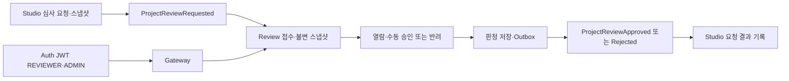

# Review 축소·단순화 개선 계획

[문서 목록](README.md) · [Studio 완료 범위](studio-simplification-plan.md) · [기존 심사 모델](domain/models/review.md) · [유스케이스 작성 규칙](use-case-conventions.md)

2026-10-14 작성·재작성 완료. 아래 범위의 구현과 실제 검증을 완료했으며 [완료 기록](#재작성-완료-기록)에 결과를 정리했다.

## 목표와 기준

Review는 Studio가 제출한 출시 자료·전체 빌드의 불변 스냅샷을 받아 사람이 승인 또는 반려하고,
그 판정의 원본과 결과 이벤트를 관리한다. 최초 심사와 수정 후 재심사는 같은 접수·판정 흐름을 사용한다.

완료된 Auth·Gateway·Studio와 사용하는 공통 계약을 기준으로 한다.
재작성 전 Review의 기존 코드는 제거·전환 대상을 조사하는 데만 사용했다.
Catalog·Store·Download 등 미완료 모듈의 API·DB·동작과 기존 Review API의 호환성은 설계·검증 제약으로 삼지 않는다.

| 모듈 | 책임 |
|---|---|
| Auth | CREATOR·REVIEWER·ADMIN 역할과 JWT 발급, 심사자 계정 초기화 |
| Gateway | 기존 `/api/v1/reviews/**` 경로의 라우팅과 REVIEWER·ADMIN 접근 제어 |
| Studio | 출시 자료·빌드 관리, 심사 요청·재요청, 외부 결과 기록과 현재 버전의 출시 요청 조건 확인 |
| Review | 요청 접수, 제출 스냅샷 열람, 수동 승인·반려, 판정자·사유·시각 기록과 결과 발행 |

Review는 Studio의 현재 작업본을 수정하거나 요청을 대신 생성하지 않는다.
실제 출시·상품 공개·상점 진열·판매·구매자 다운로드를 수행하지 않는다.
초기에는 심사자 배정 없이 REVIEWER·ADMIN이 모든 접수 건을 조회하고 판정할 수 있다.

## 최소 사용자 흐름

1. CREATOR가 Studio에서 상세정보·썸네일·전체 ZIP을 준비하고 심사를 요청한다.
2. Review가 `ProjectReviewRequested`를 받아 요청 당시 스냅샷을 한 건의 심사로 저장한다.
3. REVIEWER 또는 ADMIN이 Auth에서 로그인하고 Gateway를 통해 심사 목록·상세를 확인한다.
4. Review에서 해당 스냅샷의 ZIP 다운로드 URL을 받아 빌드를 열람한다.
5. 승인하거나 필수 반려 사유를 입력한다. 판정자는 JWT `sub`로 기록한다.
6. 판정과 결과 이벤트를 함께 저장한다. Studio는 결과 이벤트를 수신해 원래 요청에 기록한다.
7. 반려 후 CREATOR가 Studio에서 재요청하면 새 요청 ID의 심사가 생성된다.
8. 승인 뒤 상세정보·빌드를 수정한 경우에도 새 요청으로 심사하며 과거 스냅샷·판정은 유지한다.

Studio의 요청 접수 응답과 Review의 심사 생성, Review의 판정 응답과 Studio의 결과 반영 사이에는
이벤트 전달 지연이 있다. API에서 다른 서비스의 반영 완료를 기다리지 않는다.

## 기존 구현에서 정리할 대상

재작성 전 Review에는 두 심사 흐름, 업무·감사 엔티티 5개, 업무 HTTP API 14개가 있다.
수신 이벤트도 완료된 Studio의 `ProjectReviewRequested`가 아닌
`GameRegistered`·`SubmissionCreated`를 사용한다.

| 기존 구성 | 개선 방향 |
|---|---|
| `ReviewRequest`와 `SubmissionSnapshot`·`ReviewCase`의 두 흐름 | 요청 단위 `ProjectReview` 한 모델로 통합 |
| 등급·상점 자료·빌드 QA·법무·SDK·판매 조건의 여섯 유형 | 상세정보·전체 빌드를 함께 보는 단일 수동 심사 |
| `IN_REVIEW`, 외부 접수, 보류·취소·만료·이의 제기 상태 | `REQUESTED / APPROVED / REJECTED` 세 상태 |
| 담당자 배정, 체크리스트, 내부 메모, SLA·만료 스케줄러 | 초기 범위에서 제거 |
| 자체등급 자동 승인, 외부 등급 기관 포트·목 구현, 등급 증빙 | 초기 범위에서 제거 |
| 별도 감사·판정 이력 엔티티와 서비스 | 요청별 불변 스냅샷·최종 판정 정보로 필요한 이력 보관 |
| 구 Studio 이벤트와 구 결과 이벤트 | 현재 Project 심사 요청·결과 계약으로 교체 |
| 기존 심사 서비스 두 개 | 접수·조회·파일 열람·판정 유스케이스로 재구성 |

기존 구현 조사는 재작성 전 커밋 37f9807 기준이다.
당시 SubmissionReviewController·StudioEventListener·ReviewType은 해당 커밋의 Git 이력에서 확인할 수 있다.

## 최소 저장 모델

업무 엔티티는 `ProjectReview` 하나다. 새 테이블은 `project_review`로 두며 공통 Outbox·Inbox와 구분한다.

| 값 | 의미 |
|---|---|
| `reviewRequestId` | Studio가 발급한 요청 ID. Review의 PK로 그대로 사용하며 자체 번호를 발급하지 않음 |
| `requestEventId` | 최초 접수한 요청 이벤트 ID |
| `projectId, productCode, ownerSubject, contentVersion` | 스냅샷에서 추출한 조회·결과 연결 정보 |
| `snapshot` | 받은 `ProjectSnapshot` 전체를 보관하는 불변 JSON |
| `status` | REQUESTED·APPROVED·REJECTED |
| `feedback` | 반려 사유. 반려 시 필수, 최대 2000자 |
| `actor` | 최초 최종 판정을 수행한 JWT sub |
| `decidedAt` | 최초 최종 판정 시각 |
| `requestedAt` | 요청 이벤트의 발생 시각 |
| `createdAt, updatedAt` | 수신·DB 변경 시각 |

`reviewRequestId`에 유일성을 보장하고 상태·접수 시각, Project·접수 시각에 조회 인덱스를 둔다.
Project·버전·빌드 조합에는 유니크 제약을 두지 않는다.
동일 버전의 반려 후 재요청도 새 ID로 접수되어야 한다.
다른 서비스 테이블을 조인하거나 외부 DB FK를 만들지 않는다.

스냅샷의 빌드 ID·버전·경로·크기·SHA-256은 최초 제출 값을 유지한다.
Studio의 최신 Project를 조회해 스냅샷이나 조회용 필드를 갱신하지 않는다.
한 요청의 최종 판정은 한 번이며, Project별 과거 요청을 조회하면 재심사 이력도 함께 확인할 수 있다.

## 상태·동시성·재요청 규칙

| 상황 | 처리 |
|---|---|
| 새 요청 수신 | REQUESTED로 접수 |
| 동일 이벤트 재수신 | 같은 업무 트랜잭션의 Inbox로 중복 제거 |
| 다른 이벤트 ID로 동일 요청·동일 스냅샷 수신 | 기존 심사 유지, 스냅샷·판정·최초 접수 정보 변경 없음 |
| 같은 요청 ID에 다른 스냅샷 수신 | 계약 위반으로 처리, 기존 자료를 덮어쓰지 않음 |
| REQUESTED 승인·반려 | 최종 판정 기록과 결과 Outbox를 같은 트랜잭션에서 저장 |
| 동일한 최종 판정·반려 사유 재전송 | 기존 결과 반환, 새 결과 이벤트 발행 없음 |
| 반대 판정 또는 확정된 반려 사유 변경 | 409, 기존 판정 유지 |
| 동시 승인·반려 | 요청 행 잠금으로 한 판정만 확정 |
| 반려 후 재심사 | Studio가 발급한 새 요청 ID로 새 심사 생성, 이전 건을 다시 열지 않음 |
| 심사 중 Studio 작업본 변경 | 원래 요청의 스냅샷을 계속 심사, 현재 버전 여부는 Studio가 판단 |

동일 판정 재전송 시 최초 판정자와 판정 시각도 유지한다.
승인·반려를 뒤집는 관리자 예외 API는 초기 범위에 포함하지 않는다.

## HTTP API와 권한

모든 업무 API는 기존 Gateway 경로 `/api/v1/reviews/**` 안에 두고,
Gateway와 Review 양쪽에서 REVIEWER 또는 ADMIN을 요구한다.
심사자 계정은 Auth의 기존 `AUTH_REVIEWER_EMAIL / AUTH_REVIEWER_PASSWORD` 초기화 기능을 사용한다.
창작자는 자기 요청의 결과를 Studio에서 조회한다. CREATOR 권한만으로 Review 운영 API에 접근할 수 없다.

| 메서드 | 경로 | 역할 |
|---|---|---|
| GET | `/api/v1/reviews` | 상태·Project 필터와 페이지 조회 |
| GET | `/api/v1/reviews/{reviewRequestId}` | 제출 상세정보·빌드 정보·판정 조회 |
| GET | `/api/v1/reviews/{reviewRequestId}/build-download` | 해당 스냅샷 ZIP의 짧은 수명 다운로드 URL 발급 |
| POST | `/api/v1/reviews/{reviewRequestId}/approve` | 승인 |
| POST | `/api/v1/reviews/{reviewRequestId}/reject` | 반려와 필수 feedback 기록 |

총 5개 업무 엔드포인트다. 별도 접수·재접수·이의 제기·판정 수정 API는 만들지 않는다.
목록은 기본 page=0, size=20, 최대 size=100이며 접수 시각 내림차순과 요청 ID로 정렬한다.
판정 성공은 200이며 Studio의 결과 반영 완료를 뜻하지 않는다.
잘못된 입력은 400, 인증 실패는 401, 권한 부족은 403, 미접수 요청은 404, 확정 판정 충돌은 409다.

응답은 공통 `ApiResponse`와 전용 DTO를 사용한다.
상세 응답에는 제출 자료와 빌드 버전·크기·체크섬을 제공하고 내부 저장 경로는 노출하지 않는다.
판정 요청의 대상은 경로의 reviewRequestId로 지정한다.
actor·판정 시각·projectId·buildId·contentVersion은 요청 본문으로 받지 않는다.
BFF 쿠키를 사용하는 POST는 기존 Gateway의 CSRF 계약을 따른다.

## 이벤트와 트랜잭션

새 공통 이벤트를 추가하지 않고 이미 완료된 Studio가 사용하는 세 계약을 그대로 연결한다.

| 방향 | 이벤트 | 토픽 |
|---|---|---|
| 수신 | `ProjectReviewRequestedEvent` | `stove.studio.v1` |
| 승인 결과 | `ProjectReviewApprovedEvent` | `stove.review.v1` |
| 반려 결과 | `ProjectReviewRejectedEvent` | `stove.review.v1` |

결과의 `reviewRequestId, projectId, contentVersion, productCode`는 저장된 요청·스냅샷에서 가져온다.
`actor`는 검증된 JWT sub, 반려의 `feedback`은 확정한 사유다.
결과 이벤트의 UUID·시각은 기존 `of()` 팩터리가 생성하며 Kafka 키는 `productCode`를 유지한다.
Outbox의 aggregateId도 productCode로 맞춰 같은 Project의 결과 발행 순서를 유지한다.

수신 경계에서는 봉투·본문의 이벤트 ID와 유형, Kafka 키와 productCode의 일치 및
필수 요청 ID·Project ID·버전·소유자·빌드 정보가 현재 계약에 맞는지 확인한다.
이 검증은 입력 계약을 확인하는 것이며 Studio의 소유권·출시 조건을 다시 판정하는 절차가 아니다.

리스너와 접수 유스케이스는 새 consumer group `review-project`를 공유한다.
기존 그룹이 새 이벤트를 무시하고 소비 위치를 전진시켰을 가능성을 피하며,
첫 기동은 보관된 이벤트의 earliest부터 새 요청을 접수한다.
Studio 토픽의 출시 요청 등 다른 업무 이벤트와 구 이벤트는 처리하지 않는다.

Inbox 마킹·심사 접수는 하나의 DB 트랜잭션으로 묶는다.
수신 동시 중복은 DB 유일 제약과 실패 트랜잭션의 재시도로 처리하고 결과를 검증한다.
심사 실패를 성공 소비로 처리하거나 Inbox만 별도 커밋하지 않는다.
잘못된 계약과 처리 실패는 기존 공통 Kafka 재시도·DLT 경계를 사용한다.

판정은 행 잠금·상태 변경·결과 Outbox를 하나의 DB 트랜잭션으로 묶는다.
커밋 뒤 Outbox 릴레이가 결과를 발행하며 실패·재전달은 공통 모듈이 처리한다.
Studio의 DB를 직접 변경하거나 HTTP로 결과를 동기 반영하지 않는다.

## 심사자 빌드 열람

현재 Studio의 빌드 API는 CREATOR·소유자 전용이며 ZIP 열람용 API가 없다.
Review가 저장된 스냅샷의 `storagePath`를 이용해 읽기 전용 S3/MinIO 어댑터로 URL을 발급한다.
Studio의 소유권 정책을 완화하거나 미완료 Download 모듈에 의존하지 않는다.

- 클라이언트는 reviewRequestId만 전달한다. 임의 URL·버킷·객체 경로를 입력받지 않는다.
- 스냅샷의 s3 경로와 설정된 버킷을 확인하고 그 객체의 존재·크기를 확인한다.
- 객체 누락·크기 불일치이면 URL을 발급하지 않으며 접수된 심사·스냅샷은 보존한다.
- 기본 유효기간 5분의 GET URL과 expiresAt·fileSize·checksum을 반환한다.
- 다운로드 시 SHA-256을 확인할 수 있도록 제출된 checksum을 제공한다. HEAD만으로 해시 검증 완료를 주장하지 않는다.
- 저장소에는 읽기·조회 권한만 부여하며 업로드·삭제·버킷 생성은 수행하지 않는다.
- 기존 Studio와 같은 버킷·리전·암호화 조건을 사용하고 URL의 외부 접근 주소를 별도로 설정할 수 있게 한다.
- URL 응답은 캐시하지 않고 서명 URL을 로그에 남기지 않는다.

저장소 조회·서명은 긴 DB 트랜잭션 밖에서 실행한다.
파일 열람 실패와 저장소 일시 장애는 승인·반려 판정으로 자동 변환하지 않는다.
Review는 ZIP을 실행하거나 자동 품질 검사·등급 판정을 수행하지 않는다.

## 구현 구조

| 위치 | 구성 |
|---|---|
| core.domain | ProjectReview·ReviewSubmission·상태·리포지토리, 불변 스냅샷·최종 판정 규칙 |
| core.service | ReceiveProjectReview, ReadProjectReviews, ReadReviewBuildDownload, DecideProjectReview |
| core.port | ReviewBuildStorage 인터페이스 |
| api.controller / api.listener | 5개 API와 ProjectReviewRequested 입력 해석·ReviewSubmissionMapper.from 검증·내부 입력 변환·유스케이스 호출 |
| infrastructure | 읽기 전용 S3/MinIO 어댑터 |
| config | JWT·스토리지 설정 |

Review에 S3 SDK 의존성과 전용 스토리지 설정을 추가한다.
Studio의 구현 클래스·설정 클래스를 직접 참조하거나 파일 객체를 복제하지 않는다.

승인·반려는 같은 판정 유스케이스에서 조율한다.
DTO 변환은 `from()`, 엔티티 초기화는 의도가 드러나는 팩터리,
공통 결과 이벤트는 기존 `of()`를 사용한다.
공통 계약이 Review 엔티티나 Studio 구현 클래스에 의존하게 만들지 않는다.
구 서비스·모델·리포지토리·DTO·스케줄러·외부 등급 포트와 관련 테스트는 새 범위로 교체한다.

## DB와 전환

1. 기존 Flyway V1~V9는 수정하지 않고 체크섬을 유지한다.
2. V10에 새 project_review 테이블과 인덱스를 추가하고 기존 공통 Outbox·Inbox를 재사용한다.
3. 구 review_request·review_case·submission_snapshot·감사 테이블은 역사 자료로 보존하되 새 업무에서 읽지 않는다.
4. 구 심사에는 새 Studio 요청 ID·완전한 ProjectSnapshot 대응이 보장되지 않으므로 자동 이관하거나 과거 승인을 새 요청에 연결하지 않는다.
5. 전환 전 Studio의 미처리 요청과 새 Review 접수를 대조한다. Kafka 보관 범위 밖의 요청은 보존된 원본 요청 이벤트로 재전달하며 복구할 원본이 없으면 누락을 명시한다.
6. 구 이벤트 호환 처리, 두 심사 흐름의 병행 운영, 미완료 외부 모듈의 연동 수정을 만들지 않는다.

구 테이블의 물리 삭제는 이력 보관 정책을 정한 뒤 별도로 처리한다.
업무 코드 제거와 기존 SQL·자료 삭제를 같은 작업으로 묶지 않는다.

## 구현 순서

1. **접수·모델**: 새 테이블, ProjectReview, 새 이벤트 수신·Inbox, 불변 스냅샷·중복 접수를 구현한다. 구 수신 기점을 교체하고 SLA 스케줄러를 제거한다.
2. **조회·열람**: 역할·페이지 조회·상세 DTO와 읽기 전용 빌드 URL 발급을 구현한다. 구 컨트롤러를 교체해 경로 충돌을 없애고 관련 테스트·OpenAPI를 함께 갱신한다.
3. **판정·결과**: 승인·반려·행 잠금·동일 판정 재시도·Outbox와 Studio 결과 수신을 연결한다.
4. **구 코드 정리**: 두 기존 흐름과 관련 DTO·외부 포트·스케줄러·불필요 설정을 제거하고 OpenAPI·문서를 갱신한다.
5. **독립 검증**: Auth·Gateway·Studio·Review만 실행하는 별도 스택과 검증 스크립트를 만든다.

단계별로 빌드 가능한 상태를 유지하며 Auth·Gateway·Studio의 계약을 유지한다.
중간 단계는 개발 단계이며 새 흐름이 완성된 모듈을 배포 단위로 삼는다.
구현과 검증은 완료했으며 기존 운영 DB의 이관 실행은 배포 시 적용한다.

## 검증과 완료 조건

| 경계 | 필수 확인 |
|---|---|
| 단위·아키텍처 | 세 상태 전이, 불변 판정·스냅샷, API 응답 계약, 유스케이스·포트 의존 방향 |
| 권한 | 실제 JWT의 REVIEWER·ADMIN 허용, 익명과 REVIEWER·ADMIN 없는 MEMBER·CREATOR 차단, 요청 본문으로 판정자 위조 불가 |
| 실제 MySQL·Kafka | 중복 이벤트·동일 요청 재전달·상충 스냅샷, Inbox와 접수의 원자성 |
| 동시 판정 | 승인·반려 경합에서 판정 한 건·결과 Outbox 한 건만 확정 |
| 실제 MinIO | 요청 당시 ZIP·크기·다운로드 바이트·SHA-256 일치, 만료 URL·타 버킷·파일 누락 처리 |
| 실제 Studio 연결 | 승인·반려 결과가 같은 요청 ID·버전에 기록되고 현재 버전의 출시 요청 조건에 반영 |
| 재심사·편집 | 반려 후 같은 버전 재요청, 승인 후 새 버전 심사, 심사 중 수정과 과거 요청 결과 보존 |
| 지연·재시작 | 과거 결과가 새 요청을 덮어쓰지 않음, 저장된 판정·Outbox가 재시작 후 전달 |
| 전환·계약 | 빈 DB·V9 DB의 V10 적용, 구 데이터와 신규 요청 분리, OpenAPI 5개 업무 API |
| 회귀 | 완료된 Auth·Gateway·Studio와 사용하는 공통 이벤트·메시징 계약 |

검증 스택은 네 앱과 MySQL·Redis·Kafka·MinIO만 사용한다.
Catalog·Store·Order·Payment·License·Download·Settlement의 실행이나 전체 서비스 E2E를 완료 조건으로 사용하지 않는다.
Review의 실제 승인으로 Studio의 출시 요청 발행까지 확인하되 실제 출시 결과는 검증 픽스처 경계에 둔다.

완료는 위 필수 검증이 통과하고 기존 심사 코드가 새 흐름으로 교체된 뒤 표시한다.
이 범위의 구현·검증을 완료해 Review를 완료 모듈 목록에 추가했다.

## 재작성 완료 기록

2026-10-14, 요청 단위 ProjectReview와 세 상태·5개 업무 API로 재작성을 완료했다.
구 심사·감사 모델·서비스·DTO·SLA·외부 등급 포트를 제거하고 V10을 추가했다.
Auth·Gateway·Studio의 런타임 코드는 변경하지 않았으며 기존 요청·결과 계약을 연결했다.

- Review 단위·아키텍처·권한·리스너·전용 계정 설정 테스트 50건 통과.
- 실제 MySQL·Kafka·MinIO 통합 테스트 12건 통과: 중복 접수·Inbox 롤백·판정 원자성·동시 판정·빌드 열람·만료·이관·OpenAPI.
- 네 모듈 E2E 10건 통과: 실제 PKCE 로그인·역할·요청·ZIP·반려·재심사·승인·출시 요청·편집·지연 결과.
- 실제 Review 프로세스 재시작 전후 2건 통과: 저장된 판정과 미발행 Outbox의 전달·중복 판정 방지.
- 별도 MinIO 읽기 전용 계정의 실제 업로드·삭제 거절 확인.
- Review 전용 저장소 계정 설정을 필수로 하고 Studio 쓰기 계정의 자동 대체를 차단했다.
- 완료된 Auth·Gateway·Studio와 사용하는 공통 이벤트·메시징 회귀 검증 통과.

재실행과 계정·스토리지 설정은 [Review 실행·검증](review-guide.md)을 따른다.
검증 스택의 자체 앱·컨테이너는 종료 시 정리된다.
