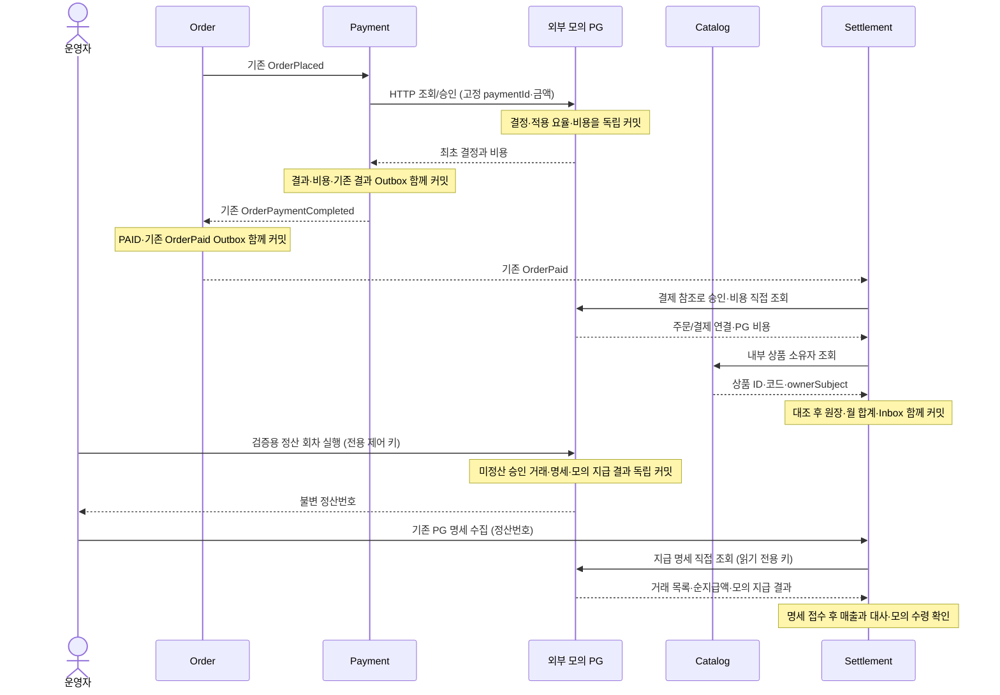

# Settlement MVP 재작성 계획

[문서 목록](README.md) · [작업 기준·순서](../AGENTS.md) · [Order 완료 범위](order-mvp-plan.md) · [Payment 완료 범위](payment-mvp-plan.md) · [Catalog 완료 범위](catalog-mvp-plan.md) · [유스케이스 작성 규칙](use-case-conventions.md)

2026-10-18 계획 작성·재작성 완료. **구현·로컬 OrbStack 검증을 마쳤다.** 실행 결과는 아래 재작성 완료 기록을 따른다.
플랫폼이 PG 비용을 전액 부담하는 정책으로 Settlement를 최소 MVP로 재작성한다.
모의 PG는 Payment에서 분리해 별도 프로세스·DB·HTTP API를 가진 외부 서비스로 구성한다.
기준은 재작성 완료된 Auth·Gateway·Studio·Review·Catalog·Store·Order·Payment·License·Download의 현재 계약이다.
기존 Settlement의 API·모델·구매/환불 이벤트·테스트는 호환성 요구나 완료 기준으로 삼지 않는다.

같은 날 계획을 갱신해 **외부 모의 PG·정산 명세·모의 지급 결과·플랫폼 수령 대사**를 이번 범위로 정했다.
Payment가 모의 PG 정산을 호스팅/중계하던 초안은 대체한다. Payment·Settlement가 각각 자기 포트와 HTTP 어댑터로 외부 PG를 직접 호출한다.
결제 승인, PG 지급 결과, 플랫폼의 모의 수령 확인, 판매자 월 마감은 각각 구분한다.

## 목표와 책임

결제 완료 거래를 판매자의 매출로 기록하고, 플랫폼 수수료·판매자 정산액·플랫폼 부담 PG 비용을 구분해 조회·월 마감하는 흐름을 완성한다.
모의 PG가 거래를 묶어 지급액을 확정하면 Settlement가 거래별 근거를 대조해 모의 수령을 기록한다.
고객 청구액 확정, PG 비용·지급 결과, 플랫폼 수령 대사, 판매자 배분·마감의 책임을 코드와 실행 결과로 설명할 수 있게 한다.

| 주체 | 소유하는 책임 |
|---|---|
| Auth·Gateway | JWT sub·CREATOR/ADMIN 권한, 로그인·토큰 전달과 정산 공개 경로 라우팅 |
| Catalog | 공개 상품의 불변 식별자·소유자 제공. 가격·공개본·판매자 소유권의 정본 |
| Order | 고객 청구액·주문 스냅샷 확정, 결제 결과 검증·PAID 반영, 기존 OrderPaid 발행 |
| 모의 PG | 최초 결제 결정·비용과 별도 정산 회차의 명세·모의 지급 결과를 독립 보존. 같은 결제 키/정산 요청 키에 같은 결과 반환 |
| Payment | 외부 PG 승인/조회, 확정 결제 결과·비용 보존과 기존 결과 Outbox |
| Settlement | 매출·판매자·비용 대조, 배분·월 마감·조회, PG 지급 명세 보존·거래별 대사·모의 수령 확인 |
| License·Download | 기존 보유권·다운로드. 매출 접수나 마감의 선행 조건으로 사용하지 않음 |

이번 완료점은 **모의 거래의 정산 금액 확정과 모의 PG 지급 명세에 근거한 수령 대사**다.
모의 PG 지급 결과를 시험용 수령 근거로 삼으며 실제 PG 계약·금융 거래·은행 입금·판매자 송금을 완료한 것으로 설명하지 않는다.
Settlement는 다른 모듈의 DB를 직접 읽거나 주문·결제·보유권·공개본을 변경하지 않는다.

## 이번 MVP와 후속 범위

| 이번에 포함 | 최소 구현 |
|---|---|
| 거래 | 기존 단일 상품·수량 하나·양수 KRW·할인 0인 결제 완료 주문 |
| 외부 공급자 | simulators/mock-pg 독립 앱, 전용 MySQL·프로세스·HTTP API·클라이언트별 접근 권한 |
| PG 비용 | 승인 시 확정되는 고정 요율 모의 비용, 공급자 원장·Payment의 불변 스냅샷 |
| PG 정산 | 미정산 승인 거래를 묶는 수동 회차, 불변 명세·포함 거래·공제 비용·모의 지급 결과 |
| 플랫폼 수령 | 지급 명세 접수·거래별 대사, 미도착 매출 대기·불일치 표시·중복 없는 모의 수령 확정 |
| 배분 | 플랫폼 수수료 정책 하나, PG 비용은 플랫폼 전액 부담 |
| 원장 | 주문당 매출 한 건, 입력 전체 보존·내용 비교·Inbox와 원자적 저장 |
| 월 정산 | 판매자·월별 합계, OPEN → CLOSED 수동 마감, 마감 후 지연 거래의 현재 월 반영 |
| 조회·운영 | CREATOR의 본인 매출·월 정산, ADMIN의 전체/판매자별 조회·월 마감·기존 PG 명세 수집/수령 조회/재대사 |
| 검증 | 완료 열 앱 + Settlement + 외부 모의 PG의 구매·정산 흐름, 독립 DB/통신 장애·재전달·마감 경합 |

소량의 개발·학습 데이터, 단일 Settlement·모의 PG 인스턴스로 시작한다. 업무 MySQL·Kafka와 별도로 PG 전용 MySQL을 둔다.
별도 정산 이벤트 소비자가 없으므로 Settlement의 업무 이벤트·Outbox 발행은 추가하지 않는다.

후속 범위는 다음과 같다.

- 실제 PG의 정산 자료 연동·은행 입금 확인/대사·승인 후 나중에 확정/수정되는 비용·판매자 송금/지급대행.
- PG 정산의 영업일·일/주별 자동 실행·지급 대기/실패/분할 지급·여러 가맹점/PG·정산 명세 정정·실제 계좌 잔액 관리.
- 판매자 PG 비용 부담·분담·상한, 판매자별 개별 요율·계약 관리·요율 변경·기간별 정책 선택.
- 할인·쿠폰·플랫폼 보조금·무료 지급·복수 상품·다중 통화·자체 판매와 입점 판매의 별도 분류.
- 환불·부분 환불·차지백·수수료 반환·송금 비용·세금계산서·원천징수·세무 회계 처리.
- 마감 취소·재마감·확정 금액 수정·자동 마감 배치·다중 인스턴스 작업 분배·CSV·전용 대사 화면.
- 기존 공유 데이터의 자동 정산 이관·소급 계산, DB 유실 후 전량 재구축·전용 복구 플랫폼.

## 금액 정책과 확정 시점

### 플랫폼 전액 부담

```text
paidAmount        = OrderPaid.amount
platformFeeAmount = paidAmount × platformFeeRate (원 단위 HALF_UP)
sellerPayoutAmount = paidAmount − platformFeeAmount
pgFeeAmount        = 외부 PG가 거래별로 확정·보존한 비용
platformNetAmount  = platformFeeAmount − pgFeeAmount
pgPayoutAmount     = paidAmount − pgFeeAmount

paidAmount = sellerPayoutAmount + platformNetAmount + pgFeeAmount
pgPayoutAmount = sellerPayoutAmount + platformNetAmount
```

- 플랫폼 수수료의 기준은 고객 결제액이다. PG 비용을 먼저 뺀 잔액을 기준으로 배분하지 않는다.
- PG 비용이 달라져도 같은 결제액·플랫폼 수수료 조건의 판매자 정산액은 같다.
- platformNetAmount는 다른 비용·세금 차감 전 배분 잔액이다. 회계상 순이익으로 표시하지 않는다.
- PG 비용이 플랫폼 수수료보다 크면 platformNetAmount가 음수가 될 수 있다. 이를 0으로 보정하거나 판매자에게 전가하지 않는다.
- 모든 금액은 정수 long·KRW다. BigDecimal로 비율을 계산하고 HALF_UP 후 정확한 정수 변환을 사용한다. 누적 합계·건수의 오버플로도 거부한다.
- pgPayoutAmount는 개별 거래의 PG 순지급 기준액이다. 실제 모의 지급·수령은 거래들을 묶은 명세별 합계로 기록한다.

### MVP 정책 값

| 항목 | 설계·검증용 정책 |
|---|---|
| 플랫폼 수수료 | PLATFORM_MVP_V1, 1,000bps = 10%, 원 단위 HALF_UP |
| 모의 PG 비용 | SIMULATED_FEE_V1, 기본 300bps = 3%, 원 단위 HALF_UP |
| PG 비용 의미 | 이번 모의 정책에서 플랫폼에 청구되는 총비용. 별도 부가세 계산은 추가하지 않음 |
| 승인/거절 | 신규 APPROVED는 계산된 비용, 신규 DECLINED는 확정 비용 0. 기술 오류는 최종 거절로 바꾸지 않음 |

위 값은 실행 가능한 설계를 위한 **모의 정책 값**이며 실제 사업 계약·PG 요율이 아니다.
플랫폼 정책은 이번 MVP 전체에 동일한 고정 규칙으로 적용한다. config가 고정 정책 객체를 조립하고 운영 중 요율 변경 기능은 제공하지 않는다.
요율 변경을 도입할 때는 거래에 적용할 조건의 확정 시점·버전 선택을 별도로 설계한다. 처리 지연 거래에 최신 요율을 임의 적용하지 않는다.
모의 PG의 승인/거절·정책 ID·요율은 외부 PG의 config에서만 바인딩하고 0~10,000bps를 검증한다.
Payment·Settlement는 PG 요율을 설정하거나 PG 비용을 산출하지 않는다. 정책 버전의 의미를 바꾸어 재사용하지 않는다.

| 예시 | 결제액 | 플랫폼 수수료 | 판매자 정산액 | PG 비용 | 플랫폼 잔여액 |
|---|---:|---:|---:|---:|---:|
| 기본 | 10,000 | 1,000 | 9,000 | 300 | 700 |
| PG 비용 증가 픽스처 | 10,000 | 1,000 | 9,000 | 500 | 500 |
| 플랫폼 비용 초과 픽스처 | 10,000 | 1,000 | 9,000 | 1,200 | -200 |

고객 청구액은 Order에서 확정된 값을 유지한다. 고객에게 PG 비용을 추가 청구하거나 Payment.amount에서 비용을 차감하지 않는다.

## 입력 계약과 연동 방식

현재 [OrderPaidEvent](../common/kafka/src/main/java/com/stove/common/kafka/contract/payload/OrderPaidEvent.java)는 결제 완료 주문의 13개 값을 담지만 판매자·PG 비용은 담지 않는다.
현재 [CatalogProduct](../apps/catalog/src/main/java/com/stove/catalog/core/domain/CatalogProduct.java)는 ownerSubject를 보존하고 같은 상품의 소유자 변경을 거부한다.
이 계약을 기준으로 **OrderPaid 한 종류 소비 + 외부 PG 거래/비용 조회 + Catalog 소유자 조회**를 선택한다.

- OrderPlaced·OrderPaymentCompleted/Failed·OrderPaid의 기존 본문·토픽·키·발행 의미를 유지한다.
- Order·License에 PG 비용 필드를 중계·저장하기 위한 변경은 추가하지 않는다.
- Settlement는 Payment를 경유하지 않고 PG의 결제 참조 조회와 지급 명세 조회 API를 직접 호출한다. Catalog 소유자만 별도 내부 GET으로 확인한다.
- 같은 상품의 소유자가 불변인 현재 Catalog 계약을 사용한다. 판매자 양도를 도입할 때는 거래 시점 소유자의 별도 스냅샷 계약이 필요하다.
- 신규 매출 저장에는 PG·Catalog의 가용성이 필요하다. 저장된 매출의 재전달·조회·마감은 외부 조회 없이 처리한다.
- 두 이벤트를 조합하는 대기 테이블이나 별도 비용 확정 이벤트는 이번에 추가하지 않는다.
- PG 수령은 OrderPaid 소비와 독립된 ADMIN의 **기존 공급자 명세 수집 요청**으로 시작한다. Settlement는 PG 지급 명세를 생성하지 않는다.
- 모의 PG 정산 회차 생성은 외부 PG의 검증용 제어 API와 검증 스크립트가 담당한다. 플랫폼 업무 포트·운영 API에 이 제어 기능을 넣지 않는다.
- 아직 도착하지 않은 매출은 수령 대사를 대기하게 하며 결제·매출 처리를 되돌리지 않는다.



## 외부 모의 PG의 배치와 교체 경계

- 같은 저장소의 simulators/mock-pg를 독립 실행 앱으로 추가한다. Gradle 경로는 :simulators:mock-pg이며 업무 apps 모듈·완료 도메인 목록에 포함하지 않는다.
- Java 21·기존 Spring Boot 빌드 기반을 사용하되 자체 HTTP DTO·값 검증·서비스·저장소·Flyway·보안을 둔다. settings.gradle과 실행/검증 구성을 명시적으로 확장한다.
- Payment·Settlement와 별도 프로세스/포트, 별도 MySQL 컨테이너·DB·자격증명·볼륨을 사용한다. PG DB 자격증명은 PG 프로세스에만 제공한다.
- PG는 앱의 core.port를 구현하거나 앱/공통 업무 계약 JAR에 의존하지 않는다. 앱도 PG 구현체·JAR·DB에 의존하지 않고 HTTP 계약만 사용한다.
- PG에는 Order/Payment/Settlement 엔티티·Auth JWT·Kafka·Inbox·Outbox·플랫폼 수수료·판매자 배분을 넣지 않는다. 자체 결제 원장·정산 명세·지급 결과만 소유한다.
- 각 앱의 core.port는 필요한 기능과 내부 결과를 정의하고, adapter는 PG별 HTTP·인증·오류·필드 매핑을 담당한다. config가 주소·키·타임아웃·선택한 구현체를 조립한다.

| 호출 모듈 | 자기 모듈의 포트 | 모의 PG HTTP 구현 |
|---|---|---|
| Payment | 기존 PgGateway — 고정 키 결제의 승인/결과 확인 | adapter.pg.SimulatedPgHttpGateway |
| Settlement | PgPayments — 주문 근거에 연결할 승인 거래·비용 조회 | adapter의 SimulatedPgPaymentHttpClient |
| Settlement | PgSettlements — 공급자가 이미 확정한 지급 명세 조회 | adapter의 SimulatedPgSettlementHttpClient |

PG HTTP 응답 DTO를 앱 도메인에 그대로 전달하거나 세 모듈 사이에 공유 PgResult Java 모델을 만들지 않는다.

### 포트 소유권과 호출 경로

Java 인터페이스는 호출 모듈이 필요한 기능을 선언하는 내부 경계다. 실제 네트워크 연동은 그 모듈의 HTTP/SDK 어댑터가 수행한다.
Payment의 PgGateway는 Payment의 결제 업무만 표현한다. Settlement는 이를 import하거나 Payment의 어댑터를 호출하지 않고 자기 PgPayments·PgSettlements를 사용한다.
외부 PG 서버가 Payment의 Java 인터페이스를 구현하는 구조도 아니다. 공급자는 자체 HTTP 계약을 제공하고 각 호출 모듈의 어댑터가 이를 내부 계약에 맞춘다.
같은 공급자를 호출해도 결제 확정과 지급 명세 수집의 포트 소유권·실행 경로는 독립적이다.

실제 자금 수령은 PG 계약에 따른 플랫폼 계좌의 금융 거래다. Payment 또는 Settlement의 Java 객체를 통해 돈이 이동하는 것으로 설명하지 않는다.
이번 Settlement의 수령 업무는 공급자가 보고한 지급 내역을 수집하고 원장과 대조하는 것이다. 실제 계좌 입금 증거 확인은 후속 범위다.

### 포트원 등 실제 공급자로 전환할 때

포트원은 여러 PG의 결제 연동을 제공하므로 포트원 결제 API와 실제 PG의 지급 명세를 구분한다.
공식 [일반 인증 결제 가이드](https://developers.portone.io/opi/ko/integration/start/v2/checkout?v=v2)는 브라우저 SDK 결제창 호출과 서버 결제 조회·금액 검증을 안내한다.
현재 PgGateway.charge의 입력은 paymentId·orderNo·amount·currency뿐이므로 이 인터페이스의 구현 교체만으로 일반 인증 결제가 완성되지 않는다.
도입할 결제 방식에 맞게 결제 준비·사용자 인증·서버 검증·웹훅/재조회·상태 전이를 설계하고 필요한 포트·API를 확장한다.

Settlement의 지급 명세 자료원은 선택한 PG·가맹점 계약·사용 가능한 연동 기능을 확인한 뒤 결정한다.
포트원의 [대사 API](https://developers.portone.io/api/rest-v2/reconciliation)와 [파트너 정산 API](https://developers.portone.io/api/rest-v2/platform.transfer?v=v2)는 용도와 제공 데이터를 각각 확인한다.
특히 파트너 정산은 플랫폼이 판매자에게 정산하는 업무이므로 PG가 플랫폼에 지급한 명세를 그대로 대신한다고 가정하지 않는다.
결제 연동을 완료했다는 이유로 이번 모의 PG와 같은 거래별 확정 비용·지급 명세 조회가 자동 제공된다고 가정하지 않는다.
필요한 자료가 PG API·파일·별도 서비스로 제공되면 Settlement의 해당 어댑터로 수집한다. 비용이 승인 뒤 확정되면 미확정 비용·후속 확정 흐름도 별도로 설계한다.

포트에 필요한 기능·값·상태가 실제 공급자에서도 충족될 때는 어댑터와 조립 변경으로 전환할 수 있다.
모의 PG의 승인 시 비용 확정·검증용 회차 제어를 모든 실제 PG의 공통 기능으로 가정하지 않는다. base URL만 바꾸면 연동이 끝난다고 설명하지 않는다.
실제 연동 뒤 모의 PG를 필수 프록시로 남기지 않는다.

### 독립 모의 PG로 분리하는 목적

인터페이스와 인프로세스 대역만으로도 단위 검증과 구현 교체 경계를 만들 수 있다. 별도 프로세스가 교체 가능성의 필수 조건은 아니다.
이번 분리는 공급자 원장을 플랫폼 밖에 두고 Payment·Settlement가 독립적으로 HTTP를 호출하는 흐름을 실행·검증하기 위해 선택한다.
PG 처리 후 응답 유실·PG 단독 중단·플랫폼 롤백·재시작·같은 키 복구와 Payment 중단 중 Settlement의 명세 수집을 검증한다.
추가 프로세스·DB·기동 구성이 필요하므로 같은 저장소의 최소 검증 서비스로 유지하고 별도 저장소·플랫폼 업무 기능·공통 PG 중계 서비스를 추가하지 않는다.
이 분리는 실제 공급자 계약과 결제 흐름을 확인하는 작업을 대체하지 않는다.

## Payment의 외부 PG 호출·비용 보존

### 공급자 결정과 Payment 결과

1. Payment 내부 값 PgFee에 policyId·rateBps·amount를 둔다. 값 자체의 유효성은 생성 시 보장한다.
2. PgResult에 비용 스냅샷을 추가한다. PgGateway의 호출 키와 고객 청구액 계약은 유지하고 구현을 HTTP 어댑터로 교체한다.
3. HTTP 어댑터는 먼저 paymentId 참조로 PG 결정을 조회한다. 없으면 같은 paymentId를 멱등 키로 승인 요청한다. 조회의 통신 오류를 404로 취급하지 않는다.
4. 외부 PG는 최초 결정·요율·비용을 자기 DB에 저장하고 같은 paymentId에는 전체 결과를 반환한다. Payment는 현재 요율로 비용을 계산하지 않는다.
5. Payment.confirm은 원래 요청·공급자와 함께 비용을 검증·보존한다. 이미 확정한 결과의 비용도 전체 비교에 포함한다.
6. 결과·비용·기존 OrderPaymentCompleted/Failed Outbox는 같은 Payment 트랜잭션으로 저장한다. PG HTTP 호출 중에는 Payment 트랜잭션·잠금을 잡지 않는다.

신규 승인 비용은 외부 PG가 청구액 기준으로 계산하며 비용 누락·음수·요율과 맞지 않는 신규 결정을 만들지 않는다.
이 모의 정책에서는 비용을 0~청구액으로 제한하고 플랫폼 수수료 초과 비용은 허용한다. 공급자 생성 경합은 PG DB의 유일 제약·롤백 후 재조회로 해결한다.
응답 유실·외부 PG 종료·Payment 결과 롤백·재시작·PG 정책 변경 뒤에도 같은 키로 최초 거래를 회복한다.
시간 초과·연결 실패·잘못된 결과는 PENDING을 유지하고, 확인된 DECLINED만 FAILED로 확정한다.
신규 Payment의 공급자 ID는 config에서 전달해 고정한다. 이번 공급자 ID는 SIMULATED이며 HTTP 어댑터 선택과 별개다. 과거 결제의 공급자·키를 변경하지 않는다.

### 기존 Payment 데이터

기존 V1~V11·체크섬을 보존하고 V12__pg_fee_snapshot.sql에서 **purchase_payment에만**
pg_fee_policy_id·pg_fee_rate_bps·pg_fee_amount를 nullable로 추가한다. 비용은 세 컬럼 전체가 있거나 전체가 없어야 한다.
Payment 안의 simulated_payment_charge는 보관·전환 근거로 남기고 신규 결정·정산 명세를 쓰지 않는다.

- 신규 PENDING은 비용 미확정이다. 신규 최종 결정에는 승인 비용 또는 거절 0원 근거가 있다.
- 기존 최종 결정의 빈 비용은 **미산정**이다. 0원이나 현재 요율의 계산값으로 자동 보충하지 않는다.
- 기존 비용 없는 공급자 결정은 아래 전환 절차로 외부 PG에 원래 키·결과 그대로 이관한다. 기존 PENDING은 이 결정을 HTTP로 회복하고 비용은 미산정으로 남긴다.
- 따라서 PgResult와 Payment의 읽기·복구는 비용 없는 기존 결정을 표현할 수 있어야 한다. 새 공급자 결정을 만드는 경로는 비용을 필수로 보장한다.
- 비용 없는 기존 PAID도 결제 조회·Order 결과 반영·License 지급의 기존 의미를 유지한다. 새 정산의 비용 근거로는 사용할 수 없다.
- 미산정 비용의 사후 확정·이력 갱신은 후속 범위다. 이번 실제 검증은 전용 빈 DB에서 비용 도입 이후 새 거래로 수행한다.

구매자용 Payment HTTP 응답과 기존 결제 이벤트는 유지한다. Settlement용 비용/PG 정산 중계 API는 Payment에 추가하지 않는다.
Payment의 구 JDBC SimulatedPgGateway·승인/거절/요율 설정을 HTTP 클라이언트 구성으로 교체하고 로컬 PG 폴백은 제공하지 않는다.

## 모의 PG 정산 명세·지급 결과

### 정산 회차와 공급자 원장

이번 모의 PG는 **플랫폼 가맹점 하나·KRW·수동 정산 회차**로 구성한다.
PG 검증용 제어 요청 한 번이 정산 주기 실행을 대신한다. 플랫폼 업무 API·결제 승인 호출에서는 명세를 만들지 않고 판매자 월 마감과도 묶지 않는다.
실제 PG 영업일·지급 지연·은행 계좌는 모사하지 않는다.

1. 검증 운영자가 PG 전용 제어 API에 UUID requestId로 회차 생성을 요청한다. 수령액·수수료·포함 거래·지급 완료 여부를 입력하지 않는다.
2. 외부 PG가 최초 접수 시각 cutoffAt을 고정한다. 이 작업에 Payment·Settlement의 호출이나 데이터 조회는 없다.
3. 공급자 원장의 APPROVED 중 **비용 확정·미배정·PG 결정 시각이 cutoffAt 이전**인 거래를 선택한다. Payment/Order 업무 테이블로 공급자 지급 대상을 판단하지 않는다.
4. 각 거래의 최초 비용을 그대로 사용해 명세 헤더·거래 항목·모의 지급 결과를 독립 트랜잭션으로 함께 저장한다.
5. 명세 상태는 SIMULATED_PAID, 결과는 불변이다. 같은 requestId는 최초 명세를 반환하며 이후 거래를 추가하지 않는다.
6. 후속 회차는 아직 배정되지 않은 거래만 선택한다. cutoffAt 이전 시각의 결정이 늦게 커밋됐어도 다음 회차에서 누락 없이 선택한다.

모의 PG 정산번호는 공급자가 생성한다. 업무 조회 명세는 provider·providerSettlementId·currency·cutoffAt·paidAt·status,
paymentAmountTotal·pgFeeAmountTotal·payoutAmount·recordCount와 불변 거래 목록을 제공한다.
거래 항목은 paymentId·orderNo·providerTransactionId·providerOccurredAt·amount·currency·PG 정책 ID/요율/비용이다.
항목 순서는 providerOccurredAt·paymentId로 고정하며 합계는 **거래별로 반올림해 보존한 값의 합**이다. 합계 금액에 요율을 다시 적용하지 않는다.

```text
paymentAmountTotal = Σ 거래별 amount
pgFeeAmountTotal   = Σ 거래별 pgFeeAmount
payoutAmount      = paymentAmountTotal − pgFeeAmountTotal
```

외부 PG의 전용 DB에 pg_charge·pg_settlement·pg_settlement_item을 둔다. Payment DB에 공급자 정산 테이블을 추가하지 않는다.
공급자 명세는 제어 요청 requestId도 내부 보존한다. 제어 요청 키·정산번호와 항목의 providerTransactionId·paymentId에 각각 유일 제약을 두어 승인 거래를 두 명세에 배정하지 않는다.
후보 거래는 일정한 순서로 잠그고 배정을 재확인한다. 경합에서 패하면 전체 공급자 트랜잭션을 종료하고 다시 선택한다.
같은 requestId의 동시 호출도 명세 한 건·같은 결과로 수렴한다. 명세 헤더만 있거나 일부 항목만 배정되는 커밋은 허용하지 않는다.

- 대상이 없으면 409 NO_ELIGIBLE_CHARGES이며 빈 지급 명세·성공한 요청 키를 만들지 않는다.
- DECLINED·비용 미산정인 기존 거래·이미 배정한 거래는 제외한다. 미산정 비용을 0원으로 보충해 지급하지 않는다.
- PG 비용 합계가 결제액 합계를 넘거나 항목/합계가 맞지 않으면 지급 결과를 확정하지 않는다. 오버플로도 거부한다.
- PG 제어 응답이 유실되면 제어 API의 **같은 requestId**로 최초 정산번호를 회복한다. 플랫폼의 명세 수집 재시도는 providerSettlementId로 같은 명세를 읽는다.
- 모의 PG는 Payment와 Settlement의 업무 트랜잭션·저장소를 참조하지 않는다. 공급자 명세 커밋과 플랫폼 수령 커밋을 분리한다.

### 플랫폼의 접수·대사·모의 수령

Settlement는 PgReceipt·PgReceiptItem에 공급자 명세의 전체 내용을 보존하고 아래 상태로 관리한다.

| 상태 | 의미 |
|---|---|
| REPORTED_PAID | 모의 PG가 지급했다고 보고한 명세를 접수. 내부 매출 미도착 등으로 대사 미완료 |
| MISMATCH | 도착한 내부 거래와 식별자·금액·비용 등이 다름. 불일치 근거 보존, 수령 미확정 |
| SIMULATED_RECEIVED | 모든 항목이 내부 매출과 일치해 시험용 수령으로 확정 |

1. ADMIN은 기존 providerSettlementId로 수집을 요청한다. ReceivePgSettlement는 기존 접수를 확인하고 새 입력만 DB 트랜잭션 밖에서 PG 명세를 직접 조회한다.
2. HTTP 어댑터·내부 값에서 명세 형식·SIMULATED 공급자/지급 상태·항목 중복·정수/통화·비용·건수·세 합계를 검증한다.
3. 유효한 지급 보고의 헤더·항목 전체를 REPORTED_PAID로 같은 트랜잭션에서 저장한다. 운영자의 최초 sub·접수 시각도 보존한다.
4. 접수 커밋 뒤 ReconcilePgReceipt가 별도 READ_COMMITTED 트랜잭션에서 헤더를 잠그고 거래별 내부 SettlementSale과 대조한다.
5. 모든 항목이 일치할 때만 SIMULATED_RECEIVED·최초 simulatedReceivedAt을 함께 확정한다. 첫 수령 요청에서 대사를 한 번 시도한다.

거래 대조는 provider·providerTransactionId·providerOccurredAt·paymentId·orderNo·amount·currency·PG 정책 ID/요율/비용 전체를 확인한다.
하나라도 내부 매출이 없으면 성공으로 건너뛰지 않고 REPORTED_PAID로 남긴다. 이미 있는 항목의 값이 다르면 MISMATCH와 항목별 사유를 남긴다.
입력 전체의 형식/합계 오류나 식별자 재사용 충돌은 접수 자체를 거부한다. 사업 원장의 수정이나 비용 덮어쓰기로 대사를 맞추지 않는다.

- 명세의 포함 거래·금액·지급 결과는 삽입 후 불변이다. 상태·대사 사유·대사 시각만 갱신하며 최초 모의 수령 시각은 유지한다.
- 최초 조회·동시 접수 중 같은 (provider, providerSettlementId)의 응답이 경합하면 저장한 전체 명세와 비교한다. 같은 키의 다른 명세는 충돌이며, 다른 명세에 이미 접수한 거래도 거부한다.
- 이미 접수한 정산번호의 재요청은 저장된 명세를 재사용한다. 공급자 명세 정정·원격 재수집 기능은 이번에 제공하지 않는다.
- 같은 요청 재시도·재대사·동시 실행으로 수령액을 다시 가산하지 않는다. 수령 합계는 SIMULATED_RECEIVED 명세의 payoutAmount 합계로 구한다.
- SIMULATED_RECEIVED의 재대사는 최초 확정 결과를 반환한다. 후속 조회·재시작으로 상태를 낮추거나 simulatedReceivedAt을 덮어쓰지 않는다.
- 미도착 OrderPaid가 나중에 반영되면 운영자가 재대사한다. 자동 대사 스케줄러는 추가하지 않는다. 저장된 명세의 재대사는 PG/Catalog 장애 중에도 가능하다.
- 공급자 보고 저장과 대사는 별도 트랜잭션이다. 접수 뒤 프로세스가 종료돼도 명세를 보존하고 같은 요청 또는 재대사로 재개한다.
- PG 조회 응답 유실·플랫폼 접수 저장 실패는 같은 providerSettlementId로 재조회한다. 플랫폼의 수집 요청·재시도는 PG 원장을 변경하지 않는다.

예: 승인 3건이 각각 10,000원·PG 비용 300원이면 모의 PG 명세의 결제액 30,000원·비용 900원·지급액 29,100원을 대조한다.
같은 세 거래의 판매자 정산액 합계 27,000원 + 플랫폼 잔여액 합계 2,100원 = 모의 수령액 29,100원이다.
이 식은 **해당 명세에 포함된 거래 집합**에 적용한다. 날짜가 같은 판매자 월 합계를 그대로 PG 명세 합계와 비교하지 않는다.

SIMULATED_RECEIVED는 모의 PG 지급 보고와 내부 원장의 일치를 근거로 한 시험용 상태다.
실제 PG 연동에서는 지급 통지·은행 입금 증거를 구분해 별도 수령 확인 계약을 설계해야 한다. 이 상태를 실제 은행 입금 완료로 재사용하지 않는다.

## 외부 PG HTTP 계약

### 업무 API와 검증용 제어 API

| 메서드 | PG 서비스 경로 | 호출 권한·용도 |
|---|---|---|
| POST | /v1/charges | Payment 키, paymentId·orderNo·amount·currency로 승인 요청 |
| GET | /v1/charges/by-reference/{paymentId} | Payment/Settlement 키, 가맹점 결제 참조로 최초 결정·거래 ID·비용 조회 |
| GET | /v1/settlements/{providerSettlementId} | Settlement 키, 이미 확정한 지급 명세 조회 |
| POST | /test-support/v1/settlement-runs | PG 제어 키, requestId로 모의 정산 회차 생성 |
| GET | /test-support/v1/settlement-runs/{requestId} | PG 제어 키, 제어 요청에 대응하는 최초 정산번호 조회 |

PG 승인 POST의 Idempotency-Key는 paymentId와 같아야 한다. 같은 키·같은 주문/금액/통화는 최초 결과를 반환하고 다른 입력은 409다.
공급자 거래 ID는 PG가 생성하고 paymentId는 Payment가 발급한 가맹점 참조다. 두 값을 혼동하거나 키 재발급으로 결과를 회피하지 않는다.
없는 거래/명세는 404이고 GET은 원장을 변경하지 않는다. 신규 PG 결정의 비용은 필수이며 이관한 기존 결정의 미산정 비용은 명시적으로 구분한다.

결제 응답은 provider·paymentId·orderNo·amount·currency·providerTransactionId·providerOccurredAt·decision·거절 사유·PG 정책 ID/요율/비용이다.
Settlement는 APPROVED이며 비용이 확정된 응답만 사용하고 OrderPaid의 paymentId·orderNo·amount·currency를 대조한다.
상품·구매자·requestEventId·paymentResultEventId의 근거는 기존 OrderPaid 자체다. 이 값을 PG가 확인하도록 보내거나 PG 응답에 추가하지 않는다.
OrderPaid.occurredAt과 PG 결정 시각은 서로 다른 사실이므로 일치를 요구하지 않는다.
할인 도입은 후속 범위이며 Order가 이미 확정한 청구액을 이번 정산 기준액으로 사용한다.

PG는 자체 JSON 응답/오류 계약을 제공한다. 플랫폼 ApiResponse·Kafka 계약·앱 HTTP DTO를 공유하지 않는다.
각 어댑터는 형식·필수 값·정수 범위·결정·통화·시각·연결 정보를 검증하고 모듈 내부 값/오류로 변환한다.
외부 PG 비용 조회 실패·비승인·비용 미산정·연결 불일치에는 정상 매출을 기록하지 않는다. 지급 명세 형식은 위 명세·대사 규칙을 따른다.

### 접근 권한과 설정

- PG 전용 키 세 개를 서로 다른 값으로 설정한다: MOCK_PG_PAYMENT_KEY, MOCK_PG_SETTLEMENT_KEY, MOCK_PG_CONTROL_KEY. 요청 헤더는 X-Pg-Api-Key다.
- PG는 키가 미설정/공백/중복이면 기동을 거절한다. 누락·잘못된 키는 401, 유효한 다른 역할 키로 허용 밖 기능을 호출하면 403이다.
- Payment 프로세스에는 Payment 키만, Settlement 프로세스에는 읽기 전용 Settlement 키만 제공한다. PG 제어 키는 검증 운영/스크립트에만 제공한다.
- 플랫폼 JWT와 Gateway ADMIN 권한은 PG 제어 권한이 아니다. Payment·Settlement 실행 설정에 제어 키를 전달하지 않는다.
- Gateway는 PG 업무/제어 경로를 라우팅하지 않는다. PG는 로컬/OrbStack 사설망에서 실행하고 health를 제외한 업무 경로를 닫아 둔다.
- Payment·Settlement는 PG base URL·자기 키·연결/읽기 제한 시간을 명시적으로 설정한다. 키·토큰·자격증명은 로그·검증 요약에 남기지 않는다.
- 초기 연결 2초·읽기 5초를 기준으로 한다. 연결/조회 실패를 거절·미존재·지급 완료로 바꾸지 않는다. 어댑터의 숨은 무한 재시도나 로컬 승인 폴백은 추가하지 않는다.
- PG 승인/정산 응답 유실·프로세스 중단·재시작은 별도 프로세스·DB를 대상으로 검증한다. 같은 Payment DB 안의 독립 트랜잭션 검사로 대체하지 않는다.

## Catalog 내부 소유자 조회

GET /internal/v1/products/{productCode}/owner 하나를 추가하고 ApiResponse 안에 productId·productCode·ownerSubject를 반환한다.
없는 상품은 404, 잘못된 코드는 400이다. CatalogProduct의 불변 소유자를 사용하며 현재 가격·제목·빌드로 정산 입력을 교체하지 않는다.
Settlement는 OrderPaid.productId·productCode와 대조하고 ownerSubject를 sellerSubject로 보존한다. Studio의 구 숫자 sellerId·워크스페이스 조회는 사용하지 않는다.

- 공개 OpenAPI에서 숨기고 Cache-Control: no-store를 적용한다. Gateway에 /internal/** 라우트를 추가하지 않는다.
- CATALOG_SETTLEMENT_SERVICE_KEY·X-Settlement-Service-Key를 사용한다. 키 미설정·공백이면 해당 내부 경로만 닫고 누락·불일치 키는 401로 거절한다.
- Catalog의 기존 Download 키·빌드 조회와 분리하고 위 GET만 허용한다. 사용자 JWT·PG 키로 대체하지 않는다.
- Settlement config에서 Catalog base URL·키·유한한 타임아웃을 조립하고 HTTP 어댑터에서 응답 봉투·필드 타입·값·연결을 검증한다.

## Settlement 입력·원자성·재전달

OrderPaid 전용 소비 그룹은 settlement-paid-order다. 원래 토픽 stove.order.v1·Kafka 키 orderNo를 사용한다.
api.listener의 SettlementOrderMapper.from(...)에서 봉투·본문의 eventId·eventType·키와 13개 값의 유효성을 확인해 내부 PaidOrder로 변환한다.
서비스·도메인은 외부 이벤트 전체나 EventEnvelope를 받지 않는다. 다른 모듈의 입력 검증 함수·상수에 의존하지 않는다.

RecordPaidSale 유스케이스는 외부 조회와 DB 트랜잭션을 다음 순서로 조율한다.

1. 기존 원장을 먼저 조회한다. 같은 주문이 있으면 **OrderPaid 13개 값 전체**와 Inbox의 일관성을 검증하고 동일 재전달만 종료한다.
2. 새 입력이면 외부 PG 승인 거래·비용을 직접 조회·대조하고, Catalog 상품·판매자를 조회·대조한다. 이때 Settlement DB 트랜잭션·월 잠금을 잡지 않는다.
3. 생성 시 유효한 내부 매출 입력을 구성한다. TransactionTemplate 또는 별도 트랜잭션 경계에서 기존 업무 키를 다시 확인한다.
4. 귀속 월의 SellerMonthlySettlement 행을 생성/잠금하고 아래 마감·지연 거래 규칙으로 반영 월을 확정한다.
5. Inbox·SettlementSale·OPEN 월 합계 갱신을 함께 저장·flush·커밋한다. 월 합계만 갱신되거나 Inbox만 남는 성공은 허용하지 않는다.

| 입력/장애 | 처리 |
|---|---|
| 같은 이벤트·같은 입력 | 기존 원장·월 합계·시각 유지. 외부 서비스 중단 중에도 동일 재전달 처리 가능 |
| 같은 주문의 이벤트 ID·발생 시각·본문 변경 | 충돌. 기존 원장 유지 |
| eventId·requestEventId·paymentResultEventId·paymentId를 다른 주문에 재사용 | 충돌. 다른 매출로 수락하지 않음 |
| 신규 원장 동시 생성 | 업무 유일 제약으로 한 건만 확정. 패한 트랜잭션 종료 후 재조회·내용 비교 |
| Inbox와 원장의 한쪽만 존재 | 불일치로 거부. 정상 중복으로 건너뛰지 않음 |
| PG/Catalog 조회 실패·미산정·비승인·값 불일치 | 정상 원장·Inbox·월 합계 없음. 결제 상태는 유지 |
| 원장·합계·Inbox 저장 실패 | 전부 롤백, 같은 입력으로 재처리 |

신규 조회 도중 다른 실행이 원장을 확정했으면 기존 원장을 다시 확인하고 동일 입력/충돌 규칙을 적용한다.
DB 유일 제약 위반을 잡은 뒤 이미 실패한 트랜잭션 안에서 계속 작업하지 않는다.
원장 반영·월 마감의 트랜잭션은 READ_COMMITTED로 구성하고, 월 행 잠금 뒤 읽은 원장 합계로 판단한다.
단일 인스턴스 전제라도 이벤트 재전달·HTTP 마감과의 동시 실행은 검증한다.

Kafka의 기존 제한 재시도·DLT를 사용한다. HTTP 장애가 재시도 기간 안에 회복되면 원래 입력으로 처리한다.
재시도가 소진되어 DLT로 이동한 입력은 **자동 복구됐다고 설명하지 않는다.** 원인 제거 후 원본 키·본문·eventId/eventType 헤더를 유지해 수동 재전달하는 검증 스크립트·실행 절차를 제공한다.
같은 토픽의 다른 소비자 실패와 구 이벤트를 구분해 Settlement의 OrderPaid 실패만 선택한다. DLT 전체를 무조건 재발행하지 않는다.
공통 운영 API는 기존 최소 구성처럼 비활성화하고 OrderPaid 전용 재처리 HTTP API·대기 테이블·스케줄러는 추가하지 않는다.
PG 수령 명세의 재대사는 별도의 명시적 업무 API이며 Kafka 재전달과 구분한다.
정상/실패/복구 건수와 DLT 잔류 입력을 완료 기록에서 대조한다.

## 최소 저장 모델

Settlement의 새 업무 테이블은 settlement_sale·seller_monthly_settlement·pg_receipt·pg_receipt_item 네 개다.
매출 원장·월 합계와 PG 명세·수령 상태를 분리한다. Kafka 매출 접수에는 공통 processed_event를 재사용한다.

| 모델 | 보존할 값 |
|---|---|
| SettlementSale | 기존 OrderPaid의 13개 값 전체, sellerSubject, 플랫폼 정책 ID·요율·수수료·판매자 정산액, PG 정책 ID·요율·비용·공급자·거래 ID·결정 시각, 플랫폼 잔여액, saleMonth·settlementMonth·receivedAt |
| SellerMonthlySettlement | sellerSubject·settlementMonth, OPEN/CLOSED, 결제액·플랫폼 수수료·판매자 정산액·PG 비용·플랫폼 잔여액 합계·recordCount, createdAt·updatedAt·closedAt |
| PgReceipt | provider·providerSettlementId, 공급자 cutoffAt·paidAt·SIMULATED_PAID, 통화·세 합계·건수, 수령 대사 상태·최초 운영자 sub·reportedAt·lastCheckedAt·simulatedReceivedAt |
| PgReceiptItem | receipt 연결, 지급 명세 항목 전체의 불변 스냅샷, 최신 대사의 누락/불일치 코드·사유 |

- SettlementSale은 삽입 후 불변이다. 환불/정정 유형·closed 불리언·별도 판매자 사본·원문 JSON 저장은 추가하지 않는다.
- orderNo·eventId·requestEventId·paymentResultEventId·paymentId에 각각 유일 제약을 둔다. 같은 상품의 서로 다른 구매자 거래는 별도 매출이다.
- SellerMonthlySettlement의 업무 키는 (sellerSubject, settlementMonth)이며 유일하다. 매출과 월 합계의 연결은 같은 판매자·반영 월이다.
- PgReceipt는 (provider, providerSettlementId)에 유일 제약을 둔다. PgReceiptItem은 명세 FK와 (provider, providerTransactionId)·(provider, paymentId) 유일 제약을 둔다. PG 제어 요청의 requestId를 플랫폼 수령 키로 사용하지 않는다.
- 명세 헤더·항목의 접수는 원자적이다. 모든 항목이 대사되기 전에는 일부 금액만 수령 합계에 포함하지 않는다. 수령 상태 전환이 매출·월 합계를 다시 증가시키지 않는다.
- PG 명세가 매출보다 먼저 도착할 수 있으므로 항목에 SettlementSale의 존재를 강제하는 FK는 두지 않는다. 재대사 때 불변 결제 키로 연결한다.
- 식별자는 원문·대소문자를 보존하고 DB 비교·유일 제약도 동일하게 적용한다. Instant는 UTC·마이크로초 정밀도로 저장한다.
- V6에서 재사용 processed_event의 식별자 비교도 대소문자를 구분하게 맞춘다. 기존 행·소비 그룹은 보존하고 대소문자만 다른 이벤트의 동작을 검증한다.
- DB에서도 비음수 결제/수수료·판매자 몫, 금액 보존식, 월 상태·closedAt의 일관성을 검증한다. platformNetAmount와 그 합계는 음수를 허용한다.
- 원장 조회/집계에 sellerSubject·settlementMonth와 정렬 키 인덱스를 둔다. 월 합계·건수는 원장과 같은 트랜잭션에서만 증감한다.

## 귀속 월·마감·늦은 거래

### 시각과 월

- 매출 발생 기준은 기존 OrderPaid.occurredAt, 즉 Order가 최초 PAID를 반영한 시각이다. PG 승인 시각으로 이름을 바꾸지 않는다.
- saleMonth는 그 Instant를 Asia/Seoul로 변환한 yyyy-MM이다. 서버 기본 시간대·수신 시각으로 원래 매출월을 정하지 않는다.
- settlementMonth는 실제 월 합계에 반영한 월이다. 정상 수신은 saleMonth와 같다.
- SettlementSale.receivedAt은 이벤트 접수 시각이며 PG 수령 시각이 아니다. PG 결정 시각·OrderPaid 발생 시각·명세 paidAt·reportedAt·simulatedReceivedAt을 각각 보존한다.
- 현재 시각은 config에서 조립한 Clock으로 주입해 월 경계 검사를 결정적으로 수행한다. 사용자에게 처리 시각을 지정하는 API는 제공하지 않는다.

### 마감과 지연 반영

1. 운영자는 **현재 KST 월보다 이전 월**만 판매자별로 마감할 수 있다. 현재·미래 월 마감은 409다.
2. 매출 반영과 마감은 같은 판매자·월 행을 잠근다. 월 행이 없으면 유일 제약으로 생성 경합을 해결한다.
3. 마감은 잠금 상태에서 원장 합계·건수와 저장 월 합계를 대조한 뒤 CLOSED·closedAt을 함께 확정한다. 빈 달의 명시적 마감은 0건 CLOSED로 남긴다.
4. 동일 판매자·월의 마감 재요청은 최초 금액·closedAt을 그대로 반환한다. 재집계하여 확정 금액을 바꾸지 않는다.
5. 늦은 거래의 saleMonth가 아직 OPEN이면 원래 월에 반영한다. 이미 CLOSED이면 **접수 트랜잭션 시점의 현재 KST 월**에 반영하고 saleMonth를 보존한다.
6. 현재 월은 마감할 수 없으므로 지연 거래를 반영할 OPEN 월이 있다. 월초 경계에서는 현재 월과 상태를 트랜잭션 안에서 재평가한다.
7. 둘 이상의 월 행을 잠글 때는 판매자·월의 일정한 순서를 적용한다. 원장 유일 제약 경합은 트랜잭션 종료 후 다시 처리한다.

예: 9월 매출 10,000원이 9월 마감 뒤 10월에 처음 도착하면 saleMonth=2026-09·settlementMonth=2026-10으로 기록한다.
확정된 9월 합계는 유지하고 10월 합계에 한 번 반영한다. 같은 입력이 11월에 다시 와도 최초 반영 월을 유지한다.
마감 경합에서 먼저 잠금을 잡은 매출은 해당 월에 포함되고, 마감이 먼저 확정되면 늦은 거래 규칙으로 반영한다.
이 규칙은 지연된 양수 매출의 반영이며 환불·마감 수정·실제 송금 이월 업무를 구현한 것으로 설명하지 않는다.

### PG 수령과 판매자 월 마감의 관계

- PG 정산은 공급자 거래의 수동 회차이고 판매자 월 마감은 saleMonth/settlementMonth에 따른 금액 확정이다. 두 주기를 동일하게 강제하지 않는다.
- 월 마감은 PG 수령 확인 전에도 가능하다. CLOSED를 수령 완료나 판매자 지급 완료로 해석하지 않는다.
- PG 수령·재대사는 이미 기록한 판매자 몫·반영 월·closedAt을 변경하지 않는다. 매출 도착 지연은 PG 대사 상태에 반영한다.
- 모의 PG 한 명세에 여러 판매자·여러 반영 월의 거래가 포함될 수 있다. 수령 대사는 명세 항목의 거래 집합으로 수행한다.
- 판매자 실제 송금과 지급 가능 잔액·자금 부족 처리는 후속 범위다. 이번에는 수령액을 근거로 자동 송금하지 않는다.

## 공개 API·권한·응답

| 메서드 | 경로 | 권한·용도 |
|---|---|---|
| GET | /api/v1/settlements/me/sales | CREATOR, 내 매출 페이지 |
| GET | /api/v1/settlements/me/months | CREATOR, 내 월 정산 페이지 |
| GET | /api/v1/settlements/sales | ADMIN, 전체/판매자별 매출 페이지 |
| GET | /api/v1/settlements/months | ADMIN, 전체/판매자별 월 정산 페이지 |
| POST | /api/v1/settlements/sellers/{sellerSubject}/months/{month}/close | ADMIN, 판매자·월 마감 |
| POST | /api/v1/settlements/pg-receipts | ADMIN, providerSettlementId로 기존 지급 명세 수집·접수·최초 대사 |
| GET | /api/v1/settlements/pg-receipts | ADMIN, 접수한 PG 명세·수령 상태 페이지 |
| GET | /api/v1/settlements/pg-receipts/{providerSettlementId} | ADMIN, 명세·거래 항목·대사 사유 상세 |
| POST | /api/v1/settlements/pg-receipts/{providerSettlementId}/reconcile | ADMIN, 저장한 명세 재대사 |

- Gateway와 Settlement 모두 기존 서명·issuer·만료·aud=esd-api와 역할을 검증하고 나머지 업무 경로를 기본 거부한다.
- 본인 조회의 sellerSubject는 JWT sub다. 숫자 member_id·X-Member-Id·요청의 seller 지정·Studio 워크스페이스를 사용하지 않는다.
- CREATOR는 본인 조회만 제공한다. ADMIN은 운영 경로를 사용하며 권한만으로 me의 주체를 바꾸지 않는다.
- 목록은 page=0·size=20, page ≥ 0·1 ≤ size ≤ 100이다. 매출/월 목록의 month 선택 필터는 settlementMonth를 뜻한다. ADMIN 매출/월 목록에만 sellerSubject 필터를 허용한다.
- 매출은 occurredAt DESC·id DESC, 월 목록은 settlementMonth DESC·id DESC로 정렬한다. ApiResponse의 content·page·size·totalElements·totalPages를 제공한다.
- 본인 매출에는 주문번호·상품 표시 스냅샷·결제액·플랫폼 수수료·판매자 정산액·두 월·매출/접수 시각을 제공한다. 본인 월 목록에는 상태·같은 금액 합계·건수·closedAt을 제공한다.
- ADMIN에는 sellerSubject·PG 비용·플랫폼 잔여액·정책과 결제 연결 근거를 추가 제공한다. 공급자 자격증명·키·원문은 응답하지 않는다.
- CLOSED는 판매자 금액 마감이고 SIMULATED_RECEIVED는 모의 PG 수령 대사 완료다. 실제 입금·판매자 지급 완료 상태나 세금계산서 번호는 추가하지 않는다.
- 익명 401, 역할 없음·CREATOR의 운영 경로 접근 403, 잘못된 필터/페이지/월 400이다. 거래 없는 조회는 빈 페이지이며 조회가 월 행을 생성하지 않는다.
- 기존 매출/월 조회·마감과 PG 수령 조회·재대사는 저장된 원장만 사용한다. PG·Payment·Catalog 중단 중에도 제공한다.
- PG 명세 수집 요청의 본문은 providerSettlementId 하나다. 공급자는 현재 설정된 SIMULATED이며 같은 명세 ID 재요청은 기존 접수/대사로 수렴한다. 주체는 ADMIN JWT sub로 기록한다.
- 이번 PG는 SIMULATED 하나이므로 명세 상세/재대사의 providerSettlementId는 이 공급자 범위에서 찾는다. 없는 명세는 404다.
- PG 명세 목록은 reportedAt DESC·id DESC, 선택 상태 필터를 사용한다. 상세는 공급자 명세 전체·불변 항목과 최신 대사 사유를 제공한다.
- 요청 접수·재대사 응답은 명세와 REPORTED_PAID/MISMATCH/SIMULATED_RECEIVED 상태를 구분한다. HTTP 성공만으로 모의 수령 완료라고 표시하지 않는다.
- 신규 명세 수집의 PG 연결/응답 오류는 503이며 새 접수를 만들지 않는다. 같은 providerSettlementId로 재조회한다. 공급자 명세 없음은 404, 키·명세 충돌은 409, 잘못된 입력은 400이다.
- PG 명세는 여러 판매자의 거래를 포함할 수 있으므로 ADMIN만 접근한다. CREATOR에게 전체 명세나 수령 운영 권한을 부여하지 않는다.

## 구현 구성·기존 코드 정리

| 위치 | 최소 구성 |
|---|---|
| Settlement core.domain | PaidOrder·결제 비용·판매자·PG 지급 명세 값, 고정 플랫폼 정책, SettlementSale·SellerMonthlySettlement·PgReceipt·PgReceiptItem·저장소와 검증 값 |
| Settlement core.service | RecordPaidSale, CloseSellerMonth, SearchSales, SearchSellerMonths, ReceivePgSettlement, ReconcilePgReceipt, ReadPgReceipts |
| Settlement core.port | PgPayments, CatalogOwners, PgSettlements |
| Settlement adapter | SimulatedPgPaymentHttpClient·CatalogOwnerHttpClient·SimulatedPgSettlementHttpClient. 기존 루트/하위 패키지 규칙 유지 |
| Settlement api.listener | OrderEventListener·SettlementOrderMapper |
| Settlement api.controller | 위 아홉 업무 API, 본인/운영 응답 DTO·PG 명세 입력/응답 |
| Settlement config | JWT·내부 HTTP 클라이언트·키·고정 정책·트랜잭션 조립 |
| Payment | PgFee·PgResult·Payment의 결과/비용, 기존 PgGateway의 SimulatedPgHttpGateway·HTTP config·V12. PG 정산 중계·공급자 원장은 추가하지 않음 |
| Catalog | 내부 ReadProductOwner·controller·DTO·전용 키 접근 제한 |
| simulators/mock-pg | 자체 결제/정산/지급 값·서비스·JDBC 저장소·HTTP DTO/컨트롤러·키/정책 config·독립 Flyway V1 |

서비스가 Inbox·잠금·업무 변경·필요한 Outbox를 조율한다. 외부 조회·설정 바인딩·HTTP DTO 해석은 지정한 경계에 둔다.
Java 지역/반복/리소스 변수와 import는 명시적으로 작성하고 와일드카드 import·불필요한 FQN·var를 사용하지 않는다.
업무 유스케이스는 동사형 이름을 사용하며 메서드별 위임 계층·공통 외부 입력 검증 계층을 추가하지 않는다.
PG 공급자 원장·수수료 계산·명세 생성·지급 결정은 simulators/mock-pg 안에서만 구현한다.
Settlement의 PG 수령 HTTP 호출과 접수/대사 트랜잭션 조율은 해당 유스케이스가 맡는다. 서비스 간 DB 트랜잭션·분산 락은 추가하지 않는다.

구 Settlement의 PaymentCompleted/PaymentCancelled 리스너, 숫자 sellerId·SELF/PARTNER·할인/환불 원장,
CreatorWorkspaceClient·세금계산서 포트/모의 발행기·마감 파사드·자동 배치·ShedLock·전용 대사/CSV와 구 테스트를 제거·교체한다.
기존 공유 이벤트 타입은 다른 사용처를 확인하며 일괄 삭제하지 않는다. 구 업무 경로가 남지 않도록 OpenAPI·라우팅·Compose 설정을 함께 정리한다.

## DB 전환과 데이터 보존

- Settlement V1~V5와 체크섬을 보존하고 V6__settlement_sales.sql로 새 업무 테이블 두 개를 추가한다.
- V7__pg_receipts.sql로 pg_receipt·pg_receipt_item을 추가한다. 새 Settlement 업무 테이블 합계는 네 개다.
- Payment V12는 purchase_payment의 비용 스냅샷만 확장한다. Payment에 PG 정산 테이블·그 테이블용 마이그레이션을 추가하지 않는다.
- 외부 모의 PG는 자기 Flyway V1에서 pg_charge·pg_settlement·pg_settlement_item 세 공급자 테이블을 만든다. 플랫폼 Flyway와 스키마/이력을 공유하지 않는다.
- 기존 settlement_record·seller_settlement·ShedLock·공통 Inbox/Outbox 자료를 물리 삭제하거나 새 정산으로 자동 변환하지 않는다.
- 새 소비 그룹을 사용하고 과거 Settlement의 소비 그룹·원장을 새 입력의 처리 근거로 사용하지 않는다.
- 공통 Outbox 자동 구성이 참조하는 기존 테이블은 보존하되 Settlement 릴레이는 비활성화한다.
- Payment V12의 비용 없는 기존 거래와 새 거래를 구분한다. 과거 이벤트의 소급 접수·PG 비용 재계산으로 새 원장을 채우지 않는다.
- 공급자 명세·항목 배정과 플랫폼 수령 자료도 전환/재시작 때 보존한다. 도입 전 비용 미산정 거래를 신규 모의 PG 지급 대상으로 자동 편입하지 않는다.
- 최초 완료 검증은 **독립된 빈 업무 DB·PG DB·Kafka·포트**에서 수행한다. 빈 DB·Payment V11→V12·Settlement V5→V7·PG V1과 중간 V6의 갱신·자료 보존을 별도 통합 검사로 확인한다.

### 기존 내장 모의 PG에서의 전환

Payment의 현재 simulated_payment_charge를 빈 외부 PG로 단순 교체하면, 응답 유실로 PENDING인 기존 결제가 새 결정으로 처리될 수 있다.
공유 스택을 바꿀 때는 아래 전환 절차를 따르며 최초 완료 검증과 구분한다.

1. 구 Payment/모의 PG 쓰기를 중단하고 처리 스케줄러를 끈다. 기존 PG 원장·PENDING·결과·Outbox·소비 그룹/DLT·건수/금액을 보존한다.
2. 현재 V11의 simulated_payment_charge만 오프라인 도구로 외부 PG의 pg_charge에 이관한다. 구 V10의 다른 결제 체계를 자동 편입하지 않는다.
3. paymentId·orderNo·금액·통화·공급자 거래 ID·결정·발생 시각·사유를 원문대로 보존하고 기존 빈 비용은 미산정으로 유지한다. 원본 행을 삭제하지 않는다.
4. 이관 도구는 재실행 시 동일 행만 건너뛰고 다른 값은 충돌로 중단한다. 모든 기존 결정의 키·본문·건수·금액을 외부 PG 조회와 대조한다.
5. Payment를 처리 비활성 상태로 외부 HTTP에 연결하고, 기존 결정이 있는 PENDING이 재승인 없이 같은 결과로 복구되는지 확인한 뒤 처리를 재개한다.
6. 구 내장 공급자와 새 공급자에 동시에 쓰지 않는다. 이관·대조 전에는 기존 공유 DB의 PENDING을 새 HTTP 공급자로 자동 재개하지 않는다.

PG 공급자 식별자 SIMULATED와 기존 거래 ID를 보존한다. 이관한 기존 미산정 비용은 신규 정산 명세 대상에서 제외한다.
실제 전환에는 미발행 Outbox·DLT·그룹 오프셋·정산 시작점도 함께 점검한다. 이번 문서 갱신으로 공유 스택을 전환하거나 자료를 이관하지 않는다.

## 구현 순서

1. **외부 PG:** 독립 모듈/빌드·프로세스·DB·V1·키별 권한·승인/조회·정산 명세·검증용 제어·멱등/배정 규칙을 구현한다.
2. **Payment 외부화:** PgGateway의 HTTP 구현·비용 보존·V12·응답 유실/PG 중단 복구·구 원장 이관 도구를 구현하고 내장 승인 구현을 교체한다.
3. **매출 접수:** V6·입력 mapper·PG 거래/비용 직접 조회·Catalog 소유자 조회·원장/월 합계/Inbox 트랜잭션·중복/충돌 규칙을 구현한다.
4. **PG 수령:** V7·PG 명세 HTTP 어댑터·전체 접수/재대사·미도착/불일치·최초 수령/재시작 복구를 구현한다.
5. **마감·조회:** 월 잠금·지연 거래·수동 마감·본인/운영/PG 수령 조회·보안·OpenAPI와 구 코드/설정 정리를 구현한다.
6. **로컬 검증:** 집중 검사 후 완료 모듈 회귀와 격리된 OrbStack의 열한 업무 앱 + 외부 PG 여정을 실행한다.
7. **완료 기록:** 실제 명령·건수·증거·제한·정리 결과를 기록하고 검증을 마친 뒤에만 Settlement를 완료 목록에 추가한다.

아래는 수립한 검증 범위다. 실제 실행 명령·건수·증거는 재작성 완료 기록에 구분한다.

## 로컬 OrbStack 검증 계획

코드·문서 편집, 빌드·테스트·서비스 실행을 모두 로컬에서 수행한다. 과거 계획의 OCI 실행 지시는 이번 작업에 적용하지 않는다.
Docker context의 OrbStack 연결을 확인하고 검증별 전용 포트·DB·컨테이너·버킷을 사용한다. 기존 공유 볼륨·중지 스택을 보존한다.

집중 검사의 예정 명령은 다음과 같다. 실행 환경에서 OrbStack의 DOCKER_HOST·기존 MinIO 테스트 이미지를 명시한다.

```bash
./gradlew :simulators:mock-pg:test :apps:payment:test :apps:catalog:test :apps:settlement:test \
  :common:archunit:test :common:kafka:test :common:messaging:test --no-daemon

./gradlew :simulators:mock-pg:integrationTest :apps:payment:integrationTest :apps:catalog:integrationTest \
  :apps:settlement:integrationTest :apps:order:integrationTest \
  :apps:license:integrationTest :apps:gateway:integrationTest \
  -Pstove.infraTest.maxParallel=1 --no-daemon
```

| 검증 계층 | 필요한 판정 |
|---|---|
| 비용·배분 | 기본/0%/반올림 경계·음수/누락/소수 절삭 거부·합계 오버플로·PG 비용 증가 시 판매자 몫 유지·플랫폼 음수 잔여 허용 |
| 공급자·Payment | 실제 HTTP·서로 다른 프로세스/DB·참조 조회 후 승인·같은 키 동시 호출·독립 커밋·응답 유실·PG 종료/재시작·결과/Outbox 롤백·정책 변경 후 최초 비용 보존·비용만 다른 최종 결과 충돌 |
| 공급자 PG 정산 | 여러 거래/판매자 합산·항목별 반올림 합계·거절/기존 미산정/기배정 제외·대상 없음·같은 요청/다른 요청 동시 실행·거래 중복 배정 방지·cutoff 전 늦은 커밋의 다음 회차 반영·응답 유실·부분 저장 롤백 |
| 플랫폼 수령 | 기존 PG 명세 GET만 수행·명세 전체 접수·거래별 대사·OrderPaid 지연 시 REPORTED_PAID→재대사·값 불일치 MISMATCH·합계/중복 항목 오류·동일 ID의 변경 명세·거래 재사용 거부·최초 simulatedReceivedAt·중복 수령 합계 방지 |
| 기존 데이터 | Payment V11→V12·Settlement V5→V7·PG V1·V6 중간 갱신·빈 DB·구 PG 원장 반복 이관/변경 충돌·원본 키/결정/자료 보존·미산정 비용·기존 PENDING의 HTTP 복구·공개 계약 유지 |
| 공급자/내부 계약 | PG 세 역할 키·업무/제어 경로 분리·플랫폼에 제어 키 부재·Catalog 전용 키/Download 키 분리·Gateway 라우트 부재·타입/ID/통화/금액/비용/명세 불일치·타임아웃 |
| 이벤트·원장 | 봉투/본문/키 검증·13개 값 비교·출처 ID 교차 재사용·동시 최초 접수·Inbox/원장 불일치·원장/합계/Inbox 동시 롤백 |
| 월·마감 | UTC↔KST 월 경계·OPEN/CLOSED·빈 달·현재/미래 월 거절·반복 마감·매출/마감 및 마감/마감 경합·지연 거래 현재 월 반영·재전달 월 보존·PG 수령 전 마감/수령 후 마감 불변 |
| 보안·조회 | 실제 서명 JWT의 401/403·sub 소유권·두 판매자 격리·CREATOR의 PG 수령 운영 거절·수령 요청 금액/상태 주입 거부·운영 필터·페이지/동률 정렬·외부 서비스 장애 중 저장 자료 조회/마감/재대사 |
| 복구 | PG/업무 DB 독립 중단·HTTP 재시도/DLT·Kafka 중단·커밋 후 ACK 전 재시작·미발행 OrderPaid 회복·PG 제어 응답 유실/명세 조회 응답 유실·보고 저장 후/대사 전 재시작·같은 결제/제어/명세 키 회복 |
| 구조·계약 | 앱과 PG 사이 프로젝트/도메인 JAR·DB 직접 의존 없음·포트는 호출 모듈 소유·계층/설정 경계·명시적 타입/import·새 정산 OpenAPI·기존 공개 계약 유지·Payment PG 중계/내장 승인/로컬 폴백 부재 |

집중 검사를 통과하면 완료 열 모듈의 기존 단위·관련 통합 회귀를 수행한다. 변경 없는 검사를 근거 없이 반복하지 않는다.
새 정산 OpenAPI는 생성 후 갱신 옵션 없이 다시 대조한다. Catalog 내부 API와 외부 PG 계약은 플랫폼 공개 문서에 섞지 않는다.
Payment를 실행하는 verify-payment.py·verify-license.py·verify-download.py 등의 기존 검증도 외부 PG 프로세스·별도 DB·주소/키 준비를 사용하게 갱신한다.
기존 Payment의 DB 내 공급자 원장/어댑터 주입 검사는 HTTP 계약·외부 프로세스 장애 검사로 교체하며, 앱 테스트가 PG 구현 JAR을 직접 호출하지 않는다.

### 실제 서비스 간 여정

기존 scripts/verify-download.py의 격리 방식을 참고해 scripts/verify-settlement.py와 정산 E2E 시나리오를 추가한다.
Auth·Gateway·Studio·Review·Catalog·Store·Order·Payment·License·Download·Settlement 열한 업무 앱과 외부 모의 PG를 각각 로컬 프로세스로 실행한다.
기존 인프라와 PG 전용 MySQL을 OrbStack 컨테이너로 구동하고 실행 자료는 runs/의 전용 경로에 보존한다.
PG는 독립된 포트/DB 자격증명을 사용한다. 모의 PG의 기동·검증을 업무 모듈 재작성 완료 수에 더하지 않는다.

1. 서로 다른 CREATOR 두 명이 상품을 출시한다. 상품/구매자를 구분해 동일 상품 중복 구매 제한을 지키는 10,000원 승인 거래 세 건을 만들고 Payment/Order PAID·License 지급·실제 ZIP 다운로드를 확인한다.
2. 기본 정책의 새 10,000원 거래에 공급자 비용 300원·Payment 비용 300원·정산 수수료 1,000원·판매자 몫 9,000원·플랫폼 잔여 700원을 대조한다.
3. 거절 거래는 매출이 없음을 확인한다. 구매자 청구액과 기존 이벤트·라이브러리 계약이 비용 확장으로 달라지지 않았는지 확인한다.
4. 검증 스크립트가 PG 제어 키·requestId로 외부 PG 회차를 생성하고 정산번호를 얻는다. ADMIN은 그 번호로 명세를 수집한다. 승인 세 건·결제액 30,000원·비용 900원·지급액/모의 수령액 29,100원, 판매자 몫 합계 27,000원·플랫폼 잔여 합계 2,100원을 대조한다.
5. PG 제어 키의 같은 요청과 플랫폼의 같은 명세 수집/재대사를 각각 반복하고 재시작해 최초 결과가 유지되는지 확인한다. 새 거래 없는 PG 회차는 대상 없음이며 플랫폼 수집 재시도는 PG 명세를 만들지 않아야 한다.
6. 두 판매자의 본인 조회·ADMIN 전체/판매자별 조회·PG 수령 운영 권한과 잘못된 역할·판매자 지정 차단을 실제 로그인으로 확인한다.
7. Settlement 중단 중 새 구매를 완료하고 재시작해 한 번만 반영한다. 원본 OrderPaid 재전달·커밋 후 재시작에도 원장/월 합계/Inbox 수가 유지되어야 한다.
8. 신규 매출의 PG/Catalog 조회 중단을 재현해 정상 원장 부재·DLT를 확인한다. 복구 후 원본을 재전달해 금액 한 번 반영을 확인한다.
9. 이미 PAID인 거래를 준비한 뒤 Payment를 중단한다. OrderPaid 수신·PG 직접 조회를 통한 새 매출 저장과 기존 PG 명세 수집이 가능해야 한다. Payment 경유 경로가 없음을 확인한다.
10. 저장된 거래를 기준으로 PG/Catalog 중단 중 본인/운영/수령 조회·동일 재전달·기존 명세 재대사가 가능함을 확인한다.
11. OrderPaid 릴레이를 중지한 새 구매 뒤 스크립트로 다음 PG 회차를 생성하고 ADMIN이 명세를 수집한다. 지급 보고는 보존되지만 미도착 매출 때문에 REPORTED_PAID이고 해당 명세 수령액은 아직 합산되지 않아야 한다.
12. Settlement를 재시작하고 원래 OrderPaid Outbox ID·본문으로 전달을 재개한다. 매출 반영 뒤 PG/Catalog를 중단해도 재대사로 SIMULATED_RECEIVED가 한 번만 확정되고 공급자 명세는 유지되어야 한다.
13. PG 프로세스/전용 DB를 중단해도 저장된 주문·결제·라이브러리·매출 조회는 유지되고 새 결제는 확정되지 않음을 확인한다. 복구 후 같은 paymentId로 최초 결정을 회복한다.
14. 기존 공유 컨테이너·볼륨 보존과 이번 검증의 PG/업무 자원만 정리했는지 실행 전후 목록을 대조한다.

현재 월의 실제 구매를 과거 거래로 바꾸지 않는다. 현재 월 마감 거절은 실제 여정에서 확인하고,
과거 월 마감·지연 거래·월초·음수 플랫폼 잔여·결제/PG 정산 응답 유실·명세 불일치는 고정 Clock과 입력/공급자 장애 픽스처로 검증한다.
마감 HTTP 검증에는 실제 서명 JWT와 MySQL·Kafka를 사용하되 과거 시각 입력은 계약 픽스처임을 결과에 표시한다.
픽스처 결과를 실제 과거 구매·실제 PG 비용·실제 입금/송금 완료로 기록하지 않는다.

## 완료 조건과 기록

- 플랫폼 전액 부담 계산식·근거 불변·원장/월 합계/Inbox 원자성이 검사와 실제 여정에서 일치한다.
- PG를 독립 프로세스·DB·HTTP 공급자로 분리하고 Payment·Settlement가 각자의 포트를 통해 직접 호출한다. PG 전용 제어 키/기능이 플랫폼 업무 경로에 남지 않는다.
- 모의 PG 명세·항목 배정·지급 결과 불변, 플랫폼 접수/대사·최초 수령·중복 방지·미도착/불일치/응답 유실 복구를 검증한다.
- Payment HTTP 전환·비용 확장·기존 결정 이관/복구·Catalog 소유자 조회가 완료 모듈의 기존 구매·출시·보유권·다운로드 계약을 유지한다.
- 정산 조회·수동 마감·지연 거래·보안·재전달·DLT 복구와 구 업무 제거를 검증한다.
- PG 정산·플랫폼 모의 수령·판매자 월 마감의 시각/상태/주기를 구분하고 실제 은행 입금·판매자 송금 완료로 표시하지 않는다.
- 실제 명령·JUnit 건수/실패/건너뜀·OpenAPI 결과·DB/금액/이벤트 대조·로그 경로·자원 정리 결과를 이 문서에 기록한다.
- 실행 안내·현재 서비스/모델/보안 문서를 구현 결과로 갱신한 뒤 AGENTS.md 완료 목록·완료일을 추가한다.

실제 PG·자금 이동·세무 처리는 이번 완료 조건에 포함하지 않는다.


## 재작성 완료 기록

2026-10-18 로컬 macOS·Java 21·OrbStack(Docker context: orbstack)에서 구현·빌드·검증을 완료했다.
독립 모의 PG, Payment HTTP/비용 전환, Catalog 소유자 내부 조회와 Settlement의 매출·월 마감·명세 대사를 구현했다.
구 Settlement의 환불·할인 분담·숫자 판매자·워크스페이스·계산서·자동 마감·CSV 경로와 테스트는 제거·교체했다.

### 실행과 판정

```sh
./gradlew test :simulators:mock-pg:integrationTest :apps:payment:integrationTest \
  :apps:settlement:integrationTest :apps:catalog:integrationTest :apps:order:integrationTest \
  :apps:license:integrationTest :apps:gateway:integrationTest :apps:download:integrationTest \
  verifyCommonRuntimeDependencies -Pstove.infraTest.maxParallel=1 --continue --offline --no-daemon

./gradlew :apps:settlement:integrationTest -Pstove.infraTest.maxParallel=1 --offline --no-daemon
python3 scripts/verify-payment.py
python3 scripts/verify-settlement.py
```

통합 검사에 OrbStack DOCKER_HOST와 기존 로컬 MinIO 이미지를 지정했다. OpenAPI는 한 번 생성한 뒤 갱신 옵션 없이 대조했다.
**단위 보고서 1,014건·관련 통합 152건·실제 프로세스 여정 32단계가 통과했고 실패·오류·JUnit 건너뜀은 모두 0건이다.**
변경 없는 일부 Gradle 태스크는 이번 세션의 성공한 결과를 UP-TO-DATE로 재사용했다. 기본 비활성 e2e:test와 태그별 실제 프로세스 검증을 구분했다.

| 계층 | 검증 결과 |
|---|---|
| Payment | 단위 59건·통합 23건. 외부 PG의 별도 JVM·MySQL, 같은 키 복구·비용 불변·결과/Outbox 롤백·V11→V12·반복 이관/충돌·미산정 비용 복구 |
| Settlement | 단위 46건·통합 19건. 13개 값 대조·출처 재사용·원장/월 합계/Inbox 원자성·동시 접수/마감·KST 지연 반영·명세 경합/불일치·재대사·JWT/OpenAPI·V5→V6→V7 |
| 외부 모의 PG | 단위 2건·통합 7건. 클라이언트별 키·요율 경계·정책 버전 재사용 거부·독립 결정·회차 경합·중복 배정 방지·항목별 반올림·부분 실패 롤백·지연 커밋·기존 미산정 제외 |
| Catalog | 단위 47건·통합 18건. 소유자 3개 필드·키 분리·기본 닫힘·현재 공개 빌드와 기존 출시 계약 |
| 완료 모듈 회귀 | Order 통합 35건·License 41건·Gateway 1건·Download 8건, 그 외 완료 모듈·공통 라이브러리 단위 보고서 포함 총 1,014건 |
| 실제 Payment | 여덟 업무 앱 + 외부 PG 11단계. 응답 유실·결과 저장 롤백·Order/Catalog/Kafka 중단·동일 키/원본 결과 복구 |
| 실제 Settlement | 열한 업무 앱 + 외부 PG 21단계. 두 판매자·실제 구매/ZIP·역할 격리·PG 직접 조회·미도착 매출·수령 재대사·PG/DB/Catalog/Payment 중단·DLT/원본 재전달·커밋 후 ACK 전 강제 종료 |

### 실제 금액과 상태

| 항목 | 초기 PG 명세 | 최종 전체 |
|---|---:|---:|
| 승인 거래/매출 | 3건 | 7건 |
| 결제액 | 30,000원 | 70,000원 |
| PG 비용 | 900원 | 2,100원 |
| 판매자 몫 | 27,000원 | 63,000원 |
| 플랫폼 잔여액 | 2,100원 | 4,900원 |
| PG 순지급액/모의 수령액 | 29,100원 | 67,900원 |

최종 PG 원장은 승인 7건·거절 1건이다. 지급 명세 3건에 승인 거래 7건이 한 번씩 포함됐고 세 명세 모두 SIMULATED_RECEIVED다.
신규 거절 거래는 매출·판매자 몫에 포함되지 않았다. 70,000 = 63,000 + 2,100 + 4,900, 67,900 = 63,000 + 4,900을 DB·API로 대조했다.

- Payment 중단 중 원래 OrderPaid의 새 매출 접수와 기존 PG 명세 수집이 동작했다. Payment 정산 중계가 필요하지 않음을 확인했다.
- 명세가 매출보다 먼저 도착하면 REPORTED_PAID였다. 매출 도착 뒤 PG·Catalog 중단 중 저장된 근거로 재대사해 최초 모의 수령 시각을 유지했다.
- PG 장애의 OrderPaid는 정상 원장 없이 DLT에 도달했다. 복구 후 원래 키·본문·이벤트 ID/종류로 두 번 전달해 한 번만 반영됐다.
- 네 번째 매출의 업무 커밋 직후·소비자 ACK 전에 테스트 전용 프로세스를 halt했다. 원본 이벤트 ID 표식과 DB 4건을 확인하고 정상 재시작 후 같은 원장 ID·접수 시각·4건을 유지했다.
- sub 없음·공백·길이 초과 JWT를 401로 차단하고 CREATOR의 본인 조회가 전체 조회로 바뀌지 않음을 검증했다.

### 보존과 실행 증거

- 기존 추적 SQL 마이그레이션 85개가 HEAD 원문과 동일하다. Payment V12·Settlement V6/V7·외부 PG V1만 추가했다.
- 기존 내장 PG 이관은 전용 테스트 DB에서 신규/반복/변경 충돌과 PENDING의 원래 거래 ID 복구를 확인했다. 기존 공유 스택·원장은 실제 전환하지 않았다.
- 생산 Payment·Settlement JAR에 검증용 클래스가 없고, 모의 PG JAR에 공통 업무 JAR·Kafka가 없음을 확인했다.
- Settlement 공개 OpenAPI는 8개 경로·9개 동작이며 Catalog 내부 API·PG 제어 API는 포함하지 않는다.
- 전체 JUnit 사본·집계·실제 프로세스 로그·최종 금액·정적 점검: `runs/stove-settlement-validation-qkhznjib/`.
- 최종 열한 업무 앱 + PG: `runs/stove-settlement-check-qej4juao/summary.json`, 단계별 JUnit 21개와 서비스별 로그·커밋 표식·컨테이너 전후 목록.
- Payment 프로세스 회귀: `runs/stove-payment-check-p_na90hp/`, 단계별 JUnit 11개와 서비스별 로그.
- 각 검증의 전용 프로세스·Compose 컨테이너·볼륨을 정리했다. 실행 증거는 보존하고 기존 공유 자료를 사용·삭제하지 않았다.

이 완료는 모의 PG의 보고를 근거로 한 정산 MVP다. 실제 PG 연동·은행 입금 확인·판매자 송금·환불·세무 처리는 후속 범위로 남긴다.
