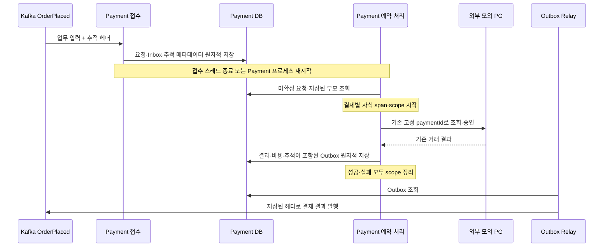

# Tempo 기반 분산 추적 도입·검증 계획

[문서 목록](README.md) · [작업 기준](../AGENTS.md) · [관련 이슈 #99](https://github.com/tlswltjq/esd-platform/issues/99) · [Payment 계약](payment-guide.md) · [Compose 구성](compose-layout.md)

2026-10-24 작성. 기준 revision은 `d7fc8d435df3c74fffa5ff7a58f853b2dfe082a2`다.
사용자가 확정한 실행 순서는 **Tempo 공통 기반 도입·검증 → 실제 Payment 추적 문제(#99) 해결**이다.
공통 단계의 합격 근거와 Payment 수정의 합격 근거를 각각 남긴다. 아래 상세 설계 중 Payment 저장·복원은 두 번째 단계에만 적용한다.

## 목표와 도입 범위

먼저 기존 Tempo·Grafana 구성으로 수집·조회와 Gateway→Order→Catalog, Gateway→Download→License·Catalog의 실제 HTTP 추적을 검증한다.
수집기 중단과 샘플링 0에서도 구매·보유권·ZIP 다운로드가 완료되는지 확인한다. 독립 실행 명령은 `python3 -B tools/verification/verify-tracing.py --foundation-only`다.

공통 단계 합격 후 주문 요청의 추적을 Payment의 내구 접수·예약 처리·PG 호출·결과 Outbox·후속 소비까지 연결한다.
프로세스가 재시작하거나 같은 결제를 다시 처리해도 원래 요청과의 연결 근거를 유지하고, 다른 주문의 추적이 섞이지 않도록 한다.
별도로 시작하는 Download 요청에서는 License·Catalog로 이어지는 실제 HTTP 호출을 추적한다.

Tempo는 독립 인프라 컨테이너로 유지한다. 업무 앱·Gradle 모듈·공통 추적 실행 서버를 추가하지 않는다.
이번 범위는 로컬 OrbStack의 현행 구매 흐름과 #99의 복구 시나리오다.
환불·할인·DLT 운영 기능, #100의 성능 A/B, #101의 전체 여정 자동화는 해당 후속 이슈에서 진행한다.
Collector·Alloy·Loki, Tempo 분산 배포·외부 저장소·원격 운영 배포는 별도 확장으로 둔다.

## 작업 전 기반과 확인된 공백

| 항목 | 현재 근거 | 계획에 반영할 내용 |
|---|---|---|
| 추적 의존성 | 루트 `build.gradle`이 `apps/*`에 Micrometer OTel bridge·OTLP exporter를 제공 | 기존 Spring Boot 3.5.6 의존성 조합 유지 |
| Tempo | `docker-compose.yml`의 `grafana/tempo:2.9.4`, `infra/tempo/tempo.yml`의 로컬 저장·1시간 보존 | 이미지·설정 조합 유지, 실제 수집·조회 검증 |
| Grafana | Tempo 데이터소스 `http://tempo:3200` 등록 | 데이터소스 연결과 실제 trace 조회 확인 |
| 전송 | 앱 Compose의 `OTLP_ENDPOINT=http://tempo:4318/v1/traces` | 검증 스택의 실제 endpoint·샘플링 값을 별도로 확인 |
| Outbox | Recorder가 현재 span의 `traceparent` 저장, Relay가 Kafka 헤더로 복원 | 기존 전달 규칙 회귀 검증 |
| Payment 접수 | `ReceiveOrderPayment`는 Inbox·`purchase_payment`만 저장 | 접수 시점 추적 메타데이터의 영속 보존 추가 |
| Payment 재개 | 스케줄러가 `ResolvePayment`를 호출하며 요청 컨텍스트를 복원하지 않음 | 결제 한 건마다 저장된 부모를 복원 |
| HTTP 클라이언트 | Order·Payment·Settlement·Download의 config가 `RestClient.builder()` 직접 호출 | 자동 구성된 builder로 조립하고 실제 HTTP 헤더·span으로 확인 |
| 장애 대역 | `PaymentFaultConfiguration.FaultOutbox`가 추적 비활성 생성자를 사용 | 실제 `TraceContextCapture`를 주입해 장애 시험에서도 추적 유지 |
| 기존 추적 E2E | 제거된 결제 콜백·Download의 Kafka 참여를 전제 | 현행 구매·HTTP 계약을 사용하는 독립 E2E로 대체 |
| 기존 실행 검증 | `verify-jib.py`는 샘플링 0이고 검증 스택에 Tempo를 만들지 않음 | 샘플링 1·Tempo를 사용하는 별도 검증 진입점 추가 |

#99에는 별도 처리 스레드와 실제 추적 구성요소를 사용했을 때 결과 Outbox의 `trace_parent`가 null인 재현 기록이 있다.
구현에 앞서 동일 원인을 잡는 자동 테스트를 저장소에 추가하고 수정 전 실패를 직접 확인한다.
`OutboxRecorder`의 “업무 트랜잭션 안이면 요청 스레드”라는 현재 주석도 예약 처리에 맞게 고친다.

## 책임과 연결 방식

| 위치 | 맡을 책임 |
|---|---|
| Payment `api.listener`의 mapper | 이벤트 봉투·본문·키의 기존 검증, 추적 헤더를 별도 내부 메타데이터로 변환 |
| Payment `core.port` | 추적 메타데이터 저장·조회와 결제 처리 scope 실행 계약. Micrometer·Kafka 타입 노출 금지 |
| Payment `adapter`의 기존 구조 아래 신규 하위 패키지 | DB 메타데이터 저장, W3C 컨텍스트 추출·복원과 span 수명 관리 |
| Payment 서비스 | Inbox·요청·추적 메타데이터의 트랜잭션 조율, 저장된 컨텍스트 아래 개별 결제 처리 |
| 각 앱 `config` | 추적 구현체·저장소·관측 가능한 HTTP 클라이언트 조립, 환경 설정 바인딩 |
| `common/messaging` | 현재 scope의 컨텍스트를 Outbox에 저장하고 발행 시 헤더로 복원 |
| Tempo·Grafana | 수집·저장·검색과 화면 조회. 업무 성공 여부의 선행 조건으로 사용하지 않음 |

`PaymentOrderRequest`·업무 이벤트 본문에 추적 필드를 추가하지 않는다.
도메인 모델에는 Tracer·Span·Kafka 레코드·외부 이벤트를 전달하지 않는다.
신규 내부 메타데이터는 생성할 때 값의 유효성을 보장하며, 추적 라이브러리 처리는 adapter에 둔다.
서비스에는 필요한 포트·값만 주입하고 바인딩 객체를 전달하지 않는다.

### 영속 저장과 중복 정책

1. Payment DB에 `payment_request_trace`라는 작은 메타데이터 테이블을 추가한다. `payment_id`를 PK·`purchase_payment.payment_id` 참조로 사용하고, nullable `trace_parent`와 접수 시각을 저장한다. 이번 계약은 기존 시스템과 같은 W3C `traceparent` 전달이며 `tracestate`·baggage 영속 전달은 확장 범위다.
2. 신규 결제를 접수할 때 헤더가 없어도 메타데이터 행을 만들고 부모를 null로 기록한다. 결제 요청·Inbox와 같은 서비스 트랜잭션으로 커밋하거나 함께 롤백한다. 정상 DB 저장 실패를 추적 수집기 장애로 취급해 삼키지 않는다.
3. 최초 접수가 확정한 컨텍스트를 유지한다. 같은 업무 입력의 재전달에 다른 추적 헤더가 붙어도 덮어쓰지 않는다. 업무 본문·식별자가 변경된 중복은 기존 계약대로 거부한다.
4. 기존 결제의 메타데이터 부재는 “저장된 부모 없음”으로 처리한다. 과거 요청의 부모를 추정하거나 일괄 생성하지 않는다. 기존 Flyway 파일은 수정하지 않고 다음 버전의 추가 마이그레이션으로 만든다.
5. SQL 저장·조회 구현은 Payment adapter에 두며 다른 앱이 이 테이블을 직접 조회하지 않는다. 스키마 추가 후 기존 Payment 실행 코드와의 호환성을 검증한다.

### 헤더와 span 정책

- 유효한 입력은 Kafka에서 전달받은 W3C 부모를 보존한다. 추적 헤더가 없으면 임의의 현재 스케줄러·다른 요청 컨텍스트를 대신 저장하지 않는다.
- 헤더 없음·빈 값·형식 오류·중복 헤더는 저장된 부모 없음으로 처리하며 결제 업무는 계속한다. 잘못된 hex, 길이 초과, 0으로만 구성된 trace/span ID도 시험한다. 지원 형식은 실제 사용 중인 propagator와 맞추고 표준 파싱·직렬화를 재사용한다.
- 이번 영속 계약은 현재 OTel 전파 값인 W3C v00이다. 다른 버전은 부모 없음으로 처리한다. 추출·새 span 생성·전송 직렬화는 실제 Micrometer/OTel propagator를 사용한다.
- 이상 헤더는 제한된 사유 코드로 관측한다. JWT·API 키·presigned URL·원문 본문을 추적 속성이나 경고에 넣지 않는다.
- 예약 처리는 결제 한 건·처리 시도마다 새 span을 생성한다. **저장된 부모의 자식 span으로 연결해 원래 trace ID를 유지하는 방식**을 선택한다. 이미 끝난 span 객체를 재사용하거나 접수부터 결제 완료까지 하나의 span을 계속 열어 두지 않는다.
- 부모가 없는 결제는 다른 작업의 scope를 배제한 새 root로 처리한다. 추적이 비활성인 구성에서는 비활성 구현으로 업무를 수행한다. 새 root는 원래 요청과 연결됐다는 완료 근거로 세지 않는다.
- 한 회차에서 A·B를 처리하더라도 span·scope를 건별로 열고 닫는다. 성공·예외·defer·트랜잭션 롤백의 모든 경로에서 scope를 정리하고 기존 외부 scope를 복원한다.
- PG 요청·조회, 결과 확정 트랜잭션, 결과 Outbox 적재를 해당 시도의 scope 안에서 수행한다. PG HTTP 호출 중 Payment DB 트랜잭션·잠금을 잡지 않는 기존 경계를 유지한다.
- 재시도는 원래 부모 아래 별도 span으로 남는다. trace ID·부모 관계를 검증하며, 서로 다른 시도의 span ID가 같아야 한다고 요구하지 않는다.
- Outbox 재발행은 저장된 컨텍스트를 유지한다. Kafka producer의 자동 observation이 Relay가 복원한 헤더를 덮어쓰지 않도록 기존 설정을 회귀 검증한다.



### HTTP 전파와 관측 대상

Order→Catalog, Payment→외부 PG, Settlement→Catalog·외부 PG, Download→License·Catalog의 클라이언트를 대상으로 한다.
각 config에 Spring Boot가 자동 구성한 `RestClient.Builder`를 주입하고, 여러 클라이언트를 조립할 때는 clone 또는 독립 builder를 사용해 주소·인증 헤더가 섞이지 않게 한다.
현재 타임아웃·인증·리다이렉트·오류 매핑은 보존하고 HTTP 경계에서 실제 `traceparent` 전송과 client span 생성을 검증한다.
이 선택의 근거는 [Spring Boot 3.5 추적 문서](https://docs.spring.io/spring-boot/3.5/reference/actuator/tracing.html)의 자동 구성 builder 전파 규칙이다.

외부 mock-pg에는 현재 OTel bridge·exporter가 없으므로 PG 호출은 Payment·Settlement의 HTTP client span을 필수 근거로 삼는다.
mock-pg 서버 span을 필수 서비스 집합에 넣지 않으며, 외부 공급자 자체의 계측은 후속 범위로 둔다.
Gateway의 BFF 토큰 교환 클라이언트 등 구매 요청에서 별도로 시작되는 인증 흐름은 이번 필수 trace 범위에 포함하지 않는다.

## 작업 순서와 단계별 판정

### 공통 기반 선행 검증

기존 Tempo 2.9.4 설정·볼륨을 사용하고 Grafana를 검증한 12.2.1로 고정한다. 격리된 Compose 프로젝트에서 실제 앱 OCI 이미지, 샘플링 1, OTLP endpoint, HTTP client/server 부모 관계, Grafana 데이터소스 조회를 확인한다.
Payment 저장·복원 변경 없이 `--foundation-only`를 먼저 실행한다. 주문·다운로드의 HTTP trace만 합격 대상으로 삼고, 비동기 구매 전체 trace의 연결은 #99 단계에서 판정한다.
Tempo 중단·복구와 샘플링 0·1 전환도 실제 업무 결과와 함께 확인하고 원래 컨테이너·볼륨 보존 결과를 기록한다.

### 1. 현재 실패를 자동 테스트로 고정

- 실제 Micrometer/OpenTelemetry 구성과 메모리 exporter를 사용하는 Payment 추적 통합 테스트를 만든다. Mockito Tracer만으로 저장·복원 성공을 판정하지 않는다.
- Spring 테스트의 추적 자동 구성 비활성 여부를 확인하고 필요한 구성을 명시적으로 켠다. 실제 tracer·propagator·메모리 exporter가 사용되며 span이 기록되는지 먼저 검사한다.
- trace A·B로 요청을 접수하고 접수 scope 종료 후 별도 스레드의 같은 처리 회차에서 두 결제를 확정한다. 결과 Outbox와 PG client span의 trace가 원래 요청과 이어져야 한다는 기대를 작성한다.
- 현재 코드의 미보존·HTTP 헤더 누락으로 실패하는 지점을 구분해 저장한다. 수집기 없이도 재현 가능한 실패를 먼저 고정한다.
- 기존 Payment 통합 기반은 예약 처리를 끄므로 별도 스케줄러 배선 테스트를 둔다. 예약 처리 검증은 `ResolvePayment.execute()` 직접 호출로 대체하지 않는다.
- 장애 시험용 `FaultOutbox`가 실제 추적을 전달하도록 보완하고 대역 자체의 비활성화 때문에 실패한 경우와 운영 코드 실패를 구분한다.

판정: 수정 전 실패 XML·명령·원인을 보존하고 결함을 재현하는 테스트가 실제 실행돼야 한다.

### 2. 접수·재개의 저장·복원 구현

- 순수 Java 포트·메타데이터 입력, adapter 구현, config 조립과 추가 마이그레이션을 구현한다.
- 최초 접수·중복·동시 접수·롤백·기존 DB 입력 정책을 테스트로 고정한다.
- 저장된 부모 아래 건별 처리 scope를 만들고 성공·실패·재시도·Outbox 적재를 연결한다.
- 추적 비활성 구현과 헤더 없는 입력도 같은 업무 경로로 처리한다.
- 도메인의 추적 라이브러리 의존 금지, 명시적 타입·import, mapper 입력 경계를 기존 아키텍처 검사에 반영한다.

판정: 1단계의 동일 테스트와 아래 시나리오 행렬의 관련 단위·통합 테스트를 통과해야 한다.

### 3. HTTP 전파와 Outbox 회귀 검증

- 대상 config의 자동 구성 builder 주입을 반영한다.
- 실제 HTTP 시험 서버가 받은 헤더와 exporter의 client span을 대조한다. 인증 헤더·타임아웃·리다이렉트 정책 회귀도 기존 검사로 확인한다.
- Recorder 저장→Relay 발행→Kafka consumer 복원을 실제 MySQL·Kafka 경계에서 확인한다.
- 기존 같은 배치 scope, trace 누출, Relay 헤더 덮어쓰기 방지 검사를 수행한다. #93의 이벤트 순서 확장을 이번 구현의 선행 요건으로 가져오지 않는다.

판정: 전송 헤더와 저장된 trace·parent 관계가 일치하고 기존 결제·이벤트 동작이 유지돼야 한다.

### 4. 격리된 OrbStack의 Tempo E2E

- `tools/verification/verify-tracing.py`를 신규 진입점으로 만든다. 기존 검증 도구의 기동·종료 지원 코드를 재사용하되 필요한 공통화만 한다.
- 실행별 Compose 프로젝트·포트·DB·Kafka·MinIO·Tempo 볼륨·네트워크를 생성한다. 기본 Compose의 고정 `container_name`과 공유 네트워크·볼륨을 그대로 상속하지 않는다.
- 기존과 같은 Jib 앱 이미지를 사용한다. 격리 스택에는 Tempo와 Grafana를 추가하고 모든 대상 앱의 `OTLP_ENDPOINT`·`TRACING_SAMPLE_RATE=1`을 실행 설정에서 확인한다.
- Tempo는 `2.9.4`와 현재 2.x 설정 조합을 사용한다. 검증에 사용하는 Grafana 이미지도 실행 전 버전·digest를 확정해 기록한다. 이번 작업에 Tempo 3.x 전환을 섞지 않는다.
- 현행 출시·구매 픽스처와 공개 API를 사용한다. 정상 여정은 DB 수정·Kafka 수동 발행 없이 수행하고, 헤더 변형·응답 유실·중복 전달 시험은 별도 장애 단계로 표시한다.
- 구매 trace의 Gateway→Order→Payment 예약 처리·PG client 호출→Order 결과 소비→OrderPaid→License·Settlement 연결을 Tempo API로 판정한다.
- Download는 별도 요청의 trace ID로 Gateway→Download→License·Catalog HTTP 연결을 확인하고, 실제 ZIP 해시·보유권 확인의 기존 검증을 재사용한다.
- Payment 실제 프로세스 재시작, PG 커밋 뒤 응답 유실, 결과·Outbox 롤백 후 재개, Kafka 발행 실패·재시도를 순서대로 시험한다. 재시작 전후 저장소는 보존한다.
- 서비스 이름의 존재만으로 통과시키지 않는다. trace ID·span ID·parent ID, 해당 주문/결제·이벤트 근거를 대조해 A·B 혼합을 검사한다. 실제 Tempo 2.9.4 조회 응답을 기준으로 parser와 fixture를 검증한다.
- 전용 `:e2e:tracingE2eTest` 태스크·`tracing` 태그를 만들고 기존 과거 추적 테스트를 현행 시나리오로 대체한다. 기존 Journey의 결제 콜백에 의존하지 않으며 일반 E2E 태스크와 중복 실행하지 않도록 필터를 조정한다.
- Tempo 주소는 `stove.e2e.tempo-base-url` 같은 명시적 입력으로 전달한다. 앱의 포트 offset과 Tempo 포트를 암묵적으로 묶지 않는다. Grafana는 전용 Tempo 데이터소스 연결과 같은 trace 조회를 확인하며 서비스 그래프·로그 수집은 필수 판정에서 제외한다.

초기 제한은 인프라 준비 240초, 앱/재시작 준비 180초, 해당 작업 완료 뒤 Tempo 조회 90초로 정한다.
실제 예약·재시도 설정을 확인하고 시험 전에 적용값·제한을 결과에 남긴다. 제한을 바꾸면 원인과 변경값을 기록하며 실패 회차를 삭제하지 않는다.
수집기 중단으로 유실된 span의 사후 재수집은 보장하지 않는다. 장애 중 업무 진행과 복구 뒤 새 요청의 정상 수집을 각각 검증한다.

판정: 아래 필수 시나리오가 모두 자동 판정되고 Grafana에서도 저장한 trace ID를 조회할 수 있어야 한다.

### 5. 실행 안내와 완료 기록

- `docs/getting-started.md`에 Tempo/Grafana 접속·trace ID 조회·추적이 보이지 않을 때의 확인 순서를 추가한다.
- `docs/decisions.md`의 추적 결정에 내구 접수 경계와 건별 scope 정책을 기록하고, 과거 결정의 적용 시점을 보존한다.
- `docs/testing.md`와 `tools/verification/README.md`에 새 검증 명령·태그·격리·증거 위치를 연결한다.
- `docs/architecture.md`와 Payment 안내에 실제 구현된 저장·복원 책임을 반영한다. 과거 콜백 기반 기록은 당시 기록임을 구분한다.
- 변경 모듈의 단위·통합 검사와 기존 구매·Download·Settlement 회귀 검증을 수행하고, 수행한 범위·실행 수·실패·건너뜀을 완료 기록에 남긴다.

## 필수 시나리오 행렬

| ID | 입력·장애 | 자동 판정 | 주 검증 층 |
|---|---|---|---|
| T01 | 서로 다른 trace A·B로 접수한 두 주문을 같은 예약 회차에서 처리 | 각각 원래 trace의 자식이며 같은 회차 trace로 합쳐지지 않음 | 통합·Tempo E2E |
| T02 | 접수 scope 종료·별도 스레드 처리·무관한 외부 scope 아래 재개 | 저장된 부모가 우선하며 종료 후 기존 scope 복원 | 실제 tracer 통합 |
| T03 | 동일 이벤트 재전달·동시 접수·서로 다른 재전달 trace | 최초 컨텍스트 유지, 요청·Inbox·메타데이터 한 건 | MySQL 통합 |
| T04 | 요청·Inbox·메타데이터 저장 중 롤백 | 모두 롤백, 다시 접수할 수 있음 | MySQL 통합 |
| T05 | 추적 헤더 없음·잘못된 헤더·기존 메타데이터 없는 결제 | 정상 업무 처리, A·B·스케줄러 부모를 임의 상속하지 않음 | 단위·통합 |
| T06 | 접수 후 Payment 실제 프로세스 종료·재시작 | 스케줄러가 자동 재개, 고정 paymentId·원래 trace 연결 보존 | 프로세스 E2E |
| T07 | PG 커밋 후 응답 유실·일시 장애·재시도 | 같은 승인 한 건, 원래 trace 아래 별도 시도 span | 통합·프로세스 E2E |
| T08 | Payment 결과·Outbox 저장 롤백 후 재개 | PG 원장은 유지, 최종 결과·Outbox 한 건, 추적 연결 보존 | 통합·프로세스 E2E |
| T09 | Kafka 발행 실패·재시도·후속 소비 | Outbox 컨텍스트·계약 헤더 유지, OrderPaid·License·Settlement 연결 | MySQL/Kafka 통합·E2E |
| T10 | A 처리 실패 뒤 B 처리·연속 회차·종료 경로별 예외 | A scope·MDC가 B나 다음 작업에 누출되지 않음 | 실제 tracer 통합 |
| T11 | 각 대상 HTTP 호출·별도 Download 요청 | 실제 헤더·client span·수신 서비스 부모 관계 일치, 인증·타임아웃 유지 | HTTP 통합·Tempo E2E |
| T12 | 샘플링 0·추적 비활성 구성 | 결제·이벤트·보유권 정상 완료, 추적 유무가 업무 분기를 바꾸지 않음 | 통합·격리 E2E |
| T13 | Tempo 중단·연결 실패·복구 | 결제·Outbox·권한 처리 지속, 복구 후 새 요청 수집 | 프로세스 E2E |
| T14 | 재실행·검증 스택 종료 | 새 식별자로 실행, 필수 검사 누락 없음, 기존 공유 자원 보존 | 실행 도구 |

T12의 샘플링 0은 새 root와 sampled=false 입력의 조건을 명시한다. sampled=true 원격 부모의 계승 정책을 샘플링 0과 혼동하지 않는다.
T13은 collector 중단에 따른 span 유실 가능성과 업무 성공을 함께 기록하며, 장애 구간의 trace 완전성을 통과 조건으로 삼지 않는다.

## 실행 명령과 증거

공통 기반과 Payment 후속 검증을 별도 실행할 수 있다.

```bash
# 변경 영역의 단위 검사: 실제 변경된 HTTP config 모듈도 포함한다.
./gradlew :common:messaging:test :apps:payment:test :apps:order:test :apps:settlement:test :apps:download:test --no-daemon --console=plain

# 실제 MySQL·Kafka·외부 PG를 사용하는 통합 검사
./gradlew :common:messaging:integrationTest :apps:payment:integrationTest :apps:order:integrationTest :apps:settlement:integrationTest :apps:download:integrationTest -Pstove.infraTest.maxParallel=1 --no-daemon --console=plain

# 공통 기반: Payment 저장·복원 검증 제외
python3 -B tools/verification/verify-tracing.py --foundation-only

# Payment 후속 단계: 이미지 준비·격리 스택·추적 E2E·장애 단계·정리
python3 tools/verification/verify-tracing.py

# 기존 정상 구매·ZIP 다운로드·정산 회귀: 해당 revision의 이미지를 사용
python3 tools/verification/verify-jib.py --skip-build
```

OrbStack Docker endpoint 등 호스트 환경 설정은 기존 검증 절차를 따르며, 검증 도구가 호스트의 공유 스택을 변경하지 않도록 한다.
첫 실행은 해당 revision에서 이미지를 준비한다. 기존 이미지를 재사용할 때는 이미지 식별값과 소스 revision의 일치를 확인한다.
이미지 캐시만 사용하는 환경에서는 `./gradlew jibDockerBuild --offline --no-daemon --console=plain`으로 먼저 준비한 뒤 검증 명령에 `--skip-build`를 붙인다.

원자료는 `runs/tracing-validation-<실행 ID>/`에 보존한다. 최소 기록은 다음과 같다.

- revision·dirty 여부·호스트·이미지 digest·실행 명령·시작/종료 시각.
- 실제 OTLP endpoint·샘플링·폴링/재시도 간격·조회 제한·Tempo 보존 기간·격리 자원 이름.
- 시나리오별 orderNo·paymentId·eventId·trace ID·span/parent 관계와 원문 Tempo 응답.
- 단계별 업무 상태·PG 거래 건수·Outbox/Inbox 건수·권한·ZIP 해시와 실패 원인.
- JUnit XML, 실행 수·실패·오류·건너뜀·필수 시나리오 누락, 앱/Tempo 로그·Grafana 조회 근거.
- `result.json`의 전체 완료 여부와 정리 결과·기존 컨테이너/볼륨 보존 확인. 인증 자료는 출력·공유용 증거에서 제외한다.

테스트 0건·필수 시나리오 건너뜀·선행 실패로 후속 단계가 실행되지 않은 결과는 성공으로 기록하지 않는다.
정상 종료 시 실행 전용 자원만 정리하고 증거는 보존한다. 실패 시 남긴 자원도 실행 manifest로 식별해 공유 자원을 정리 대상에서 제외한다.

## 완료 기준

- [x] 실패 테스트의 수정 전 결과와 수정 후 통과 결과를 모두 보존했다.
- [x] 최초 요청 추적이 Payment의 예약·재시작·재시도·결과 Outbox·후속 소비까지 이어졌다.
- [x] 서로 다른 요청의 trace가 섞이지 않으며 없는 부모·이상 헤더·추적 비활성 정책을 검증했다.
- [x] 실제 HTTP 경계와 Outbox/Kafka 경계의 trace·parent 관계를 자동 판정했다.
- [x] T01~T14를 단위·통합·실제 프로세스·Tempo 검증의 명시된 층에서 모두 판정했다.
- [x] 수집기 장애·샘플링 0에서도 기존 구매·이벤트·권한·정산 업무가 완료됐다.
- [x] 격리된 로컬 OrbStack 검증과 기존 구매·다운로드·정산 회귀를 통과했다.
- [x] Grafana 조회 안내·자동 검증 명령·버전·제한·증거 경로를 문서에 반영했다.

## 구현과 검증 기록

2026-10-24 작업본에 공통 HTTP builder 조립과 Payment V13 추적 메타데이터·입력 mapper·저장/실행 포트·JDBC/Micrometer adapter를 구현했다.
최초 접수의 부모를 요청·Inbox와 함께 저장하고, 결제별 시도 span을 만들며, 기존 부모가 없는 결제는 독립 root로 처리한다. 도메인·업무 이벤트에는 추적 라이브러리를 노출하지 않는다.

| 검증 | 결과와 원자료 |
|---|---|
| 수정 전 재현 | `runs/tracing-implementation-y4694bwe/baseline.log`, `baseline-junit/`: 실제 tracer·listener·별도 처리 스레드로 실행한 `twoReceiptsKeepTheirOriginalTracesAcrossThreadAndBatchBoundary` 1건이 결과 Outbox의 null 부모 때문에 실패 |
| Payment 단위·통합 | `verification-final.log`, `checks-final.json`, `final-junit/`: 단위 74건·통합 34건 실패·오류·건너뜀 0. 실제 스케줄러·중복/동시 접수·메타데이터 저장 실패 롤백·PG 응답 유실·결과 롤백·무부모/구버전 건·샘플링 없음 검증 |
| 기존 변경 영역 회귀 | 같은 검증 명령에서 Order·Download·Settlement·공통 messaging의 단위 280건·통합 74건은 동일 입력의 기존 통과 결과를 `UP-TO-DATE`로 재사용. 해당 변경의 최초 전체 실행 근거는 `verification-2.log`에 보존 |
| 공통 검증 도구 보완 | `runs/tracing-validation-lx99q0gs/`: HTTP 부모 관계와 Tempo 중단 중 구매·ZIP 다운로드는 통과. 샘플링 변경 시 11개 JVM 동시 기동으로 Auth DB handshake timeout이 발생해 순차 묶음 재기동으로 보완. 실패 회차는 보존 |
| 공통 기반 완료 | `runs/tracing-validation-8_zyhikw/result.json`: V12 Payment 이미지로 8단계·구매 5건 통과. Gateway→Order→Catalog와 별도 Download→License·Catalog의 실제 span 부모, Tempo 중단·복구·샘플링 0/1, Grafana 조회, 12개 앱 정상 종료와 원래 볼륨 보존 확인. PG·결제·Payment Outbox·Order Inbox·보유권 각각 5건 일치 |
| scope·MDC 최종 보강 | `runs/tracing-implementation-y4694bwe/tracing-final.log`, `tracing-final-junit/`: 추적 통합 10건과 실제 스케줄러 1건 재실행, 실패·오류·건너뜀 0. 별도 작업 스레드 종료와 예외 전파 시 span·MDC 복원을 추가 확인 |
| Payment 프로세스 검증 도구 보완 | `runs/tracing-validation-4nm3i91h/`: 두 주문 접수 후 재시작·PG 응답 유실·결과 롤백과 각 후속 trace 연결은 통과. 브로커 종료 후 재기동은 Docker DNS 제거로 Kafka consumer 생성 단계에서 실패했으므로 Kafka 일시 정지로 DNS를 유지하며 실제 발행 timeout을 검증하도록 조정. 장애 fixture의 셸 변수도 Compose에서 보존하도록 수정하고 임시 컨테이너로 JVM 옵션·인자 전달을 확인 |
| Payment 프로세스·Tempo 완료 | `runs/tracing-validation-v8ym0cge/result.json`: 16단계 실패·오류·건너뜀 0. 접수 후 프로세스 재시작, PG 응답 유실, 결과 롤백, Kafka 일시 정지 중 실제 발행 실패·복구, Tempo 중단·복구, Payment 추적 비활성, 샘플링 0/1을 통과. 구매 9건 모두 업무·보유권·ZIP·정산 매출 확인. 필수 수집 대상 6건은 PG client span·OrderPaid 후속 소비·별도 Download의 HTTP 부모 관계까지 확인 |
| 원장·배포·증거 정합성 | 같은 실행에서 PG 거래·결제·Payment 결과 Outbox·Order Inbox·보유권·추적 메타데이터가 각각 9건. Grafana 데이터소스 조회, 12개 Jib 이미지·사용자·JVM 옵션·정상 종료와 원래 컨테이너/볼륨 보존 확인. 실행 시작 manifest와 최종 코드/설정 SHA-256 차이 0. `payment-ledger.tsv`, `payment-outbox.tsv`, 시나리오별 trace JSON·JUnit·장애 직전 로그 보존 |
| 기존 실제 업무 회귀 완료 | `runs/jib-validation-334nwo64/result.json`: 새 DB·Kafka·MinIO의 별도 환경에서 기존 구매·ZIP 다운로드, 배분·소유권 격리, PG 지급 명세 수령·대사·중복 없는 재시도 3단계 통과. 12개 앱 정상 종료·전용 자원 정리·원래 컨테이너 보존 확인 |

기존 V12 Payment 이미지로 공통 검증을 먼저 마친 뒤 V13 이미지를 빌드해 Payment 프로세스·Tempo 검증을 완료했다. 공통 실행의 `payment_migration`으로 사용한 스키마 버전을 구분한다.
샘플링 0은 sampled=false 입력을 사용했고 실제 원래 trace 조회 404도 확인했다. 수집기 중단·Payment 추적 비활성의 trace 완전성은 합격 대상으로 세지 않으며 복구 뒤 새 요청 수집을 검증했다.
기존 저장분에 부모 정보가 없으면 독립 root로 처리한다. 과거 원래 요청의 trace를 소급 복원하지 않는다.

공통 8단계 → Payment 16단계 → 기존 실제 업무 회귀 3단계를 각각 새 격리 환경에서 완료했다. 이번 Payment 단위 74건·통합 34건과 별도 scope 보강 11건도 실패·오류·건너뜀 0이다.
증거는 로컬 `runs/`에 보존하며 저장소에는 검증 도구·테스트·설정·문서를 남긴다. GitHub 이슈 상태는 변경하지 않았다.

## 공식 근거

- [Spring Boot 3.5 추적](https://docs.spring.io/spring-boot/3.5/reference/actuator/tracing.html): 기존 앱의 자동 구성·OTLP 전송·HTTP builder 전파 규칙. 패치 버전별 실제 API는 현재 의존성으로 확인한다.
- [Micrometer span·scope API](https://docs.micrometer.io/tracing/reference/api.html): 명시적 부모와 scope 수명 관리. 구현에는 현재 Boot BOM의 API를 사용한다.
- [W3C Trace Context](https://www.w3.org/TR/trace-context/): 헤더 형식·부모·샘플링 의미. 저장소의 기존 `traceparent` 계약 범위에 맞춘다.
- [Tempo Docker Compose 안내](https://grafana.com/docs/tempo/latest/set-up-for-tracing/setup-tempo/deploy/locally/docker-compose/): 독립 인프라 배치의 참고. 최신 버전의 설정을 현재 고정된 2.9.4에 그대로 적용하지 않는다.
